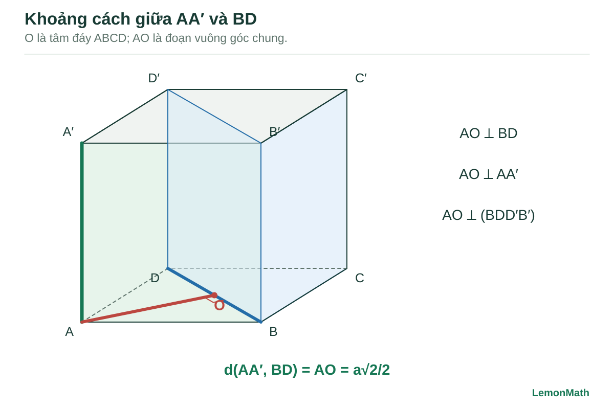

:::goals
- Hiểu khoảng cách từ một điểm đến đường thẳng và đến mặt phẳng.
- Biết khoảng cách giữa đường thẳng và mặt phẳng song song, giữa hai mặt phẳng song song.
- Tính khoảng cách giữa hai đường thẳng chéo nhau bằng cách đưa về khoảng cách đến một mặt phẳng.
- Vận dụng vào hình chóp, hình lập phương, hình hộp chữ nhật và bài toán thực tế.
:::

Giả sử trong một căn phòng hình hộp chữ nhật, một đường ống chạy thẳng đứng dọc một góc tường, còn một sợi cáp căng theo đường chéo của sàn (số liệu giả định). Hai vật này không cắt nhau và cũng không song song. Khoảng cách ngắn nhất giữa chúng là bao nhiêu? Để trả lời, ta cần khái niệm khoảng cách trong không gian.

## Khám phá: điểm trên đường nào gần nhất?

Trên mặt phẳng, xét đường thẳng $\Delta$ là trục hoành và điểm $M(0;3)$. Với điểm $X(t;0)$ trên $\Delta$, độ dài $MX=\sqrt{9+t^2}$.

| $t$ | $0$ | $1$ | $2$ | $4$ |
|---|---|---|---|---|
| $MX$ | $3$ | $\sqrt{10}\approx3{,}16$ | $\sqrt{13}\approx3{,}61$ | $5$ |

Độ dài $MX$ nhỏ nhất bằng $3$ khi $X$ là chân $H$ của đường vuông góc hạ từ $M$ xuống $\Delta$. Trong không gian cũng vậy: khoảng cách ngắn nhất được đo theo phương vuông góc.

## Khoảng cách từ một điểm

:::definition Khoảng cách từ một điểm đến đường thẳng, đến mặt phẳng
- **Khoảng cách từ điểm $M$ đến đường thẳng $\Delta$** là độ dài đoạn $MH$, với $H$ là hình chiếu vuông góc của $M$ lên $\Delta$. Kí hiệu $d(M,\Delta)$.
- **Khoảng cách từ điểm $M$ đến mặt phẳng $(P)$** là độ dài đoạn $MH$, với $H$ là hình chiếu vuông góc của $M$ lên $(P)$. Kí hiệu $d(M,(P))$.
:::

**Vì sao $MH$ ngắn nhất?** Với mọi điểm $X$ của $(P)$ khác $H$, tam giác $MHX$ vuông tại $H$ nên $MX^2=MH^2+HX^2>MH^2$, suy ra $MX>MH$. Lập luận tương tự cho đường thẳng.

Nếu $M$ thuộc đường thẳng hoặc mặt phẳng thì khoảng cách bằng $0$.

## Khoảng cách giữa các hình

:::theorem Khoảng cách giữa đường thẳng và mặt phẳng song song, giữa hai mặt phẳng song song
- Nếu $\Delta\parallel(P)$ thì mọi điểm của $\Delta$ cách $(P)$ một khoảng như nhau. Khoảng cách đó gọi là **khoảng cách giữa $\Delta$ và $(P)$**: $d(\Delta,(P))=d(M,(P))$ với $M$ là một điểm bất kì của $\Delta$.
- Nếu $(P)\parallel(Q)$ thì mọi điểm của $(P)$ cách $(Q)$ một khoảng như nhau, gọi là **khoảng cách giữa hai mặt phẳng**: $d((P),(Q))=d(M,(Q))$ với $M\in(P)$.
:::

:::definition Khoảng cách giữa hai đường thẳng chéo nhau
Cho hai đường thẳng chéo nhau $a$ và $b$. Gọi $(Q)$ là mặt phẳng chứa $b$ và song song với $a$. **Khoảng cách giữa $a$ và $b$** bằng khoảng cách giữa $a$ và $(Q)$, kí hiệu $d(a,b)$.
:::

Khoảng cách giữa hai đường thẳng chéo nhau cũng bằng độ dài đoạn vuông góc chung của chúng, và là khoảng cách nhỏ nhất giữa một điểm của $a$ với một điểm của $b$.

:::diagram Khoảng cách từ $A$ đến mặt phẳng $(SBC)$
alt: Hình chóp S.ABCD có SA vuông góc với đáy, điểm H nằm trên SB sao cho AH vuông góc với SB, đoạn AH là khoảng cách từ A đến mặt phẳng SBC
point A 0,0 below-left
point B 4,0 below-right
point C 5.2,1.5 right
point D 1.2,1.5 above
point S 0,4.2 above-left
point H 2.1,2.0 above
segment S A
segment S B
segment S C
segment S D dashed
segment A B
segment B C
segment A D dashed
segment D C dashed
segment A H dashed
right S A B
right A H S
:::

## Ví dụ

Trước hết ta tính khoảng cách từ một điểm đến một đường thẳng.

:::example Khoảng cách từ điểm đến đường thẳng
Cho hình chóp $S.ABCD$ có đáy $ABCD$ là hình vuông cạnh $a$, $SA\perp(ABCD)$ và $SA=a$. Tính khoảng cách từ $A$ đến đường thẳng $SC$.

**Lời giải.** Vì $SA\perp(ABCD)$ nên $SA\perp AC$. Ta có $AC=a\sqrt2$ và $SC=\sqrt{SA^2+AC^2}=a\sqrt3$.

Gọi $K$ là chân đường vuông góc hạ từ $A$ xuống $SC$. Trong tam giác $SAC$ vuông tại $A$, tính diện tích hai cách: $\dfrac12 AK\cdot SC=\dfrac12SA\cdot AC$. Do đó
$$AK=\frac{SA\cdot AC}{SC}=\frac{a\cdot a\sqrt2}{a\sqrt3}=\frac{a\sqrt6}{3}.$$

Vậy $d(A,SC)=\dfrac{a\sqrt6}{3}$.
:::

Tiếp theo ta tính khoảng cách từ một điểm đến một mặt phẳng.

:::example Khoảng cách từ đỉnh của tứ diện vuông
Cho tứ diện $OABC$ có $OA$, $OB$, $OC$ đôi một vuông góc và $OA=OB=OC=a$. Tính $d(O,(ABC))$.

**Lời giải.** Gọi $M$ là trung điểm $BC$. Vì $OA\perp(OBC)$ nên $OA\perp BC$; tam giác $OBC$ vuông cân tại $O$ nên $OM\perp BC$. Hai đường thẳng $OA$, $OM$ cắt nhau tại $O$ trong $(OAM)$ nên $BC\perp(OAM)$.

Trong mặt phẳng $(OAM)$ kẻ $OH\perp AM$. Vì $BC\perp(OAM)$ nên $BC\perp OH$. Hai đường $AM$, $BC$ cắt nhau tại $M$ trong $(ABC)$ nên $OH\perp(ABC)$, tức $OH=d(O,(ABC))$.

Tam giác $OAM$ vuông tại $O$ có $OA=a$ và $OM=\dfrac{a\sqrt2}{2}$ nên
$$\frac1{OH^2}=\frac1{OA^2}+\frac1{OM^2}=\frac1{a^2}+\frac2{a^2}=\frac3{a^2}\Rightarrow OH=\frac{a}{\sqrt3}=\frac{a\sqrt3}{3}.$$

Vậy $d(O,(ABC))=\dfrac{a\sqrt3}{3}$.
:::

Bây giờ ta xét khoảng cách đến mặt bên của hình chóp.

:::example Khoảng cách từ chân đường cao đến mặt bên
Cho hình chóp $S.ABCD$ có đáy $ABCD$ là hình vuông cạnh $a$, $SA\perp(ABCD)$ và $SA=a$. Tính $d(A,(SBC))$.

**Lời giải.** Ta có $BC\perp AB$ và $BC\perp SA$ nên $BC\perp(SAB)$. Trong $(SAB)$ kẻ $AH\perp SB$ tại $H$. Vì $BC\perp(SAB)$ nên $BC\perp AH$. Hai đường $SB$, $BC$ cắt nhau tại $B$ trong $(SBC)$ nên $AH\perp(SBC)$, suy ra $AH=d(A,(SBC))$.

Tam giác $SAB$ vuông tại $A$ có $SA=AB=a$ nên $SB=a\sqrt2$ và
$$AH=\frac{SA\cdot AB}{SB}=\frac{a\cdot a}{a\sqrt2}=\frac{a\sqrt2}{2}.$$

Vậy $d(A,(SBC))=\dfrac{a\sqrt2}{2}$.
:::

Cuối cùng là khoảng cách giữa hai đường thẳng chéo nhau.

:::example Khoảng cách giữa hai đường chéo nhau trong hình lập phương
Cho hình lập phương $ABCD.A'B'C'D'$ cạnh $a$. Tính khoảng cách giữa hai đường thẳng $AA'$ và $BD$.

**Lời giải.** Hai đường thẳng $AA'$ và $BD$ chéo nhau. Mặt phẳng $(BDD'B')$ chứa $BD$ và song song với $AA'$ (vì $AA'\parallel BB'$ và $BB'\subset(BDD'B')$). Do đó
$$d(AA',BD)=d(AA',(BDD'B'))=d(A,(BDD'B')).$$

Gọi $O$ là tâm của đáy $ABCD$. Ta có $AO\perp BD$ và $AO\perp BB'$ (vì $BB'\perp(ABCD)$). Hai đường thẳng $BD$, $BB'$ cắt nhau trong $(BDD'B')$ nên $AO\perp(BDD'B')$. Vậy $d(A,(BDD'B'))=AO=\dfrac{a\sqrt2}{2}$.

Vậy $d(AA',BD)=\dfrac{a\sqrt2}{2}$.

:::

Giờ ta quay lại đường ống và sợi cáp ở đầu bài, đi đủ bốn bước.

:::example Vận dụng: khoảng cách giữa ống và cáp
Giả sử một căn phòng hình hộp chữ nhật $ABCD.A'B'C'D'$ có sàn $ABCD$ với $AB=6$ m, $AD=4$ m và cao $AA'=3$ m (số liệu giả định). Một đường ống chạy dọc cạnh đứng $AA'$ và một sợi cáp căng dọc đường chéo $BD$ của sàn. Tính khoảng cách ngắn nhất giữa ống và cáp, làm tròn đến hàng phần mười của mét.

**Lời giải.**

*Hiểu đề.* Cần tìm $d(AA',BD)$ với hai đường chéo nhau.

*Tìm cách giải.* Như trong hình lập phương, mặt phẳng $(BDD'B')$ chứa $BD$ và song song với $AA'$, nên $d(AA',BD)=d(A,(BDD'B'))$. Chân đường vuông góc từ $A$ nằm trên $BD$ trong mặt đáy, nên khoảng cách này bằng $d(A,BD)$.

*Giải.* Trong tam giác $ABD$ vuông tại $A$ có $AB=6$, $AD=4$ nên $BD=\sqrt{36+16}=\sqrt{52}$. Kẻ $AK\perp BD$, ta có
$$AK=\frac{AB\cdot AD}{BD}=\frac{24}{\sqrt{52}}\approx3{,}3.$$

Vậy khoảng cách ngắn nhất giữa ống và cáp khoảng $3{,}3$ m.

*Nhìn lại.* Kết quả có hợp lí không? Khoảng cách phải nhỏ hơn cả $AB=6$ và $AD=4$, vì $AK$ là đường cao ứng với cạnh huyền nên ngắn hơn hai cạnh góc vuông; $3{,}3<4$ là hợp lí. Chiều cao phòng $AA'=3$ m không ảnh hưởng đến kết quả vì ống thẳng đứng và cáp nằm ngang, khoảng cách chỉ đo trong mặt sàn.
:::

:::warning Những sai lầm thường gặp
- **Lấy khoảng cách tới một điểm bất kì của đường thẳng.** Sai: $d(M,\Delta)=MX$ với $X$ là điểm tuỳ ý của $\Delta$. Lí do sai: chỉ chân đường vuông góc cho độ dài ngắn nhất. Đúng: $d(M,\Delta)=MH$ với $MH\perp\Delta$.
- **Quên chứng minh đoạn vuông góc với mặt phẳng.** Sai: kẻ $AH\perp SB$ rồi kết luận ngay $AH=d(A,(SBC))$. Lí do sai: $AH$ phải vuông góc với cả mặt phẳng $(SBC)$, tức vuông góc với hai đường cắt nhau của nó. Đúng: chỉ ra thêm $AH\perp BC$.
- **Tính khoảng cách giữa hai đường chéo nhau bằng đoạn nối hai điểm tuỳ ý.** Sai: lấy $AB'$ hay đoạn nối hai điểm bất kì làm khoảng cách. Lí do sai: đoạn đó thường dài hơn khoảng cách ngắn nhất. Đúng: đưa về khoảng cách từ một điểm đến mặt phẳng chứa đường kia và song song với đường này.
- **Cho rằng đường thẳng song song với mặt phẳng thì khoảng cách bằng $0$.** Sai: $\Delta\parallel(P)$ nên $d(\Delta,(P))=0$. Lí do sai: đường thẳng song song không có điểm chung với mặt phẳng. Đúng: khoảng cách bằng khoảng cách từ một điểm bất kì của $\Delta$ đến $(P)$ và lớn hơn $0$.
:::

**Kết nối.** Bài này dùng [đường thẳng vuông góc với mặt phẳng](lesson:line-perpendicular-plane) để dựng chân đường vuông góc, và dùng [phép chiếu vuông góc](lesson:orthogonal-projection-angle) để chuyển bài toán về tam giác vuông. Bài [thể tích](lesson:volumes) dùng chiều cao chính là khoảng cách từ đỉnh đến mặt đáy. Trong thực tế, thợ xây và kĩ sư dùng khoảng cách ngắn nhất giữa các ống và dây để bố trí đường kĩ thuật không va chạm nhau.

## Thuật ngữ

:::terms
- khoảng cách từ điểm đến đường thẳng | distance from a point to a line
- khoảng cách từ điểm đến mặt phẳng | distance from a point to a plane
- khoảng cách giữa hai mặt phẳng song song | distance between two parallel planes
- khoảng cách giữa hai đường thẳng chéo nhau | distance between two skew lines
- đoạn vuông góc chung | common perpendicular
- chân đường vuông góc | foot of the perpendicular
- đường cao | height
- hình hộp chữ nhật | cuboid
- hình chóp | pyramid
- song song | parallel
:::

## Tóm tắt

- $d(M,\Delta)=MH$ và $d(M,(P))=MH$, với $H$ là hình chiếu vuông góc của $M$ lên $\Delta$ hoặc $(P)$; đó là khoảng cách ngắn nhất.
- $d(\Delta,(P))=d(M,(P))$ với $M\in\Delta$ khi $\Delta\parallel(P)$; $d((P),(Q))=d(M,(Q))$ với $M\in(P)$ khi $(P)\parallel(Q)$.
- Hai đường thẳng chéo nhau $a$, $b$: $d(a,b)=d(a,(Q))$ với $(Q)\supset b$ và $(Q)\parallel a$.
- Để tìm $d(A,(P))$, dựng $AH\perp(P)$ bằng cách chứng minh $AH$ vuông góc với hai đường cắt nhau của $(P)$, rồi tính trong tam giác vuông.
- Công thức hay dùng trong tam giác vuông: đường cao $h=\dfrac{xy}{\sqrt{x^2+y^2}}$ với hai cạnh góc vuông $x$, $y$.

## Luyện tập

Mỗi bài có phần kiến thức và gợi ý các bước. Hãy tự làm trước, rồi mới bấm xem lời giải.

:::exercise
Cho hình chóp $S.ABC$ có $SA\perp(ABC)$, tam giác $ABC$ vuông tại $A$, $AB=15$, $AC=20$ và $SA=16$ (đơn vị tuỳ ý). Tính $d(A,BC)$ và $d(A,(SBC))$.

::hint
**Kiến thức:** đường cao trong tam giác vuông; dựng $AH\perp SK$ với $K$ là chân đường cao từ $A$ trong tam giác $ABC$.

**Gợi ý các bước:**
1. Tính $BC$ rồi $AK$.
2. Chứng minh $BC\perp(SAK)$, kẻ $AH\perp SK$ và tính $AH$.

::solution
$BC=\sqrt{225+400}=25$ và $AK=\dfrac{15\cdot20}{25}=12$. Vậy $d(A,BC)=12$.

$BC\perp AK$ và $BC\perp SA$ nên $BC\perp(SAK)$. Kẻ $AH\perp SK$ thì $AH\perp BC$, do đó $AH\perp(SBC)$. Tam giác $SAK$ vuông tại $A$ có $SK=\sqrt{256+144}=20$, nên $AH=\dfrac{16\cdot12}{20}=9{,}6$.

**Đáp số.** $d(A,BC)=12$; $d(A,(SBC))=9{,}6$.
:::

:::exercise
Cho hình lập phương $ABCD.A'B'C'D'$ cạnh $a$. Tính khoảng cách từ $B$ đến mặt phẳng $(ACC'A')$.

::hint
**Kiến thức:** $BD\perp(ACC'A')$.

**Gợi ý các bước:**
1. Gọi $O$ là tâm của $ABCD$.
2. Chỉ ra $BO\perp(ACC'A')$.

::solution
Gọi $O=AC\cap BD$. Vì $ABCD$ là hình vuông nên $BD\perp AC$.

Vì $ABCD.A'B'C'D'$ là hình lập phương nên $AA'\perp(ABCD)$, suy ra $AA'\perp BD$.

Đường thẳng $BD$ vuông góc với hai đường thẳng cắt nhau $AC$ và $AA'$ cùng nằm trong $(ACC'A')$, nên $BD\perp(ACC'A')$. Do $O\in BD$ nên $BO\perp(ACC'A')$, và $O\in AC\subset(ACC'A')$.

Do đó $d\left(B,(ACC'A')\right)=BO$.

Hình vuông $ABCD$ cạnh $a$ có đường chéo $BD=a\sqrt2$, và $O$ là trung điểm $BD$ nên $BO=\dfrac{BD}{2}=\dfrac{a\sqrt2}{2}$.

Vậy khoảng cách từ $B$ đến mặt phẳng $(ACC'A')$ bằng $\dfrac{a\sqrt2}{2}$.

**Đáp số.** $\dfrac{a\sqrt2}{2}$.
:::

:::exercise
Cho hình lập phương $ABCD.A'B'C'D'$ cạnh $a$. Tính khoảng cách giữa đường thẳng $BB'$ và mặt phẳng $(ACC'A')$.

::hint
**Kiến thức:** $BB'\parallel CC'$ nên $BB'\parallel(ACC'A')$.

**Gợi ý các bước:**
1. Chọn điểm $B$ trên $BB'$.
2. Dùng kết quả của bài trước.

::solution
Ta có $BB'\parallel CC'$ (các cạnh bên của hình lập phương) và $CC'\subset(ACC'A')$. Mặt khác $BB'\not\subset(ACC'A')$ (vì $B\notin(ACC'A')$). Do đó $BB'\parallel(ACC'A')$.

Khoảng cách giữa đường thẳng $BB'$ và mặt phẳng song song $(ACC'A')$ bằng khoảng cách từ một điểm bất kì của $BB'$ đến mặt phẳng đó. Chọn điểm $B$:
$$d\left(BB',(ACC'A')\right)=d\left(B,(ACC'A')\right)=\frac{a\sqrt2}{2}$$
(kết quả của Bài 2).

Vậy khoảng cách giữa $BB'$ và $(ACC'A')$ bằng $\dfrac{a\sqrt2}{2}$.

**Đáp số.** $\dfrac{a\sqrt2}{2}$.
:::

:::exercise
Xét tính đúng sai của các mệnh đề sau.

a) Khoảng cách từ điểm $M$ đến mặt phẳng $(P)$ là độ dài đoạn vuông góc hạ từ $M$ xuống $(P)$.

b) Nếu $\Delta\parallel(P)$ thì $d(\Delta,(P))=0$.

c) Khoảng cách giữa hai mặt phẳng song song bằng khoảng cách từ một điểm bất kì của mặt phẳng này đến mặt phẳng kia.

d) Khoảng cách giữa hai đường thẳng chéo nhau $a$, $b$ bằng khoảng cách giữa $a$ và một mặt phẳng chứa $b$ bất kì.

::hint
**Kiến thức:** các định nghĩa về khoảng cách.

**Gợi ý các bước:**
1. So từng mệnh đề với định nghĩa.
2. Với câu d, chú ý mặt phẳng phải song song với $a$.

::solution
a) **Đúng.** Theo định nghĩa, khoảng cách từ điểm $M$ đến mặt phẳng $(P)$ là khoảng cách $MH$ từ $M$ đến hình chiếu vuông góc $H$ của $M$ trên $(P)$, tức là độ dài đoạn vuông góc hạ từ $M$ xuống $(P)$.

b) **Sai.** Nếu $\Delta\parallel(P)$ thì $\Delta$ và $(P)$ không có điểm chung, nên khoảng cách $d(\Delta,(P))$ (bằng khoảng cách từ một điểm bất kì của $\Delta$ đến $(P)$) lớn hơn $0$.

c) **Đúng.** Theo định lí, nếu hai mặt phẳng song song thì khoảng cách từ mọi điểm của mặt phẳng này đến mặt phẳng kia đều bằng nhau; khoảng cách đó chính là khoảng cách giữa hai mặt phẳng.

d) **Sai.** Khoảng cách giữa hai đường thẳng chéo nhau $a$, $b$ bằng khoảng cách giữa $a$ và mặt phẳng chứa $b$ và song song với $a$. Nếu lấy một mặt phẳng chứa $b$ bất kì mà không song song với $a$ thì mặt phẳng đó cắt $a$ và khoảng cách bằng $0$, không bằng khoảng cách giữa $a$ và $b$.

Vậy các mệnh đề a), c) đúng; các mệnh đề b), d) sai.

**Đáp số.** a) Đúng; b) Sai; c) Đúng; d) Sai.
:::

:::exercise
Giả sử một căn phòng hình hộp chữ nhật $ABCD.A'B'C'D'$ có sàn $ABCD$ với $AB=8$ m, $AD=6$ m và cao $AA'=3$ m (số liệu giả định). Một đường ống chạy dọc cạnh đứng $AA'$ và một sợi cáp căng dọc đường chéo $BD$ của sàn. Tính khoảng cách ngắn nhất giữa ống và cáp.

::hint
**Kiến thức:** $d(AA',BD)=d(A,BD)$.

**Gợi ý các bước:**
1. Tính $BD$.
2. Tính đường cao ứng với cạnh huyền trong tam giác $ABD$.

::solution
Vì $ABCD$ là hình chữ nhật nên tam giác $ABD$ vuông tại $A$, với $AB=8$ m và $AD=6$ m.

Theo định lí Pythagore:
$$BD=\sqrt{AB^2+AD^2}=\sqrt{64+36}=10\ \text{(m)}.$$

Kẻ $AH\perp BD$ tại $H$. Vì $AA'\perp(ABCD)$ và $AH\subset(ABCD)$ nên $AA'\perp AH$. Như vậy $AH$ vuông góc với cả $AA'$ và $BD$, nên $AH$ là đoạn vuông góc chung của hai đường thẳng chéo nhau $AA'$ và $BD$. Do đó
$$d(AA',BD)=AH=d(A,BD).$$

Trong tam giác $ABD$ vuông tại $A$, ta có $AH\cdot BD=AB\cdot AD$ (cùng bằng hai lần diện tích tam giác), nên
$$AH=\frac{AB\cdot AD}{BD}=\frac{8\cdot6}{10}=4{,}8\ \text{(m)}.$$

Vậy khoảng cách ngắn nhất giữa ống và cáp là $4{,}8$ m.

**Đáp số.** $4{,}8$ m.
:::

:::exercise
Giả sử một mái chóp có dạng hình chóp $S.ABCD$ với đáy $ABCD$ là hình vuông cạnh $6$ m, các cạnh bên đều bằng $5$ m (số liệu giả định). Gọi $O$ là tâm của đáy. Tính khoảng cách từ $S$ đến mặt phẳng $(ABCD)$ và khoảng cách từ $S$ đến đường thẳng $BC$.

::hint
**Kiến thức:** $SO\perp(ABCD)$; gọi $M$ là trung điểm $BC$ thì $SM\perp BC$.

**Gợi ý các bước:**
1. Tính $SO$ trong tam giác $SOA$.
2. Tính $SM$ trong tam giác $SOM$ vuông tại $O$ với $OM=3$.

::solution
Đáy $ABCD$ là hình vuông cạnh $6$ m, $O$ là tâm nên $OA=OB=OC=OD$. Các cạnh bên $SA=SB=SC=SD=5$ m, nên $SO\perp(ABCD)$ và $d\left(S,(ABCD)\right)=SO$.

Đường chéo của đáy là $AC=6\sqrt2$, suy ra $OA=\dfrac{AC}{2}=3\sqrt2$.

Trong tam giác $SOA$ vuông tại $O$:
$$SO=\sqrt{SA^2-OA^2}=\sqrt{25-18}=\sqrt7\approx2{,}6\ \text{(m)}.$$

Gọi $M$ là trung điểm của $BC$. Tam giác $SBC$ cân tại $S$ nên trung tuyến $SM$ cũng là đường cao: $SM\perp BC$, tức là $d(S,BC)=SM$.

Ta có $OM\perp BC$ và $OM=\dfrac{AB}{2}=3$ m. Vì $SO\perp(ABCD)$ nên $SO\perp OM$, và trong tam giác $SOM$ vuông tại $O$:
$$SM=\sqrt{SO^2+OM^2}=\sqrt{7+9}=4\ \text{(m)}.$$

Vậy khoảng cách từ $S$ đến mặt phẳng $(ABCD)$ khoảng $2{,}6$ m và khoảng cách từ $S$ đến đường thẳng $BC$ bằng $4$ m.

**Đáp số.** $d(S,(ABCD))\approx2{,}6$ m; $d(S,BC)=4$ m.
:::

:::exercise
Cho hình lập phương $ABCD.A'B'C'D'$ cạnh $a$. Tính khoảng cách từ $A'$ đến mặt phẳng $(AB'D')$.

::hint
**Kiến thức:** tứ diện $A'.AB'D'$ có ba cạnh xuất phát từ $A'$ đôi một vuông góc và bằng $a$.

**Gợi ý các bước:**
1. Nhận ra dạng tứ diện vuông đã gặp ở phần ví dụ.
2. Áp dụng kết quả.

::solution
Tứ diện $A'.AB'D'$ có ba cạnh $A'A$, $A'B'$, $A'D'$ đôi một vuông góc và cùng bằng $a$ (các cạnh của hình lập phương xuất phát từ $A'$).

Thể tích: $V=\dfrac13\cdot S_{A'B'D'}\cdot A'A=\dfrac13\cdot\dfrac{a^2}{2}\cdot a=\dfrac{a^3}{6}$.

Tam giác $AB'D'$ có ba cạnh $AB'=B'D'=D'A=a\sqrt2$ (đường chéo của các mặt hình vuông) nên là tam giác đều cạnh $a\sqrt2$, diện tích
$$S_{AB'D'}=\frac{\sqrt3}{4}\left(a\sqrt2\right)^2=\frac{a^2\sqrt3}{2}.$$

Khoảng cách từ $A'$ đến $(AB'D')$ là chiều cao của tứ diện ứng với đáy $AB'D'$, nên
$$d\left(A',(AB'D')\right)=\frac{3V}{S_{AB'D'}}=\frac{a^3/2}{a^2\sqrt3/2}=\frac{a}{\sqrt3}=\frac{a\sqrt3}{3}.$$

Vậy khoảng cách từ $A'$ đến mặt phẳng $(AB'D')$ bằng $\dfrac{a\sqrt3}{3}$.

**Đáp số.** $\dfrac{a\sqrt3}{3}$.
:::

:::exercise
Ôn lại định lí Pythagore. Cho hình lập phương $ABCD.A'B'C'D'$ cạnh $a$. Tính khoảng cách từ $A$ đến đường thẳng $CC'$ và đến đường thẳng $BC'$.

::hint
**Kiến thức:** $AC\perp CC'$ và $AB\perp BC'$.

**Gợi ý các bước:**
1. Tìm chân đường vuông góc hạ từ $A$ xuống mỗi đường.
2. Tính độ dài bằng Pythagore.

::solution
Áp dụng định lí Pythagore và quan hệ vuông góc trong hình lập phương cạnh $a$.

Khoảng cách từ $A$ đến $CC'$: vì $CC'\perp(ABCD)$ và $AC\subset(ABCD)$ nên $CC'\perp AC$. Do đó $AC$ là đoạn vuông góc hạ từ $A$ xuống $CC'$ và
$$d(A,CC')=AC=\sqrt{AB^2+BC^2}=\sqrt{a^2+a^2}=a\sqrt2.$$

Khoảng cách từ $A$ đến $BC'$: vì $AB\perp BC$ và $AB\perp BB'$ nên $AB\perp(BCC'B')$. Mà $BC'\subset(BCC'B')$ nên $AB\perp BC'$. Do đó $AB$ là đoạn vuông góc hạ từ $A$ xuống $BC'$ và
$$d(A,BC')=AB=a.$$

Vậy $d(A,CC')=a\sqrt2$ và $d(A,BC')=a$.

**Đáp số.** $a\sqrt2$ và $a$.
:::

:::exercise Thử thách
Cho hình lập phương $ABCD.A'B'C'D'$ cạnh $a$. Tính khoảng cách giữa hai đường thẳng chéo nhau $AB'$ và $BC'$.

::hint
**Kiến thức:** $AB'\parallel DC'$, nên $AB'\parallel(BDC')$. Tứ diện $C.BDC'$ có ba cạnh xuất phát từ $C$ đôi một vuông góc.

**Gợi ý các bước:**
1. Chuyển về $d(A,(BDC'))$.
2. Dùng trung điểm $O$ của $AC$ để chuyển sang $d(C,(BDC'))$.

::solution
Ta có $AB'\parallel DC'$ (vì $AB'C'D$ là hình chữ nhật) và $DC'\subset(BDC')$, còn $AB'\not\subset(BDC')$. Do đó $AB'\parallel(BDC')$, và $BC'\subset(BDC')$.

Khoảng cách giữa hai đường thẳng chéo nhau $AB'$ và $BC'$ bằng khoảng cách giữa $AB'$ và mặt phẳng $(BDC')$ chứa $BC'$ và song song với $AB'$. Do đó
$$d(AB',BC')=d\left(AB',(BDC')\right)=d\left(A,(BDC')\right).$$

Gọi $O$ là trung điểm của $AC$. Vì $O$ cũng là trung điểm của $BD$ nên $O\in BD\subset(BDC')$. Vì $O$ là trung điểm của $AC$ và $O$ thuộc mặt phẳng $(BDC')$ nên $A$ và $C$ có cùng khoảng cách đến $(BDC')$:
$$d\left(A,(BDC')\right)=d\left(C,(BDC')\right).$$

Tứ diện $C.BDC'$ có ba cạnh $CB$, $CD$, $CC'$ đôi một vuông góc và cùng bằng $a$. Thể tích $V=\dfrac13\cdot\dfrac{a^2}{2}\cdot a=\dfrac{a^3}{6}$. Tam giác $BDC'$ có ba cạnh $BD=DC'=C'B=a\sqrt2$ nên là tam giác đều, diện tích $\dfrac{\sqrt3}{4}\left(a\sqrt2\right)^2=\dfrac{a^2\sqrt3}{2}$. Do đó
$$d\left(C,(BDC')\right)=\frac{3V}{S_{BDC'}}=\frac{a^3/2}{a^2\sqrt3/2}=\frac{a\sqrt3}{3}.$$

Vậy khoảng cách giữa hai đường thẳng chéo nhau $AB'$ và $BC'$ bằng $\dfrac{a\sqrt3}{3}$.

**Đáp số.** $\dfrac{a\sqrt3}{3}$.
:::

## Kiểm tra mini

:::quiz
::mc NB
Khoảng cách từ điểm $M$ đến mặt phẳng $(P)$ bằng
A. độ dài $MN$ với $N$ là điểm bất kì của $(P)$.
B. độ dài lớn nhất của đoạn nối $M$ với một điểm của $(P)$.
C. độ dài $MH$ với $H$ là hình chiếu vuông góc của $M$ lên $(P)$.
D. độ dài đoạn nối $M$ với một điểm của $(P)$ trong cùng một mặt phẳng.
::key C
Đó là định nghĩa, và $MH$ là độ dài ngắn nhất. Phương án A và D phụ thuộc vào điểm chọn, B sai vì không có độ dài lớn nhất.

::mc VD
Cho hình chóp $S.ABCD$ có đáy là hình vuông cạnh $a$, $SA\perp(ABCD)$ và $SA=a$. Khoảng cách từ $A$ đến $(SBC)$ bằng
A. $a$.
B. $\dfrac{a\sqrt3}{3}$.
C. $a\sqrt2$.
D. $\dfrac{a\sqrt2}{2}$.
::key D
$AH=\dfrac{SA\cdot AB}{SB}=\dfrac{a^2}{a\sqrt2}=\dfrac{a\sqrt2}{2}$. Phương án A là $SA$, B là khoảng cách của một tứ diện vuông khác, C là đường chéo đáy.

::mc VD
Cho hình lập phương $ABCD.A'B'C'D'$ cạnh $a$. Khoảng cách giữa $AA'$ và mặt phẳng $(BDD'B')$ bằng
A. $\dfrac{a\sqrt2}{2}$.
B. $a$.
C. $\dfrac{a}{2}$.
D. $a\sqrt2$.
::key A
$d(AA',(BDD'B'))=d(A,(BDD'B'))=AO=\dfrac{a\sqrt2}{2}$. Phương án B là cạnh, C là nửa cạnh, D là đường chéo mặt.

::mc VD
Cho tứ diện $OABC$ có $OA$, $OB$, $OC$ đôi một vuông góc và bằng $a$. Khoảng cách từ $O$ đến $(ABC)$ bằng
A. $\dfrac{a\sqrt2}{2}$.
B. $\dfrac{a\sqrt3}{3}$.
C. $\dfrac{a}{2}$.
D. $a$.
::key B
$\dfrac1{OH^2}=\dfrac3{a^2}$ nên $OH=\dfrac{a}{\sqrt3}=\dfrac{a\sqrt3}{3}$. Phương án A là $OM$, C và D không thoả hệ thức.

::tf NB TH TH NB
Xét tính đúng sai của các mệnh đề sau:
a) Khoảng cách từ điểm $M$ đến đường thẳng $\Delta$ là độ dài đoạn vuông góc hạ từ $M$ xuống $\Delta$.
b) Nếu $(P)\parallel(Q)$ thì mọi điểm của $(P)$ cách $(Q)$ một khoảng như nhau.
c) Nếu $\Delta\parallel(P)$ thì $d(\Delta,(P))=0$.
d) Khoảng cách giữa hai đường chéo nhau $a$, $b$ là khoảng cách giữa $a$ và mặt phẳng chứa $b$ song song với $a$.
::key Đ Đ S Đ
a) Đúng theo định nghĩa. b) Đúng theo định lí. c) Sai: $\Delta$ không có điểm chung với $(P)$ nên khoảng cách lớn hơn $0$. d) Đúng theo định nghĩa.

::sa VDC
Giả sử một căn phòng hình hộp chữ nhật có sàn $8$ m $\times6$ m và cao $3$ m. Một ống chạy thẳng đứng dọc một góc phòng và một sợi cáp căng theo đường chéo của sàn không đi qua góc đó. Tính khoảng cách ngắn nhất giữa ống và cáp theo mét.
::key 4,8
Khoảng cách bằng đường cao ứng với cạnh huyền của tam giác vuông có hai cạnh góc vuông $8$ và $6$: $\dfrac{8\cdot6}{10}=4{,}8$.

::sa VD
Cho tứ diện $OABC$ có $OA$, $OB$, $OC$ đôi một vuông góc và đều bằng $6$. Tính khoảng cách từ $O$ đến $(ABC)$, làm tròn đến hàng phần mười.
::key 3,5
$d=\dfrac{6}{\sqrt3}=2\sqrt3\approx3{,}5$.
:::
