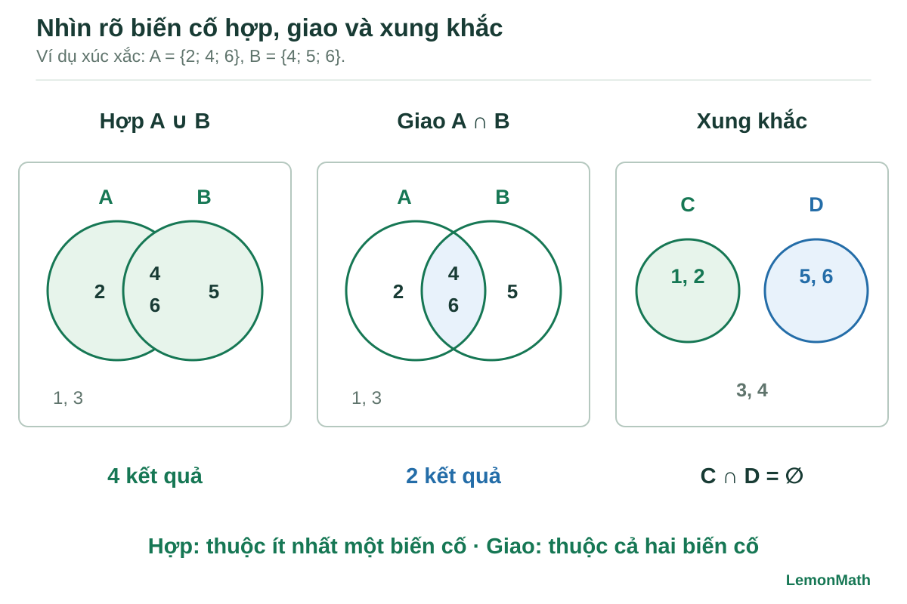

:::goals
- Hiểu và mô tả biến cố hợp $A\cup B$, biến cố giao $A\cap B$ và biến cố đối $\overline A$.
- Nhận biết hai biến cố xung khắc.
- Hiểu biến cố độc lập và dùng điều kiện $P(AB)=P(A)\,P(B)$ để kiểm tra.
- Vận dụng vào gieo xúc xắc, rút bài, khảo sát và các tình huống thực tế.
:::

Giả sử trong một lớp $40$ học sinh, có $25$ bạn thích bóng đá, $18$ bạn thích bóng rổ và $8$ bạn thích cả hai (số liệu giả định). Chọn ngẫu nhiên một học sinh. Xác suất để bạn đó thích ít nhất một trong hai môn là bao nhiêu? Hai sở thích này có độc lập với nhau không? Để trả lời, ta cần ngôn ngữ của biến cố hợp, biến cố giao và biến cố độc lập.

## Khám phá: hai biến cố trên cùng một con xúc xắc

Gieo một con xúc xắc cân đối, có $6$ kết quả đồng khả năng. Xét $A$: "số chấm chẵn" và $B$: "số chấm không nhỏ hơn $4$".

| Số chấm | $1$ | $2$ | $3$ | $4$ | $5$ | $6$ |
|---|---|---|---|---|---|---|
| Thuộc $A$ | không | có | không | có | không | có |
| Thuộc $B$ | không | không | không | có | có | có |

Các kết quả thuận lợi cho $A$ là $\{2,4,6\}$, cho $B$ là $\{4,5,6\}$. Những kết quả thuộc ít nhất một biến cố là $\{2,4,5,6\}$; những kết quả thuộc cả hai là $\{4,6\}$. Hai tập này cho ta hai biến cố mới.

## Biến cố hợp, biến cố giao

:::definition Biến cố hợp, biến cố giao, biến cố đối
Cho hai biến cố $A$ và $B$ của cùng một phép thử.
- **Biến cố hợp** $A\cup B$ xảy ra khi **ít nhất một** trong hai biến cố $A$, $B$ xảy ra.
- **Biến cố giao** $A\cap B$ (còn viết $AB$) xảy ra khi **cả hai** biến cố $A$ và $B$ cùng xảy ra.
- **Biến cố đối** của $A$, kí hiệu $\overline A$, xảy ra khi $A$ không xảy ra.
:::

Tập các kết quả thuận lợi cho $A\cup B$ là hợp của hai tập thuận lợi cho $A$ và $B$; tập thuận lợi cho $A\cap B$ là giao của chúng. Từ ví dụ xúc xắc: $A\cup B=\{2,4,5,6\}$ và $A\cap B=\{4,6\}$.

:::definition Hai biến cố xung khắc
Hai biến cố $A$ và $B$ gọi là **xung khắc** nếu chúng không thể cùng xảy ra, tức $A\cap B=\varnothing$. Khi đó $P(AB)=0$.
:::

Mỗi biến cố $A$ và biến cố đối $\overline A$ luôn xung khắc, và $P(A)+P(\overline A)=1$.

:::definition Hai biến cố độc lập
Hai biến cố $A$ và $B$ gọi là **độc lập** nếu việc xảy ra hay không xảy ra của biến cố này không làm thay đổi xác suất của biến cố kia. Khi đó
$$P(AB)=P(A)\,P(B).$$
Ngược lại, nếu $P(AB)=P(A)\,P(B)$ thì $A$ và $B$ độc lập.
:::

Nếu $A$ và $B$ độc lập thì các cặp $A$ và $\overline B$, $\overline A$ và $B$, $\overline A$ và $\overline B$ cũng độc lập.

## Ví dụ

Trước hết là hợp và giao trên xúc xắc.

:::example Hợp và giao của hai biến cố
Gieo một con xúc xắc cân đối. Gọi $A$: "số chấm chẵn", $B$: "số chấm không nhỏ hơn $4$". Mô tả $A\cup B$, $A\cap B$ và tính xác suất của chúng.

**Lời giải.** Ta có $A=\{2,4,6\}$ và $B=\{4,5,6\}$. Vậy $A\cup B=\{2,4,5,6\}$ có $4$ kết quả và $A\cap B=\{4,6\}$ có $2$ kết quả. Do $6$ kết quả đồng khả năng,
$$P(A\cup B)=\frac46=\frac23,\qquad P(A\cap B)=\frac26=\frac13.$$

Vậy $P(A\cup B)=\dfrac23$ và $P(A\cap B)=\dfrac13$.

:::

Tiếp theo là bộ bài tây.

:::example Rút một lá bài
Rút ngẫu nhiên một lá từ bộ bài tây $52$ lá. Gọi $A$: "rút được lá cơ" và $B$: "rút được lá K". Tính $P(A\cup B)$ và $P(A\cap B)$.

**Lời giải.** Có $13$ lá cơ và $4$ lá K. Giao $A\cap B$ chỉ gồm lá K cơ, tức $1$ kết quả. Hợp $A\cup B$ gồm $13$ lá cơ và $3$ lá K còn lại (không phải cơ), tổng cộng $16$ kết quả. Vậy
$$P(A\cap B)=\frac1{52},\qquad P(A\cup B)=\frac{16}{52}=\frac4{13}.$$

Vậy $P(A\cap B)=\dfrac1{52}$ và $P(A\cup B)=\dfrac4{13}$.
:::

Bây giờ là hai biến cố xung khắc.

:::example Biến cố xung khắc
Rút ngẫu nhiên một lá từ bộ bài tây $52$ lá. Gọi $A$: "rút được lá át" và $B$: "rút được lá Q". Hai biến cố này có xung khắc không? Có độc lập không?

**Lời giải.** Một lá bài không thể vừa là át vừa là Q nên $A\cap B=\varnothing$, hai biến cố xung khắc và $P(AB)=0$. Mặt khác $P(A)=P(B)=\dfrac4{52}=\dfrac1{13}$ nên $P(A)\,P(B)=\dfrac1{169}\neq0$. Vậy $P(AB)\neq P(A)\,P(B)$ và hai biến cố **không** độc lập.

Vậy $A$, $B$ xung khắc nhưng không độc lập.
:::

Rồi kiểm tra tính độc lập.

:::example Kiểm tra tính độc lập
Gieo một con xúc xắc cân đối hai lần. Gọi $A$: "lần thứ nhất ra $3$ chấm", $B$: "tổng hai lần bằng $7$", $C$: "tổng hai lần bằng $8$". Hãy xét tính độc lập của $A$ với $B$ và của $A$ với $C$.

**Lời giải.** Có $36$ kết quả đồng khả năng. Ta có $P(A)=\dfrac6{36}=\dfrac16$, $P(B)=\dfrac6{36}=\dfrac16$ (các cặp $(1,6),(2,5),\dots,(6,1)$) và $P(C)=\dfrac5{36}$.

Giao $A\cap B$ chỉ có $(3,4)$ nên $P(AB)=\dfrac1{36}=\dfrac16\cdot\dfrac16=P(A)\,P(B)$. Vậy $A$ và $B$ độc lập.

Giao $A\cap C$ chỉ có $(3,5)$ nên $P(AC)=\dfrac1{36}$, trong khi $P(A)\,P(C)=\dfrac16\cdot\dfrac5{36}=\dfrac5{216}$. Hai giá trị khác nhau nên $A$ và $C$ không độc lập.

Vậy $A$ và $B$ độc lập, còn $A$ và $C$ không độc lập.
:::

Cuối cùng ta quay lại bài toán khảo sát ở đầu bài, đi đủ bốn bước.

:::example Vận dụng: khảo sát sở thích của lớp
Giả sử trong một lớp $40$ học sinh có $25$ bạn thích bóng đá, $18$ bạn thích bóng rổ và $8$ bạn thích cả hai (số liệu giả định). Chọn ngẫu nhiên một học sinh. Gọi $A$: "bạn thích bóng đá", $B$: "bạn thích bóng rổ". Tính $P(A\cup B)$ và xét hai biến cố có độc lập không.

**Lời giải.**

*Hiểu đề.* Cần xác suất bạn đó thích ít nhất một môn, tức $P(A\cup B)$, và so sánh $P(AB)$ với $P(A)\,P(B)$.

*Tìm cách giải.* Số học sinh thích ít nhất một môn đếm bằng cách cộng hai nhóm rồi trừ phần đếm hai lần (những bạn thích cả hai). Sau đó so sánh các xác suất.

*Giải.* Có $25+18-8=35$ bạn thích ít nhất một môn, nên $P(A\cup B)=\dfrac{35}{40}=\dfrac78$. Cũng có $P(A)=\dfrac{25}{40}=\dfrac58$, $P(B)=\dfrac{18}{40}=\dfrac9{20}$ và $P(AB)=\dfrac8{40}=\dfrac15$. Tích $P(A)\,P(B)=\dfrac58\cdot\dfrac9{20}=\dfrac9{32}\approx0{,}28$, trong khi $P(AB)=0{,}2$. Hai giá trị khác nhau nên hai biến cố không độc lập.

Vậy $P(A\cup B)=\dfrac78$ và hai biến cố không độc lập.

*Nhìn lại.* Kết quả có hợp lí không? Xác suất $\dfrac78$ phải lớn hơn mỗi xác suất $P(A)=\dfrac58$ và $P(B)=\dfrac9{20}$, và đúng như vậy. Còn lại $5$ bạn không thích môn nào, tức $P(\overline{A\cup B})=\dfrac18$ và $\dfrac78+\dfrac18=1$. Kết quả không độc lập cũng hợp lí: trong số bạn thích bóng đá, tỉ lệ thích bóng rổ là $\dfrac8{25}=0{,}32$, thấp hơn tỉ lệ chung $\dfrac9{20}=0{,}45$, nên biết một bạn thích bóng đá làm giảm khả năng bạn đó thích bóng rổ.
:::

:::warning Những sai lầm thường gặp
- **Hợp nghĩa là cả hai.** Sai: $A\cup B$ xảy ra khi $A$ và $B$ cùng xảy ra. Lí do sai: đó là biến cố giao. Đúng: $A\cup B$ xảy ra khi ít nhất một trong hai xảy ra.
- **Cộng thẳng số kết quả khi tính hợp.** Sai: $n(A\cup B)=n(A)+n(B)$ trong ví dụ lá cơ hoặc lá K. Lí do sai: lá K cơ bị đếm hai lần. Đúng: $n(A\cup B)=n(A)+n(B)-n(A\cap B)=13+4-1=16$.
- **Xung khắc thì độc lập.** Sai: $A$, $B$ xung khắc nên độc lập. Lí do sai: xung khắc cho $P(AB)=0$, còn độc lập đòi $P(AB)=P(A)P(B)$; hai điều này chỉ trùng khi một xác suất bằng $0$. Đúng: hai biến cố có xác suất dương mà xung khắc thì không độc lập.
- **Độc lập nghĩa là không cùng xảy ra.** Sai: $A$, $B$ độc lập thì $A\cap B=\varnothing$. Lí do sai: hai biến cố độc lập vẫn có thể cùng xảy ra. Đúng: $P(AB)=P(A)\,P(B)>0$ khi cả hai xác suất dương.
:::

**Kết nối.** Bài này dùng định nghĩa xác suất cổ điển và phép đếm kết quả đã học. Bài [công thức cộng xác suất](lesson:addition-rule) sẽ biến phép đếm $n(A\cup B)=n(A)+n(B)-n(A\cap B)$ thành công thức $P(A\cup B)=P(A)+P(B)-P(AB)$. Trong thực tế, các khảo sát, kiểm tra chất lượng và dự báo rủi ro đều cần phân biệt hợp, giao và độc lập.

## Thuật ngữ

:::terms
- biến cố hợp | union of events
- biến cố giao | intersection of events
- biến cố đối | complementary event
- biến cố xung khắc | mutually exclusive events
- biến cố độc lập | independent events
- phép thử | experiment
- không gian mẫu | sample space
- kết quả thuận lợi | favourable outcome
- xác suất | probability
- bộ bài tây | standard deck of cards
:::

## Tóm tắt

- $A\cup B$: ít nhất một trong hai biến cố xảy ra; $A\cap B$ (hay $AB$): cả hai cùng xảy ra; $\overline A$: $A$ không xảy ra.
- $A$, $B$ xung khắc nếu $A\cap B=\varnothing$, khi đó $P(AB)=0$.
- $A$, $B$ độc lập khi và chỉ khi $P(AB)=P(A)\,P(B)$.
- Nếu $A$, $B$ độc lập thì $A$ và $\overline B$ cũng độc lập; xung khắc và độc lập là hai khái niệm khác nhau.
- Số kết quả của hợp: $n(A\cup B)=n(A)+n(B)-n(A\cap B)$.

## Luyện tập

Mỗi bài có phần kiến thức và gợi ý các bước. Hãy tự làm trước, rồi mới bấm xem lời giải.

:::exercise
Gieo một con xúc xắc cân đối. Gọi $A$: "số chấm chia hết cho $3$" và $B$: "số chấm lẻ". Mô tả $A\cup B$, $A\cap B$ và tính xác suất của chúng.

::hint
**Kiến thức:** liệt kê tập kết quả thuận lợi; hợp và giao.

**Gợi ý các bước:**
1. Liệt kê $A$ và $B$.
2. Tìm hợp, giao rồi chia cho $6$.

::solution
Không gian mẫu là $\Omega=\{1,2,3,4,5,6\}$ gồm $6$ kết quả đồng khả năng.

Biến cố $A$: "số chấm chia hết cho $3$" nên $A=\{3,6\}$. Biến cố $B$: "số chấm lẻ" nên $B=\{1,3,5\}$.

Biến cố hợp $A\cup B$ là biến cố "số chấm chia hết cho $3$ hoặc là số lẻ", gồm các kết quả thuộc ít nhất một trong hai tập: $A\cup B=\{1,3,5,6\}$.

Biến cố giao $A\cap B$ là biến cố "số chấm vừa chia hết cho $3$ vừa là số lẻ", gồm các kết quả thuộc cả hai tập: $A\cap B=\{3\}$.

Do đó $n(A\cup B)=4$ và $n(A\cap B)=1$, suy ra
$$P(A\cup B)=\frac46=\frac23,\qquad P(A\cap B)=\frac16.$$

Vậy $P(A\cup B)=\dfrac23$ và $P(A\cap B)=\dfrac16$.

**Đáp số.** $\dfrac23$ và $\dfrac16$.
:::

:::exercise
Rút ngẫu nhiên một lá từ bộ bài tây $52$ lá. Gọi $A$: "lá bích" và $B$: "lá J, Q hoặc K". Tính $P(A\cup B)$ và $P(A\cap B)$.

::hint
**Kiến thức:** $n(A\cup B)=n(A)+n(B)-n(A\cap B)$.

**Gợi ý các bước:**
1. Đếm $n(A)=13$, $n(B)=12$.
2. Đếm giao: các lá J, Q, K bích.

::solution
Bộ bài tây có $52$ lá, mỗi lá được rút với khả năng như nhau, nên $n(\Omega)=52$.

Biến cố $A$: "lá bích" có $n(A)=13$. Biến cố $B$: "lá J, Q hoặc K" có $n(B)=3\cdot4=12$ lá (mỗi quân có $4$ chất).

Biến cố giao $A\cap B$ là "lá bích và là J, Q hoặc K", gồm J bích, Q bích, K bích, nên $n(A\cap B)=3$.

Áp dụng công thức cộng, ta có
$$n(A\cup B)=n(A)+n(B)-n(A\cap B)=13+12-3=22.$$

Do đó
$$P(A\cup B)=\frac{22}{52}=\frac{11}{26},\qquad P(A\cap B)=\frac{3}{52}.$$

Vậy $P(A\cup B)=\dfrac{11}{26}$ và $P(A\cap B)=\dfrac3{52}$.

**Đáp số.** $\dfrac{11}{26}$ và $\dfrac3{52}$.
:::

:::exercise
Tung một đồng xu cân đối ba lần. Gọi $A$: "có ít nhất hai mặt ngửa" và $B$: "lần đầu ra mặt sấp". Tính $P(A\cup B)$ và $P(A\cap B)$.

::hint
**Kiến thức:** có $8$ kết quả đồng khả năng.

**Gợi ý các bước:**
1. Liệt kê các kết quả thuận lợi cho $A$ và $B$ (N: ngửa, S: sấp).
2. Tìm hợp và giao.

::solution
Kí hiệu $N$ là mặt ngửa, $S$ là mặt sấp. Tung đồng xu cân đối ba lần có $2^3=8$ kết quả đồng khả năng.

Biến cố $A$: "có ít nhất hai mặt ngửa" nên $A=\{NNN,NNS,NSN,SNN\}$, có $4$ kết quả.

Biến cố $B$: "lần đầu ra mặt sấp" nên $B=\{SNN,SNS,SSN,SSS\}$, có $4$ kết quả.

Kết quả thuộc cả $A$ và $B$ chỉ có $SNN$, nên $A\cap B=\{SNN\}$ và $n(A\cap B)=1$.

Số kết quả của $A\cup B$ là $n(A\cup B)=4+4-1=7$.

Do đó
$$P(A\cup B)=\frac78,\qquad P(A\cap B)=\frac18.$$

Vậy $P(A\cup B)=\dfrac78$ và $P(A\cap B)=\dfrac18$.

**Đáp số.** $\dfrac78$ và $\dfrac18$.
:::

:::exercise
Xét tính đúng sai của các mệnh đề sau.

a) Biến cố $A\cup B$ xảy ra khi ít nhất một trong hai biến cố $A$, $B$ xảy ra.

b) Nếu $A\cap B=\varnothing$ thì $A$ và $B$ luôn độc lập.

c) Nếu $P(AB)=P(A)\,P(B)$ thì $A$ và $B$ độc lập.

d) Biến cố $A\cup B$ chỉ xảy ra khi cả $A$ và $B$ cùng xảy ra.

::hint
**Kiến thức:** các định nghĩa.

**Gợi ý các bước:**
1. So từng mệnh đề với định nghĩa.
2. Phân biệt xung khắc và độc lập.

::solution
a) **Đúng.** Theo định nghĩa, biến cố hợp $A\cup B$ xảy ra khi và chỉ khi ít nhất một trong hai biến cố $A$, $B$ xảy ra.

b) **Sai.** Nếu $A\cap B=\varnothing$ (hai biến cố xung khắc) thì $P(AB)=0$. Hai biến cố độc lập khi $P(AB)=P(A)P(B)$; nếu $P(A)>0$ và $P(B)>0$ thì $P(A)P(B)>0$, khác $P(AB)=0$. Chẳng hạn, gieo một con xúc xắc cân đối với $A=\{1\}$, $B=\{2\}$: $A\cap B=\varnothing$ nhưng $P(AB)=0\ne\dfrac1{36}=P(A)P(B)$.

c) **Đúng.** Theo định nghĩa, hai biến cố $A$ và $B$ độc lập khi $P(AB)=P(A)\,P(B)$.

d) **Sai.** Biến cố $A\cup B$ xảy ra khi ít nhất một trong hai biến cố xảy ra, không nhất thiết cả hai cùng xảy ra. Biến cố "cả $A$ và $B$ cùng xảy ra" là biến cố giao $A\cap B$.

Vậy các mệnh đề a), c) đúng; các mệnh đề b), d) sai.

**Đáp số.** a) Đúng; b) Sai; c) Đúng; d) Sai.
:::

:::exercise
Giả sử hai xạ thủ bắn độc lập vào cùng một bia, xác suất bắn trúng của người thứ nhất là $0{,}8$ và của người thứ hai là $0{,}7$ (số liệu giả định). Tính xác suất cả hai cùng bắn trúng và xác suất cả hai cùng bắn trượt.

::hint
**Kiến thức:** nếu $A$, $B$ độc lập thì $P(AB)=P(A)P(B)$; $\overline A$, $\overline B$ cũng độc lập.

**Gợi ý các bước:**
1. Tính $P(AB)$.
2. Tính $P(\overline A)$, $P(\overline B)$ rồi nhân.

::solution
Gọi $A$ là biến cố "người thứ nhất bắn trúng" và $B$ là biến cố "người thứ hai bắn trúng". Theo đề, $P(A)=0{,}8$, $P(B)=0{,}7$ và hai biến cố $A$, $B$ độc lập.

Cả hai cùng bắn trúng là biến cố $AB$. Vì $A$, $B$ độc lập nên
$$P(AB)=P(A)\,P(B)=0{,}8\cdot0{,}7=0{,}56.$$

Cả hai cùng bắn trượt là biến cố $\overline A\,\overline B$. Ta có $P(\overline A)=1-0{,}8=0{,}2$ và $P(\overline B)=1-0{,}7=0{,}3$. Vì $A$, $B$ độc lập nên $\overline A$, $\overline B$ cũng độc lập, do đó
$$P(\overline A\,\overline B)=P(\overline A)\,P(\overline B)=0{,}2\cdot0{,}3=0{,}06.$$

Vậy xác suất cả hai cùng bắn trúng là $0{,}56$ và xác suất cả hai cùng bắn trượt là $0{,}06$.

**Đáp số.** $0{,}56$ và $0{,}06$.
:::

:::exercise
Gieo một con xúc xắc cân đối hai lần. Gọi $A$: "tổng hai lần bằng $7$" và $B$: "lần thứ hai ra $6$ chấm". Hai biến cố có độc lập không?

::hint
**Kiến thức:** so sánh $P(AB)$ với $P(A)P(B)$.

**Gợi ý các bước:**
1. Tính $P(A)$, $P(B)$.
2. Tìm giao: chỉ có $(1,6)$.

::solution
Gieo xúc xắc cân đối hai lần có $6\cdot6=36$ kết quả đồng khả năng, mỗi kết quả là một cặp $(i; j)$ với $i$ là số chấm lần đầu, $j$ là số chấm lần hai.

Biến cố $A$: "tổng hai lần bằng $7$" gồm $6$ kết quả $(1; 6)$, $(2; 5)$, $(3; 4)$, $(4; 3)$, $(5; 2)$, $(6; 1)$, nên $P(A)=\dfrac{6}{36}=\dfrac16$.

Biến cố $B$: "lần thứ hai ra $6$ chấm" gồm $6$ kết quả $(1; 6)$, $(2; 6)$, $\ldots$, $(6; 6)$, nên $P(B)=\dfrac{6}{36}=\dfrac16$.

Kết quả thuộc cả $A$ và $B$ chỉ có $(1; 6)$, nên $A\cap B=\{(1; 6)\}$ và $P(AB)=\dfrac1{36}$.

Ta có $P(A)\,P(B)=\dfrac16\cdot\dfrac16=\dfrac1{36}=P(AB)$.

Vậy hai biến cố $A$ và $B$ độc lập.

**Đáp số.** Có, hai biến cố độc lập.
:::

:::exercise
Giả sử trong một lớp $30$ học sinh có $18$ bạn học cờ vua, $12$ bạn học nhạc và $5$ bạn học cả hai (số liệu giả định). Chọn ngẫu nhiên một học sinh. Tính xác suất bạn đó học ít nhất một trong hai môn và xác suất bạn đó không học môn nào.

::hint
**Kiến thức:** $n(A\cup B)=n(A)+n(B)-n(A\cap B)$; biến cố đối.

**Gợi ý các bước:**
1. Tính số bạn học ít nhất một môn.
2. Dùng biến cố đối.

::solution
Gọi $A$ là biến cố "bạn được chọn học cờ vua" và $B$ là biến cố "bạn được chọn học nhạc". Theo đề, $n(A)=18$, $n(B)=12$, $n(A\cap B)=5$ và $n(\Omega)=30$.

Biến cố "học ít nhất một trong hai môn" là $A\cup B$. Áp dụng công thức cộng, số bạn học ít nhất một môn là
$$n(A\cup B)=n(A)+n(B)-n(A\cap B)=18+12-5=25.$$

Do đó
$$P(A\cup B)=\frac{25}{30}=\frac56.$$

Biến cố "không học môn nào" là biến cố đối của $A\cup B$, nên
$$P\left(\overline{A\cup B}\right)=1-P(A\cup B)=1-\frac56=\frac16.$$

Vậy xác suất bạn đó học ít nhất một trong hai môn là $\dfrac56$ và xác suất bạn đó không học môn nào là $\dfrac16$.

**Đáp số.** $\dfrac56$ và $\dfrac16$.
:::

:::exercise
Ôn lại phân số. Rút lần lượt hai lá từ bộ bài tây $52$ lá, mỗi lần rút xong đều trả lá bài về bộ. Tính xác suất cả hai lần đều rút được lá cơ.

::hint
**Kiến thức:** có hoàn lại thì hai lần rút độc lập.

**Gợi ý các bước:**
1. Tính xác suất rút lá cơ ở một lần.
2. Nhân hai xác suất.

::solution
Gọi $A_1$ là biến cố "lần rút thứ nhất được lá cơ" và $A_2$ là biến cố "lần rút thứ hai được lá cơ".

Bộ bài có $52$ lá, trong đó có $13$ lá cơ. Mỗi lần rút xong đều trả lá bài về bộ nên bộ bài luôn đủ $52$ lá, và kết quả lần rút thứ hai không phụ thuộc lần thứ nhất. Do đó $A_1$ và $A_2$ độc lập và
$$P(A_1)=P(A_2)=\frac{13}{52}=\frac14.$$

Cả hai lần đều rút được lá cơ là biến cố $A_1A_2$, nên
$$P(A_1A_2)=P(A_1)\,P(A_2)=\frac14\cdot\frac14=\frac1{16}.$$

Vậy xác suất cả hai lần đều rút được lá cơ là $\dfrac1{16}$.

**Đáp số.** $\dfrac1{16}$.
:::

:::exercise Thử thách
Chứng minh rằng nếu $A$ và $B$ độc lập thì $A$ và $\overline B$ cũng độc lập.

::hint
**Kiến thức:** $A=AB\cup A\overline B$ và hai biến cố này xung khắc, nên $P(A)=P(AB)+P(A\overline B)$.

**Gợi ý các bước:**
1. Biểu diễn $P(A\overline B)$ theo $P(A)$ và $P(AB)$.
2. Thay $P(AB)=P(A)P(B)$.

::solution
Giả sử $A$ và $B$ độc lập, tức là $P(AB)=P(A)\,P(B)$. Ta cần chứng minh $P(A\overline B)=P(A)\,P(\overline B)$.

Biến cố $A$ là hợp của hai biến cố xung khắc $AB$ và $A\overline B$ (tuỳ theo $B$ xảy ra hay không), nên
$$P(A)=P(AB)+P(A\overline B),\ \text{suy ra}\ P(A\overline B)=P(A)-P(AB).$$

Thay $P(AB)=P(A)\,P(B)$ vào, ta được
$$\begin{aligned}P(A\overline B)&=P(A)-P(A)\,P(B)\\&=P(A)\,\bigl(1-P(B)\bigr)\\&=P(A)\,P(\overline B).\end{aligned}$$

Vậy nếu $A$ và $B$ độc lập thì $A$ và $\overline B$ cũng độc lập.

**Đáp số.** Đã chứng minh.
:::

## Kiểm tra mini

:::quiz
::mc NB
Biến cố $A\cup B$ xảy ra khi
A. ít nhất một trong hai biến cố $A$, $B$ xảy ra.
B. $A$ xảy ra mà $B$ không xảy ra.
C. cả $A$ và $B$ cùng xảy ra.
D. không biến cố nào xảy ra.
::key A
Đó là định nghĩa biến cố hợp. Phương án C là biến cố giao, B và D là các biến cố khác.

::mc TH
Gieo một con xúc xắc cân đối. Gọi $A$: "số chấm chẵn" và $B$: "số chấm không nhỏ hơn $4$". Xác suất $P(A\cap B)$ bằng
A. $\dfrac12$.
B. $\dfrac13$.
C. $\dfrac16$.
D. $\dfrac23$.
::key B
$A\cap B=\{4,6\}$ nên $P=\dfrac26=\dfrac13$. Phương án D là $P(A\cup B)$, A là $P(A)$, C chỉ đếm một kết quả.

::mc TH
Rút một lá từ bộ bài tây $52$ lá. Gọi $A$: "lá cơ" và $B$: "lá K". Xác suất $P(A\cup B)$ bằng
A. $\dfrac1{52}$.
B. $\dfrac{17}{52}$.
C. $\dfrac4{13}$.
D. $\dfrac1{13}$.
::key C
$n(A\cup B)=13+4-1=16$ nên $P=\dfrac{16}{52}=\dfrac4{13}$. Phương án B quên trừ phần chung, A là $P(AB)$, D là $P(B)$.

::mc NB
Hai biến cố $A$, $B$ độc lập khi và chỉ khi
A. $A\cap B=\varnothing$.
B. $P(AB)=0$.
C. $P(A\cup B)=P(A)+P(B)$.
D. $P(AB)=P(A)\,P(B)$.
::key D
Đó là điều kiện độc lập. Phương án A và B nói về biến cố xung khắc, C chỉ đúng khi xung khắc.

::tf NB TH TH TH
Xét tính đúng sai của các mệnh đề sau:
a) Biến cố giao $A\cap B$ xảy ra khi cả $A$ và $B$ cùng xảy ra.
b) $A$ và biến cố đối $\overline A$ luôn xung khắc.
c) Hai biến cố xung khắc có xác suất dương thì luôn độc lập.
d) Nếu $A$ và $B$ độc lập thì $A$ và $\overline B$ cũng độc lập.
::key Đ Đ S Đ
a) Đúng theo định nghĩa. b) Đúng vì $A$ và $\overline A$ không thể cùng xảy ra. c) Sai: khi đó $P(AB)=0\neq P(A)P(B)$. d) Đúng theo tính chất.

::sa TH
Hai biến cố độc lập $A$, $B$ có $P(A)=0{,}6$ và $P(B)=0{,}5$. Tính $P(AB)$.
::key 0,3
$P(AB)=0{,}6\cdot0{,}5=0{,}3$.

::sa VD
Giả sử trong một khảo sát $50$ người, có $30$ người dùng ứng dụng X, $24$ người dùng ứng dụng Y và $14$ người dùng cả hai. Chọn ngẫu nhiên một người. Tính xác suất người đó dùng ít nhất một ứng dụng.
::key 0,8
$30+24-14=40$ người, xác suất $\dfrac{40}{50}=0{,}8$.
:::
