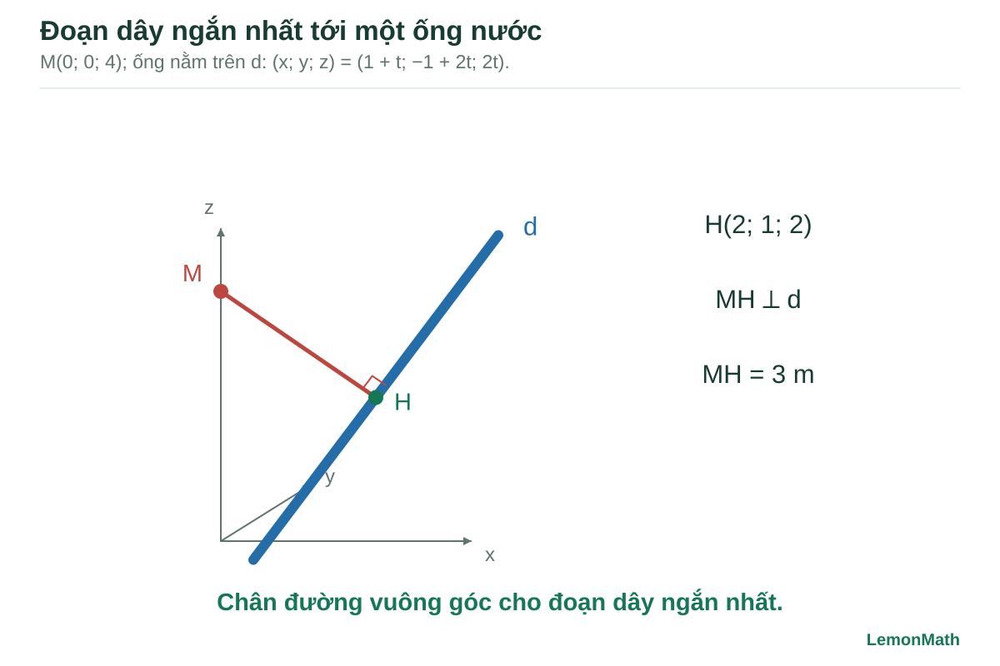

:::goals
- Viết phương trình tham số và phương trình chính tắc của đường thẳng khi biết một điểm và vectơ chỉ phương, hoặc biết hai điểm.
- Xét vị trí tương đối của hai đường thẳng: song song, trùng nhau, cắt nhau, chéo nhau.
- Xét vị trí của đường thẳng và mặt phẳng; tìm giao điểm.
- Tìm hình chiếu vuông góc của một điểm trên mặt phẳng và trên đường thẳng.
:::

Một chiếc drone cất cánh từ điểm $M_0(1; 2; 0)$ trên sân trường (đơn vị: mét). Nó bay thẳng, và mỗi giây lại dịch chuyển theo vectơ $\vec{u}=(2; 1; 2)$. Trên cao có một vòng kiểm tra đặt tại $N(9; 6; 8)$. Bạn thử đoán xem: drone có bay xuyên qua vòng không, và nếu có thì sau bao nhiêu giây? Ta không cần thả drone bay thử. Chỉ cần viết đường bay của nó thành phương trình là trả lời được.

Ở mặt phẳng, bạn đã biết một điểm và một hướng là đủ để vẽ một đường thẳng. Trong không gian cũng vậy: đường thẳng được xác định bởi **một điểm** và **một hướng**. Chỉ khác là bây giờ mỗi điểm có ba toạ độ thay vì hai.

## Phương trình tham số của đường thẳng

### Khám phá: vị trí của drone

Sau $t$ giây, drone ở điểm $M$ với $\overrightarrow{M_0M}=t\vec{u}$. Nói cách khác, nó đã dịch chuyển bấy nhiêu lần bước bay mỗi giây kể từ chỗ cất cánh. Ta ghi vài vị trí để xem quy luật:

| $t$ (giây) | $0$ | $1$ | $2$ | $3$ |
|---|---|---|---|---|
| vị trí | $(1; 2; 0)$ | $(3; 3; 2)$ | $(5; 4; 4)$ | $(7; 5; 6)$ |

Vị trí sau $t$ giây là $(1+2t; 2+t; 2t)$. Vòng kiểm tra ở $N(9; 6; 8)$, nên ta hỏi: có một thời điểm nào làm cả ba toạ độ cùng khớp không? Tức là cần $1+2t=9$, $2+t=6$, $2t=8$. Cả ba đều cho $t=4$. Nếu chúng cho ba giá trị khác nhau thì drone đã bay lệch vòng. Vậy drone qua vòng kiểm tra sau $4$ giây. Quãng đường đã bay là $4|\vec{u}|=4\cdot3=12$ m.

:::diagram Đường thẳng qua $M_0$ có vectơ chỉ phương $\vec{u}$
alt: Một đường thẳng d đi qua điểm M0, mũi tên vectơ u đặt trên đường thẳng, và một điểm M khác trên d
point P -1,-0.5 ""
point Q 7,3.5 ""
point M0 0,0 below-right "M_0"
point U 2,1 below-right ""
point M 5,2.5 below-right
segment P Q
arrow M0 U "u"
label 6.6,3.6 "d"
:::

:::definition Vectơ chỉ phương, phương trình tham số
- Vectơ $\vec{u}\neq\vec{0}$ là một **vectơ chỉ phương** của đường thẳng $\Delta$ nếu giá của $\vec{u}$ song song hoặc trùng với $\Delta$. Mọi vectơ $k\vec{u}$ ($k\neq0$) cũng là vectơ chỉ phương.
- Đường thẳng $\Delta$ đi qua $M_0(x_0; y_0; z_0)$ và có vectơ chỉ phương $\vec{u}=(a; b; c)$ có **phương trình tham số**
$$\begin{cases}x=x_0+at\\ y=y_0+bt\\ z=z_0+ct\end{cases}\quad(t\in\mathbb{R}).$$
- Nếu $a$, $b$, $c$ đều khác $0$, khử $t$ ta được **phương trình chính tắc**
$$\frac{x-x_0}{a}=\frac{y-y_0}{b}=\frac{z-z_0}{c}.$$
:::

**Vì sao đúng?** Điểm $M(x; y; z)$ thuộc $\Delta$ khi và chỉ khi $\overrightarrow{M_0M}$ cùng phương với $\vec{u}$, tức là có số $t$ để $\overrightarrow{M_0M}=t\vec{u}$. Đó chính là điều chiếc drone đã làm: đi một số lần bước bay từ điểm xuất phát. Viết theo từng toạ độ: $x-x_0=at$, $y-y_0=bt$, $z-z_0=ct$. Khi $abc\neq0$, ta chia mỗi đẳng thức cho hệ số tương ứng, và cả ba phân số đều bằng $t$.

:::example Từ một điểm và vectơ chỉ phương
Cho đường thẳng $\Delta$ đi qua $M(1; -2; 3)$ và có vectơ chỉ phương $\vec{u}=(2; 0; -1)$. Viết phương trình tham số của $\Delta$, tìm điểm ứng với $t=2$ và xét xem $A(-3; -2; 5)$ có thuộc $\Delta$ không.

**Lời giải.** Thay điểm và vectơ chỉ phương vào công thức:

$$\Delta: \begin{cases}x=1+2t\\ y=-2\\ z=3-t.\end{cases}$$

Với $t=2$ ta được điểm $(5; -2; 1)$. Với $A$, từ $1+2t=-3$ ta có $t=-2$; khi đó $z=3+2=5$ và $y=-2$ đều khớp.

Vậy $A$ thuộc $\Delta$ (ứng với $t=-2$). Đường thẳng này không có phương trình chính tắc, vì toạ độ thứ hai của $\vec{u}$ bằng $0$.
:::

Không phải lúc nào đề cũng cho sẵn vectơ chỉ phương, nhưng ta thường tự tìm được. Biết hai điểm thì vectơ nối chúng chạy dọc theo đường thẳng, nên ta lấy nó làm vectơ chỉ phương. Nếu đường thẳng vuông góc với một mặt phẳng thì nó cùng hướng với vectơ pháp tuyến của mặt phẳng, nên vectơ pháp tuyến chính là vectơ chỉ phương. Ví dụ dưới đây dùng cả hai cách.

:::example Qua hai điểm; vuông góc với một mặt phẳng
a) Viết phương trình tham số và chính tắc của đường thẳng $AB$ với $A(1; 2; -1)$, $B(3; -1; 1)$.

b) Viết phương trình tham số của đường thẳng $d$ đi qua $M(2; 0; -1)$ và vuông góc với $(P): x-2y+2z+3=0$.

**Lời giải.** a) Lấy $\vec{u}=\overrightarrow{AB}=(2; -3; 2)$ và điểm $A$:

$$AB: \begin{cases}x=1+2t\\ y=2-3t\\ z=-1+2t\end{cases}\qquad\text{và}\qquad \frac{x-1}{2}=\frac{y-2}{-3}=\frac{z+1}{2}.$$

b) $d\perp(P)$ nên $d$ nhận $\vec{n}_P=(1; -2; 2)$ làm vectơ chỉ phương:

$$d: \begin{cases}x=2+t\\ y=-2t\\ z=-1+2t.\end{cases}$$

Vậy ta có các phương trình như trên.
:::

## Vị trí tương đối của hai đường thẳng

Trong không gian, hai đường thẳng có bốn khả năng: song song, trùng nhau, cắt nhau, và một khả năng mà mặt phẳng không có. Hình dung một cầu vượt chạy ngang trên cao và con đường chạy bên dưới: chúng không gặp nhau, mà cũng không song song. Hai đường thẳng như vậy gọi là **chéo nhau**.

:::theorem Cách xét hai đường thẳng
Cho $d_1$ qua $M_1$, vectơ chỉ phương $\vec{u}_1$ và $d_2$ qua $M_2$, vectơ chỉ phương $\vec{u}_2$.
- Nếu $\vec{u}_1$, $\vec{u}_2$ cùng phương: $d_1$ trùng $d_2$ khi $M_1\in d_2$; $d_1\parallel d_2$ khi $M_1\notin d_2$.
- Nếu $\vec{u}_1$, $\vec{u}_2$ không cùng phương: giải hệ gồm ba phương trình toạ độ với hai tham số $t$, $s$. Hệ có nghiệm thì $d_1$ cắt $d_2$; hệ vô nghiệm thì $d_1$, $d_2$ chéo nhau.
:::

:::example Cắt nhau hay chéo nhau
Cho $d_1: \begin{cases}x=1+t\\ y=2t\\ z=2-t\end{cases}$, $d_2: \begin{cases}x=1+s\\ y=3-s\\ z=-1+2s\end{cases}$ và $d_3: \begin{cases}x=1+s\\ y=3-s\\ z=2s.\end{cases}$ Xét vị trí của $d_1$ với $d_2$ và của $d_1$ với $d_3$.

**Lời giải.** Vectơ chỉ phương $\vec{u}_1=(1; 2; -1)$ và $(1; -1; 2)$ không cùng phương (toạ độ đầu bằng nhau nhưng toạ độ thứ hai khác). Ta dùng hai tham số khác nhau $t$, $s$ và giải hệ. Với $d_1$, $d_2$:

$$\begin{cases}1+t=1+s\\ 2t=3-s\\ 2-t=-1+2s\end{cases}\iff\begin{cases}t=s\\ 3t=3\\ 3=3s\end{cases}\iff t=s=1.$$

Hệ có nghiệm, nên $d_1$ cắt $d_2$ tại điểm ứng với $t=1$, tức $(2; 2; 1)$.

Với $d_1$, $d_3$: hai phương trình đầu vẫn cho $t=s=1$, nhưng phương trình thứ ba cần $2-1=2\cdot1$, tức $1=2$, vô lí.

Vậy $d_1$ cắt $d_2$ tại $(2; 2; 1)$, còn $d_1$ và $d_3$ chéo nhau.
:::

## Đường thẳng và mặt phẳng

Một điểm của đường thẳng nằm trên mặt phẳng khi toạ độ của nó thoả mãn phương trình của mặt phẳng. Vì mọi điểm của đường thẳng đều viết được theo tham số, ta thay phương trình tham số của $d$ vào phương trình của $(P)$ và được một phương trình bậc nhất theo $t$. Số nghiệm của phương trình đó cho biết $d$ và $(P)$ gặp nhau như thế nào.

:::theorem Vị trí của đường thẳng và mặt phẳng
Thay $x$, $y$, $z$ của $d$ vào phương trình $(P)$:
- có đúng một nghiệm $t$: $d$ cắt $(P)$ tại một điểm;
- vô nghiệm: $d\parallel(P)$;
- nghiệm đúng với mọi $t$: $d$ nằm trong $(P)$.

Nói riêng, $d$ song song hoặc nằm trong $(P)$ khi và chỉ khi $\vec{u}\cdot\vec{n}=0$; $d\perp(P)$ khi và chỉ khi $\vec{u}$ cùng phương với $\vec{n}$.
:::

:::example Một đường thẳng và ba mặt phẳng
Cho $d: \begin{cases}x=1+2t\\ y=-1+t\\ z=2-t.\end{cases}$ Xét vị trí của $d$ với $(P): x+y+z-6=0$, $(Q): x-y+z-4=0$ và $(R): x-y+z+1=0$.

**Lời giải.** Thay $d$ vào từng phương trình rồi rút gọn:

$$\begin{aligned} (P)&: (1+2t)+(-1+t)+(2-t)-6=2t-4=0\iff t=2;\\ (Q)&: (1+2t)-(-1+t)+(2-t)-4=0\ \text{với mọi}\ t;\\ (R)&: (1+2t)-(-1+t)+(2-t)+1=5=0\ \text{(vô lí)}. \end{aligned}$$

Vậy $d$ cắt $(P)$ tại điểm ứng với $t=2$, tức $(5; 1; 0)$; $d$ nằm trong $(Q)$; $d\parallel(R)$.
:::

## Hình chiếu vuông góc của một điểm

Điểm của một mặt phẳng hay một đường thẳng gần nhất với điểm cho trước chính là chỗ ta thả vuông góc xuống. Điểm ấy gọi là hình chiếu. Hình chiếu $H$ của điểm $M$ trên mặt phẳng $(P)$ là giao điểm của $(P)$ với đường thẳng qua $M$ vuông góc với $(P)$. Hình chiếu $H$ của $M$ trên đường thẳng $d$ là điểm $H\in d$ sao cho $\overrightarrow{MH}\perp\vec{u}$.

:::diagram Hình chiếu $H$ của $M$ trên mặt phẳng $(P)$
alt: Một mặt phẳng vẽ dạng hình bình hành, điểm M ở phía trên, đoạn MH vuông góc với mặt phẳng tại H
point P1 0,0 ""
point P2 5,0 ""
point P3 6.5,2 ""
point P4 1.5,2 ""
point H 3.2,1 below
point M 3.2,4 right
point E 4.6,1 ""
polygon P1 P2 P3 P4
segment M H
right M H E
label 0.6,0.4 "(P)"
:::

:::example Điểm trên sườn đồi gần drone nhất
Sườn đồi là mặt phẳng $(P): x+2y+2z-5=0$ (đơn vị: mét), drone ở $M(4; 5; 9)$. Tìm điểm $H$ trên sườn đồi gần drone nhất và khoảng cách $MH$.

**Lời giải.** Điểm gần nhất là hình chiếu của $M$ trên $(P)$. Đường thẳng qua $M$ vuông góc với $(P)$ có vectơ chỉ phương $\vec{n}=(1; 2; 2)$: $x=4+t$, $y=5+2t$, $z=9+2t$. Thay vào $(P)$:

$$(4+t)+2(5+2t)+2(9+2t)-5=27+9t=0\iff t=-3.$$

Khi đó $H(1; -1; 3)$ và $\overrightarrow{HM}=(3; 6; 6)$, nên $MH=\sqrt{9+36+36}=9$.

Vậy điểm gần drone nhất là $H(1; -1; 3)$, cách drone $9$ m.

**Kiểm tra.** Công thức khoảng cách: $\dfrac{|4+10+18-5|}{3}=9$.
:::

Ví dụ cuối có nhiều bước hơn, nên ta làm chậm lại và chia thành bốn bước: hiểu đề, tìm cách giải, giải, nhìn lại.

:::example Đoạn dây ngắn nhất tới một ống nước
Một ống nước thẳng nằm dọc đường thẳng $d: x=1+t$, $y=-1+2t$, $z=2t$ (đơn vị: mét). Từ móc $M(0; 0; 4)$ cần kéo một sợi dây ngắn nhất tới ống. Tìm điểm buộc dây $H$ trên ống và độ dài sợi dây.

**Lời giải.**

*Hiểu đề.* Sợi dây ngắn nhất là đoạn vuông góc từ $M$ tới $d$, nên $H$ là hình chiếu của $M$ trên $d$.

*Tìm cách giải.* Viết $H$ theo $t$, rồi dùng điều kiện $\overrightarrow{MH}\cdot\vec{u}=0$ với $\vec{u}=(1; 2; 2)$.

*Giải.* $H(1+t; -1+2t; 2t)$ nên $\overrightarrow{MH}=(1+t; -1+2t; 2t-4)$. Khi đó:

$$\overrightarrow{MH}\cdot\vec{u}=(1+t)+2(-1+2t)+2(2t-4)=9t-9=0\iff t=1.$$

Vậy $H(2; 1; 2)$, $\overrightarrow{MH}=(2; 1; -2)$ và $MH=\sqrt{4+1+4}=3$. Sợi dây dài $3$ m.

*Nhìn lại.* Chỉ cần một điều kiện vuông góc là tìm được $t$. Độ dài $MH$ chính là khoảng cách từ $M$ đến đường thẳng $d$.

:::

:::warning Những sai lầm thường gặp
- **Dùng chung một tham số cho hai đường thẳng.** Sai: giải $d_1$, $d_2$ bằng hệ $1+t=1+t$, $2t=3-t$, ... Vì sao sai: mỗi đường thẳng có tham số riêng, và một giao điểm có thể ứng với $t$ và $s$ khác nhau. Đúng: dùng $t$ cho $d_1$, $s$ cho $d_2$.
- **Kết luận "song song" chỉ vì không cắt nhau.** Sai: $d_1$, $d_3$ không có điểm chung nên song song. Vì sao sai: trong không gian còn có trường hợp chéo nhau. Đúng: muốn song song thì $\vec{u}_1$, $\vec{u}_2$ còn phải cùng phương.
- **Viết phương trình chính tắc khi có toạ độ bằng $0$.** Sai: viết $\Delta$ ở Ví dụ 1 thành $\dfrac{x-1}{2}=\dfrac{y+2}{0}=\dfrac{z-3}{-1}$. Vì sao sai: ta không chia được cho $0$. Đúng: dùng phương trình tham số.
- **Dùng vectơ pháp tuyến làm vectơ chỉ phương cho đường thẳng song song với mặt phẳng.** Sai: đường thẳng song song với $(P)$ nhận $\vec{n}_P$ làm vectơ chỉ phương. Vì sao sai: $\vec{n}_P$ vuông góc với $(P)$. Đúng: $\vec{n}_P$ là vectơ chỉ phương của đường thẳng **vuông góc** với $(P)$.
Mấy chỗ này nhiều bạn hay nhầm ở lần đầu, nên đừng lo nếu bạn cũng vậy. Làm xong, bạn thử thay kết quả vào đề để kiểm tra.
:::

## Thuật ngữ

:::terms
- đường thẳng | line
- vectơ chỉ phương | direction vector
- phương trình tham số | parametric equations
- tham số | parameter
- phương trình chính tắc | Cartesian (symmetric) equations
- hai đường thẳng cắt nhau | intersecting lines
- hai đường thẳng chéo nhau | skew lines
- giao điểm | point of intersection
- hình chiếu vuông góc | orthogonal projection
:::

## Tóm tắt

- Đường thẳng qua $M_0(x_0; y_0; z_0)$ với vectơ chỉ phương $\vec{u}=(a; b; c)$ có phương trình $x=x_0+at$, $y=y_0+bt$, $z=z_0+ct$.
- Khi $abc\neq0$: $\dfrac{x-x_0}{a}=\dfrac{y-y_0}{b}=\dfrac{z-z_0}{c}$.
- Qua hai điểm $A$, $B$: $\vec{u}=\overrightarrow{AB}$. Vuông góc với $(P)$: $\vec{u}=\vec{n}_P$.
- Hai đường thẳng: $\vec{u}_1$, $\vec{u}_2$ cùng phương thì song song hoặc trùng nhau. Không cùng phương thì giải hệ theo $t$, $s$: có nghiệm là cắt nhau, vô nghiệm là chéo nhau.
- Đường thẳng và mặt phẳng: thay vào được phương trình theo $t$. Một nghiệm là cắt, vô nghiệm là song song, mọi $t$ là nằm trong.
- Hình chiếu trên $(P)$: giao của $(P)$ với đường thẳng qua $M$ có vectơ chỉ phương $\vec{n}$. Hình chiếu trên $d$: $H\in d$, $\overrightarrow{MH}\cdot\vec{u}=0$.
Quay lại câu hỏi về chiếc drone: một điểm và một vectơ chỉ phương đủ để viết cả đường bay, và việc còn lại chỉ là giải phương trình theo tham số. Bạn nhớ điều đó là đã nắm được ý chính của cả bài.

## Luyện tập

Mỗi bài đều có phần kiến thức cần dùng và vài bước gợi ý để bạn bắt đầu. Hãy tự làm trước, đừng vội mở lời giải. Nếu bị kẹt, bạn xem gợi ý một chút, làm tiếp, rồi mới mở lời giải để đối chiếu.

:::exercise
Viết phương trình tham số của đường thẳng đi qua $A(2; -1; 3)$ và có vectơ chỉ phương $\vec{u}=(1; 4; -2)$. Tìm điểm ứng với $t=-1$ và kiểm tra xem $B(4; 7; -1)$ có thuộc đường thẳng không.

::hint
**Kiến thức:** $x=x_0+at$, $y=y_0+bt$, $z=z_0+ct$.

**Gợi ý các bước:**
1. Viết phương trình tham số.
2. Thay $t=-1$.
3. Tìm $t$ từ hoành độ của $B$ rồi kiểm tra hai toạ độ còn lại.

::solution
Đường thẳng đi qua $A(2; -1; 3)$ và có vectơ chỉ phương $\vec{u}=(1; 4; -2)$ nên có phương trình tham số
$$\begin{cases}x=2+t\\ y=-1+4t\\ z=3-2t\end{cases}\quad(t\in\mathbb{R}).$$

Với $t=-1$ ta có $x=2-1=1$, $y=-1-4=-5$, $z=3+2=5$. Vậy điểm ứng với $t=-1$ là $(1; -5; 5)$.

Để kiểm tra $B(4; 7; -1)$, ta tìm $t$ từ toạ độ $x$: $2+t=4$, suy ra $t=2$. Thay $t=2$ vào hai phương trình còn lại:
$$y=-1+4\cdot2=7,\qquad z=3-2\cdot2=-1.$$

Các giá trị này trùng với toạ độ $y$, $z$ của $B$.

Vậy điểm ứng với $t=-1$ là $(1; -5; 5)$ và $B$ thuộc đường thẳng (ứng với $t=2$).

**Đáp số.** $(1; -5; 5)$; $B$ thuộc đường thẳng (ứng với $t=2$).
:::

:::exercise
Viết phương trình tham số và phương trình chính tắc của đường thẳng đi qua $A(1; 0; -2)$ và $B(3; 2; -1)$.

::hint
**Kiến thức:** $\vec{u}=\overrightarrow{AB}$.

**Gợi ý các bước:**
1. Tính $\overrightarrow{AB}$.
2. Viết hai dạng phương trình với điểm $A$.

::solution
Đường thẳng đi qua $A(1; 0; -2)$ và $B(3; 2; -1)$ nhận vectơ
$$\overrightarrow{AB}=(3-1; 2-0; -1-(-2))=(2; 2; 1)$$
làm vectơ chỉ phương.

Phương trình tham số của đường thẳng đi qua $A$ với vectơ chỉ phương $\overrightarrow{AB}$ là
$$\begin{cases}x=1+2t\\ y=2t\\ z=-2+t\end{cases}\quad(t\in\mathbb{R}).$$

Vì cả ba toạ độ của vectơ chỉ phương đều khác $0$ nên đường thẳng có phương trình chính tắc
$$\frac{x-1}{2}=\frac{y}{2}=\frac{z+2}{1}.$$

Vậy đường thẳng $AB$ có phương trình tham số và phương trình chính tắc như trên.

**Đáp số.** Như trên.
:::

:::exercise
Viết phương trình đường thẳng $d$ đi qua $M(1; -1; 2)$ và vuông góc với $(P): 2x-y+3z+5=0$. Tìm giao điểm của $d$ và $(P)$.

::hint
**Kiến thức:** $d\perp(P)$ thì $\vec{u}_d=\vec{n}_P$; giao điểm: thay phương trình tham số vào $(P)$.

**Gợi ý các bước:**
1. Viết $d$ với $\vec{u}=(2; -1; 3)$.
2. Thay vào $(P)$, giải $t$.

::solution
Vì $d$ vuông góc với $(P): 2x-y+3z+5=0$ nên $d$ nhận vectơ pháp tuyến $\vec{n}_P=(2; -1; 3)$ của $(P)$ làm vectơ chỉ phương. Đường thẳng $d$ đi qua $M(1; -1; 2)$ nên có phương trình
$$d:\ \begin{cases}x=1+2t\\ y=-1-t\\ z=2+3t\end{cases}\quad(t\in\mathbb{R}).$$

Giao điểm của $d$ và $(P)$ ứng với giá trị $t$ thoả mãn phương trình của $(P)$. Thay toạ độ theo $t$ vào $(P)$, ta được
$$2(1+2t)-(-1-t)+3(2+3t)+5=14+14t=0\iff t=-1.$$

Thay $t=-1$ vào phương trình của $d$: $x=1-2=-1$, $y=-1+1=0$, $z=2-3=-1$.

Vậy giao điểm của $d$ và $(P)$ là $(-1; 0; -1)$.

**Đáp số.** $(-1; 0; -1)$.
:::

:::exercise
Viết phương trình tham số và chính tắc của đường thẳng đi qua $M(0; 1; -1)$ và song song với $\Delta: \dfrac{x-1}{2}=\dfrac{y+3}{-1}=\dfrac{z}{3}$.

::hint
**Kiến thức:** hai đường thẳng song song có chung vectơ chỉ phương; đọc $\vec{u}$ ở các mẫu số.

**Gợi ý các bước:**
1. Đọc $\vec{u}=(2; -1; 3)$.
2. Viết phương trình qua $M$.

::solution
Từ phương trình chính tắc, đường thẳng $\Delta: \dfrac{x-1}{2}=\dfrac{y+3}{-1}=\dfrac{z}{3}$ có vectơ chỉ phương $\vec{u}_\Delta=(2; -1; 3)$.

Đường thẳng cần tìm song song với $\Delta$ nên nhận $\vec{u}_\Delta=(2; -1; 3)$ làm vectơ chỉ phương, và đi qua $M(0; 1; -1)$. Phương trình tham số là
$$\begin{cases}x=2t\\ y=1-t\\ z=-1+3t\end{cases}\quad(t\in\mathbb{R}),$$
và phương trình chính tắc là
$$\frac{x}{2}=\frac{y-1}{-1}=\frac{z+1}{3}.$$

Kiểm tra $M$ có thuộc $\Delta$ hay không: thay toạ độ $M$ vào phương trình của $\Delta$ ta được $\dfrac{0-1}{2}=-\dfrac12$ và $\dfrac{1+3}{-1}=-4$. Vì $-\dfrac12\ne-4$ nên $M\notin\Delta$.

Vậy đường thẳng cần tìm có phương trình như trên; nó song song với $\Delta$ và không trùng với $\Delta$.

**Đáp số.** Như trên.
:::

:::exercise
Cho $d_1: \begin{cases}x=1+2t\\ y=-t\\ z=3+t\end{cases}$ và $d_2: \dfrac{x-3}{-4}=\dfrac{y+1}{2}=\dfrac{z-4}{-2}$. Mỗi khẳng định sau đúng hay sai?

a) $\vec{u}_1=(2; -1; 1)$ là một vectơ chỉ phương của $d_1$.

b) Điểm $M(3; -1; 4)$ thuộc $d_1$.

c) $d_1$ song song với $d_2$.

d) $d_1$ vuông góc với mặt phẳng $(P): 2x-y+z=0$.

::hint
**Kiến thức:** hai vectơ chỉ phương cùng phương thì hai đường thẳng song song hoặc trùng nhau; kiểm tra thêm một điểm.

**Gợi ý các bước:**
1. Đọc $\vec{u}_1$, $\vec{u}_2$.
2. Thay $M$ vào $d_1$ (tìm $t$).
3. So sánh $\vec{u}_1$ với $\vec{n}_P$.

::solution
Đường thẳng $d_1$ đi qua điểm $(1; 0; 3)$ (ứng với $t=0$). Đường thẳng $d_2$ có vectơ chỉ phương $\vec{u}_2=(-4; 2; -2)$.

a) **Đúng.** Hệ số của $t$ trong phương trình tham số của $d_1$ là $2$, $-1$, $1$, nên $\vec{u}_1=(2; -1; 1)$ là một vectơ chỉ phương của $d_1$.

b) **Đúng.** Với $t=1$ ta có $x=1+2=3$, $y=-1$, $z=3+1=4$, tức là $(3; -1; 4)$. Vậy $M(3; -1; 4)$ thuộc $d_1$.

c) **Sai.** Ta có $\vec{u}_2=(-4; 2; -2)=-2\vec{u}_1$ nên hai vectơ chỉ phương cùng phương. Mặt khác $M(3; -1; 4)$ thuộc $d_1$ theo câu b), và cũng thuộc $d_2$ vì
$$\frac{3-3}{-4}=\frac{-1+1}{2}=\frac{4-4}{-2}=0.$$
Hai đường thẳng có chung điểm $M$ nên chúng trùng nhau, không song song.

d) **Đúng.** Mặt phẳng $(P): 2x-y+z=0$ có vectơ pháp tuyến $\vec{n}_P=(2; -1; 1)=\vec{u}_1$. Vectơ chỉ phương của $d_1$ cùng phương với vectơ pháp tuyến của $(P)$ nên $d_1\perp(P)$.

Vậy các mệnh đề a), b), d) đúng; mệnh đề c) sai.

**Đáp số.** a) Đúng; b) Đúng; c) Sai; d) Đúng.
:::

:::exercise
Một máy bay cất cánh từ điểm $O(0; 0; 0)$ và bay thẳng, mỗi giây dịch chuyển theo vectơ $\vec{v}=(80; 60; 10)$ (đơn vị: mét). Khi máy bay đạt độ cao $1500$ m, hình chiếu của nó trên mặt đất cách $O$ bao nhiêu kilômét?

::hint
**Kiến thức:** vị trí sau $t$ giây là $(80t; 60t; 10t)$.

**Gợi ý các bước:**
1. Giải $10t=1500$.
2. Hình chiếu trên mặt đất là $(80t; 60t; 0)$; tính khoảng cách tới $O$.

::solution
Gọi $t$ (giây) là thời gian bay, $t>0$. Mỗi giây máy bay dịch chuyển theo vectơ $\vec{v}=(80; 60; 10)$ nên sau $t$ giây vị trí của máy bay là
$$(80t; 60t; 10t)\ (\text{mét}).$$

Máy bay đạt độ cao $1500$ m khi $10t=1500$, suy ra $t=150$ (giây) (thoả mãn $t>0$).

Khi đó máy bay ở vị trí $(80\cdot150; 60\cdot150; 1500)=(12000; 9000; 1500)$. Hình chiếu của nó trên mặt đất (mặt phẳng $z=0$) là $(12000; 9000; 0)$.

Khoảng cách từ hình chiếu đó đến $O$ là
$$\sqrt{12000^2+9000^2}=\sqrt{144000000+81000000}=\sqrt{225000000}=15000\ (\text{m}).$$

Đổi đơn vị: $15000$ m $=15$ km.

Vậy khi máy bay đạt độ cao $1500$ m, hình chiếu của nó trên mặt đất cách $O$ là $15$ kilômét.

**Đáp số.** $15$.
:::

:::exercise
Cho $d: x=2+t$, $y=1-t$, $z=3+2t$. Xét vị trí của $d$ với $(P_1): x+y-1=0$, $(P_2): x+3y+z-8=0$, $(P_3): x-y+z-6=0$.

::hint
**Kiến thức:** thay phương trình tham số vào phương trình mặt phẳng.

**Gợi ý các bước:**
1. Thay vào từng mặt phẳng và rút gọn theo $t$.
2. Đọc số nghiệm.

::solution
Đường thẳng $d$ đi qua $A(2; 1; 3)$ (ứng với $t=0$) và có vectơ chỉ phương $\vec{u}=(1; -1; 2)$. Để xét vị trí của $d$ với mỗi mặt phẳng, ta thay toạ độ theo $t$ vào phương trình mặt phẳng.

Với $(P_1): x+y-1=0$:
$$(2+t)+(1-t)-1=2=0,$$
phương trình này vô nghiệm (vô lí) nên $d$ và $(P_1)$ không có điểm chung. Vậy $d\parallel(P_1)$.

Với $(P_2): x+3y+z-8=0$:
$$(2+t)+3(1-t)+(3+2t)-8=(2+3+3-8)+(t-3t+2t)=0$$
với mọi $t$, nên mọi điểm của $d$ đều thuộc $(P_2)$. Vậy $d$ nằm trong $(P_2)$.

Với $(P_3): x-y+z-6=0$:
$$(2+t)-(1-t)+(3+2t)-6=4t-2=0\iff t=\frac12.$$

Phương trình có đúng một nghiệm nên $d$ cắt $(P_3)$. Thay $t=\dfrac12$ vào phương trình của $d$: $x=\dfrac52$, $y=\dfrac12$, $z=4$.

Vậy $d$ song song với $(P_1)$, nằm trong $(P_2)$ và cắt $(P_3)$ tại điểm $\left(\dfrac52; \dfrac12; 4\right)$.

**Đáp số.** Song song với $(P_1)$; nằm trong $(P_2)$; cắt $(P_3)$ tại $\left(\dfrac52; \dfrac12; 4\right)$.
:::

:::exercise
Xét vị trí của hai đường thẳng $d_1: x=1+t$, $y=1-t$, $z=2t$ và $d_2: x=1+2s$, $y=-2+s$, $z=5-s$. Nếu chúng cắt nhau, tìm giao điểm.

::hint
**Kiến thức:** vectơ chỉ phương không cùng phương thì giải hệ theo $t$, $s$.

**Gợi ý các bước:**
1. So sánh $(1; -1; 2)$ và $(2; 1; -1)$.
2. Giải hai phương trình đầu, rồi thử phương trình thứ ba.

::solution
Đường thẳng $d_1$ có vectơ chỉ phương $\vec{u}_1=(1; -1; 2)$, đường thẳng $d_2$ có vectơ chỉ phương $\vec{u}_2=(2; 1; -1)$. Vì $\dfrac12\ne\dfrac{-1}{1}$ nên hai vectơ không cùng phương, do đó $d_1$ và $d_2$ không song song, cũng không trùng nhau.

Để tìm giao điểm (nếu có), ta giải hệ ba phương trình theo ẩn $t$, $s$ bằng cách cho các toạ độ bằng nhau:
$$\begin{cases}1+t=1+2s\\ 1-t=-2+s\\ 2t=5-s.\end{cases}$$

Từ phương trình đầu ta có $t=2s$. Thay vào phương trình thứ hai: $1-2s=-2+s\iff3s=3\iff s=1$, suy ra $t=2$.

Thay $t=2$, $s=1$ vào phương trình thứ ba: $2\cdot2=4$ và $5-1=4$, đẳng thức đúng. Hệ có nghiệm duy nhất $(t; s)=(2; 1)$ nên hai đường thẳng cắt nhau.

Thay $t=2$ vào $d_1$: $x=1+2=3$, $y=1-2=-1$, $z=2\cdot2=4$. (Thay $s=1$ vào $d_2$ cũng được $(3; -1; 4)$.)

Vậy $d_1$ và $d_2$ cắt nhau tại điểm $(3; -1; 4)$.

**Đáp số.** Cắt nhau tại $(3; -1; 4)$.
:::

:::exercise
(Ôn lại [Biểu thức toạ độ của các phép toán vectơ](lesson:vector-coordinate-operations).) Ở bài trước, ta chứng minh $A(1; 2; -1)$, $B(3; 1; 1)$, $C(7; -1; 5)$ thẳng hàng bằng vectơ cùng phương. Hãy viết phương trình tham số của đường thẳng $AB$ và chỉ ra giá trị $t$ ứng với điểm $C$.

::hint
**Kiến thức:** $\vec{u}=\overrightarrow{AB}$; $C$ thuộc $AB$ khi có một $t$ chung cho cả ba toạ độ.

**Gợi ý các bước:**
1. $\overrightarrow{AB}=(2; -1; 2)$.
2. Giải $1+2t=7$ và kiểm tra.

::solution
Đường thẳng $AB$ đi qua $A(1; 2; -1)$ và có vectơ chỉ phương
$$\overrightarrow{AB}=(3-1; 1-2; 1-(-1))=(2; -1; 2).$$

Phương trình tham số của đường thẳng $AB$ là
$$\begin{cases}x=1+2t\\ y=2-t\\ z=-1+2t\end{cases}\quad(t\in\mathbb{R}).$$

Điểm $C(7; -1; 5)$ ứng với giá trị $t$ thoả mãn $1+2t=7$, suy ra $t=3$. Thay $t=3$ vào hai phương trình còn lại:
$$y=2-3=-1,\qquad z=-1+2\cdot3=5.$$

Các giá trị này trùng với toạ độ $y$, $z$ của $C$, nên $C$ thuộc đường thẳng $AB$ và ứng với $t=3$.

Vậy giá trị $t$ ứng với điểm $C$ là $t=3$; điều này đúng với $\overrightarrow{AC}=3\overrightarrow{AB}$ ở bài trước.

**Đáp số.** $t=3$, đúng với $\overrightarrow{AC}=3\overrightarrow{AB}$ ở bài trước.
:::

:::exercise Thử thách
Một tia laze xuất phát từ $A(1; 2; 3)$, phản xạ trên một tấm gương phẳng nằm trong mặt phẳng $(P): x+2y+2z-2=0$ rồi tới $B(3; 2; 2)$. Tìm điểm phản xạ $M$ trên gương. (Gợi ý: đường đi $A\to M\to B$ ngắn nhất khi $M$ nằm trên đoạn $A'B$, với $A'$ là điểm đối xứng của $A$ qua $(P)$.)

::hint
**Kiến thức:** hình chiếu $H$ của $A$ trên $(P)$; $H$ là trung điểm của $AA'$.

**Gợi ý các bước:**
1. Tìm $H$, rồi $A'=2H-A$ (theo toạ độ).
2. Viết đường thẳng $A'B$ và tìm giao điểm với $(P)$.

::solution
Gọi $A'$ là điểm đối xứng của $A(1; 2; 3)$ qua $(P): x+2y+2z-2=0$. Mặt phẳng $(P)$ có vectơ pháp tuyến $\vec{n}_P=(1; 2; 2)$.

Đường thẳng qua $A$ vuông góc với $(P)$ nhận $\vec{n}_P$ làm vectơ chỉ phương nên có phương trình
$$\begin{cases}x=1+t\\ y=2+2t\\ z=3+2t.\end{cases}$$

Gọi $H$ là giao điểm của đường thẳng này với $(P)$. Thay vào $(P)$:
$$(1+t)+2(2+2t)+2(3+2t)-2=9+9t=0\iff t=-1.$$

Suy ra $H(0; 0; 1)$. Vì $H$ là trung điểm của $AA'$ nên
$$A'=(2\cdot0-1; 2\cdot0-2; 2\cdot1-3)=(-1; -2; -1).$$

Thay toạ độ vào vế trái của $(P)$: với $A'$ ta được $-1-4-2-2=-9$, với $B(3; 2; 2)$ ta được $3+4+4-2=9$. Hai giá trị trái dấu nên $A'$ và $B$ nằm về hai phía của $(P)$; hai giá trị có cùng giá trị tuyệt đối nên $A'$ và $B$ cách đều $(P)$.

Do đó đoạn $A'B$ cắt $(P)$ tại trung điểm của nó. Vì quãng đường $A\to M\to B$ ngắn nhất khi $M$ nằm trên đoạn $A'B$ và $M\in(P)$, nên $M$ là trung điểm của $A'B$:
$$M=\left(\frac{-1+3}{2}; \frac{-2+2}{2}; \frac{-1+2}{2}\right)=\left(1; 0; \frac12\right).$$

Kiểm tra: $1+2\cdot0+2\cdot\dfrac12-2=0$, nên $M\in(P)$.

Khi đó đường đi của tia sáng dài $A'B=\sqrt{4^2+4^2+3^2}=\sqrt{41}\approx6{,}40$.

Vậy điểm phản xạ trên gương là $M\left(1; 0; \dfrac12\right)$.

**Đáp số.** $M\left(1; 0; \dfrac12\right)$.
:::

## Kiểm tra mini

:::quiz
::mc NB
Trong không gian $Oxyz$, một vectơ chỉ phương của đường thẳng $d: \begin{cases}x=1-2t\\ y=3\\ z=-1+t\end{cases}$ là
A. $(1; 3; -1)$.
B. $(-2; 3; 1)$.
C. $(-2; 0; 1)$.
D. $(2; 0; 1)$.
::key C
Vectơ chỉ phương gồm các hệ số của $t$: $-2$, $0$, $1$. Phương án A là toạ độ một điểm, B lấy số $3$ không có $t$, D sai dấu.

::mc TH
Điểm nào sau đây thuộc đường thẳng $\dfrac{x-1}{2}=\dfrac{y+2}{-1}=\dfrac{z-3}{3}$?
A. $(-1; 2; -3)$.
B. $(2; -1; 3)$.
C. $(3; -1; 6)$.
D. $(1; -2; 3)$.
::key D
Thay $(1; -2; 3)$ cả ba phân số bằng $0$. Phương án A đổi dấu toạ độ điểm, B lấy nhầm vectơ chỉ phương, C sai ở phân số thứ hai: $\dfrac{-1+2}{-1}=-1\neq1$.

::mc TH
Đường thẳng đi qua $A(1; 0; 2)$ và vuông góc với $(P): 2x-y+z-3=0$ có phương trình là
A. $x=1+2t$, $y=-t$, $z=2+t$.
B. $x=2+t$, $y=-1$, $z=1+2t$.
C. $x=1+2t$, $y=t$, $z=2+t$.
D. $x=1+2t$, $y=-t$, $z=2-3t$.
::key A
Vectơ chỉ phương là $\vec{n}_P=(2; -1; 1)$. Phương án B đổi vai trò điểm và vectơ, C sai dấu toạ độ thứ hai, D lấy nhầm hệ số tự do $-3$.

::mc VD
Cho $d_1: x=1+t$, $y=2t$, $z=3-t$ và $d_2: x=s$, $y=1+s$, $z=2s$. Vị trí của $d_1$ và $d_2$ là
A. song song.
B. cắt nhau.
C. chéo nhau.
D. trùng nhau.
::key C
$(1; 2; -1)$ và $(1; 1; 2)$ không cùng phương, nên loại A và D. Hai phương trình đầu cho $s=1+t$ và $2t=1+s=2+t$, tức $t=2$, $s=3$; phương trình thứ ba cần $3-2=2\cdot3$, vô lí. Vậy hai đường thẳng chéo nhau; chọn "song song" là quên trường hợp chéo nhau.

::tf NB TH VD TH
Cho đường thẳng $d: x=1+t$, $y=2-t$, $z=-1+2t$ và mặt phẳng $(P): x+y+z-4=0$.
a) $\vec{u}=(1; -1; 2)$ là một vectơ chỉ phương của $d$.
b) $d$ song song với $(P)$.
c) $d$ cắt $(P)$ tại điểm $(2; 1; 1)$.
d) $d$ vuông góc với mặt phẳng $(Q): x-y+2z+7=0$.
::key Đ S Đ Đ
a) Đúng. b) Sai: $\vec{u}\cdot\vec{n}_P=1-1+2=2\neq0$. c) Đúng: thay vào được $2t-2=0$, $t=1$, điểm $(2; 1; 1)$. d) Đúng: $\vec{n}_Q=(1; -1; 2)=\vec{u}$.

::sa VD
Đường thẳng $d: x=2+t$, $y=-1+2t$, $z=3-t$ cắt mặt phẳng $(P): x+y+z-10=0$ tại điểm $M(a; b; c)$. Tính $a+b+c$.
::key 10
Thay vào: $2t-6=0$, $t=3$, nên $M(5; 5; 0)$ và $a+b+c=10$. Một cách khác: $M$ thuộc $(P)$ nên $a+b+c-10=0$.

::sa VD
Tính khoảng cách từ $M(2; 3; 1)$ đến đường thẳng $d: x=1+2t$, $y=-1+t$, $z=1+2t$ (làm tròn đến hàng phần trăm).
::key 3,61
$\overrightarrow{MH}=(2t-1; t-4; 2t)$ với $H\in d$; $\overrightarrow{MH}\cdot(2; 1; 2)=9t-6=0$, $t=\dfrac23$. Khi đó $\overrightarrow{MH}=\left(\dfrac13; -\dfrac{10}{3}; \dfrac43\right)$, $MH=\sqrt{13}\approx3{,}61$.
:::
