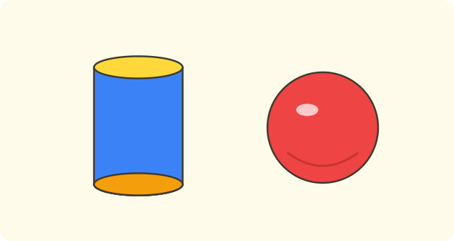
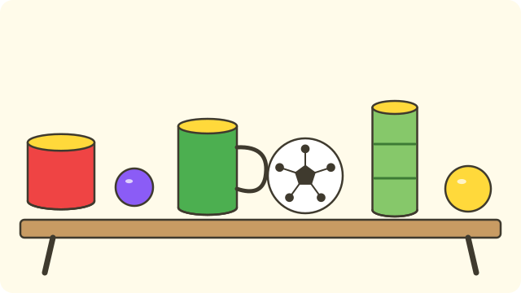

:::goals
- Nhận biết khối trụ và khối cầu trong các đồ vật quanh em.
- Nói được khối trụ có $2$ mặt phẳng và $1$ mặt cong, khối cầu chỉ có mặt cong.
- Biết vì sao lon sữa xếp chồng được còn quả bóng thì không.
:::

Lan đặt một quả bóng và một lon sữa lên mặt bàn hơi nghiêng. Quả bóng lăn đi rất nhanh. Lon sữa nằm ngang cũng lăn, nhưng khi dựng đứng lên thì đứng yên.

Vì sao quả bóng lăn đi rất nhanh còn lon sữa dựng đứng thì yên? Câu trả lời nằm ở hình dạng của chúng. Em sẽ làm quen với hai loại khối mới, rồi tự giải thích được chuyện trên bàn của Lan.

## Cùng khám phá

Em hãy cầm một lon sữa. Sờ vào hai đầu: đầu trên và đầu dưới đều phẳng. Sờ xung quanh thân lon: chỗ này cong.

Bây giờ em cầm một quả bóng. Sờ khắp quả bóng: chỗ nào cũng cong, không có chỗ nào phẳng.

Ta ghi những điều vừa sờ thấy vào bảng để so sánh cho dễ:

| | Lon sữa | Quả bóng |
|---|---|---|
| Số mặt phẳng | $2$ | $0$ |
| Số mặt cong | $1$ | $1$ |
| Đặt đứng, xếp chồng lên nhau | được | không vững |
| Lăn | lăn theo một hướng | lăn theo mọi hướng |

Bây giờ ta đặt tên cho hai hình dạng này. Lon sữa có dạng **khối trụ**. Quả bóng có dạng **khối cầu**.

:::theorem Nhận biết khối trụ và khối cầu
- **Khối trụ** có $2$ mặt phẳng hình tròn (gọi là hai đáy) và $1$ mặt cong xung quanh. Ví dụ: lon sữa, cái trống, hộp bánh tròn.
- **Khối cầu** chỉ có mặt cong, không có mặt phẳng nào. Ví dụ: quả bóng, viên bi.
:::

Giờ em đã giải thích được chuyện của Lan. Khối trụ xếp chồng được vì hai đáy của nó phẳng, đặt lên nhau không bị trượt. Khối cầu không có mặt phẳng nào để tựa vào, nên dễ lăn đi.

## Ví dụ

Ta thử nhận ra hình dạng của một đồ vật quen thuộc trong lớp.

:::example Cái trống
Cái trống của lớp em là khối trụ hay khối cầu?

**Lời giải.** Hai đầu trống là hai mặt phẳng hình tròn, thân trống là một mặt cong. Vật có $2$ mặt phẳng tròn và $1$ mặt cong là khối trụ.

Vậy cái trống là khối trụ.
:::

Em đếm các mặt của một khối trụ, giống như lúc em sờ lon sữa.

:::example Đếm mặt của lon sữa
Một lon sữa có bao nhiêu mặt phẳng và bao nhiêu mặt cong?

**Lời giải.** Lon sữa là khối trụ. Khối trụ có hai đáy phẳng là đầu trên và đầu dưới, và một mặt cong là thân lon.

Vậy lon sữa có $2$ mặt phẳng và $1$ mặt cong.
:::

Nhiều đồ vật lẫn vào nhau thì sao? Ta thử xếp chúng vào hai nhóm.

:::example Phân loại đồ vật
Trên bàn có: hộp bánh tròn, viên bi, cái cốc hình trụ, quả bóng đá, ống tre, quả bóng bàn. Có mấy khối trụ, mấy khối cầu?

**Lời giải.** Em xếp từng vật vào nhóm:

- Khối trụ (có hai đáy phẳng): hộp bánh tròn, cái cốc, ống tre. Có $3$ vật.
- Khối cầu (chỉ có mặt cong): viên bi, quả bóng đá, quả bóng bàn. Có $3$ vật.

Vậy có $3$ khối trụ và $3$ khối cầu.
:::

Cuối cùng, ta dùng điều vừa học để giúp Nam chọn vật xếp tháp.

:::example Xếp tháp
Nam có $4$ lon sữa và $3$ quả bóng. Nam muốn xếp một cái tháp cao. Nam nên dùng loại nào? Vì sao?

**Lời giải.** Muốn xếp tháp, các vật phải đặt chồng lên nhau mà không lăn. Lon sữa là khối trụ, có đáy phẳng nên đặt chồng được. Quả bóng là khối cầu, không có mặt phẳng nên sẽ lăn.

Vậy Nam nên dùng $4$ lon sữa.
:::

:::warning Những lỗi em hay gặp
- **Nghĩ quả bóng có mặt phẳng.** Sai: "Quả bóng có $1$ mặt phẳng". Vì sao sai: em sờ khắp quả bóng, chỗ nào cũng cong, không có chỗ nào phẳng. Đúng: khối cầu có $0$ mặt phẳng.
- **Quên khối trụ có mặt cong.** Sai: "Lon sữa chỉ có $2$ mặt phẳng". Vì sao sai: sờ quanh thân lon, em thấy chỗ đó cong. Đúng: lon sữa có $2$ mặt phẳng và $1$ mặt cong.
- **Nhầm hộp sữa hình hộp với khối trụ.** Sai: "Hộp sữa bốn góc vuông là khối trụ". Vì sao sai: hộp có góc, còn khối trụ có hai đáy là hình tròn, không có góc. Đúng: chỉ vật có hai đáy tròn mới là khối trụ.
:::

## Thuật ngữ

:::terms
- khối trụ | cylinder
- khối cầu | sphere
- mặt phẳng | flat face
- mặt cong | curved surface
- đáy | base
- lăn | roll
- xếp chồng | stack
:::

## Tóm tắt

- Khối trụ có $2$ mặt phẳng hình tròn (hai đáy) và $1$ mặt cong. Ví dụ: lon sữa, cái trống.
- Khối cầu chỉ có $1$ mặt cong, không có mặt phẳng. Ví dụ: quả bóng, viên bi.
- Khối trụ xếp chồng được vì có đáy phẳng; khối cầu dễ lăn nên không xếp chồng vững.
- Muốn biết một vật là khối nào, em sờ xem vật có mặt phẳng không.
Quay lại câu hỏi đầu bài: vì sao quả bóng và lon sữa khác nhau? Vì lon sữa có đáy phẳng còn quả bóng thì không. Lần sau cầm một đồ vật, em thử sờ xem nó có mặt phẳng không nhé, rồi làm phần luyện tập.

## Luyện tập

Mỗi bài có phần kiến thức cần nhớ và gợi ý cách bắt đầu. Em cứ tự làm trước. Làm chưa đúng cũng không sao, vì như thế em biết chỗ nào cần xem lại. Xong rồi hãy bấm xem lời giải.

:::exercise
Mỗi đồ vật có dạng khối trụ hay khối cầu?

a) Lon nước ngọt.

b) Quả bóng bàn.

c) Cái trống.

d) Viên bi.

::hint
**Kiến thức:** vật có hai đáy phẳng hình tròn là khối trụ; vật không có mặt phẳng là khối cầu.

**Gợi ý các bước:**
1. Nghĩ xem vật có chỗ nào phẳng không.
2. Có hai đầu phẳng thì chọn khối trụ, còn lại chọn khối cầu.

::solution
Khối trụ có hai đáy phẳng và một mặt cong. Khối cầu không có mặt phẳng nào.

a) Lon nước ngọt có hai đáy phẳng nên là khối trụ.

b) Quả bóng bàn không có mặt phẳng nên là khối cầu.

c) Cái trống có hai đáy phẳng nên là khối trụ.

d) Viên bi không có mặt phẳng nên là khối cầu.

Vậy lon nước ngọt và cái trống có dạng khối trụ; quả bóng bàn và viên bi có dạng khối cầu.

**Đáp số.** a) khối trụ; b) khối cầu; c) khối trụ; d) khối cầu.
:::

:::exercise
Điền số thích hợp.

a) Khối trụ có $\square$ mặt phẳng.

b) Khối trụ có $\square$ mặt cong.

c) Khối cầu có $\square$ mặt phẳng.

::hint
**Kiến thức:** khối trụ có $2$ mặt phẳng và $1$ mặt cong; khối cầu không có mặt phẳng.

**Gợi ý các bước:**
1. Nhớ lại bảng ở phần Cùng khám phá.
2. Điền từng chỗ trống.

::solution
Khối trụ có hai đáy phẳng và một mặt cong.

a) Khối trụ có $2$ mặt phẳng (hai đáy).

b) Khối trụ có $1$ mặt cong.

c) Khối cầu không có mặt phẳng nào, nên có $0$ mặt phẳng.

Vậy ta điền các số $2$, $1$ và $0$.

**Đáp số.** a) $2$; b) $1$; c) $0$.
:::

:::exercise
Câu nào đúng, câu nào sai?

a) Khối cầu có mặt phẳng.

b) Khối trụ xếp chồng lên nhau được.

c) Quả bóng lăn được theo mọi hướng.

::hint
**Kiến thức:** khối cầu không có mặt phẳng; khối trụ có đáy phẳng nên xếp chồng được.

**Gợi ý các bước:**
1. Đọc từng câu.
2. Đối chiếu với phần Tóm tắt.

::solution
a) **Sai.** Khối cầu không có mặt phẳng nào, nên câu "Khối cầu có mặt phẳng" là sai.

b) **Đúng.** Khối trụ có đáy phẳng nên các khối trụ xếp chồng lên nhau được.

c) **Đúng.** Quả bóng có dạng khối cầu, mà khối cầu lăn được theo mọi hướng.

Vậy câu b), c) đúng; câu a) sai.

**Đáp số.** a) Sai; b) Đúng; c) Đúng.
:::

:::exercise
Trong các đồ vật sau, vật nào không cùng nhóm với các vật còn lại: lon sữa, cái trống, quả bóng, cái cốc hình trụ?

::hint
**Kiến thức:** vật có hai đáy phẳng là khối trụ.

**Gợi ý các bước:**
1. Xếp từng vật vào khối trụ hoặc khối cầu.
2. Tìm vật ở nhóm khác.

::solution
Ta xác định dạng khối của từng đồ vật.

Lon sữa có hai đáy phẳng nên là khối trụ.

Cái trống có hai đáy phẳng nên là khối trụ.

Cái cốc hình trụ là khối trụ.

Quả bóng không có mặt phẳng nên là khối cầu.

Vậy ba vật là khối trụ, còn quả bóng là khối cầu nên quả bóng không cùng nhóm với các vật còn lại.

**Đáp số.** Quả bóng.
:::

:::exercise
Em muốn xếp một cái tháp cao bằng các đồ vật. Em chọn lon sữa hay quả bóng? Vì sao?

::hint
**Kiến thức:** vật có đáy phẳng thì đặt chồng lên nhau được.

**Gợi ý các bước:**
1. Vật nào có mặt phẳng?
2. Vật có mặt phẳng thì có lăn đi khi chồng lên nhau không?

::solution
Lon sữa là khối trụ, có đáy phẳng nên có thể xếp chồng lên nhau.

Quả bóng là khối cầu, không có mặt phẳng nên sẽ lăn đi, không xếp chồng được.

Vậy em chọn lon sữa để xếp một cái tháp cao, vì lon sữa có đáy phẳng.

**Đáp số.** Chọn lon sữa.
:::

:::exercise
Mai nói: "Quả cam tròn có hai mặt phẳng nên là khối trụ." Lời nói của Mai sai ở đâu? Sửa lại cho đúng.

::hint
**Kiến thức:** khối cầu không có mặt phẳng.

**Gợi ý các bước:**
1. Quả cam có chỗ nào phẳng không?
2. Vật không có mặt phẳng là khối nào?

::solution
Quả cam tròn không có mặt phẳng nào.

Vật không có mặt phẳng là khối cầu, còn khối trụ mới có hai mặt phẳng (hai đáy).

Mai sai ở chỗ nói quả cam có hai mặt phẳng, nên đã gọi nhầm là khối trụ.

Vậy câu đúng là: quả cam tròn không có mặt phẳng nên có dạng khối cầu.

**Đáp số.** Quả cam tròn có dạng khối cầu.
:::

:::exercise
Cô bán hàng có $20$ lon sữa, xếp thành $5$ chồng bằng nhau. Hỏi mỗi chồng có bao nhiêu lon sữa? (Em nhớ lại bảng chia $5$.)

::hint
**Kiến thức:** chia đều thì dùng phép chia: $20:5$.

**Gợi ý các bước:**
1. Đề cho biết gì? Có $20$ lon, $5$ chồng bằng nhau. Đề hỏi gì? Số lon mỗi chồng.
2. Tính $20:5$ rồi ghi đáp số có đơn vị.

::solution
Bài giải

Cô xếp $20$ lon sữa thành $5$ chồng bằng nhau nên số lon sữa mỗi chồng là:
$$20:5=4\ \text{(lon)}.$$

Kiểm tra: $4\times5=20$. Đúng.

Vậy mỗi chồng có $4$ lon sữa.

**Đáp số.** $4$ lon sữa.
:::

:::exercise Thử thách
Một em bé có $3$ khối trụ và $2$ khối cầu. Hỏi tất cả các khối đó có bao nhiêu mặt phẳng?

::hint
**Kiến thức:** mỗi khối trụ có $2$ mặt phẳng, mỗi khối cầu có $0$ mặt phẳng.

**Gợi ý các bước:**
1. Tính số mặt phẳng của $3$ khối trụ: $3\times2$.
2. Tính số mặt phẳng của $2$ khối cầu rồi cộng lại.

::solution
Bài giải

Mỗi khối trụ có $2$ mặt phẳng nên $3$ khối trụ có số mặt phẳng là:
$$3\times2=6\ \text{(mặt phẳng)}.$$

Mỗi khối cầu có $0$ mặt phẳng nên $2$ khối cầu có số mặt phẳng là:
$$2\times0=0\ \text{(mặt phẳng)}.$$

Tổng số mặt phẳng của tất cả các khối là:
$$6+0=6\ \text{(mặt phẳng)}.$$

Vậy tất cả các khối đó có $6$ mặt phẳng.

**Đáp số.** $6$ mặt phẳng.
:::

## Kiểm tra mini

:::quiz
::mc NB
Đồ vật nào có dạng khối cầu?
A. Lon sữa.
B. Cái trống.
C. Quả bóng đá.
D. Hộp bánh tròn.
::key C
Quả bóng đá không có mặt phẳng nào nên là khối cầu. Các vật còn lại đều có hai đáy phẳng, là khối trụ.

::mc NB
Khối trụ có bao nhiêu mặt phẳng?
A. $0$.
B. $1$.
C. $2$.
D. $3$.
::key C
Khối trụ có hai đáy phẳng. Phương án B là số mặt cong, em đừng nhầm.

::mc TH
Vì sao xếp chồng được các lon sữa?
A. Vì lon sữa có đáy phẳng.
B. Vì lon sữa không có mặt cong.
C. Vì lon sữa là khối cầu.
D. Vì lon sữa rất nhẹ.
::key A
Hai đáy phẳng của lon sữa đặt lên nhau không bị trượt. Lon sữa là khối trụ chứ không phải khối cầu, và vẫn có mặt cong.

::mc NB
Khối nào không có mặt phẳng nào?
A. Khối trụ.
B. Khối cầu.
C. Cả hai khối.
D. Không khối nào.
::key B
Khối cầu chỉ có mặt cong. Khối trụ có $2$ mặt phẳng.

::tf NB NB TH NB
Em xét các khối trụ và khối cầu.
a) Khối trụ có $2$ mặt phẳng.
b) Khối trụ có $3$ mặt cong.
c) Khối trụ xếp chồng lên nhau được.
d) Quả bóng là khối trụ.
::key Đ S Đ S
a) Đúng: có hai đáy phẳng. b) Sai: khối trụ chỉ có $1$ mặt cong. c) Đúng: nhờ đáy phẳng. d) Sai: quả bóng là khối cầu.

::sa VD
Có $4$ lon sữa. Tất cả các lon có bao nhiêu mặt phẳng?
::key 8
Mỗi lon sữa là khối trụ, có $2$ mặt phẳng. Vậy $4\times2=8$ (mặt phẳng).

::sa VD
Có $15$ lon sữa, xếp thành các chồng, mỗi chồng $5$ lon. Có bao nhiêu chồng?
::key 3
$15:5=3$ (chồng), vì $3\times5=15$.
:::
