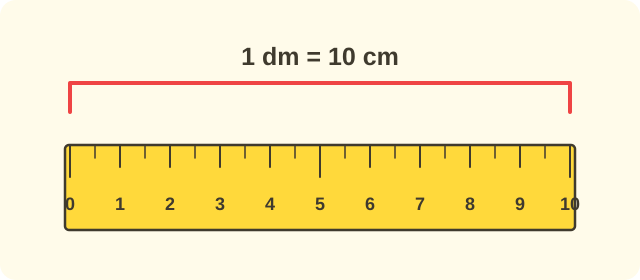

:::goals
- Biết các đơn vị đo độ dài đề-xi-mét (dm), mét (m), ki-lô-mét (km).
- Nhớ $1$ dm $=10$ cm, $1$ m $=10$ dm, $1$ km $=1000$ m và đổi giữa các đơn vị.
- Chọn đơn vị phù hợp để đo và làm tính với số đo độ dài.
:::

Nam đo chiều dài chiếc bàn học bằng gang tay và được $6$ gang. Mai đo cùng chiếc bàn ấy bằng gang tay của mình và được $7$ gang. Vì sao hai bạn đo ra hai số khác nhau?

Vì gang tay của mỗi người dài khác nhau. Muốn mọi người đo giống nhau, ta cần các đơn vị chuẩn. Em đã biết xăng-ti-mét (cm). Hôm nay em học thêm ba đơn vị mới.

## Cùng khám phá

Em dùng thước kẻ dài $10$ cm. Đoạn dài $10$ cm gọi là $1$ **đề-xi-mét**, viết tắt là dm.

- $1$ dm $=10$ cm.

Em cầm thước mét của cô giáo. Thước dài bằng $10$ thước kẻ $1$ dm đặt nối nhau. Độ dài này gọi là $1$ **mét**, viết tắt là m.

- $1$ m $=10$ dm.

Quãng đường rất dài như từ trường đến thành phố khác ta dùng **ki-lô-mét**, viết tắt là km.

- $1$ km $=1000$ m.

Ta ghi vào bảng:

| Đơn vị | Viết tắt | Đổi |
|---|---|---|
| đề-xi-mét | dm | $1$ dm $=10$ cm |
| mét | m | $1$ m $=10$ dm |
| ki-lô-mét | km | $1$ km $=1000$ m |

:::theorem Các đơn vị đo độ dài
- $1$ dm $=10$ cm.
- $1$ m $=10$ dm.
- $1$ km $=1000$ m.
:::

Đơn vị càng lớn thì càng dùng để đo vật càng dài: dm đo bàn, ghế; m đo lớp học, sân; km đo đường đi giữa các nơi xa nhau.

## Ví dụ

Ta bắt đầu với việc đổi mét ra đề-xi-mét.

:::example Đổi m ra dm
Đổi $3$ m ra dm.

**Lời giải.** Mỗi mét bằng $10$ dm, nên $3$ m là ba nhóm $10$ dm:
$$3\text{ m}=10+10+10=30\text{ dm}.$$
Vậy $3$ m $=30$ dm.
:::

Bây giờ em đổi ngược lại.

:::example Đổi dm ra m
Đổi $40$ dm ra m.

**Lời giải.** $10$ dm là $1$ m. Trong $40$ dm có $4$ nhóm $10$ dm:
$$40\text{ dm}=4\text{ m}.$$
Vậy $40$ dm $=4$ m.
:::

Tiếp theo em chọn đơn vị phù hợp.

:::example Chọn đơn vị
Chọn đơn vị dm, m hay km để đo: a) chiều dài sân trường; b) quãng đường từ Hà Nội đến Hải Phòng.

**Lời giải.** a) Sân trường dài hơn một lớp học nhưng không quá xa nên ta dùng mét. b) Quãng đường giữa hai thành phố rất dài nên ta dùng ki-lô-mét.

Vậy a) dùng m; b) dùng km.
:::

Cuối cùng em làm tính với số đo độ dài.

:::example Đi bộ
Sáng nay Nam đi bộ $3$ km, chiều nay Nam đi bộ $2$ km. Hỏi cả hai buổi Nam đi bộ bao nhiêu ki-lô-mét?

**Lời giải.** "Cả hai buổi" là gộp lại nên ta làm phép cộng, giữ nguyên đơn vị:
$$3+2=5\ \text{(km)}.$$
Vậy cả hai buổi Nam đi bộ $5$ km.
:::

:::warning Những lỗi em hay gặp
- **Nhầm mét với đề-xi-mét.** Sai: "$1$ m $=100$ dm". Vì sao sai: một mét bằng mười thước $1$ dm. Đúng: $1$ m $=10$ dm.
- **Quên đơn vị trong đáp số.** Sai: "Đáp số: $5$". Đúng: "Đáp số: $5$ km".
- **Dùng sai đơn vị.** Sai: "Chiếc bút dài $15$ km". Vì sao sai: km dùng cho đường rất dài. Đúng: chiếc bút dài $15$ cm.
:::

## Thuật ngữ

:::terms
- đề-xi-mét | decimetre
- mét | metre
- ki-lô-mét | kilometre
- xăng-ti-mét | centimetre
- độ dài | length
- đơn vị đo | unit of measurement
- viết tắt | abbreviation
:::

## Tóm tắt

- $1$ dm $=10$ cm; $1$ m $=10$ dm; $1$ km $=1000$ m.
- Dùng dm đo vật ngắn, m đo sân và lớp học, km đo đường dài.
- Làm tính với số đo thì giữ nguyên đơn vị và ghi đơn vị vào đáp số.

## Luyện tập

Mỗi bài có phần kiến thức và gợi ý. Em hãy tự làm trước, rồi mới bấm xem lời giải.

:::exercise
Điền số thích hợp.

a) $1$ dm $=\square$ cm.

b) $1$ m $=\square$ dm.

c) $1$ km $=\square$ m.

::hint
**Kiến thức:** nhớ bảng đổi đơn vị.

**Gợi ý các bước:**
1. Xem đơn vị lớn hơn đổi sang đơn vị nhỏ hơn nào.
2. Điền từng chỗ trống.

::solution
Một đề-xi-mét bằng mười xăng-ti-mét, một mét bằng mười đề-xi-mét, một ki-lô-mét bằng một nghìn mét.

**Đáp số.** a) $10$; b) $10$; c) $1000$.
:::

:::exercise
Đổi đơn vị.

a) $3$ m $=\square$ dm.

b) $50$ dm $=\square$ m.

c) $7$ dm $=\square$ cm.

::hint
**Kiến thức:** $1$ m $=10$ dm; $1$ dm $=10$ cm.

**Gợi ý các bước:**
1. Đổi sang đơn vị nhỏ hơn thì được số lớn hơn.
2. Đếm thêm theo $10$ hoặc chia thành các nhóm $10$.

::solution
a) $3\times10=30$. b) $50$ dm có $5$ nhóm $10$ dm nên là $5$ m. c) $7\times10=70$.

**Đáp số.** a) $30$; b) $5$; c) $70$.
:::

:::exercise
Em nhớ lại bài trước. Quãng đường A dài $450$ m, quãng đường B dài $405$ m. Điền dấu $>$, $<$ hoặc $=$ rồi cho biết quãng đường nào dài hơn.

::hint
**Kiến thức:** so sánh hàng trăm, rồi hàng chục.

**Gợi ý các bước:**
1. So sánh hàng trăm của $450$ và $405$.
2. Nếu bằng nhau, so sánh hàng chục.

::solution
Hàng trăm bằng nhau là $4$. Hàng chục $5>0$ nên $450>405$.

**Đáp số.** $450>405$; quãng đường A dài hơn.
:::

:::exercise
Tính.

a) $6$ dm $+3$ dm.

b) $15$ m $-8$ m.

c) $20$ km $-5$ km.

::hint
**Kiến thức:** tính như số bình thường, giữ nguyên đơn vị.

**Gợi ý các bước:**
1. Tính với các số.
2. Viết đơn vị vào kết quả.

::solution
a) $6+3=9$. b) $15-8=7$. c) $20-5=15$.

**Đáp số.** a) $9$ dm; b) $7$ m; c) $15$ km.
:::

:::exercise
Chọn đơn vị (dm, m hay km) thích hợp. Vì sao?

a) Chiều cao của cái bàn học.

b) Chiều dài sân trường.

c) Đường từ nhà em đến thành phố ở xa.

::hint
**Kiến thức:** dm đo vật ngắn, m đo sân và lớp học, km đo đường dài.

**Gợi ý các bước:**
1. Vật đó dài hay ngắn?
2. Chọn đơn vị phù hợp độ dài.

::solution
a) Bàn học không quá dài, chọn dm. b) Sân trường dài hơn bàn nhiều, chọn m. c) Đường đến thành phố rất dài, chọn km.

**Đáp số.** a) dm; b) m; c) km.
:::

:::exercise
Mai nói: "$1$ m $=100$ dm." Mai sai ở đâu? Sửa lại cho đúng.

::hint
**Kiến thức:** một mét bằng mười đề-xi-mét.

**Gợi ý các bước:**
1. Một thước mét bằng mấy thước $1$ dm nối nhau?
2. Sửa lại số.

::solution
Thước mét dài bằng $10$ thước $1$ dm, không phải $100$.

**Đáp số.** $1$ m $=10$ dm.
:::

:::exercise
Sáng nay Nam đi bộ $3$ km, chiều nay Nam đi bộ $2$ km. Hỏi cả hai buổi Nam đi bộ bao nhiêu ki-lô-mét?

::hint
**Kiến thức:** "cả hai buổi" nghĩa là gộp lại: dùng phép cộng.

**Gợi ý các bước:**
1. Đề cho biết gì? $3$ km và $2$ km. Đề hỏi gì? Tổng quãng đường.
2. Tính $3+2$ rồi ghi đáp số có đơn vị.

::solution
Quãng đường cả hai buổi là:
$$3+2=5\ \text{(km)}.$$

**Đáp số.** $5$ km.
:::

:::exercise Thử thách
Một sợi dây dài $3$ m. Người ta cắt thành các đoạn dài $5$ dm. Cắt được bao nhiêu đoạn?

::hint
**Kiến thức:** $3$ m $=30$ dm; chia đều: $30:5$.

**Gợi ý các bước:**
1. Đổi $3$ m ra dm.
2. Chia cho độ dài một đoạn.

::solution
$3$ m $=30$ dm. Số đoạn dây là $30:5=6$ (đoạn).

**Kiểm tra.** $6\times5=30$. Đúng.

**Đáp số.** $6$ đoạn.
:::

## Kiểm tra mini

:::quiz
::mc
$1$ m bằng
A. $1$ dm.
B. $10$ dm.
C. $100$ dm.
D. $1000$ dm.
::key B
$1$ m $=10$ dm. Phương án C là lỗi nhầm với $100$ cm.

::mc
Đơn vị nào thích hợp nhất để đo khoảng cách giữa hai thành phố?
A. cm.
B. dm.
C. m.
D. km.
::key D
Hai thành phố cách nhau rất xa nên dùng km.

::mc
$4$ m bằng
A. $4$ dm.
B. $14$ dm.
C. $40$ dm.
D. $400$ dm.
::key C
$4\times10=40$ dm. Phương án A quên đổi đơn vị.

::mc
$20$ dm bằng
A. $2$ m.
B. $20$ m.
C. $200$ m.
D. $2$ km.
::key A
$20$ dm có $2$ nhóm $10$ dm nên là $2$ m.

::tf
Em xét các đơn vị đo độ dài.
a) $1$ km $=1000$ m.
b) $1$ dm $=10$ cm.
c) $1$ m $=100$ dm.
d) Đo chiều dài chiếc bút bằng km.
::key Đ Đ S S
a) Đúng. b) Đúng. c) Sai: $1$ m $=10$ dm. d) Sai: chiếc bút ngắn nên dùng cm.

::sa
$5$ m bằng bao nhiêu đề-xi-mét?
::key 50
$5\times10=50$ (dm).

::sa
$60$ dm bằng bao nhiêu mét?
::key 6
$60$ dm có $6$ nhóm $10$ dm, tức $6$ m.
:::
