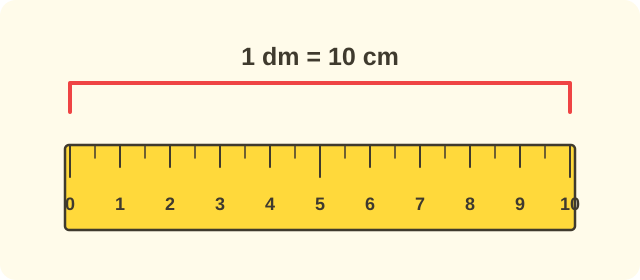

:::goals
- Biết các đơn vị đo độ dài đề-xi-mét (dm), mét (m), ki-lô-mét (km).
- Nhớ $1$ dm $=10$ cm, $1$ m $=10$ dm, $1$ km $=1000$ m và đổi giữa các đơn vị.
- Chọn đơn vị phù hợp để đo và làm tính với số đo độ dài.
:::

Nam đo chiều dài chiếc bàn học bằng gang tay và được $6$ gang. Mai đo cùng chiếc bàn ấy bằng gang tay của mình và được $7$ gang. Vì sao hai bạn đo ra hai số khác nhau?

Vì gang tay của mỗi người dài ngắn khác nhau, nên kết quả đo cũng khác nhau. Muốn ai đo cũng ra một kết quả, ta cần đơn vị chuẩn, nghĩa là một độ dài mà ai cũng dùng giống nhau. Em đã biết xăng-ti-mét (cm). Hôm nay em làm quen thêm ba đơn vị nữa, để đo được những thứ dài hơn nhiều.

## Cùng khám phá

Em dùng thước kẻ dài $10$ cm. Đoạn dài $10$ cm gọi là $1$ **đề-xi-mét**, viết tắt là dm.

- $1$ dm $=10$ cm.

Giờ em cầm thước mét của cô giáo. Thước này dài bằng $10$ thước kẻ $1$ dm đặt nối đuôi nhau. Độ dài ấy gọi là $1$ **mét**, viết tắt là m.

- $1$ m $=10$ dm.

Còn quãng đường rất dài, như từ trường em đến một thành phố khác, thì mét cũng chưa tiện. Với những quãng đường như thế ta dùng **ki-lô-mét**, viết tắt là km.

- $1$ km $=1000$ m.

Ta gom cả ba đơn vị vào một bảng để dễ nhớ:

| Đơn vị | Viết tắt | Đổi |
|---|---|---|
| đề-xi-mét | dm | $1$ dm $=10$ cm |
| mét | m | $1$ m $=10$ dm |
| ki-lô-mét | km | $1$ km $=1000$ m |

:::theorem Các đơn vị đo độ dài
- $1$ dm $=10$ cm.
- $1$ m $=10$ dm.
- $1$ km $=1000$ m.
:::

Đơn vị càng lớn thì ta dùng để đo những thứ càng dài. Em nhớ thế này: dm đo bàn, ghế; m đo lớp học, sân; km đo đường đi giữa các nơi xa nhau.

## Ví dụ

Ta thử đổi mét ra đề-xi-mét trước.

:::example Đổi m ra dm
Đổi $3$ m ra dm.

**Lời giải.** Mỗi mét bằng $10$ dm, nên $3$ m là ba nhóm $10$ dm:
$$3\text{ m}=10+10+10=30\text{ dm}.$$
Vậy $3$ m $=30$ dm.
:::

Đổi ngược lại, từ đề-xi-mét ra mét, thì ta gom các đề-xi-mét thành từng nhóm.

:::example Đổi dm ra m
Đổi $40$ dm ra m.

**Lời giải.** $10$ dm là $1$ m. Trong $40$ dm có $4$ nhóm $10$ dm:
$$40\text{ dm}=4\text{ m}.$$
Vậy $40$ dm $=4$ m.
:::

Biết đổi rồi, em còn phải biết đo vật nào thì dùng đơn vị nào cho hợp.

:::example Chọn đơn vị
Chọn đơn vị dm, m hay km để đo: a) chiều dài sân trường; b) quãng đường từ Hà Nội đến Hải Phòng.

**Lời giải.** a) Sân trường dài hơn một lớp học nhưng không quá xa nên ta dùng mét. b) Quãng đường giữa hai thành phố rất dài nên ta dùng ki-lô-mét.

Vậy a) dùng m; b) dùng km.
:::

Cuối cùng, ta làm tính với số đo độ dài, như khi Nam đi bộ.

:::example Đi bộ
Sáng nay Nam đi bộ $3$ km, chiều nay Nam đi bộ $2$ km. Hỏi cả hai buổi Nam đi bộ bao nhiêu ki-lô-mét?

**Lời giải.** "Cả hai buổi" là gộp lại nên ta làm phép cộng, giữ nguyên đơn vị:
$$3+2=5\ \text{(km)}.$$
Vậy cả hai buổi Nam đi bộ $5$ km.
:::

:::warning Những lỗi em hay gặp
- **Nhầm mét với đề-xi-mét.** Sai: "$1$ m $=100$ dm". Vì sao sai: một mét chỉ dài bằng mười thước $1$ dm đặt nối nhau. Đúng: $1$ m $=10$ dm.
- **Quên đơn vị trong đáp số.** Sai: "Đáp số: $5$". Vì sao sai: chỉ có số mà thiếu đơn vị thì chưa nói được độ dài là bao nhiêu. Đúng: "Đáp số: $5$ km".
- **Dùng sai đơn vị.** Sai: "Chiếc bút dài $15$ km". Vì sao sai: km chỉ dùng cho đường rất dài, không dùng cho chiếc bút. Đúng: chiếc bút dài $15$ cm.
:::

## Thuật ngữ

:::terms
- đề-xi-mét | decimetre
- mét | metre
- ki-lô-mét | kilometre
- xăng-ti-mét | centimetre
- độ dài | length
- đơn vị đo | unit of measurement
- viết tắt | abbreviation
:::

## Tóm tắt

- $1$ dm $=10$ cm; $1$ m $=10$ dm; $1$ km $=1000$ m.
- Dùng dm đo vật ngắn, m đo sân và lớp học, km đo đường dài.
- Làm tính với số đo thì giữ nguyên đơn vị và ghi đơn vị vào đáp số.
Quay lại câu hỏi đầu bài: vì sao Nam và Mai đo ra hai số khác nhau? Vì gang tay mỗi người dài khác nhau. Có đơn vị chuẩn như dm, m, km thì ai đo cũng ra cùng một kết quả. Em nhớ ghi đơn vị vào đáp số, rồi làm phần luyện tập nhé.

## Luyện tập

Mỗi bài có phần kiến thức cần nhớ và gợi ý cách bắt đầu. Em cứ tự làm trước. Làm chưa đúng cũng không sao, vì như thế em biết chỗ nào cần xem lại. Xong rồi hãy bấm xem lời giải.

:::exercise
Điền số thích hợp.

a) $1$ dm $=\square$ cm.

b) $1$ m $=\square$ dm.

c) $1$ km $=\square$ m.

::hint
**Kiến thức:** nhớ bảng đổi đơn vị.

**Gợi ý các bước:**
1. Xem đơn vị lớn hơn đổi sang đơn vị nhỏ hơn nào.
2. Điền từng chỗ trống.

::solution
Em nhớ lại mối quan hệ giữa các đơn vị đo độ dài:

a) Một đề-xi-mét dài bằng mười xăng-ti-mét, nên $1$ dm $=10$ cm.

b) Một mét dài bằng mười đề-xi-mét, nên $1$ m $=10$ dm.

c) Một ki-lô-mét dài bằng một nghìn mét, nên $1$ km $=1000$ m.

Vậy các số cần điền là $10$, $10$ và $1000$.

**Đáp số.** a) $10$; b) $10$; c) $1000$.
:::

:::exercise
Đổi đơn vị.

a) $3$ m $=\square$ dm.

b) $50$ dm $=\square$ m.

c) $7$ dm $=\square$ cm.

::hint
**Kiến thức:** $1$ m $=10$ dm; $1$ dm $=10$ cm.

**Gợi ý các bước:**
1. Đổi sang đơn vị nhỏ hơn thì được số lớn hơn.
2. Đếm thêm theo $10$ hoặc chia thành các nhóm $10$.

::solution
Em dùng $1$ m $=10$ dm và $1$ dm $=10$ cm.

a) Vì $1$ m $=10$ dm nên $3$ m gấp $3$ lần $10$ dm. Ta có
$$3\times10=30.$$
Vậy $3$ m $=30$ dm.

b) Mỗi $10$ dm bằng $1$ m. Số $50$ dm có $5$ nhóm $10$ dm nên bằng $5$ m.

Vậy $50$ dm $=5$ m.

c) Vì $1$ dm $=10$ cm nên $7$ dm gấp $7$ lần $10$ cm. Ta có
$$7\times10=70.$$
Vậy $7$ dm $=70$ cm.

**Đáp số.** a) $30$; b) $5$; c) $70$.
:::

:::exercise
Em nhớ lại bài trước. Quãng đường A dài $450$ m, quãng đường B dài $405$ m. Điền dấu $>$, $<$ hoặc $=$ rồi cho biết quãng đường nào dài hơn.

::hint
**Kiến thức:** so sánh hàng trăm, rồi hàng chục.

**Gợi ý các bước:**
1. So sánh hàng trăm của $450$ và $405$.
2. Nếu bằng nhau, so sánh hàng chục.

::solution
Để so sánh hai số có ba chữ số, em so sánh lần lượt từ hàng trăm.

Hai số $450$ và $405$ có hàng trăm bằng nhau, cùng là $4$.

Ta so sánh tiếp hàng chục: $5>0$, nên $450>405$.

Số đo quãng đường A là $450$ m, lớn hơn số đo quãng đường B là $405$ m.

Vậy $450>405$ và quãng đường A dài hơn.

**Đáp số.** $450>405$; quãng đường A dài hơn.
:::

:::exercise
Tính.

a) $6$ dm $+3$ dm.

b) $15$ m $-8$ m.

c) $20$ km $-5$ km.

::hint
**Kiến thức:** tính như số bình thường, giữ nguyên đơn vị.

**Gợi ý các bước:**
1. Tính với các số.
2. Viết đơn vị vào kết quả.

::solution
Các số đo cùng đơn vị nên em cộng, trừ các số rồi giữ nguyên đơn vị.

a) Ta có
$$6+3=9.$$
Vậy $6$ dm $+3$ dm $=9$ dm.

b) Ta có
$$15-8=7.$$
Vậy $15$ m $-8$ m $=7$ m.

c) Ta có
$$20-5=15.$$
Vậy $20$ km $-5$ km $=15$ km.

**Đáp số.** a) $9$ dm; b) $7$ m; c) $15$ km.
:::

:::exercise
Chọn đơn vị (dm, m hay km) thích hợp. Vì sao?

a) Chiều cao của cái bàn học.

b) Chiều dài sân trường.

c) Đường từ nhà em đến thành phố ở xa.

::hint
**Kiến thức:** dm đo vật ngắn, m đo sân và lớp học, km đo đường dài.

**Gợi ý các bước:**
1. Vật đó dài hay ngắn?
2. Chọn đơn vị phù hợp độ dài.

::solution
Em chọn đơn vị phù hợp với độ dài của vật cần đo.

a) Chiều cao của cái bàn học không quá dài, nên đo bằng đề-xi-mét. Chọn dm.

b) Sân trường dài hơn cái bàn học rất nhiều, nên đo bằng mét. Chọn m.

c) Đường từ nhà em đến thành phố ở xa rất dài, nên đo bằng ki-lô-mét. Chọn km.

Vậy đơn vị thích hợp là dm, m và km theo thứ tự các câu a), b), c).

**Đáp số.** a) dm; b) m; c) km.
:::

:::exercise
Mai nói: "$1$ m $=100$ dm." Mai sai ở đâu? Sửa lại cho đúng.

::hint
**Kiến thức:** một mét bằng mười đề-xi-mét.

**Gợi ý các bước:**
1. Một thước mét bằng mấy thước $1$ dm nối nhau?
2. Sửa lại số.

::solution
Em so sánh với thước mét: một thước mét dài bằng $10$ thước dài $1$ dm xếp nối nhau, không phải $100$ thước.

Do đó $1$ m $=10$ dm, còn $1$ m $=100$ dm là sai.

Mai sai ở chỗ nhầm số $10$ thành số $100$. (Số $100$ là số xăng-ti-mét trong $1$ m, tức là $1$ m $=100$ cm.)

Vậy câu đúng là $1$ m $=10$ dm.

**Đáp số.** $1$ m $=10$ dm.
:::

:::exercise
Sáng nay Nam đi bộ $3$ km, chiều nay Nam đi bộ $2$ km. Hỏi cả hai buổi Nam đi bộ bao nhiêu ki-lô-mét?

::hint
**Kiến thức:** "cả hai buổi" nghĩa là gộp lại: dùng phép cộng.

**Gợi ý các bước:**
1. Đề cho biết gì? $3$ km và $2$ km. Đề hỏi gì? Tổng quãng đường.
2. Tính $3+2$ rồi ghi đáp số có đơn vị.

::solution
Bài giải

Quãng đường Nam đi bộ cả hai buổi là:
$$3+2=5\ \text{(km)}$$

Vậy cả hai buổi Nam đi bộ $5$ km.

**Đáp số.** $5$ km.
:::

:::exercise Thử thách
Một sợi dây dài $3$ m. Người ta cắt thành các đoạn dài $5$ dm. Cắt được bao nhiêu đoạn?

::hint
**Kiến thức:** $3$ m $=30$ dm; chia đều: $30:5$.

**Gợi ý các bước:**
1. Đổi $3$ m ra dm.
2. Chia cho độ dài một đoạn.

::solution
Bài giải

Hai độ dài có đơn vị khác nhau nên em đổi về cùng một đơn vị. Ta có $1$ m $=10$ dm nên
$$3\ \text{m}=3\times10=30\ \text{(dm)}$$

Số đoạn dây cắt được là:
$$30:5=6\ \text{(đoạn)}$$

Kiểm tra: $6\times5=30$ (dm), đúng.

Vậy cắt được $6$ đoạn dây.

**Đáp số.** $6$ đoạn.
:::

## Kiểm tra mini

:::quiz
::mc NB
$1$ m bằng
A. $1$ dm.
B. $10$ dm.
C. $100$ dm.
D. $1000$ dm.
::key B
$1$ m $=10$ dm. Phương án C là lỗi nhầm với $100$ cm.

::mc TH
Đơn vị nào thích hợp nhất để đo khoảng cách giữa hai thành phố?
A. cm.
B. dm.
C. m.
D. km.
::key D
Hai thành phố cách nhau rất xa nên dùng km.

::mc TH
$4$ m bằng
A. $4$ dm.
B. $14$ dm.
C. $40$ dm.
D. $400$ dm.
::key C
$4\times10=40$ dm. Phương án A quên đổi đơn vị.

::mc TH
$20$ dm bằng
A. $2$ m.
B. $20$ m.
C. $200$ m.
D. $2$ km.
::key A
$20$ dm có $2$ nhóm $10$ dm nên là $2$ m.

::tf NB NB NB TH
Em xét các đơn vị đo độ dài.
a) $1$ km $=1000$ m.
b) $1$ dm $=10$ cm.
c) $1$ m $=100$ dm.
d) Đo chiều dài chiếc bút bằng km.
::key Đ Đ S S
a) Đúng. b) Đúng. c) Sai: $1$ m $=10$ dm. d) Sai: chiếc bút ngắn nên dùng cm.

::sa TH
$5$ m bằng bao nhiêu đề-xi-mét?
::key 50
$5\times10=50$ (dm).

::sa TH
$60$ dm bằng bao nhiêu mét?
::key 6
$60$ dm có $6$ nhóm $10$ dm, tức $6$ m.
:::
