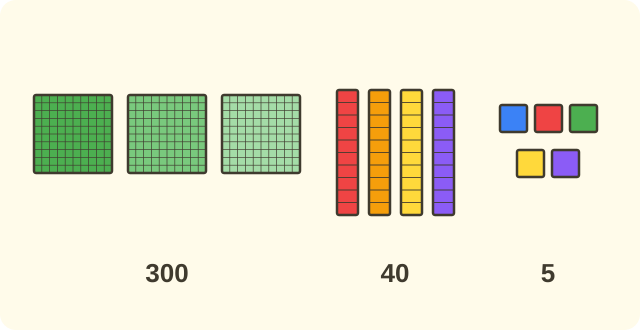

:::goals
- Viết số có ba chữ số thành tổng các trăm, chục, đơn vị, ví dụ $345=300+40+5$.
- Viết ngược lại: từ tổng các trăm, chục, đơn vị thành số.
- Viết đúng khi số có chữ số $0$, ví dụ $305=300+5$.
:::

Thư viện có $345$ quyển sách. Cô thủ thư xếp sách thành các thùng $100$ quyển, các bó $10$ quyển và các quyển lẻ. Hỏi cô dùng mấy thùng, mấy bó và mấy quyển lẻ?

Em đã biết số $345$ có $3$ trăm, $4$ chục, $5$ đơn vị. Bài này giúp em viết điều đó bằng một phép cộng.

## Cùng khám phá

Số $345$ gồm $3$ trăm, $4$ chục và $5$ đơn vị. Ta tính giá trị của từng phần:

- $3$ trăm là $300$.
- $4$ chục là $40$.
- $5$ đơn vị là $5$.

Cộng ba phần lại được $300+40+5=345$. Vậy ta viết:
$$345=300+40+5.$$

Cô thủ thư dùng $3$ thùng, $4$ bó và $5$ quyển lẻ.

:::theorem Viết số thành tổng
Số có ba chữ số $\overline{abc}$ viết thành tổng của số trăm, số chục và số đơn vị:
- chữ số hàng trăm $a$ cho $a$ trăm (ví dụ $3$ thì được $300$);
- chữ số hàng chục $b$ cho $b$ chục (ví dụ $4$ thì được $40$);
- chữ số hàng đơn vị $c$ cho $c$ đơn vị (ví dụ $5$ thì được $5$).
:::

Cách làm này đúng vì mỗi chữ số đứng ở một hàng, hàng cho biết giá trị của chữ số đó: chữ số $4$ ở hàng chục là $40$ chứ không phải $4$.

## Ví dụ

Ta bắt đầu với một số không có chữ số $0$.

:::example Viết số thành tổng
Viết số $453$ thành tổng các trăm, chục, đơn vị.

**Lời giải.** Số $453$ có chữ số $4$ ở hàng trăm, $5$ ở hàng chục, $3$ ở hàng đơn vị. Giá trị từng phần là $400$, $50$ và $3$:
$$453=400+50+3.$$
Vậy $453=400+50+3$.
:::

Bây giờ em làm ngược lại: từ tổng ra số.

:::example Từ tổng thành số
Viết số $700+60+2$.

**Lời giải.** $700$ là $7$ trăm, $60$ là $6$ chục, $2$ là $2$ đơn vị. Viết ba chữ số liền nhau: $7$, $6$, $2$:
$$700+60+2=762.$$
Vậy $700+60+2=762$.
:::

Tiếp theo là số có chữ số $0$.

:::example Số có chữ số 0
Viết số $805$ thành tổng các trăm, chục, đơn vị.

**Lời giải.** Số $805$ có $8$ trăm, $0$ chục, $5$ đơn vị. Hàng chục không có gì nên không cần viết phần chục:
$$805=800+5.$$
Vậy $805=800+5$.
:::

Cuối cùng em dùng kiến thức này giải một bài toán.

:::example Thùng, bó và quyển lẻ
Cửa hàng có $5$ thùng bút loại $100$ chiếc, $1$ bó bút loại $10$ chiếc và $9$ chiếc bút lẻ. Viết số bút thành tổng rồi cho biết có bao nhiêu chiếc bút.

**Lời giải.** $5$ thùng là $500$, $1$ bó là $10$, $9$ chiếc lẻ là $9$:
$$500+10+9=519.$$
Vậy cửa hàng có $519$ chiếc bút, và $519=500+10+9$.
:::

:::warning Những lỗi em hay gặp
- **Cộng các chữ số.** Sai: "$453=4+5+3$". Vì sao sai: $4+5+3=12$, không phải $453$. Đúng: $453=400+50+3$.
- **Quên giá trị của hàng.** Sai: "$345=300+4+5$". Vì sao sai: chữ số $4$ ở hàng chục là $40$. Đúng: $345=300+40+5$.
- **Viết sai khi có chữ số 0.** Sai: "$305=300+50$". Vì sao sai: $305$ có $0$ chục, $5$ là $5$ đơn vị. Đúng: $305=300+5$.
:::

## Thuật ngữ

:::terms
- tổng | sum
- hàng trăm | hundreds place
- hàng chục | tens place
- hàng đơn vị | ones place
- chữ số | digit
- giá trị | value
- phép cộng | addition
:::

## Tóm tắt

- Viết số thành tổng: số trăm + số chục + số đơn vị, ví dụ $345=300+40+5$.
- Chữ số ở hàng nào thì có giá trị của hàng đó: $4$ ở hàng chục là $40$.
- Hàng nào là $0$ thì có thể bỏ khỏi tổng: $305=300+5$.
- Từ tổng $300+40+5$ viết ngược lại thành số $345$.

## Luyện tập

Mỗi bài có phần kiến thức và gợi ý. Em hãy tự làm trước, rồi mới bấm xem lời giải.

:::exercise
Viết thành tổng các trăm, chục, đơn vị.

a) $236$.

b) $910$.

::hint
**Kiến thức:** mỗi chữ số có giá trị của hàng nó đứng.

**Gợi ý các bước:**
1. Viết giá trị của chữ số hàng trăm, hàng chục, hàng đơn vị.
2. Hàng nào là $0$ thì bỏ.

::solution
a) $236$ có $2$ trăm, $3$ chục, $6$ đơn vị. b) $910$ có $9$ trăm, $1$ chục, $0$ đơn vị.

**Đáp số.** a) $236=200+30+6$; b) $910=900+10$.
:::

:::exercise
Viết số.

a) $400+50+7$.

b) $800+20$.

::hint
**Kiến thức:** số trăm, số chục, số đơn vị là các chữ số của số.

**Gợi ý các bước:**
1. Xem mỗi số hạng có bao nhiêu trăm, chục, đơn vị.
2. Hàng nào thiếu thì viết chữ số $0$.

::solution
a) $4$ trăm, $5$ chục, $7$ đơn vị. b) $8$ trăm, $2$ chục, $0$ đơn vị.

**Đáp số.** a) $457$; b) $820$.
:::

:::exercise
Em nhớ lại bài trước. Số có chữ số hàng trăm là $6$, hàng chục là $0$, hàng đơn vị là $4$. Viết số đó rồi viết thành tổng.

::hint
**Kiến thức:** viết lần lượt chữ số hàng trăm, chục, đơn vị.

**Gợi ý các bước:**
1. Viết ba chữ số liền nhau.
2. Viết thành tổng, bỏ phần chục vì bằng $0$.

::solution
Số đó là $604$. Ta có $604=600+4$.

**Đáp số.** $604=600+4$.
:::

:::exercise
Điền số thích hợp vào chỗ trống.

a) $500+\square+3=573$.

b) $\square+40+2=942$.

::hint
**Kiến thức:** nhìn chữ số của số bên phải.

**Gợi ý các bước:**
1. Tìm chữ số ở hàng cần điền.
2. Viết giá trị của chữ số đó.

::solution
a) $573$ có $7$ ở hàng chục, giá trị $70$. b) $942$ có $9$ ở hàng trăm, giá trị $900$.

**Đáp số.** a) $70$; b) $900$.
:::

:::exercise
Cách viết nào đúng cho số $372$: $3+7+2$, $30+70+2$ hay $300+70+2$? Vì sao?

::hint
**Kiến thức:** chữ số $3$ ở hàng trăm có giá trị $300$.

**Gợi ý các bước:**
1. Giá trị của $3$, $7$, $2$ ở mỗi hàng là bao nhiêu?
2. Cộng các giá trị lại.

::solution
$3$ ở hàng trăm là $300$, $7$ ở hàng chục là $70$, $2$ ở hàng đơn vị là $2$. Cộng lại được $372$.

**Đáp số.** $372=300+70+2$.
:::

:::exercise
Lan viết "$305=300+50$". Lan sai ở đâu? Sửa lại cho đúng.

::hint
**Kiến thức:** $305$ có $0$ chục.

**Gợi ý các bước:**
1. $300+50$ bằng bao nhiêu?
2. $305$ có mấy chục, mấy đơn vị?

::solution
$300+50=350$, không phải $305$. Số $305$ có $3$ trăm, $0$ chục, $5$ đơn vị.

**Đáp số.** $305=300+5$.
:::

:::exercise
Thư viện có $4$ thùng sách loại $100$ quyển, $6$ bó sách loại $10$ quyển và $8$ quyển lẻ. Hỏi có bao nhiêu quyển sách? Viết thành tổng.

::hint
**Kiến thức:** mỗi thùng là $100$, mỗi bó là $10$.

**Gợi ý các bước:**
1. Đề cho biết gì? $4$ trăm, $6$ chục, $8$ đơn vị. Đề hỏi gì? Số quyển sách.
2. Viết tổng rồi ghi đáp số có đơn vị.

::solution
Tổng là $400+60+8=468$.

**Đáp số.** $468$ quyển sách; $468=400+60+8$.
:::

:::exercise Thử thách
Tìm số có ba chữ số có dạng $400+\square0+\square$, biết chữ số hàng chục bằng chữ số hàng đơn vị và hàng đơn vị là $8$.

::hint
**Kiến thức:** hàng đơn vị là $8$, hàng chục cũng là $8$.

**Gợi ý các bước:**
1. Tìm chữ số hàng chục.
2. Viết số rồi viết thành tổng.

::solution
Chữ số hàng chục là $8$, nên phần chục là $80$. Ta có $400+80+8=488$.

**Kiểm tra.** $488$ có hàng chục và hàng đơn vị đều là $8$. Đúng.

**Đáp số.** $488$.
:::

## Kiểm tra mini

:::quiz
::mc
Số $345$ viết thành tổng là
A. $300+40+5$.
B. $3+4+5$.
C. $30+40+5$.
D. $3+40+500$.
::key A
$3$ trăm là $300$, $4$ chục là $40$, $5$ đơn vị là $5$. Phương án B là lỗi cộng các chữ số.

::mc
$600+20+8$ bằng
A. $682$.
B. $628$.
C. $6208$.
D. $862$.
::key B
$6$ trăm, $2$ chục, $8$ đơn vị là $628$. Phương án A đổi chỗ hàng chục và hàng đơn vị.

::mc
Số $807$ viết thành tổng là
A. $80+7$.
B. $800+70$.
C. $800+7$.
D. $8+0+7$.
::key C
$807$ có $8$ trăm, $0$ chục, $7$ đơn vị. Phương án B là $870$.

::mc
Số $510$ viết thành tổng là
A. $5+1+0$.
B. $50+10$.
C. $500+1$.
D. $500+10$.
::key D
$5$ ở hàng trăm là $500$, $1$ ở hàng chục là $10$. Phương án C là $501$.

::tf
Em xét số $726$.
a) $726=700+20+6$.
b) $726=7+2+6$.
c) $726=700+26$.
d) $726=70+20+6$.
::key Đ S Đ S
a) Đúng. b) Sai: $7+2+6=15$. c) Đúng: $20+6=26$. d) Sai: $70+20+6=96$.

::sa
Tính $400+90+3$.
::key 493
$4$ trăm, $9$ chục, $3$ đơn vị là $493$.

::sa
Số nào điền vào chỗ trống: $200+\square+9=259$?
::key 50
$259$ có $5$ ở hàng chục, giá trị $50$.
:::
