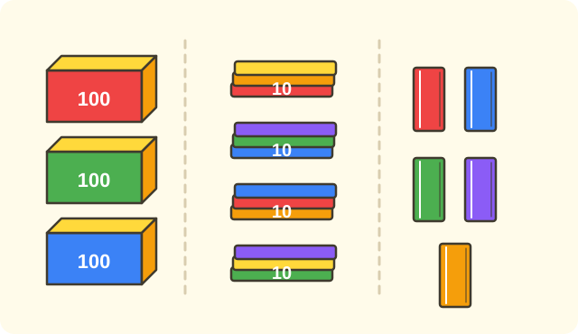

:::goals
- Đọc và viết các số có ba chữ số, ví dụ $345$, $205$.
- Biết chữ số hàng trăm, hàng chục, hàng đơn vị của một số.
- Viết đúng số có chữ số $0$, ví dụ $3$ trăm $0$ chục $7$ đơn vị là $307$.
:::

Thư viện có $3$ thùng sách, mỗi thùng $100$ quyển, thêm $4$ bó sách, mỗi bó $10$ quyển, và $5$ quyển sách lẻ. Hỏi thư viện có tất cả bao nhiêu quyển sách?

Sách có thể đóng thùng, buộc bó hay để lẻ. Em đã biết trăm, chục, đơn vị. Bây giờ ta ghép chúng lại thành một số có ba chữ số, để nói được ngay thư viện có bao nhiêu quyển mà không phải đếm từng quyển.

## Cùng khám phá

Ta xếp từng loại sách vào một cột của bảng:

| Trăm | Chục | Đơn vị |
|---|---|---|
| $3$ | $4$ | $5$ |

Thư viện có $3$ trăm, $4$ chục và $5$ đơn vị. Ta viết các chữ số liền nhau, từ trái sang phải. Chữ số $3$ ở hàng trăm, chữ số $4$ ở hàng chục, chữ số $5$ ở hàng đơn vị. Ta được số $345$.

Số $345$ đọc là "ba trăm bốn mươi lăm". Vậy thư viện có $345$ quyển sách, và ta không cần đếm từng quyển.

:::theorem Số có ba chữ số
Số có ba chữ số có:
- chữ số hàng trăm (bên trái), cho biết có bao nhiêu trăm;
- chữ số hàng chục (ở giữa), cho biết có bao nhiêu chục;
- chữ số hàng đơn vị (bên phải), cho biết có bao nhiêu đơn vị.

Nếu một hàng không có gì thì ta viết chữ số $0$ vào hàng đó.
:::

Vì sao phải viết chữ số $0$? Để các chữ số khác đứng đúng chỗ của chúng. Ví dụ $3$ trăm và $7$ đơn vị là $307$. Nếu bỏ chữ số $0$ đi thì $37$ chỉ là $3$ chục $7$ đơn vị, nhỏ hơn rất nhiều.

## Ví dụ

Ta thử đọc xem mỗi chữ số của một số đứng ở hàng nào.

:::example Các chữ số của 345
Số $345$ có chữ số hàng trăm, hàng chục, hàng đơn vị là gì?

**Lời giải.** Viết số vào bảng, từ trái sang phải là trăm, chục, đơn vị:

| Trăm | Chục | Đơn vị |
|---|---|---|
| $3$ | $4$ | $5$ |

Vậy chữ số hàng trăm là $3$, hàng chục là $4$, hàng đơn vị là $5$.
:::

Bây giờ ta làm ngược lại: cho các nhóm, em viết thành số.

:::example Viết số
Viết số gồm $6$ trăm, $2$ chục và $8$ đơn vị.

**Lời giải.** Viết chữ số trăm, rồi chữ số chục, rồi chữ số đơn vị: $6$, $2$, $8$.

Vậy số cần viết là $628$, đọc là "sáu trăm hai mươi tám".
:::

Còn một trường hợp nhiều bạn hay lúng túng: số có chữ số $0$.

:::example Số có chữ số 0
Viết số gồm $3$ trăm, $0$ chục và $7$ đơn vị.

**Lời giải.** Hàng chục không có gì, nên ta viết chữ số $0$ ở hàng chục: $3$, $0$, $7$.

Vậy số cần viết là $307$, đọc là "ba trăm linh bảy".
:::

Cuối cùng, em dùng cách viết số này để trả lời một bài toán ở cửa hàng bút.

:::example Cửa hàng bút
Cửa hàng có $5$ hộp bút loại $100$ chiếc, $3$ bó bút loại $10$ chiếc và $6$ chiếc bút lẻ. Hỏi cửa hàng có bao nhiêu chiếc bút?

**Lời giải.** Có $5$ trăm, $3$ chục và $6$ đơn vị. Viết chữ số: $5$, $3$, $6$.

Vậy cửa hàng có $536$ chiếc bút.
:::

:::warning Những lỗi em hay gặp
- **Quên chữ số 0.** Chỗ này nhiều bạn hay nhầm. Sai: "$3$ trăm $7$ đơn vị là $37$". Vì sao sai: $37$ chỉ có $3$ chục. Đúng: $3$ trăm $0$ chục $7$ đơn vị là $307$.
- **Viết sai thứ tự chữ số.** Sai: "$4$ trăm $3$ chục $5$ đơn vị là $435$ hay $453$ đều được". Vì sao sai: đổi chỗ chữ số thì được số khác, vì mỗi chữ số có giá trị theo hàng nó đứng. Đúng: chỉ có $435$.
- **Nhầm hàng của chữ số.** Sai: "chữ số $5$ trong $450$ là $5$ đơn vị". Vì sao sai: $5$ đứng ở hàng chục. Đúng: chữ số $5$ trong $450$ là $5$ chục.
:::

## Thuật ngữ

:::terms
- số có ba chữ số | three-digit number
- chữ số | digit
- hàng trăm | hundreds place
- hàng chục | tens place
- hàng đơn vị | ones place
- đọc số | read a number
- viết số | write a number
:::

## Tóm tắt

- Số có ba chữ số gồm chữ số hàng trăm, hàng chục, hàng đơn vị (từ trái sang phải).
- $3$ trăm $4$ chục $5$ đơn vị là $345$, đọc là ba trăm bốn mươi lăm.
- Hàng nào không có gì thì viết chữ số $0$.
- Đổi chỗ các chữ số thì được số khác.

Vậy thư viện có $345$ quyển sách. Mỗi chữ số cho ta biết có bao nhiêu trăm, bao nhiêu chục, bao nhiêu đơn vị. Em làm thêm vài bài ở phần luyện tập để đọc và viết số cho quen nhé.

## Luyện tập

Mỗi bài đều có phần cần nhớ và gợi ý để em bắt đầu. Em cứ tự làm trước, chưa chắc thì xem gợi ý, làm xong rồi mới bấm xem lời giải. Sai một chút cũng không sao, vì mỗi lần sửa lại là một lần em hiểu rõ hơn.

:::exercise
Cho số $482$. Tìm:

a) chữ số hàng trăm.

b) chữ số hàng chục.

c) chữ số hàng đơn vị.

::hint
**Kiến thức:** từ trái sang phải là hàng trăm, hàng chục, hàng đơn vị.

**Gợi ý các bước:**
1. Viết số vào bảng trăm, chục, đơn vị.
2. Đọc từng chữ số.

::solution
Số $482$ gồm $4$ trăm, $8$ chục và $2$ đơn vị.

a) Chữ số ở hàng trăm là $4$.

b) Chữ số ở hàng chục là $8$.

c) Chữ số ở hàng đơn vị là $2$.

Vậy số $482$ có chữ số hàng trăm là $4$, chữ số hàng chục là $8$ và chữ số hàng đơn vị là $2$.

**Đáp số.** a) $4$; b) $8$; c) $2$.
:::

:::exercise
Viết số.

a) $5$ trăm, $3$ chục, $6$ đơn vị.

b) $9$ trăm, $1$ chục, $4$ đơn vị.

::hint
**Kiến thức:** viết lần lượt chữ số trăm, chục, đơn vị.

**Gợi ý các bước:**
1. Lấy số trăm, số chục, số đơn vị.
2. Viết ba chữ số liền nhau.

::solution
Để viết số có ba chữ số, ta viết lần lượt chữ số hàng trăm, chữ số hàng chục, chữ số hàng đơn vị.

a) $5$ trăm, $3$ chục, $6$ đơn vị cho ta các chữ số $5$, $3$, $6$ nên số cần viết là $536$.

b) $9$ trăm, $1$ chục, $4$ đơn vị cho ta các chữ số $9$, $1$, $4$ nên số cần viết là $914$.

Vậy a) số cần viết là $536$; b) số cần viết là $914$.

**Đáp số.** a) $536$; b) $914$.
:::

:::exercise
Em nhớ lại bài trước. Trong các số $60, 300, 90, 700$, những số nào có ba chữ số? Điền dấu $>$, $<$ hoặc $=$: $300\;\square\;700$.

::hint
**Kiến thức:** số tròn trăm có ba chữ số; so sánh số trăm.

**Gợi ý các bước:**
1. Đếm số chữ số của từng số.
2. So sánh $3$ trăm và $7$ trăm.

::solution
Số có ba chữ số là số có hàng trăm, tức là các số từ $100$ đến $999$.

Các số $60$ và $90$ chỉ có hàng chục và hàng đơn vị nên có hai chữ số. Các số $300$ và $700$ có hàng trăm nên có ba chữ số.

Để so sánh $300$ và $700$, ta so sánh chữ số hàng trăm của hai số. Vì $3$ trăm bé hơn $7$ trăm nên $300<700$.

Vậy các số có ba chữ số là $300$ và $700$; dấu cần điền là $<$, ta có $300<700$.

**Đáp số.** $300$, $700$; $300<700$.
:::

:::exercise
Mỗi số gồm bao nhiêu trăm, chục, đơn vị?

a) $705$.

b) $250$.

::hint
**Kiến thức:** chữ số $0$ nghĩa là hàng đó không có gì.

**Gợi ý các bước:**
1. Đọc từng chữ số từ trái sang phải.
2. Ghi số trăm, số chục, số đơn vị.

::solution
Với mỗi số, ta xem chữ số ở hàng trăm, hàng chục và hàng đơn vị.

a) Số $705$ có chữ số hàng trăm là $7$, hàng chục là $0$, hàng đơn vị là $5$. Do đó $705$ gồm $7$ trăm, $0$ chục, $5$ đơn vị.

b) Số $250$ có chữ số hàng trăm là $2$, hàng chục là $5$, hàng đơn vị là $0$. Do đó $250$ gồm $2$ trăm, $5$ chục, $0$ đơn vị.

Vậy a) $705$ gồm $7$ trăm, $0$ chục, $5$ đơn vị; b) $250$ gồm $2$ trăm, $5$ chục, $0$ đơn vị.

**Đáp số.** a) $7$ trăm $0$ chục $5$ đơn vị; b) $2$ trăm $5$ chục $0$ đơn vị.
:::

:::exercise
Muốn viết "hai trăm linh sáu", em chọn số nào trong $26$, $206$, $260$? Vì sao?

::hint
**Kiến thức:** "linh" nghĩa là hàng chục không có gì.

**Gợi ý các bước:**
1. Hai trăm là mấy trăm?
2. Hàng chục có gì không? Hàng đơn vị là mấy?

::solution
Số "hai trăm linh sáu" có $2$ trăm. Chữ "linh" cho biết hàng chục là $0$, và có $6$ đơn vị.

Vậy số này có chữ số hàng trăm là $2$, hàng chục là $0$, hàng đơn vị là $6$. Ta viết các chữ số $2$, $0$, $6$ được số $206$.

Các số còn lại không đúng: $26$ chỉ có hai chữ số ($2$ chục $6$ đơn vị); $260$ có $2$ trăm $6$ chục $0$ đơn vị, đọc là hai trăm sáu mươi.

Vậy em chọn số $206$ vì số đó gồm $2$ trăm, $0$ chục, $6$ đơn vị.

**Đáp số.** $206$.
:::

:::exercise
Mai viết "$4$ trăm $5$ đơn vị là $45$". Mai sai ở đâu? Sửa lại cho đúng.

::hint
**Kiến thức:** hàng chục không có gì thì viết chữ số $0$.

**Gợi ý các bước:**
1. $45$ có mấy chục?
2. Viết lại số đủ ba chữ số.

::solution
Số $45$ có hai chữ số: $4$ ở hàng chục và $5$ ở hàng đơn vị, nên $45$ là $4$ chục $5$ đơn vị. Vì vậy Mai đã viết $4$ trăm thành $4$ chục.

Số cần viết có $4$ trăm, không có chục (tức $0$ chục) và $5$ đơn vị. Ta viết các chữ số $4$, $0$, $5$ theo thứ tự hàng trăm, hàng chục, hàng đơn vị.

Kiểm tra: số $405$ có $4$ trăm, $0$ chục, $5$ đơn vị. Đúng.

Vậy Mai sai ở chỗ viết $4$ trăm thành $4$ chục và bỏ quên chữ số $0$ ở hàng chục; $4$ trăm $5$ đơn vị phải viết là $405$.

**Đáp số.** $405$.
:::

:::exercise
Có $3$ hộp bi loại $100$ viên, $4$ túi bi loại $10$ viên và $7$ viên bi lẻ. Hỏi có tất cả bao nhiêu viên bi?

::hint
**Kiến thức:** ghép số trăm, số chục, số đơn vị thành một số.

**Gợi ý các bước:**
1. Đề cho biết gì? $3$ trăm, $4$ chục, $7$ đơn vị. Đề hỏi gì? Số viên bi.
2. Viết số rồi ghi đáp số có đơn vị.

::solution
Bài giải

$3$ hộp bi loại $100$ viên là $3$ trăm viên bi, $4$ túi bi loại $10$ viên là $4$ chục viên bi, và còn $7$ viên bi lẻ là $7$ đơn vị.

Số viên bi có tất cả là:
$$300+40+7=347\ \text{(viên)}.$$

Vậy có tất cả $347$ viên bi.

**Đáp số.** $347$ viên bi.
:::

:::exercise Thử thách
Dùng ba chữ số $2$, $5$, $8$, mỗi chữ số dùng đúng một lần, lập số có ba chữ số lớn nhất và số có ba chữ số bé nhất.

::hint
**Kiến thức:** chữ số hàng trăm càng lớn thì số càng lớn.

**Gợi ý các bước:**
1. Số lớn nhất: đặt chữ số lớn nhất ở hàng trăm, rồi hàng chục.
2. Số bé nhất: làm ngược lại.

::solution
Để lập số lớn nhất, ta xếp chữ số lớn nhất ở hàng cao nhất: hàng trăm là $8$, hàng chục là $5$, hàng đơn vị là $2$. Ta được số $852$.

Để lập số bé nhất, ta xếp chữ số bé nhất ở hàng cao nhất: hàng trăm là $2$, hàng chục là $5$, hàng đơn vị là $8$. Ta được số $258$.

Kiểm tra: hai số đều có ba chữ số; so sánh chữ số hàng trăm, $2<8$ nên $258<852$. Đúng.

Vậy số lớn nhất là $852$ và số bé nhất là $258$.

**Đáp số.** Số lớn nhất là $852$, số bé nhất là $258$.
:::

## Kiểm tra mini

:::quiz
::mc NB
Chữ số hàng chục của số $527$ là
A. $5$.
B. $2$.
C. $7$.
D. $527$.
::key B
Từ trái sang phải: $5$ hàng trăm, $2$ hàng chục, $7$ hàng đơn vị. Phương án A là chữ số hàng trăm.

::mc TH
Số gồm $4$ trăm, $0$ chục và $6$ đơn vị là
A. $46$.
B. $460$.
C. $406$.
D. $640$.
::key C
Hàng chục không có gì nên viết $0$: $406$. Phương án A bỏ mất chữ số $0$.

::mc NB
Số nào sau đây là số có ba chữ số?
A. $99$.
B. $9$.
C. $10$.
D. $100$.
::key D
$100$ có ba chữ số $1$, $0$, $0$. Các số còn lại có ít chữ số hơn.

::mc NB
Số $318$ gồm
A. $3$ trăm $1$ chục $8$ đơn vị.
B. $8$ trăm $1$ chục $3$ đơn vị.
C. $3$ chục $1$ trăm $8$ đơn vị.
D. $31$ trăm $8$ đơn vị.
::key A
Từ trái sang phải: $3$ trăm, $1$ chục, $8$ đơn vị. Phương án B đọc ngược thứ tự.

::tf NB NB NB NB
Em xét số $645$.
a) Chữ số hàng trăm là $6$.
b) Chữ số hàng chục là $5$.
c) Chữ số hàng đơn vị là $5$.
d) $645$ là số có ba chữ số.
::key Đ S Đ Đ
a) Đúng. b) Sai: chữ số hàng chục là $4$. c) Đúng. d) Đúng.

::sa NB
Chữ số hàng chục của số $982$ là chữ số nào?
::key 8
Số $982$ có $9$ trăm, $8$ chục, $2$ đơn vị.

::sa TH
Viết số gồm $5$ trăm, $0$ chục và $9$ đơn vị.
::key 509
Chữ số: $5$, $0$, $9$.
:::
