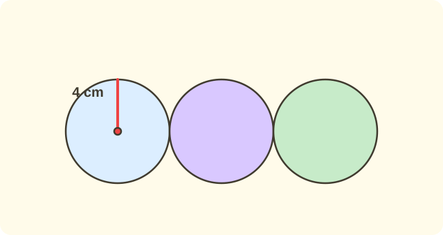

:::goals
- Nhận biết hình tròn, tâm, bán kính và đường kính.
- Biết mọi bán kính của một hình tròn bằng nhau và đường kính gấp đôi bán kính.
- Tính bán kính từ đường kính (và ngược lại), vẽ hình tròn bằng com-pa.
:::

Nam dùng com-pa vẽ một hình tròn. Bạn đặt đầu nhọn của com-pa tại điểm $O$ và mở com-pa ra $3$ cm. Hỏi hình tròn Nam vẽ có đường kính bao nhiêu xăng-ti-mét?

Bài này giúp em gọi tên các phần của hình tròn và trả lời câu hỏi trên.

## Cùng khám phá

Khi vẽ bằng com-pa, đầu nhọn đứng yên tại điểm $O$, đầu bút xoay một vòng. Mọi điểm trên đường vẽ đều cách $O$ một khoảng như nhau, bằng độ mở com-pa.

:::diagram Hình tròn tâm O: bán kính OA, OC và đường kính AB
alt: Hình tròn tâm O bán kính 3; đoạn AB nằm ngang đi qua O với hai đầu trên đường tròn; đoạn OC đi từ O lên điểm C trên đường tròn
point O 0,0 below
point A 3,0 right
point B -3,0 left
point C 0,3 above
circle O 3
segment A B
segment O C
:::

Em quan sát hình:

- Điểm $O$ là **tâm** của hình tròn.
- Đoạn thẳng nối tâm $O$ với một điểm trên đường tròn (như $OA$, $OB$, $OC$) là **bán kính**.
- Đoạn thẳng $AB$ đi qua tâm $O$ và có hai đầu trên đường tròn là **đường kính**.

Đường kính $AB$ gồm hai bán kính $OA$ và $OB$, nên đường kính dài gấp đôi bán kính. Tâm $O$ là trung điểm của đường kính $AB$.

:::theorem Bán kính và đường kính
Trong một hình tròn:

- Mọi bán kính đều bằng nhau.
- Đường kính gấp đôi bán kính: đường kính $=$ bán kính $\times2$.
- Bán kính bằng một nửa đường kính: bán kính $=$ đường kính $:2$.
:::

Điều này đúng vì mọi điểm trên đường tròn cách tâm một khoảng bằng độ mở com-pa, và đường kính gồm hai bán kính nối đuôi nhau.

Với com-pa mở $3$ cm, bán kính là $3$ cm, nên đường kính là $3\times2=6$ cm.

## Ví dụ

Ta bắt đầu bằng việc gọi tên các đoạn thẳng.

:::example Gọi tên
Cho hình tròn tâm $O$. Các điểm $A$, $B$, $C$ nằm trên đường tròn, điểm $O$ nằm trên đoạn thẳng $AB$. Gọi tên các đoạn $OA$, $AB$, $OC$.

**Lời giải.** $OA$ nối tâm với một điểm trên đường tròn, nên $OA$ là bán kính. $AB$ đi qua tâm và có hai đầu trên đường tròn, nên $AB$ là đường kính. $OC$ nối tâm với điểm $C$ trên đường tròn, nên $OC$ là bán kính.

Vậy $OA$, $OC$ là bán kính; $AB$ là đường kính.
:::

Bây giờ em tính đường kính từ bán kính.

:::example Từ bán kính đến đường kính
Hình tròn có bán kính $5$ cm. Tính đường kính.

**Lời giải.** Đường kính gấp đôi bán kính, nên ta nhân bán kính với $2$:
$$5\times2=10\ \text{(cm)}.$$
**Thử lại.** $10:2=5$. Đúng.

Vậy đường kính là $10$ cm.
:::

Làm ngược lại, em tính bán kính từ đường kính.

:::example Từ đường kính đến bán kính
Hình tròn có đường kính $14$ cm. Tính bán kính.

**Lời giải.** Bán kính bằng một nửa đường kính, nên ta chia đường kính cho $2$:
$$14:2=7\ \text{(cm)}.$$
**Thử lại.** $7\times2=14$. Đúng.

Vậy bán kính là $7$ cm.
:::

Tiếp theo, em giải một bài toán trong cuộc sống.

:::example Chiếc đĩa
Một chiếc đĩa tròn có bán kính $9$ cm. Hỏi đường kính của chiếc đĩa là bao nhiêu xăng-ti-mét?

**Lời giải.** Đường kính gấp đôi bán kính, nên đường kính là:
$$9\times2=18\ \text{(cm)}.$$
**Thử lại.** $18:2=9$. Đúng.

Vậy đường kính của chiếc đĩa là $18$ cm.
:::

Cuối cùng, em dùng com-pa để vẽ.

:::example Vẽ hình tròn
Muốn vẽ hình tròn có đường kính $8$ cm, em cần mở com-pa bao nhiêu xăng-ti-mét?

**Lời giải.** Độ mở com-pa chính là bán kính. Bán kính bằng một nửa đường kính:
$$8:2=4\ \text{(cm)}.$$
**Thử lại.** $4\times2=8$. Đúng.

Vậy em cần mở com-pa $4$ cm.
:::

:::warning Những lỗi em hay gặp
- **Nhầm bán kính với đường kính.** Sai: hình tròn có bán kính $5$ cm thì đường kính cũng $5$ cm. Vì sao sai: đường kính gồm hai bán kính. Đúng: đường kính là $5\times2=10$ cm.
- **Cho rằng đoạn nào nối hai điểm trên đường tròn cũng là đường kính.** Sai: đoạn $AC$ nối hai điểm trên đường tròn nên là đường kính. Vì sao sai: đường kính phải đi qua tâm $O$. Đúng: chỉ đoạn nối hai điểm trên đường tròn và đi qua tâm mới là đường kính.
- **Quên chia đôi hoặc nhân đôi.** Sai: đường kính $14$ cm thì bán kính $14$ cm. Vì sao sai: bán kính chỉ bằng một nửa. Đúng: $14:2=7$ cm.
- **Quên đơn vị.** Sai: "Đáp số: $10$". Đúng: "Đáp số: $10$ cm".
:::

## Thuật ngữ

:::terms
- hình tròn | circle
- tâm | centre
- bán kính | radius
- đường kính | diameter
- đường tròn | circumference (the curve of the circle)
- com-pa | compasses
- độ mở com-pa | opening of the compasses
- gấp đôi | double
:::

## Tóm tắt

- Điểm $O$ là tâm; mọi điểm trên đường tròn cách $O$ một khoảng bằng nhau.
- Bán kính nối tâm với một điểm trên đường tròn; mọi bán kính bằng nhau.
- Đường kính đi qua tâm và có hai đầu trên đường tròn; tâm là trung điểm của đường kính.
- Đường kính $=$ bán kính $\times2$; bán kính $=$ đường kính $:2$.
- Độ mở com-pa bằng bán kính; ghi đơn vị trong đáp số.

## Luyện tập

Mỗi bài có phần kiến thức và gợi ý. Em hãy tự làm trước, rồi mới bấm xem lời giải.

:::exercise
Cho hình tròn tâm $O$. Các điểm $A$, $B$ nằm trên đường tròn và $O$ nằm trên đoạn thẳng $AB$.

a) $OA$ là gì?

b) $AB$ là gì?

c) $OB$ so với $OA$ như thế nào?

::hint
**Kiến thức:** bán kính nối tâm với điểm trên đường tròn; đường kính đi qua tâm; mọi bán kính bằng nhau.

**Gợi ý các bước:**
1. Đoạn thẳng đó có đầu nào là tâm không?
2. Có đi qua tâm và hai đầu trên đường tròn không?

::solution
a) $OA$ là bán kính.

b) $AB$ là đường kính.

c) $OB$ cũng là bán kính nên $OB=OA$.

**Đáp số.** a) Bán kính; b) đường kính; c) bằng nhau.
:::

:::exercise
Tính đường kính của hình tròn có bán kính:

a) $4$ cm.

b) $6$ cm.

c) $10$ cm.

::hint
**Kiến thức:** đường kính $=$ bán kính $\times2$.

**Gợi ý các bước:**
1. Lấy bán kính.
2. Nhân với $2$ rồi ghi đơn vị.

::solution
a) $4\times2=8$ (cm).

b) $6\times2=12$ (cm).

c) $10\times2=20$ (cm).

**Đáp số.** a) $8$ cm; b) $12$ cm; c) $20$ cm.
:::

:::exercise
Em hãy nhớ lại bài trước về trung điểm. Tâm $O$ là trung điểm của đường kính $AB$. Biết $AB=18$ cm, tính $OA$ và $OB$.

::hint
**Kiến thức:** trung điểm chia đoạn thẳng thành hai đoạn bằng nhau; $OA=AB:2$.

**Gợi ý các bước:**
1. $O$ là trung điểm của $AB$.
2. Chia $AB$ cho $2$.

::solution
$OA=18:2=9$ (cm). Vì $O$ là trung điểm nên $OB=OA=9$ cm.

**Đáp số.** $OA=9$ cm và $OB=9$ cm.
:::

:::exercise
Tính bán kính của hình tròn có đường kính:

a) $12$ cm.

b) $20$ cm.

c) $30$ cm.

::hint
**Kiến thức:** bán kính $=$ đường kính $:2$.

**Gợi ý các bước:**
1. Lấy đường kính.
2. Chia cho $2$ rồi ghi đơn vị.

::solution
a) $12:2=6$ (cm).

b) $20:2=10$ (cm).

c) $30:2=15$ (cm).

**Đáp số.** a) $6$ cm; b) $10$ cm; c) $15$ cm.
:::

:::exercise
Mỗi câu sau đúng hay sai? Vì sao?

a) Mọi bán kính của một hình tròn bằng nhau.

b) Đoạn thẳng nối hai điểm bất kì trên đường tròn đều là đường kính.

c) Đường kính dài gấp đôi bán kính.

::hint
**Kiến thức:** đường kính đi qua tâm và gồm hai bán kính.

**Gợi ý các bước:**
1. Nhớ lại định nghĩa từng đoạn thẳng.
2. Tìm ví dụ cho thấy câu sai.

::solution
a) Đúng: mọi điểm trên đường tròn cách tâm một khoảng bằng nhau.

b) Sai: đoạn nối hai điểm trên đường tròn nhưng không đi qua tâm thì không là đường kính.

c) Đúng: đường kính gồm hai bán kính.

**Đáp số.** a) Đúng; b) sai; c) đúng.
:::

:::exercise
Lan nói: "Hình tròn có đường kính $10$ cm thì bán kính là $20$ cm". Lan sai ở đâu? Hãy sửa lại.

::hint
**Kiến thức:** bán kính $=$ đường kính $:2$.

**Gợi ý các bước:**
1. Bán kính có thể lớn hơn đường kính không?
2. Dùng phép tính đúng.

::solution
Lan đã nhân với $2$, nhưng phải chia đôi: $10:2=5$ (cm).

**Thử lại.** $5\times2=10$. Đúng.

**Đáp số.** Lan nhầm phép tính; bán kính là $5$ cm.
:::

:::exercise
a) Một bánh xe có bán kính $35$ cm. Hỏi đường kính của bánh xe là bao nhiêu xăng-ti-mét?

b) Muốn vẽ hình tròn có đường kính $10$ cm, em mở com-pa bao nhiêu xăng-ti-mét?

::hint
**Kiến thức:** đường kính $=$ bán kính $\times2$; độ mở com-pa bằng bán kính.

**Gợi ý các bước:**
1. Đề cho bán kính hay đường kính?
2. Nhân hoặc chia cho $2$, ghi đáp số có đơn vị.

::solution
a) Đường kính là $35\times2=70$ (cm).

b) Độ mở com-pa là bán kính: $10:2=5$ (cm).

**Đáp số.** a) $70$ cm; b) $5$ cm.
:::

:::exercise Thử thách
Ba hình tròn bằng nhau, mỗi hình có bán kính $4$ cm, được xếp thành một hàng ngang sao cho hai hình cạnh nhau chạm nhau. Hỏi hàng đó dài bao nhiêu xăng-ti-mét (từ mép trái hình đầu đến mép phải hình cuối)?

::hint
**Kiến thức:** bề ngang của một hình tròn là đường kính của nó.

**Gợi ý các bước:**
1. Tính đường kính mỗi hình tròn.
2. Hàng gồm $3$ đường kính nối đuôi nhau.

::solution
Đường kính mỗi hình tròn là $4\times2=8$ (cm). Hàng dài $8\times3=24$ (cm).

**Đáp số.** $24$ cm.
:::

## Kiểm tra mini

:::quiz
::mc
Hình tròn có bán kính $7$ cm. Đường kính của hình tròn là
A. $14$ cm.
B. $7$ cm.
C. $3$ cm.
D. $49$ cm.
::key A
Đường kính gấp đôi bán kính: $7\times2=14$ cm. Phương án B là lỗi nhầm bán kính với đường kính.

::mc
Hình tròn có đường kính $18$ cm. Bán kính của hình tròn là
A. $36$ cm.
B. $9$ cm.
C. $18$ cm.
D. $8$ cm.
::key B
Bán kính bằng một nửa đường kính: $18:2=9$ cm. Phương án A là lỗi nhân đôi.

::mc
Trong hình tròn tâm $O$, các điểm $A$, $B$, $C$ nằm trên đường tròn và $O$ nằm trên đoạn $AB$. Đoạn nào là đường kính?
A. $OA$.
B. $OC$.
C. $AB$.
D. $AC$.
::key C
Chỉ $AB$ đi qua tâm và có hai đầu trên đường tròn. $OA$ và $OC$ là bán kính, còn $AC$ không đi qua tâm.

::mc
Muốn vẽ hình tròn bán kính $6$ cm, em mở com-pa
A. $3$ cm.
B. $6$ cm.
C. $12$ cm.
D. $36$ cm.
::key B
Độ mở com-pa bằng bán kính, tức $6$ cm. Phương án C là lỗi lấy đường kính.

::tf
Hình tròn tâm $O$ có đường kính $AB=20$ cm.
a) Bán kính của hình tròn là $10$ cm.
b) $OA=OB$.
c) $O$ là trung điểm của $AB$.
d) Bán kính dài hơn đường kính.
::key Đ Đ Đ S
a) Đúng: $20:2=10$. b) Đúng: hai bán kính bằng nhau. c) Đúng: $O$ nằm giữa $A$, $B$ và $OA=OB$. d) Sai: bán kính chỉ bằng một nửa đường kính.

::sa
Hình tròn có bán kính $15$ cm. Tính đường kính (đơn vị: cm).
::key 30
$15\times2=30$ (cm).

::sa
Hình tròn có đường kính $26$ cm. Tính bán kính (đơn vị: cm).
::key 13
$26:2=13$ (cm).
:::
