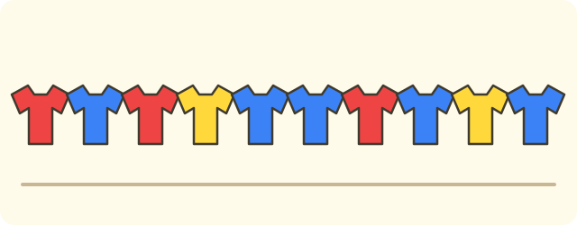
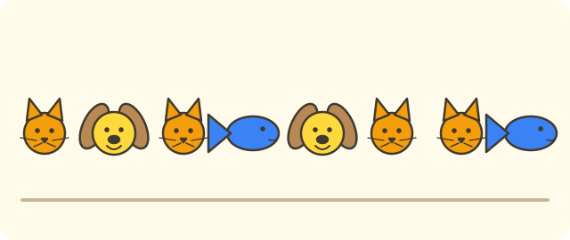

:::goals
- Biết thu thập số liệu bằng cách hỏi hoặc quan sát.
- Biết phân loại số liệu và đếm bằng vạch kiểm đếm.
- Ghi số liệu vào bảng và đọc bảng để trả lời câu hỏi.
:::

Cô giáo hỏi $12$ bạn trong tổ em: "Em thích ăn quả nào nhất: cam, chuối hay táo?" Các bạn trả lời lần lượt: cam, chuối, cam, táo, chuối, chuối, cam, táo, cam, chuối, táo, cam. Có bao nhiêu bạn thích cam?

Em có thể đếm một lượt trong dãy trên. Nhưng dãy dài rất dễ đếm sót hay đếm trùng. Bài này dạy em cách ghi lại và đếm gọn gàng hơn.

## Cùng khám phá

Ta làm từng bước nhỏ với dãy câu trả lời ở trên.

**Bước 1: thu thập.** Ta đã hỏi từng bạn và ghi lại câu trả lời. Mỗi câu trả lời là một **số liệu**.

**Bước 2: phân loại.** Ta chia các câu trả lời thành ba nhóm: cam, chuối, táo.

**Bước 3: đếm bằng vạch.** Đọc lần lượt từng câu trả lời. Gặp một câu trả lời, em kẻ một vạch $/$ vào hàng của loại quả đó. Cứ đủ $5$ vạch thì gom thành một nhóm. Em chỉ đọc dãy một lần.

| Loại quả | Vạch kiểm đếm | Số bạn |
|---|---|---|
| Cam | ///// | $5$ |
| Chuối | //// | $4$ |
| Táo | /// | $3$ |

Vậy có $5$ bạn thích cam. Em kiểm tra: $5+4+3=12$, đúng bằng số bạn được hỏi.

:::theorem Ba bước làm việc với số liệu
1. **Thu thập:** hỏi hoặc quan sát rồi ghi lại từng số liệu.
2. **Phân loại:** chia số liệu thành các nhóm.
3. **Ghi vào bảng:** đếm số liệu của mỗi nhóm bằng vạch kiểm đếm, rồi ghi số vào **bảng số liệu**.

Cuối cùng, cộng các số trong bảng. Tổng phải bằng số lần em đã hỏi hoặc đã quan sát.
:::

Bước kiểm tra cuối giúp em phát hiện mình đếm sót hay đếm trùng.

## Ví dụ

Ta bắt đầu bằng một bài lập bảng từ một dãy ngắn.

:::example Màu áo
Mai ghi màu áo của $10$ bạn: đỏ, xanh, đỏ, vàng, xanh, xanh, đỏ, xanh, vàng, xanh. Hãy lập bảng số liệu.

**Lời giải.** Ta đọc dãy một lượt, kẻ vạch vào hàng đúng màu:

| Màu áo | Vạch kiểm đếm | Số bạn |
|---|---|---|
| Đỏ | /// | $3$ |
| Xanh | ///// | $5$ |
| Vàng | // | $2$ |

Kiểm tra: $3+5+2=10$, bằng số bạn đã ghi. Vậy bảng đúng.
:::

Sau khi có bảng, em chỉ cần nhìn bảng để trả lời câu hỏi.

:::example Môn thể thao yêu thích
Bảng cho biết số bạn lớp 3A chọn mỗi môn thể thao:

| Môn | Bóng đá | Cầu lông | Bơi | Cờ vua |
|---|---|---|---|---|
| Số bạn | $9$ | $6$ | $4$ | $5$ |

a) Môn nào được nhiều bạn chọn nhất?
b) Bóng đá được nhiều hơn bơi bao nhiêu bạn?
c) Lớp 3A có bao nhiêu bạn?

**Lời giải.** a) So sánh các số $9$, $6$, $4$, $5$: số lớn nhất là $9$, nên bóng đá được chọn nhiều nhất.

b) "Nhiều hơn bao nhiêu" nghĩa là em làm phép trừ:
$$9-4=5\ \text{(bạn)}.$$

c) Mỗi bạn chọn đúng một môn, nên em cộng tất cả các số:
$$9+6+4+5=24\ \text{(bạn)}.$$

Vậy bóng đá nhiều nhất, bóng đá nhiều hơn bơi $5$ bạn, và lớp có $24$ bạn.
:::

Bảng cũng có thể ghi số liệu theo thời gian.

:::example Bán vở
Cửa hàng bán số quyển vở trong bốn ngày như sau:

| Ngày | Thứ Hai | Thứ Ba | Thứ Tư | Thứ Năm |
|---|---|---|---|---|
| Số quyển vở | $15$ | $20$ | $18$ | $12$ |

Cả bốn ngày cửa hàng bán được bao nhiêu quyển vở? Ngày nào bán ít nhất?

**Lời giải.** Muốn biết cả bốn ngày, em cộng bốn số:
$$15+20+18+12=65\ \text{(quyển vở)}.$$

Số nhỏ nhất trong bảng là $12$, ứng với thứ Năm.

Vậy cả bốn ngày bán được $65$ quyển vở, và thứ Năm bán ít nhất.
:::

Có khi bảng thiếu một ô. Em dùng tổng để tìm ô đó.

:::example Ô còn thiếu
Lớp có $30$ bạn, mỗi bạn chọn một màu. Bảng còn thiếu số bạn chọn màu vàng:

| Màu | Xanh | Đỏ | Vàng |
|---|---|---|---|
| Số bạn | $12$ | $9$ | ? |

**Lời giải.** Tổng các màu phải bằng $30$. Số bạn đã biết là $12+9=21$. Số bạn chọn vàng là phần còn lại:
$$30-21=9\ \text{(bạn)}.$$

Kiểm tra: $12+9+9=30$. Vậy có $9$ bạn chọn màu vàng.
:::

:::warning Những lỗi em hay gặp
- **Đếm sót hoặc đếm trùng.** Sai: ghi cam $6$ bạn trong khi chỉ có $5$ câu trả lời "cam". Vì sao sai: em đếm một câu trả lời hai lần. Đúng: kẻ vạch ngay khi đọc từng câu trả lời, rồi cộng kiểm tra tổng.
- **Quên so sánh với tổng.** Sai: không cộng lại các số trong bảng. Vì sao sai: em không biết bảng có sai hay không. Đúng: cộng các số và so với số bạn được hỏi.
- **Quên đơn vị trong đáp số.** Sai: "Đáp số: $24$". Đúng: "Đáp số: $24$ bạn".
:::

## Thuật ngữ

:::terms
- số liệu | data
- thu thập số liệu | collect data
- phân loại | sort (classify)
- vạch kiểm đếm | tally mark
- bảng số liệu | data table
- tổng | total
- nhiều nhất | most
- ít nhất | least
:::

## Tóm tắt

- Làm ba bước: **thu thập**, **phân loại**, **ghi vào bảng**.
- Đếm bằng vạch kiểm đếm: mỗi số liệu một vạch, đủ $5$ vạch thì gom nhóm.
- Đọc bảng: số lớn nhất là "nhiều nhất", số nhỏ nhất là "ít nhất"; "nhiều hơn bao nhiêu" thì làm phép trừ.
- Cộng các số trong bảng để kiểm tra: tổng phải bằng số lần đã hỏi.

## Luyện tập

Mỗi bài có phần kiến thức và gợi ý. Em hãy tự làm trước, rồi mới bấm xem lời giải.

:::exercise
Em ghi lại các con vật các bạn thích: mèo, chó, mèo, cá, chó, mèo, mèo, cá. Hãy lập bảng số liệu (có cột vạch kiểm đếm).

::hint
**Kiến thức:** phân loại rồi đếm bằng vạch, mỗi số liệu một vạch.

**Gợi ý các bước:**
1. Có mấy loại con vật?
2. Đọc từng con vật và kẻ vạch vào hàng của nó.
3. Cộng lại để kiểm tra.

::solution
| Con vật | Vạch kiểm đếm | Số bạn |
|---|---|---|
| Mèo | //// | $4$ |
| Chó | // | $2$ |
| Cá | // | $2$ |

Kiểm tra: $4+2+2=8$, bằng số bạn đã ghi.

**Đáp số.** Mèo $4$, chó $2$, cá $2$.
:::

:::exercise
Bảng cho biết các bạn lớp 3B đi học bằng cách nào:

| Cách đi | Đi bộ | Xe đạp | Xe buýt | Xe máy (bố mẹ đưa) |
|---|---|---|---|---|
| Số bạn | $7$ | $11$ | $5$ | $9$ |

a) Cách nào có nhiều bạn nhất? Cách nào ít nhất?
b) Lớp 3B có bao nhiêu bạn?

::hint
**Kiến thức:** so sánh các số trong bảng; cộng tất cả các số để biết số bạn cả lớp.

**Gợi ý các bước:**
1. Tìm số lớn nhất và số nhỏ nhất.
2. Cộng bốn số.

::solution
a) Số lớn nhất là $11$ (xe đạp), số nhỏ nhất là $5$ (xe buýt).

b) $7+11+5+9=32$ (bạn).

**Đáp số.** a) Xe đạp nhiều nhất, xe buýt ít nhất. b) $32$ bạn.
:::

:::exercise
Lớp có $28$ bạn, mỗi bạn chọn một câu lạc bộ. Bảng còn thiếu số bạn chọn vẽ:

| Câu lạc bộ | Hát | Múa | Vẽ |
|---|---|---|---|
| Số bạn | $11$ | $8$ | ? |

::hint
**Kiến thức:** tổng các số trong bảng bằng số bạn cả lớp.

**Gợi ý các bước:**
1. Cộng hai số đã biết.
2. Lấy $28$ trừ đi kết quả.

::solution
$11+8=19$. Số bạn chọn vẽ là $28-19=9$ (bạn).

**Kiểm tra.** $11+8+9=28$.

**Đáp số.** $9$ bạn.
:::

:::exercise
Trại gà thu được số quả trứng trong bốn ngày:

| Ngày | Thứ Hai | Thứ Ba | Thứ Tư | Thứ Năm |
|---|---|---|---|---|
| Số quả trứng | $24$ | $30$ | $27$ | $21$ |

a) Cả bốn ngày thu được bao nhiêu quả trứng?
b) Ngày nhiều nhất hơn ngày ít nhất bao nhiêu quả?

::hint
**Kiến thức:** "cả" là phép cộng; "hơn bao nhiêu" là phép trừ.

**Gợi ý các bước:**
1. Cộng bốn số.
2. Tìm số lớn nhất và nhỏ nhất rồi trừ.

::solution
a) $24+30=54$; $54+27=81$; $81+21=102$ (quả).

b) Số lớn nhất là $30$, số nhỏ nhất là $21$. Ta có $30-21=9$ (quả).

**Đáp số.** a) $102$ quả. b) $9$ quả.
:::

:::exercise
Bảng ghi các bạn thích loại kem nào:

| Kem | Dâu | Sô-cô-la | Va-ni |
|---|---|---|---|
| Số bạn | $8$ | $12$ | $6$ |

Bình nói: "Lớp mình có $30$ bạn, mỗi bạn chọn một loại kem". Bình nói đúng không? Vì sao?

::hint
**Kiến thức:** tổng các số trong bảng bằng số bạn đã được hỏi.

**Gợi ý các bước:**
1. Đề cho biết gì? Ba số trong bảng.
2. Cộng ba số rồi so với $30$.

::solution
$8+12+6=26$. Vì $26\ne30$ nên chưa đủ $30$ bạn.

**Đáp số.** Bình nói chưa đúng: bảng mới có $26$ bạn, còn thiếu $4$ bạn.
:::

:::exercise
Lan hỏi $9$ bạn chọn màu: xanh, đỏ, xanh, vàng, đỏ, xanh, vàng, xanh, đỏ. Lan ghi bảng: xanh $5$, đỏ $3$, vàng $2$. Bảng của Lan sai ở đâu? Hãy sửa lại.

::hint
**Kiến thức:** cộng các số trong bảng, so với số bạn được hỏi.

**Gợi ý các bước:**
1. Cộng $5+3+2$ rồi so với $9$.
2. Đếm lại từng màu trong dãy.

::solution
$5+3+2=10$, mà Lan chỉ hỏi $9$ bạn nên bảng sai. Đếm lại: xanh có $4$ (bạn thứ $1$, $3$, $6$, $8$), đỏ có $3$, vàng có $2$. Ta có $4+3+2=9$.

**Đáp số.** Lan đếm thừa một bạn xanh; đúng là xanh $4$, đỏ $3$, vàng $2$.
:::

:::exercise
Em hãy nhớ lại bài trước (chia số có năm chữ số cho số có một chữ số).

a) Tính $12\,640:4$.
b) Một cửa hàng bán $12\,640$ quyển vở trong $4$ tuần, mỗi tuần bán số quyển như nhau. Hãy ghi số quyển vở mỗi tuần vào một bảng.

::hint
**Kiến thức:** chia lần lượt từng hàng, từ hàng chục nghìn.

**Gợi ý các bước:**
1. Chia $12$ nghìn cho $4$, rồi chia tiếp các hàng còn lại.
2. Mỗi tuần bán cùng một số quyển.

::solution
a) $12\,640:4=3\,160$.

b)

| Tuần | Một | Hai | Ba | Bốn |
|---|---|---|---|---|
| Số quyển vở | $3\,160$ | $3\,160$ | $3\,160$ | $3\,160$ |

**Kiểm tra.** $3\,160\times4=12\,640$.

**Đáp số.** a) $3\,160$. b) Mỗi tuần $3\,160$ quyển vở.
:::

:::exercise Thử thách
Lớp có $36$ bạn, mỗi bạn chọn một trong ba môn: bóng đá, cầu lông, bơi. Bóng đá có $15$ bạn. Số bạn chọn cầu lông ít hơn số bạn chọn bóng đá là $5$ bạn. Hỏi có bao nhiêu bạn chọn bơi?

::hint
**Kiến thức:** "ít hơn" là phép trừ; tổng ba môn bằng $36$.

**Gợi ý các bước:**
1. Tìm số bạn chọn cầu lông.
2. Lấy $36$ trừ số bạn chọn bóng đá và cầu lông.

::solution
Cầu lông: $15-5=10$ (bạn). Bóng đá và cầu lông: $15+10=25$ (bạn). Bơi: $36-25=11$ (bạn).

**Kiểm tra.** $15+10+11=36$.

**Đáp số.** $11$ bạn.
:::

## Kiểm tra mini

:::quiz
::mc
Dãy: cam, táo, cam, cam, táo, chuối. Có mấy quả cam?
A. $2$.
B. $6$.
C. $4$.
D. $3$.
::key D
Cam xuất hiện ở vị trí $1$, $3$, $4$ nên có $3$ quả. Phương án B là đếm cả dãy.

::mc
Bảng: bóng đá $8$ bạn, cờ vua $5$ bạn, bơi $7$ bạn. Môn nào có ít bạn chọn nhất?
A. Cờ vua.
B. Bóng đá.
C. Bơi.
D. Cả ba môn bằng nhau.
::key A
Số nhỏ nhất trong $8$, $5$, $7$ là $5$, ứng với cờ vua. Phương án B là chọn số lớn nhất.

::mc
Với bảng ở câu trên, có tất cả bao nhiêu bạn?
A. $13$.
B. $20$.
C. $15$.
D. $21$.
::key B
$8+5+7=20$. Phương án A chỉ cộng hai số đầu, phương án C chỉ cộng bóng đá và bơi.

::mc
Tổ Một trồng $16$ cây, tổ Hai trồng $13$ cây. Tổ Một trồng nhiều hơn tổ Hai bao nhiêu cây?
A. $29$ cây.
B. $2$ cây.
C. $3$ cây.
D. $4$ cây.
::key C
"Nhiều hơn bao nhiêu" là phép trừ: $16-13=3$. Phương án A là phép cộng.

::tf
Lớp có $25$ bạn chọn hoa: hồng $10$ bạn, cúc $7$ bạn, lan $8$ bạn.
a) Hoa hồng được nhiều bạn chọn nhất.
b) Tổng số bạn trong bảng là $25$.
c) Hoa cúc được nhiều bạn chọn hơn hoa lan.
d) Hoa hồng được nhiều hơn hoa cúc $3$ bạn.
::key Đ Đ S Đ
a) Đúng: $10$ là số lớn nhất. b) Đúng: $10+7+8=25$. c) Sai: $7<8$. d) Đúng: $10-7=3$.

::sa
Ba tổ gấp được số con hạc: tổ Một $14$ con, tổ Hai $11$ con, tổ Ba $12$ con. Cả ba tổ gấp được bao nhiêu con hạc?
::key 37
$14+11+12=37$ (con hạc).

::sa
Lớp có $32$ bạn, mỗi bạn chọn một trò chơi: kéo co $14$ bạn, nhảy dây $10$ bạn, còn lại chơi cờ. Có bao nhiêu bạn chơi cờ?
::key 8
$32-14-10=8$ (bạn).
:::
