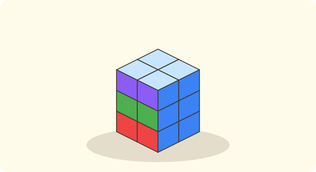
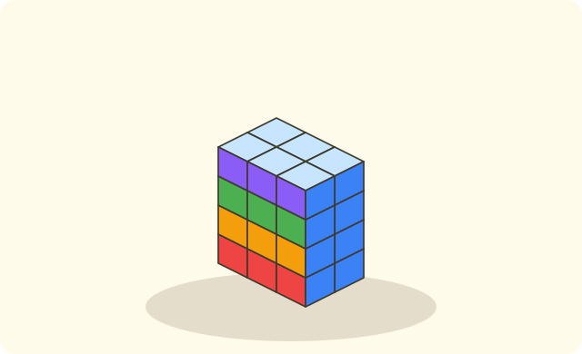

:::goals
- Nhận biết khối lập phương và khối hộp chữ nhật.
- Nêu số mặt, số đỉnh, số cạnh và hình dạng các mặt của mỗi khối.
- Giải bài toán đơn giản về các mặt và về xếp khối.
:::

Nam có một con xúc xắc và một hộp phấn. Hai vật này đều có các mặt phẳng, nhưng hình dạng không giống nhau. Hỏi chúng khác nhau ở chỗ nào?

Để trả lời, em hãy cầm từng vật lên, đếm mặt và nhìn xem mặt có hình gì.

## Cùng khám phá

Em nhìn con xúc xắc: có $6$ mặt, mỗi mặt là một hình vuông và các mặt to bằng nhau. Nó có dạng **khối lập phương**.

Em nhìn hộp phấn: cũng có $6$ mặt, nhưng mỗi mặt là một hình chữ nhật. Nó có dạng **khối hộp chữ nhật**.

:::diagram Khối lập phương
alt: Khối lập phương ABCD.A'B'C'D' vẽ theo kiểu hình hộp, các cạnh bị che khuất vẽ bằng nét đứt
point A 0,0 below-left
point B 3,0 below-right
point C 4.2,1.4 right
point D 1.2,1.4 above-left
point A' 0,3 left
point B' 3,3 above
point C' 4.2,4.4 above-right
point D' 1.2,4.4 above
segment A B
segment B C
segment C D dashed
segment D A dashed
segment A' B'
segment B' C'
segment C' D'
segment D' A'
segment A A'
segment B B'
segment C C'
segment D D' dashed
:::

Trên hình, em đếm được $8$ đỉnh. Mỗi đoạn thẳng là một cạnh, và có $12$ cạnh.

:::theorem Hai loại khối
- **Khối lập phương:** $6$ mặt đều là hình vuông bằng nhau; $8$ đỉnh; $12$ cạnh bằng nhau.
- **Khối hộp chữ nhật:** $6$ mặt là hình chữ nhật; $8$ đỉnh; $12$ cạnh. Hai mặt đối diện thì bằng nhau.
:::

Hai khối này giống nhau ở số mặt, số đỉnh, số cạnh. Chúng khác nhau ở hình dạng các mặt.

## Ví dụ

Ta bắt đầu với việc đếm các phần của khối lập phương.

:::example Đếm mặt, đỉnh, cạnh
Khối lập phương có bao nhiêu mặt, bao nhiêu đỉnh, bao nhiêu cạnh?

**Lời giải.** Em đếm trên hình hoặc trên con xúc xắc: có $6$ mặt, $8$ đỉnh và $12$ cạnh.

Vậy khối lập phương có $6$ mặt, $8$ đỉnh, $12$ cạnh.
:::

Bây giờ em gọi tên khối cho các đồ vật quen thuộc.

:::example Gọi tên đồ vật
Mỗi vật sau có dạng khối gì: con xúc xắc, viên gạch, khối rubik?

**Lời giải.** Em xem các mặt của mỗi vật. Con xúc xắc và khối rubik có các mặt là hình vuông bằng nhau. Viên gạch có các mặt là hình chữ nhật.

Vậy con xúc xắc và khối rubik là khối lập phương; viên gạch là khối hộp chữ nhật.
:::

Hai mặt đối diện của khối hộp chữ nhật bằng nhau. Ta dùng điều này để tìm kích thước.

:::example Hai mặt đối diện
Một khối hộp chữ nhật có mặt đáy là hình chữ nhật dài $6$ cm, rộng $3$ cm. Mặt nắp đối diện với mặt đáy là hình gì và có kích thước bao nhiêu?

**Lời giải.** Mặt nắp đối diện với mặt đáy nên bằng mặt đáy.

Vậy mặt nắp là hình chữ nhật dài $6$ cm, rộng $3$ cm.
:::

Cuối cùng là một bài toán xếp khối.

:::example Xếp khối
Nam xếp các khối lập phương nhỏ thành $3$ lớp, mỗi lớp có $4$ khối. Nam đã dùng tất cả bao nhiêu khối?

**Lời giải.** Có $3$ lớp, mỗi lớp $4$ khối, nên ta làm phép nhân:
$$4\times3=12\ \text{(khối)}.$$

Vậy Nam đã dùng $12$ khối.
:::

:::warning Những lỗi em hay gặp
- **Nhầm hình phẳng với khối.** Sai: "khối lập phương là hình vuông". Vì sao sai: hình vuông là hình phẳng, còn khối lập phương có $6$ mặt là hình vuông. Đúng: mỗi mặt của khối lập phương là hình vuông.
- **Nhầm số đỉnh và số cạnh.** Sai: khối lập phương có $12$ đỉnh. Vì sao sai: $12$ là số cạnh. Đúng: có $8$ đỉnh và $12$ cạnh.
- **Quên đơn vị.** Sai: "Đáp số: $12$". Đúng: "Đáp số: $12$ khối".
:::

## Thuật ngữ

:::terms
- khối lập phương | cube
- khối hộp chữ nhật | cuboid
- mặt | face
- đỉnh | vertex (corner)
- cạnh | edge
- mặt đối diện | opposite faces
- xúc xắc | dice
:::

## Tóm tắt

- Khối lập phương và khối hộp chữ nhật đều có $6$ mặt, $8$ đỉnh, $12$ cạnh.
- Các mặt của khối lập phương là hình vuông bằng nhau.
- Các mặt của khối hộp chữ nhật là hình chữ nhật; hai mặt đối diện bằng nhau.
- Xếp $n$ lớp, mỗi lớp $m$ khối thì có $m\times n$ khối.

## Luyện tập

Mỗi bài có phần kiến thức và gợi ý. Em hãy tự làm trước, rồi mới bấm xem lời giải.

:::exercise
Điền số vào chỗ trống: khối lập phương có $\ldots$ mặt, $\ldots$ đỉnh và $\ldots$ cạnh.

::hint
**Kiến thức:** khối lập phương có $6$ mặt, $8$ đỉnh, $12$ cạnh.

**Gợi ý các bước:**
1. Hình dung con xúc xắc.
2. Điền từng số theo thứ tự mặt, đỉnh, cạnh.

::solution
Khối lập phương có $6$ mặt, $8$ đỉnh và $12$ cạnh.

**Đáp số.** $6$; $8$; $12$.
:::

:::exercise
Mỗi vật sau có dạng khối gì: a) con xúc xắc; b) hộp phấn; c) khối rubik?

::hint
**Kiến thức:** mặt hình vuông bằng nhau là khối lập phương; mặt hình chữ nhật là khối hộp chữ nhật.

**Gợi ý các bước:**
1. Nhìn các mặt của vật.
2. Các mặt có bằng nhau và là hình vuông không?

::solution
a) Khối lập phương. b) Khối hộp chữ nhật. c) Khối lập phương.

**Đáp số.** a) Khối lập phương; b) Khối hộp chữ nhật; c) Khối lập phương.
:::

:::exercise
Khối lập phương có cạnh $7$ cm. Mỗi mặt là hình vuông có cạnh dài bao nhiêu xăng-ti-mét?

::hint
**Kiến thức:** các cạnh của khối lập phương bằng nhau, mỗi mặt là hình vuông.

**Gợi ý các bước:**
1. Cạnh của mặt cũng là cạnh của khối.
2. Ghi đáp số có đơn vị.

::solution
Mỗi cạnh của mặt cũng là cạnh của khối lập phương, nên dài $7$ cm.

**Đáp số.** $7$ cm.
:::

:::exercise
Một khối hộp chữ nhật có mặt đáy là hình chữ nhật dài $8$ cm, rộng $5$ cm. Mặt nắp đối diện dài và rộng bao nhiêu xăng-ti-mét?

::hint
**Kiến thức:** hai mặt đối diện của khối hộp chữ nhật bằng nhau.

**Gợi ý các bước:**
1. Mặt nắp đối diện với mặt nào?
2. Hai mặt bằng nhau thì kích thước thế nào?

::solution
Mặt nắp bằng mặt đáy nên dài $8$ cm, rộng $5$ cm.

**Đáp số.** Dài $8$ cm, rộng $5$ cm.
:::

:::exercise
An xếp các khối lập phương nhỏ thành $4$ lớp, mỗi lớp có $6$ khối. An đã dùng tất cả bao nhiêu khối?

::hint
**Kiến thức:** $4$ lớp, mỗi lớp $6$ khối: dùng phép nhân.

**Gợi ý các bước:**
1. Đề cho biết gì? $4$ lớp, mỗi lớp $6$ khối. Đề hỏi gì? Tất cả bao nhiêu khối.
2. Tính $6\times4$ và ghi đơn vị.

::solution
Số khối An đã dùng là:
$$6\times4=24\ \text{(khối)}.$$

**Đáp số.** $24$ khối.
:::

:::exercise
Bình có $20$ khối lập phương nhỏ và xếp đều thành $4$ lớp. Mỗi lớp có bao nhiêu khối?

::hint
**Kiến thức:** chia đều $20$ khối cho $4$ lớp: dùng phép chia.

**Gợi ý các bước:**
1. Đề cho biết gì? $20$ khối, $4$ lớp bằng nhau.
2. Tính $20:4$.

::solution
Số khối ở mỗi lớp là:
$$20:4=5\ \text{(khối)}.$$

**Thử lại.** $5\times4=20$. Đúng.

**Đáp số.** $5$ khối.
:::

:::exercise
Em hãy nhớ lại bài trước: mỗi mặt của một khối lập phương là hình vuông có cạnh $3$ cm. Tổng độ dài bốn cạnh của một mặt là bao nhiêu xăng-ti-mét?

::hint
**Kiến thức:** hình vuông có $4$ cạnh bằng nhau; tổng độ dài bốn cạnh bằng cạnh nhân $4$.

**Gợi ý các bước:**
1. Mặt là hình gì, mấy cạnh?
2. Tính $3\times4$.

::solution
$3\times4=12$ (cm).

**Đáp số.** $12$ cm.
:::

:::exercise Thử thách
Một con xúc xắc có $6$ mặt, tổng số chấm của hai mặt đối diện luôn bằng $7$. Tổng số chấm của cả $6$ mặt là bao nhiêu?

::hint
**Kiến thức:** $6$ mặt chia thành các cặp mặt đối diện.

**Gợi ý các bước:**
1. Có mấy cặp mặt đối diện?
2. Mỗi cặp có tổng $7$ chấm.

::solution
$6$ mặt chia thành $3$ cặp mặt đối diện. Mỗi cặp có $7$ chấm nên tổng là $7\times3=21$.

**Kiểm tra.** $1+2+3+4+5+6=21$. Đúng.

**Đáp số.** $21$ chấm.
:::

## Kiểm tra mini

:::quiz
::mc
Khối lập phương có bao nhiêu mặt?
A. $4$.
B. $6$.
C. $8$.
D. $12$.
::key B
Khối lập phương có $6$ mặt. Phương án C là số đỉnh, phương án D là số cạnh.

::mc
Mỗi mặt của khối lập phương là hình gì?
A. Hình tam giác.
B. Hình chữ nhật có hai cạnh khác nhau.
C. Hình vuông.
D. Hình tròn.
::key C
Các mặt của khối lập phương đều là hình vuông bằng nhau. Phương án B là mặt của khối hộp chữ nhật.

::mc
Khối hộp chữ nhật có mặt đáy là hình chữ nhật dài $9$ cm, rộng $4$ cm. Mặt nắp đối diện có kích thước là
A. dài $9$ cm, rộng $4$ cm.
B. dài $9$ cm, rộng $9$ cm.
C. dài $4$ cm, rộng $4$ cm.
D. dài $13$ cm, rộng $4$ cm.
::key A
Hai mặt đối diện bằng nhau nên mặt nắp cũng dài $9$ cm, rộng $4$ cm. Phương án D là lỗi cộng hai số.

::mc
Xếp các khối nhỏ thành $3$ lớp, mỗi lớp $5$ khối. Có tất cả bao nhiêu khối?
A. $8$.
B. $15$.
C. $53$.
D. $10$.
::key B
$5\times3=15$ (khối). Phương án A là lỗi cộng $5+3$.

::tf
Em xét khối lập phương.
a) Có $6$ mặt.
b) Mỗi mặt là hình vuông.
c) Có $6$ đỉnh.
d) Có $12$ cạnh.
::key Đ Đ S Đ
a) Đúng. b) Đúng: các mặt đều là hình vuông. c) Sai: có $8$ đỉnh. d) Đúng: có $12$ cạnh.

::sa
Khối lập phương có bao nhiêu đỉnh?
::key 8
Khối lập phương có $8$ đỉnh.

::sa
Xếp các khối lập phương nhỏ thành $3$ lớp, mỗi lớp $9$ khối. Có tất cả bao nhiêu khối?
::key 27
$9\times3=27$ (khối).
:::
