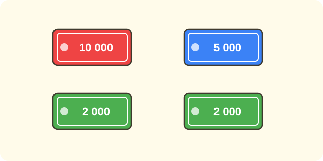
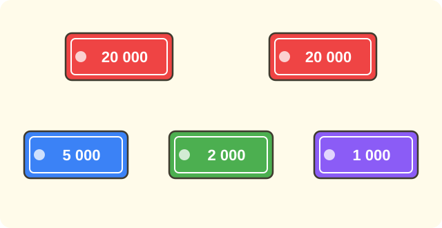
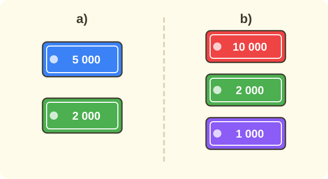

:::goals
- Nhận biết các tờ tiền Việt Nam và giá trị của chúng.
- Đếm số tiền của nhiều tờ tiền bằng cách tính theo nghìn đồng.
- Tính tiền hàng và tiền trả lại khi mua hàng.
- Giải bài toán có lời văn về tiền, nhớ ghi đơn vị đồng.
:::

Nam có một tờ tiền $20\,000$ đồng. Nam mua một cuốn sổ giá $12\,000$ đồng và đưa cô bán hàng tờ tiền đó. Hỏi cô bán hàng phải trả lại Nam bao nhiêu tiền?

Em đã học cộng và trừ các số trong phạm vi $100\,000$. Bài này dùng chính các phép tính đó để tính tiền.

## Cùng khám phá

Ở Việt Nam, đơn vị tiền là **đồng**. Em thường gặp các tờ tiền ghi trong bảng sau. Cột bên phải cho biết mỗi tờ bằng bao nhiêu **nghìn** đồng.

| Tờ tiền (đồng) | Bằng bao nhiêu nghìn đồng |
|---|---|
| $1\,000$ | $1$ nghìn |
| $2\,000$ | $2$ nghìn |
| $5\,000$ | $5$ nghìn |
| $10\,000$ | $10$ nghìn |
| $20\,000$ | $20$ nghìn |
| $50\,000$ | $50$ nghìn |
| $100\,000$ | $100$ nghìn |

Ta bắt đầu với một ví dụ nhỏ. Mẹ cho Nam hai tờ $5\,000$ đồng và một tờ $2\,000$ đồng. Nam có tất cả bao nhiêu tiền?

- Mỗi tờ $5\,000$ đồng là $5$ nghìn. Hai tờ là $5+5=10$ nghìn.
- Tờ $2\,000$ đồng là $2$ nghìn.
- Cộng lại: $10+2=12$ nghìn.

Vậy Nam có $12$ nghìn đồng, tức là $12\,000$ đồng. Em thấy không, ta cộng các số nhỏ rồi mới thêm chữ "nghìn".

Bây giờ ta quay lại bài toán của Nam ở đầu bài. Nam đưa $20$ nghìn đồng và tiền hàng là $12$ nghìn đồng. Em hãy xem trên tia số: từ $12$ lên $20$ cần thêm bao nhiêu nghìn?

:::graph Trên tia số (đơn vị: nghìn đồng): từ 12 lên 20 cần thêm 8
alt: Tia số từ 0 đến 24 tính theo nghìn đồng, đánh dấu điểm 12 và điểm 20; đoạn từ 12 đến 20 dài 8 nghìn
x: 0..24
y: -1..1
segment: (12, 0) (20, 0)
point: (12, 0) "12" below
point: (20, 0) "20" below
label: (16, 0) "+8" above
:::

Từ $12$ lên $20$ cần thêm $8$ nghìn. Em cũng có thể trừ: $20-12=8$ nghìn. Vậy cô bán hàng trả lại Nam $8\,000$ đồng.

:::theorem Tính tiền
- **Số tiền của nhiều tờ tiền:** đổi mỗi tờ ra nghìn đồng, cộng lại, rồi viết thêm "nghìn đồng".
- **Tiền hàng của nhiều món:** cộng giá tiền của từng món.
- **Tiền trả lại** $=$ tiền đưa $-$ tiền hàng.
:::

Tiền trả lại dùng phép trừ vì đó là phần tiền đưa dư ra sau khi đã trả đủ tiền hàng. Em luôn có thể thử lại: tiền hàng $+$ tiền trả lại phải bằng tiền đưa. Ở trên, $12+8=20$, đúng.

## Ví dụ

Ta bắt đầu với việc đếm một ít tờ tiền.

:::example Đếm tiền
Mai có một tờ $10\,000$ đồng, một tờ $5\,000$ đồng và hai tờ $2\,000$ đồng. Hỏi Mai có bao nhiêu tiền?

**Lời giải.** Em đổi mỗi tờ ra nghìn đồng rồi cộng:
$$10+5+2+2=19\ \text{(nghìn đồng)}.$$
Vậy Mai có $19\,000$ đồng.

**Kiểm tra.** $10\,000+5\,000+2\,000+2\,000=19\,000$. Khớp.
:::

Ví dụ sau có nhiều tờ tiền hơn, nhưng cách làm vẫn như vậy.

:::example Đếm nhiều tờ tiền
Hà có hai tờ $20\,000$ đồng, một tờ $5\,000$ đồng, một tờ $2\,000$ đồng và một tờ $1\,000$ đồng. Hỏi Hà có bao nhiêu tiền?

**Lời giải.** Hai tờ $20$ nghìn là $20+20=40$ nghìn. Em cộng thêm các tờ còn lại:
$$40+5+2+1=48\ \text{(nghìn đồng)}.$$
Vậy Hà có $48\,000$ đồng.
:::

Bây giờ em tính tiền hàng khi mua nhiều món.

:::example Tiền hàng
Nam mua một quyển vở giá $7\,000$ đồng, một cái bút giá $4\,000$ đồng và một cục tẩy giá $2\,000$ đồng. Hỏi Nam phải trả bao nhiêu tiền?

**Lời giải.** "Phải trả" cả ba món nghĩa là gộp giá của ba món, nên em làm phép cộng:
$$7\,000+4\,000+2\,000=13\,000\ \text{(đồng)}.$$
Vậy Nam phải trả $13\,000$ đồng.
:::

Sau khi biết tiền hàng, em có thể tính tiền trả lại.

:::example Tiền trả lại
Cô Lan mua rau hết $35\,000$ đồng và đưa người bán tờ $50\,000$ đồng. Hỏi người bán phải trả lại cô Lan bao nhiêu tiền?

**Lời giải.** Tiền trả lại bằng tiền đưa trừ đi tiền hàng:
$$50\,000-35\,000=15\,000\ \text{(đồng)}.$$
Vậy người bán trả lại cô Lan $15\,000$ đồng.

**Kiểm tra.** $35\,000+15\,000=50\,000$. Khớp với tiền đưa.
:::

Cuối cùng là một bài cần so sánh số tiền có với số tiền cần dùng.

:::example Có đủ tiền không?
Lan có $30\,000$ đồng. Lan muốn mua một con gấu bông giá $18\,000$ đồng và một hộp bút giá $15\,000$ đồng. Lan có đủ tiền không? Nếu không đủ thì thiếu bao nhiêu?

**Lời giải.** Trước hết em tính tiền hàng của cả hai món:
$$18\,000+15\,000=33\,000\ \text{(đồng)}.$$
Vì $33\,000>30\,000$ nên Lan không đủ tiền. Số tiền còn thiếu là:
$$33\,000-30\,000=3\,000\ \text{(đồng)}.$$
Vậy Lan không đủ tiền, còn thiếu $3\,000$ đồng.
:::

:::warning Những lỗi em hay gặp
- **Đếm thiếu tờ tiền.** Sai: có hai tờ $5\,000$ đồng và một tờ $2\,000$ đồng, tính $5\,000+2\,000=7\,000$ đồng. Vì sao sai: em bỏ sót một tờ $5\,000$ đồng. Đúng: $5\,000+5\,000+2\,000=12\,000$ đồng.
- **Cộng thay vì trừ khi tính tiền trả lại.** Sai: $20\,000+12\,000=32\,000$ đồng. Vì sao sai: tiền trả lại là phần dư ra, không thể nhiều hơn tiền đưa. Đúng: $20\,000-12\,000=8\,000$ đồng.
- **Quên đổi về đồng.** Sai: "Đáp số: $12$ đồng". Vì sao sai: $12$ nghìn đồng là $12\,000$ đồng. Đúng: "Đáp số: $12\,000$ đồng".
:::

## Thuật ngữ

:::terms
- tiền Việt Nam | Vietnamese money
- đồng | dong (the Vietnamese currency)
- tờ tiền | banknote
- nghìn | thousand
- giá tiền | price
- tiền hàng | total cost
- tiền đưa | money handed over
- tiền trả lại | change
- đủ tiền | enough money
- thiếu | short by
:::

## Tóm tắt

- Đơn vị tiền Việt Nam là **đồng**. Có các tờ $1\,000$, $2\,000$, $5\,000$, $10\,000$, $20\,000$, $50\,000$, $100\,000$ đồng.
- Muốn đếm tiền, đổi mỗi tờ ra nghìn đồng rồi cộng. Ví dụ: $5+5+2=12$ nghìn, tức là $12\,000$ đồng.
- Tiền hàng: cộng giá các món. Tiền trả lại $=$ tiền đưa $-$ tiền hàng.
- Em có thể thử lại bằng phép cộng: tiền hàng $+$ tiền trả lại $=$ tiền đưa. Nhớ ghi đơn vị đồng.

## Luyện tập

Mỗi bài có phần kiến thức và gợi ý. Em hãy tự làm trước, rồi mới bấm xem lời giải.

:::exercise
Em đếm số tiền:

a) Một tờ $5\,000$ đồng và một tờ $2\,000$ đồng.

b) Một tờ $10\,000$ đồng, một tờ $2\,000$ đồng và một tờ $1\,000$ đồng.

::hint
**Kiến thức:** đổi mỗi tờ ra nghìn đồng rồi cộng.

**Gợi ý các bước:**
1. Viết số nghìn của từng tờ.
2. Cộng lại rồi viết thêm "nghìn đồng".

::solution
a) $5+2=7$ nghìn đồng, tức là $7\,000$ đồng.

b) $10+2+1=13$ nghìn đồng, tức là $13\,000$ đồng.

**Đáp số.** a) $7\,000$ đồng; b) $13\,000$ đồng.
:::

:::exercise
a) Em có hai tờ $20\,000$ đồng và một tờ $10\,000$ đồng. Em có bao nhiêu tiền?

b) Một cuốn truyện giá $15\,000$ đồng và một cây bút chì giá $3\,000$ đồng. Mua cả hai phải trả bao nhiêu tiền?

::hint
**Kiến thức:** đếm tiền thì đổi ra nghìn rồi cộng; tiền hàng của nhiều món thì cộng giá từng món.

**Gợi ý các bước:**
1. Câu a): $20+20+10$ nghìn.
2. Câu b): $15\,000+3\,000$.

::solution
a) $20+20+10=50$ nghìn đồng, tức là $50\,000$ đồng.

b) $15\,000+3\,000=18\,000$ (đồng).

**Đáp số.** a) $50\,000$ đồng; b) $18\,000$ đồng.
:::

:::exercise
Em hãy nhớ lại bài trước (xem đồng hồ, tháng và năm).

a) Nam đến cửa hàng lúc $8$ giờ $15$ phút và mua xong sau $10$ phút. Nam mua xong lúc mấy giờ?

b) Nam đi mua sách vào tháng $5$. Tháng $5$ có bao nhiêu ngày?

::hint
**Kiến thức:** $1$ giờ có $60$ phút; các tháng $1, 3, 5, 7, 8, 10, 12$ có $31$ ngày.

**Gợi ý các bước:**
1. Câu a): cộng thêm $10$ phút vào $15$ phút.
2. Câu b): xem tháng $5$ thuộc nhóm tháng nào.

::solution
a) $15+10=25$, nên Nam mua xong lúc $8$ giờ $25$ phút.

b) Tháng $5$ nằm trong các tháng có $31$ ngày.

**Đáp số.** a) $8$ giờ $25$ phút; b) $31$ ngày.
:::

:::exercise
a) Mẹ đưa $50\,000$ đồng để mua đồ hết $28\,000$ đồng. Người bán phải trả lại mẹ bao nhiêu tiền?

b) Bố đưa $20\,000$ đồng, được trả lại $6\,000$ đồng. Bố đã mua đồ hết bao nhiêu tiền?

::hint
**Kiến thức:** tiền trả lại $=$ tiền đưa $-$ tiền hàng. Từ đó, tiền hàng $=$ tiền đưa $-$ tiền trả lại.

**Gợi ý các bước:**
1. Đề cho biết gì? Hỏi gì?
2. Câu a): đi tìm tiền trả lại. Câu b): đi tìm tiền hàng.
3. Thử lại bằng phép cộng.

::solution
a) $50\,000-28\,000=22\,000$ (đồng).

b) $20\,000-6\,000=14\,000$ (đồng).

**Kiểm tra.** Câu a): $28\,000+22\,000=50\,000$. Câu b): $14\,000+6\,000=20\,000$.

**Đáp số.** a) $22\,000$ đồng; b) $14\,000$ đồng.
:::

:::exercise
Em chọn phép tính (cộng hay trừ) và nói vì sao.

a) Mai có $25\,000$ đồng, dì cho thêm $10\,000$ đồng. Mai có tất cả bao nhiêu tiền?

b) Mai có $35\,000$ đồng, mua một quyển sách hết $28\,000$ đồng. Mai còn lại bao nhiêu tiền?

::hint
**Kiến thức:** "có thêm", "tất cả" thì cộng; "mua hết", "còn lại" thì trừ.

**Gợi ý các bước:**
1. Đề cho biết gì? Hỏi gì?
2. Chọn phép tính rồi tính.

::solution
a) Dì cho thêm tiền nên số tiền tăng lên, ta làm phép cộng: $25\,000+10\,000=35\,000$ (đồng).

b) Mai trả đi một phần tiền nên số tiền giảm xuống, ta làm phép trừ: $35\,000-28\,000=7\,000$ (đồng).

**Đáp số.** a) $35\,000$ đồng; b) $7\,000$ đồng.
:::

:::exercise
Tìm lỗi sai trong lời giải của hai bạn rồi sửa lại.

a) Hà: "Em có hai tờ $10\,000$ đồng và một tờ $5\,000$ đồng. Em có $10\,000+5\,000=15\,000$ (đồng)."

b) Tú: "Tú đưa $50\,000$ đồng, mua hàng hết $31\,000$ đồng. Tiền trả lại là $50\,000+31\,000=81\,000$ (đồng)."

::hint
**Kiến thức:** đếm đủ từng tờ tiền; tiền trả lại bằng tiền đưa trừ tiền hàng.

**Gợi ý các bước:**
1. Câu a): đếm xem có mấy tờ tiền, lời giải cộng mấy tờ.
2. Câu b): tiền trả lại có thể nhiều hơn tiền đưa không?

::solution
a) Hà mới cộng một tờ $10\,000$ đồng, bỏ sót một tờ. Làm đúng: $10\,000+10\,000+5\,000=25\,000$ (đồng).

b) Tú cộng thay vì trừ. Tiền trả lại không thể nhiều hơn tiền đưa. Làm đúng: $50\,000-31\,000=19\,000$ (đồng).

**Đáp số.** a) $25\,000$ đồng; b) $19\,000$ đồng.
:::

:::exercise
Bảng giá của một quán ăn sáng:

| Món | Giá (đồng) |
|---|---|
| Bánh mì | $12\,000$ |
| Sữa | $8\,000$ |
| Nước ép | $15\,000$ |

An mua một cái bánh mì và một hộp sữa, rồi đưa tờ $50\,000$ đồng.

a) An phải trả bao nhiêu tiền hàng?

b) Người bán trả lại An bao nhiêu tiền?

::hint
**Kiến thức:** tiền hàng là tổng giá các món; tiền trả lại $=$ tiền đưa $-$ tiền hàng.

**Gợi ý các bước:**
1. Đề cho biết gì? Hỏi gì? Tìm giá bánh mì và giá sữa trong bảng.
2. Câu a): cộng hai giá. Câu b): lấy $50\,000$ trừ tiền hàng.
3. Thử lại bằng phép cộng.

::solution
a) Tiền hàng: $12\,000+8\,000=20\,000$ (đồng).

b) Tiền trả lại: $50\,000-20\,000=30\,000$ (đồng).

**Kiểm tra.** $20\,000+30\,000=50\,000$. Khớp.

**Đáp số.** a) $20\,000$ đồng; b) $30\,000$ đồng.
:::

:::exercise Thử thách
Hùng có một tờ $20\,000$ đồng, một tờ $5\,000$ đồng và ba tờ $2\,000$ đồng.

a) Hùng có bao nhiêu tiền?

b) Hùng muốn mua một cái kính bơi giá $45\,000$ đồng. Hùng còn thiếu bao nhiêu tiền?

c) Mẹ cho Hùng thêm một tờ $20\,000$ đồng. Bây giờ Hùng có đủ tiền mua kính bơi không? Nếu đủ thì còn thừa bao nhiêu tiền?

::hint
**Kiến thức:** đếm tiền bằng cách cộng số nghìn; so sánh số tiền có với giá kính; phần thiếu hoặc thừa là hiệu của hai số.

**Gợi ý các bước:**
1. Ba tờ $2\,000$ đồng là bao nhiêu nghìn?
2. Tính số tiền Hùng có, rồi lấy $45\,000$ trừ đi.
3. Câu c): cộng thêm $20\,000$ rồi so sánh với $45\,000$.

::solution
a) $20+5+2+2+2=31$ nghìn đồng, tức là $31\,000$ đồng.

b) $45\,000-31\,000=14\,000$ (đồng).

c) Sau khi mẹ cho thêm, Hùng có $31\,000+20\,000=51\,000$ (đồng). Vì $51\,000>45\,000$ nên Hùng đủ tiền. Số tiền còn thừa là $51\,000-45\,000=6\,000$ (đồng).

**Đáp số.** a) $31\,000$ đồng; b) thiếu $14\,000$ đồng; c) đủ tiền, còn thừa $6\,000$ đồng.
:::

## Kiểm tra mini

:::quiz
::mc
Số tiền của một tờ $10\,000$ đồng và hai tờ $5\,000$ đồng là
A. $15\,000$ đồng.
B. $20\,000$ đồng.
C. $17\,000$ đồng.
D. $25\,000$ đồng.
::key B
$10\,000+5\,000+5\,000=20\,000$ đồng. Phương án A bỏ sót một tờ $5\,000$; phương án D cộng thừa một tờ $5\,000$.

::mc
Mẹ đưa $50\,000$ đồng để mua đồ hết $32\,000$ đồng. Người bán trả lại mẹ
A. $82\,000$ đồng.
B. $22\,000$ đồng.
C. $18\,000$ đồng.
D. $28\,000$ đồng.
::key C
$50\,000-32\,000=18\,000$. Phương án A là cộng thay vì trừ; phương án B là trừ nhầm ($50-32$ không phải $22$).

::mc
An mua ba món có giá $9\,000$ đồng, $6\,000$ đồng và $4\,000$ đồng. Tiền hàng là
A. $10\,000$ đồng.
B. $13\,000$ đồng.
C. $15\,000$ đồng.
D. $19\,000$ đồng.
::key D
$9\,000+6\,000+4\,000=19\,000$. Các phương án B, C, A chỉ cộng hai món ($9+4$, $9+6$, $6+4$).

::mc
Lan có $40\,000$ đồng và muốn mua hai món giá $25\,000$ đồng và $18\,000$ đồng. Câu nào đúng?
A. Lan không đủ tiền, thiếu $3\,000$ đồng.
B. Lan đủ tiền và còn thừa $15\,000$ đồng.
C. Lan đủ tiền và còn thừa $3\,000$ đồng.
D. Lan không đủ tiền, thiếu $43\,000$ đồng.
::key A
Tiền hàng là $25\,000+18\,000=43\,000$. Vì $43\,000>40\,000$ nên Lan thiếu $43\,000-40\,000=3\,000$ đồng. Phương án B chỉ tính một món; phương án D lấy tổng tiền hàng làm số tiền thiếu.

::tf
Nam có một tờ $20\,000$ đồng, một tờ $10\,000$ đồng và một tờ $5\,000$ đồng.
a) Nam có $35\,000$ đồng.
b) Nam mua được món giá $40\,000$ đồng.
c) Nam mua món giá $28\,000$ đồng thì được trả lại $7\,000$ đồng.
d) Nam đưa cả ba tờ mua món giá $30\,000$ đồng thì được trả lại $15\,000$ đồng.
::key Đ S Đ S
a) Đúng: $20+10+5=35$ nghìn. b) Sai: $35\,000<40\,000$ nên không đủ tiền. c) Đúng: $35\,000-28\,000=7\,000$. d) Sai: $35\,000-30\,000=5\,000$, không phải $15\,000$.

::sa
Mai có hai tờ $5\,000$ đồng và một tờ $2\,000$ đồng. Mai có tất cả bao nhiêu nghìn đồng?
::key 12
$5+5+2=12$ (nghìn đồng).

::sa
Bố đưa $50\,000$ đồng để mua đồ hết $36\,000$ đồng. Bố được trả lại bao nhiêu nghìn đồng?
::key 14
$50-36=14$ (nghìn đồng).
:::
