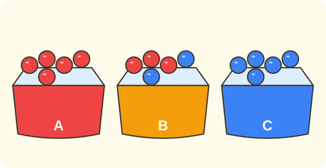

:::goals
- Nhận biết một sự kiện là chắc chắn, có thể hay không thể xảy ra.
- Giải thích vì sao bằng cách nhìn vào những gì có trong hộp.
- Ghi kết quả thử nghiệm vào bảng số liệu.
:::

Mai có một chiếc hộp kín, trong hộp chỉ có $5$ viên bi đỏ. Mai nhắm mắt lấy ra một viên bi. Mai có thể lấy được viên bi xanh không? Mai có chắc chắn lấy được viên bi đỏ không?

Bài này giúp em trả lời những câu hỏi như vậy, chỉ bằng cách nhìn xem trong hộp có gì.

## Cùng khám phá

Có ba chiếc hộp. Mỗi lần, ta nhắm mắt lấy ra một viên bi.

- **Hộp A:** $5$ viên bi đỏ.
- **Hộp B:** $3$ viên bi đỏ và $2$ viên bi xanh.
- **Hộp C:** $5$ viên bi xanh.

**Hộp A.** Trong hộp chỉ có bi đỏ. Dù lấy thế nào, ta cũng được bi đỏ. Ta nói: lấy được bi đỏ là **chắc chắn**. Lấy được bi xanh là **không thể**.

**Hộp B.** Trong hộp có cả bi đỏ và bi xanh. Lần này ta có thể được bi đỏ, lần khác có thể được bi xanh. Ta nói: lấy được bi đỏ là **có thể**, lấy được bi xanh cũng là **có thể**.

**Hộp C.** Trong hộp chỉ có bi xanh. Lấy được bi xanh là **chắc chắn**, lấy được bi đỏ là **không thể**.

:::theorem Ba mức khả năng
- **Chắc chắn:** sự kiện luôn luôn xảy ra.
- **Không thể:** sự kiện không bao giờ xảy ra.
- **Có thể:** sự kiện có lúc xảy ra, có lúc không xảy ra.

Muốn biết là mức nào, em nhìn xem trong hộp có những gì.
:::

Cách nghĩ này đúng vì em biết rõ mọi thứ trong hộp. Nếu thứ cần tìm không có, nó không thể xảy ra. Nếu mọi thứ trong hộp đều là thứ đó, nó chắc chắn xảy ra.

## Ví dụ

Ta bắt đầu với một hộp chỉ có một loại bóng.

:::example Hộp bóng vàng
Một hộp có $6$ quả bóng vàng. Nhắm mắt lấy ra một quả. Hãy nói khả năng của mỗi sự kiện:
a) lấy được quả bóng vàng;
b) lấy được quả bóng xanh.

**Lời giải.** Trong hộp chỉ có bóng vàng.

a) Quả nào lấy ra cũng là bóng vàng, nên sự kiện này **chắc chắn** xảy ra.

b) Trong hộp không có bóng xanh, nên sự kiện này **không thể** xảy ra.
:::

Bây giờ hộp có hai loại kẹo.

:::example Túi kẹo
Một túi có $4$ chiếc kẹo cam và $2$ chiếc kẹo dâu. Nhắm mắt lấy ra một chiếc. Hãy nói khả năng của:
a) lấy được kẹo cam;
b) lấy được kẹo dâu;
c) lấy được kẹo chanh.

**Lời giải.** Trong túi có cả kẹo cam và kẹo dâu, nhưng không có kẹo chanh.

a) Có thể lấy được kẹo cam, nên sự kiện này **có thể** xảy ra.

b) Có thể lấy được kẹo dâu, nên sự kiện này cũng **có thể** xảy ra.

c) Không có kẹo chanh, nên sự kiện này **không thể** xảy ra.
:::

Ta cũng có thể hỏi về các số trên thẻ.

:::example Thẻ số
Một hộp có $3$ tấm thẻ ghi số $1$, $2$, $3$. Nhắm mắt lấy ra một tấm thẻ. Hãy nói khả năng của:
a) lấy được thẻ ghi số $5$;
b) lấy được thẻ ghi số bé hơn $4$;
c) lấy được thẻ ghi số $2$.

**Lời giải.** Các số có thể lấy ra là $1$, $2$, $3$.

a) Không có thẻ số $5$, nên **không thể**.

b) Cả ba số $1$, $2$, $3$ đều bé hơn $4$, nên **chắc chắn**.

c) Thẻ số $2$ có trong hộp nhưng cũng có thẻ khác, nên **có thể**.
:::

Em cũng gặp những câu hỏi này ở ngoài đời.

:::example Chuyện hằng ngày
Hãy nói mỗi sự kiện là chắc chắn, có thể hay không thể xảy ra:
a) Mặt trời mọc vào buổi sáng.
b) Em đi bộ từ nhà đến trường trong $1$ giây.
c) Ngày mai trời mưa.

**Lời giải.** Ta nghĩ xem sự kiện có luôn xảy ra, không bao giờ xảy ra, hay có khi có khi không.

a) Buổi sáng nào Mặt trời cũng mọc, nên **chắc chắn**.

b) Không ai đi bộ nhanh như vậy, nên **không thể**.

c) Có ngày mưa, có ngày không, nên **có thể**.
:::

Cuối cùng, ta thử thật và ghi kết quả vào bảng số liệu như ở bài trước.

:::example Thử lấy bi
Hộp B có $3$ bi đỏ và $2$ bi xanh. Nam lấy một viên, ghi màu rồi bỏ lại vào hộp, làm $10$ lần. Kết quả: đỏ, xanh, đỏ, đỏ, xanh, đỏ, xanh, đỏ, đỏ, xanh. Hãy lập bảng số liệu.

**Lời giải.** Ta đọc dãy một lượt và kẻ vạch vào hàng đúng màu:

| Màu bi | Vạch kiểm đếm | Số lần |
|---|---|---|
| Đỏ | ////// | $6$ |
| Xanh | //// | $4$ |

Kiểm tra: $6+4=10$ lần. Cả hai màu đều xuất hiện, đúng với "có thể được đỏ, có thể được xanh".
:::

:::warning Những lỗi em hay gặp
- **Nhầm "có thể" với "chắc chắn".** Sai: hộp có $1$ bi đỏ và $9$ bi xanh, nói "chắc chắn lấy được bi xanh". Vì sao sai: bi đỏ vẫn nằm trong hộp nên có thể lấy được bi đỏ. Đúng: lấy được bi xanh là có thể.
- **Nhầm "rất ít" với "không thể".** Sai: hộp có $1$ bi đỏ, nói "không thể lấy được bi đỏ". Vì sao sai: bi đỏ có trong hộp. Đúng: có thể lấy được bi đỏ.
- **Không nhìn vào hộp.** Sai: trả lời mà không xem trong hộp có gì. Đúng: luôn xem trong hộp có những gì trước khi trả lời.
:::

## Thuật ngữ

:::terms
- khả năng | chance (likelihood)
- sự kiện | event
- chắc chắn | certain
- có thể | possible (might happen)
- không thể | impossible
- hộp | box
- thử nghiệm | trial (experiment)
- bảng số liệu | data table
:::

## Tóm tắt

- **Chắc chắn:** luôn xảy ra. **Không thể:** không bao giờ xảy ra. **Có thể:** có lúc xảy ra, có lúc không.
- Nhìn xem trong hộp có gì: nếu thứ cần tìm không có thì không thể; nếu mọi thứ đều là thứ đó thì chắc chắn.
- Trong hộp có nhiều loại thì mỗi loại đều có thể được lấy ra, dù loại đó ít.
- Ghi kết quả thử nghiệm bằng vạch kiểm đếm và bảng số liệu.

## Luyện tập

Mỗi bài có phần kiến thức và gợi ý. Em hãy tự làm trước, rồi mới bấm xem lời giải.

:::exercise
Một hộp có $5$ viên bi xanh. Nhắm mắt lấy ra một viên. Hãy nói khả năng của:
a) lấy được bi xanh;
b) lấy được bi đỏ.

::hint
**Kiến thức:** nhìn xem trong hộp có gì.

**Gợi ý các bước:**
1. Trong hộp có những màu nào?
2. Màu cần tìm có trong hộp không?

::solution
a) Trong hộp chỉ có bi xanh nên lấy được bi xanh là **chắc chắn**.

b) Trong hộp không có bi đỏ nên lấy được bi đỏ là **không thể**.

**Đáp số.** a) Chắc chắn. b) Không thể.
:::

:::exercise
Một túi có $3$ kẹo cam và $3$ kẹo dâu. Nhắm mắt lấy ra một chiếc. Hãy nói khả năng của:
a) lấy được kẹo cam;
b) lấy được kẹo dâu;
c) lấy được kẹo chanh.

::hint
**Kiến thức:** có trong túi nhiều loại thì mỗi loại đều có thể được lấy ra; không có trong túi thì không thể.

**Gợi ý các bước:**
1. Trong túi có những loại kẹo nào?
2. Xét từng ý a), b), c).

::solution
a) Có thể. b) Có thể. c) Trong túi không có kẹo chanh nên không thể.

**Đáp số.** a) Có thể. b) Có thể. c) Không thể.
:::

:::exercise
Hãy nói mỗi sự kiện là chắc chắn, có thể hay không thể xảy ra:
a) Một tuần có $7$ ngày.
b) Con mèo bay lên Mặt Trăng.
c) Ngày mai trời nắng.

::hint
**Kiến thức:** luôn xảy ra là chắc chắn; không bao giờ xảy ra là không thể; có khi có khi không là có thể.

**Gợi ý các bước:**
1. Nghĩ xem sự kiện có luôn xảy ra không.
2. Chọn một trong ba mức.

::solution
a) Tuần nào cũng có $7$ ngày: chắc chắn. b) Không thể. c) Có ngày nắng, có ngày không: có thể.

**Đáp số.** a) Chắc chắn. b) Không thể. c) Có thể.
:::

:::exercise
Một hộp có $4$ tấm thẻ ghi số $2$, $4$, $6$, $8$. Nhắm mắt lấy ra một tấm. Hãy nói khả năng của:
a) lấy được thẻ ghi số chẵn;
b) lấy được thẻ ghi số $5$;
c) lấy được thẻ ghi số lớn hơn $5$.

::hint
**Kiến thức:** viết các số có thể lấy ra rồi xét từng ý.

**Gợi ý các bước:**
1. Các số trong hộp là $2$, $4$, $6$, $8$.
2. Số nào thoả mãn từng ý?

::solution
a) Cả bốn số đều là số chẵn: **chắc chắn**.

b) Không có số $5$: **không thể**.

c) Có số $6$ và $8$ lớn hơn $5$, nhưng $2$ và $4$ thì không: **có thể**.

**Đáp số.** a) Chắc chắn. b) Không thể. c) Có thể.
:::

:::exercise
Một hộp có $1$ viên bi đỏ và $9$ viên bi xanh. Nam nói: "Nhắm mắt lấy một viên thì chắc chắn được bi xanh". Nam nói đúng không? Vì sao?

::hint
**Kiến thức:** "chắc chắn" nghĩa là luôn xảy ra.

**Gợi ý các bước:**
1. Đề cho biết gì? Trong hộp có $1$ bi đỏ và $9$ bi xanh.
2. Có lần nào lấy được bi đỏ không?

::solution
Viên bi đỏ vẫn nằm trong hộp, nên có thể lấy được bi đỏ.

**Đáp số.** Nam nói chưa đúng: lấy được bi xanh chỉ là **có thể**.
:::

:::exercise
Lan nói: "Hộp có $4$ bi xanh và $1$ bi đỏ. Không thể lấy được bi đỏ vì bi đỏ ít quá". Lan sai ở đâu? Hãy sửa lại.

::hint
**Kiến thức:** có trong hộp thì có thể lấy ra, dù chỉ có một viên.

**Gợi ý các bước:**
1. Bi đỏ có trong hộp không?
2. Chọn mức khả năng đúng.

::solution
Trong hộp có $1$ bi đỏ, nên lấy được bi đỏ có thể xảy ra.

**Đáp số.** Lan sai: lấy được bi đỏ là **có thể**, không phải không thể.
:::

:::exercise
Em hãy nhớ lại bài trước (bảng số liệu). Mai lấy một viên bi từ hộp, ghi màu rồi bỏ lại, làm $12$ lần: đỏ, xanh, đỏ, đỏ, xanh, đỏ, xanh, đỏ, đỏ, xanh, đỏ, xanh.

a) Lập bảng số liệu (có vạch kiểm đếm).
b) Trong hộp có cả hai màu không? Vì sao?

::hint
**Kiến thức:** đếm bằng vạch rồi cộng để kiểm tra tổng.

**Gợi ý các bước:**
1. Đọc dãy một lượt, kẻ vạch vào hàng đúng màu.
2. Cộng hai số rồi so với $12$.

::solution
a)

| Màu bi | Vạch kiểm đếm | Số lần |
|---|---|---|
| Đỏ | ///////  | $7$ |
| Xanh | ///// | $5$ |

Kiểm tra: $7+5=12$.

b) Cả bi đỏ và bi xanh đều được lấy ra, nên trong hộp có cả hai màu.

**Đáp số.** a) Đỏ $7$ lần, xanh $5$ lần. b) Có cả hai màu.
:::

:::exercise Thử thách
Một hộp có $3$ bi đỏ và $5$ bi xanh.

a) Phải lấy ra bao nhiêu viên bi xanh để chắc chắn lấy được bi đỏ?
b) Nếu giữ nguyên $5$ bi xanh, phải lấy ra bao nhiêu viên bi đỏ để không thể lấy được bi đỏ?

::hint
**Kiến thức:** chắc chắn là trong hộp chỉ có màu đó; không thể là trong hộp không có màu đó.

**Gợi ý các bước:**
1. Ở ý a), hộp phải chỉ còn bi gì?
2. Ở ý b), hộp phải không còn bi gì?

::solution
a) Phải lấy hết $5$ viên bi xanh, khi đó hộp chỉ còn $3$ bi đỏ.

b) Phải lấy hết $3$ viên bi đỏ, khi đó hộp chỉ còn $5$ bi xanh.

**Đáp số.** a) $5$ viên bi xanh. b) $3$ viên bi đỏ.
:::

## Kiểm tra mini

:::quiz
::mc
Một hộp có $6$ viên bi vàng. Nhắm mắt lấy ra một viên. Lấy được bi vàng là
A. không thể.
B. có thể.
C. chắc chắn.
D. không biết.
::key C
Trong hộp chỉ có bi vàng nên viên nào lấy ra cũng là bi vàng. Phương án B quên rằng hộp không có màu nào khác.

::mc
Một hộp có $3$ bi đỏ và $2$ bi xanh. Lấy ra một viên. Lấy được bi xanh là
A. chắc chắn.
B. không thể.
C. luôn xảy ra.
D. có thể.
::key D
Hộp có cả bi đỏ và bi xanh nên có thể lấy được bi xanh. Phương án A nhầm "có thể" với "chắc chắn".

::mc
Một hộp có $3$ tấm thẻ ghi số $1$, $2$, $3$. Lấy ra một tấm. Lấy được thẻ ghi số $7$ là
A. có thể.
B. không thể.
C. chắc chắn.
D. không biết.
::key B
Trong hộp không có thẻ số $7$. Phương án A là không nhìn vào hộp.

::mc
Sự kiện nào sau đây là chắc chắn?
A. Ngày mai trời mưa.
B. Sau thứ Hai là thứ Ba.
C. Con mèo biết bay.
D. Em thắng ván cờ chiều nay.
::key B
Sau thứ Hai luôn là thứ Ba. A và D là có thể, C là không thể.

::tf
Một hộp có $4$ bi xanh và $1$ bi đỏ. Lấy ra một viên.
a) Có thể lấy được bi đỏ.
b) Chắc chắn lấy được bi xanh.
c) Không thể lấy được bi vàng.
d) Chắc chắn lấy được bi đỏ hoặc bi xanh.
::key Đ S Đ Đ
a) Đúng: bi đỏ có trong hộp. b) Sai: bi đỏ vẫn có thể được lấy ra. c) Đúng: không có bi vàng. d) Đúng: mọi viên trong hộp đều là đỏ hoặc xanh.

::sa
Một hộp có $5$ bi đỏ và $3$ bi xanh. Lấy ra một viên. Có thể lấy được mấy màu bi khác nhau?
::key 2
Hộp có bi đỏ và bi xanh nên có thể lấy được $2$ màu.

::sa
Một hộp có $5$ bi đỏ và $3$ bi xanh. Phải lấy ra bao nhiêu viên bi xanh để chắc chắn lấy được bi đỏ?
::key 3
Phải lấy hết $3$ viên bi xanh để trong hộp chỉ còn bi đỏ.
:::
