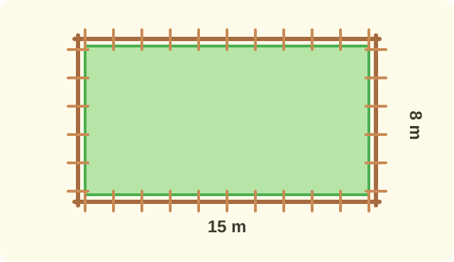
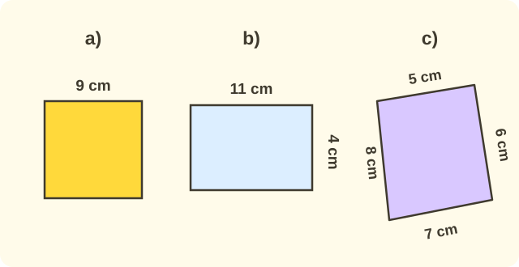
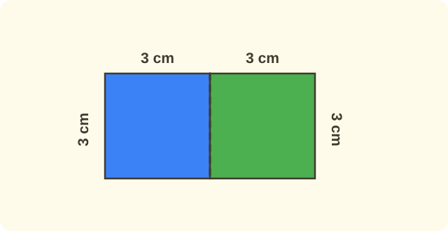

:::goals
- Hiểu chu vi của một hình là độ dài đường bao quanh hình đó.
- Tính chu vi hình tam giác và hình tứ giác bằng cách cộng độ dài các cạnh.
- Tính nhanh chu vi hình chữ nhật và hình vuông.
- Giải bài toán có lời văn về chu vi.
:::

Mai có một tấm thiệp hình chữ nhật, dài $8$ cm, rộng $5$ cm. Mai muốn dán một sợi dây kim tuyến sát quanh mép tấm thiệp, vừa đủ một vòng. Hỏi sợi dây phải dài bao nhiêu xăng-ti-mét?

Em đã biết đo độ dài bằng xăng-ti-mét và biết cộng các số. Chỉ cần hai điều đó là em giải được bài toán này.

## Cùng khám phá

Ta bắt đầu với một hình đơn giản hơn là hình tam giác. Chú kiến bò một vòng sát mép tam giác $ABC$, xuất phát từ $A$ rồi về lại $A$.

:::diagram Chú kiến bò một vòng quanh tam giác $ABC$
alt: Tam giác ABC có cạnh AB dài 4 cm, cạnh BC dài 5 cm và cạnh CA dài 3 cm
point A 0,0 below-left
point B 4,0 below-right
point C 0,3 above
polygon A B C
label 2,-0.5 "4 cm"
label 2.5,1.9 "5 cm"
label -0.6,1.5 "3 cm"
:::

Em hãy đi theo chú kiến:

- Đoạn thứ nhất, từ $A$ đến $B$, dài $4$ cm.
- Đoạn thứ hai, từ $B$ đến $C$, dài $5$ cm.
- Đoạn thứ ba, từ $C$ về $A$, dài $3$ cm.

Cả vòng dài $4+5+3=12$ cm. Độ dài cả vòng này gọi là **chu vi** của tam giác.

:::definition Chu vi
**Chu vi** của một hình là độ dài đường bao quanh hình đó.

Muốn tính chu vi hình tam giác hay hình tứ giác, em cộng độ dài tất cả các cạnh. Các độ dài phải cùng một đơn vị.
:::

Vì sao phải cộng *tất cả* các cạnh? Chú kiến phải đi qua từng cạnh thì mới về được chỗ cũ. Bỏ sót một cạnh là đi chưa hết vòng.

## Tính nhanh cho hình chữ nhật và hình vuông

Ta quay lại tấm thiệp của Mai. Hình chữ nhật có hai cạnh dài bằng nhau và hai cạnh rộng bằng nhau.

:::diagram Tấm thiệp hình chữ nhật dài 8 cm, rộng 5 cm
alt: Hình chữ nhật có hai cạnh dài 8 cm và hai cạnh rộng 5 cm
point A 0,0 below-left
point B 4,0 below-right
point C 4,2.5 above-right
point D 0,2.5 above-left
polygon A B C D
label 2,-0.45 "8 cm"
label 2,2.95 "8 cm"
label -0.6,1.25 "5 cm"
label 4.6,1.25 "5 cm"
:::

Em cộng cả bốn cạnh: $8+5+8+5=26$ cm. Em thấy có hai cạnh dài và hai cạnh rộng. Vậy ta ghép thành hai cặp "dài và rộng".

Một cặp là $8+5=13$ cm, và có hai cặp như thế. Do đó $(8+5)\times2=13\times2=26$ cm. Sợi dây của Mai dài $26$ cm.

Hình vuông có bốn cạnh bằng nhau. Nếu cạnh dài $6$ cm thì cả vòng là $6+6+6+6=24$ cm, tức là $6\times4=24$ cm.

:::theorem Chu vi hình chữ nhật và hình vuông
- Hình chữ nhật: **chu vi = (chiều dài + chiều rộng) × 2**.
- Hình vuông: **chu vi = độ dài cạnh × 4**.
:::

Hai cách này chỉ là cách cộng gọn hơn, không có gì mới. Nếu quên công thức, em vẫn có thể cộng đủ bốn cạnh để thử lại.

## Ví dụ

Ta bắt đầu với hình tam giác.

:::example Chu vi hình tam giác
Tam giác $DEF$ có $DE=5$ cm, $EF=6$ cm, $FD=7$ cm. Tính chu vi tam giác $DEF$.

**Lời giải.** Chu vi là tổng độ dài ba cạnh, nên em cộng ba số đo:
$$5+6+7=18\ \text{(cm)}.$$
Vậy chu vi tam giác $DEF$ là $18$ cm.

**Kiểm tra.** $5+6=11$, rồi $11+7=18$. Kết quả khớp.
:::

Hình tứ giác có bốn cạnh, nên em cộng bốn số.

:::example Chu vi hình tứ giác
Tứ giác $MNPQ$ có $MN=4$ cm, $NP=6$ cm, $PQ=5$ cm, $QM=7$ cm. Tính chu vi.

**Lời giải.** Em cộng độ dài cả bốn cạnh:
$$4+6+5+7=22\ \text{(cm)}.$$
Vậy chu vi tứ giác $MNPQ$ là $22$ cm.
:::

Với hình chữ nhật, em dùng cách tính nhanh.

:::example Chu vi hình chữ nhật
Một hình chữ nhật có chiều dài $9$ cm, chiều rộng $4$ cm. Tính chu vi.

**Lời giải.** Hình chữ nhật có hai cặp cạnh bằng nhau, nên em cộng chiều dài với chiều rộng rồi nhân $2$:
$$(9+4)\times2=13\times2=26\ \text{(cm)}.$$
Vậy chu vi hình chữ nhật là $26$ cm.

**Kiểm tra.** Cộng đủ bốn cạnh: $9+4+9+4=26$. Khớp.
:::

Hình vuông còn dễ hơn, vì chỉ cần biết một cạnh.

:::example Chu vi hình vuông
Một hình vuông có cạnh dài $7$ cm. Tính chu vi.

**Lời giải.** Hình vuông có bốn cạnh bằng nhau, nên em lấy độ dài cạnh nhân $4$:
$$7\times4=28\ \text{(cm)}.$$
Vậy chu vi hình vuông là $28$ cm.

**Kiểm tra.** $7+7=14$, rồi $14+14=28$. Khớp.
:::

Bây giờ em dùng chu vi để trả lời một câu hỏi trong cuộc sống.

:::example Làm hàng rào
Bác Hùng rào quanh một mảnh vườn hình chữ nhật dài $15$ m, rộng $8$ m. Hỏi hàng rào dài bao nhiêu mét?

**Lời giải.** "Rào quanh" nghĩa là đi hết một vòng sát mép vườn, nên em tính chu vi:
$$(15+8)\times2=23\times2=46\ \text{(m)}.$$
Vậy hàng rào dài $46$ m.
:::

:::warning Những lỗi em hay gặp
- **Chỉ cộng một cặp cạnh.** Sai: chu vi hình chữ nhật dài $9$ cm, rộng $4$ cm là $9+4=13$ cm. Vì sao sai: em mới đi nửa vòng. Đúng: $(9+4)\times2=26$ cm.
- **Nhân hình vuông với 2.** Sai: chu vi hình vuông cạnh $7$ cm là $7\times2=14$ cm. Vì sao sai: hình vuông có $4$ cạnh, không phải $2$. Đúng: $7\times4=28$ cm.
- **Quên đơn vị.** Sai: "Đáp số: $26$". Đúng: "Đáp số: $26$ cm".
:::

## Thuật ngữ

:::terms
- chu vi | perimeter
- cạnh | side
- hình tam giác | triangle
- hình tứ giác | quadrilateral
- hình chữ nhật | rectangle
- hình vuông | square
- chiều dài | length
- chiều rộng | width
- xăng-ti-mét | centimetre
- mét | metre
:::

## Tóm tắt

- Chu vi của một hình là độ dài đường bao quanh hình đó.
- Chu vi hình tam giác, hình tứ giác: cộng độ dài tất cả các cạnh.
- Chu vi hình chữ nhật $=$ (chiều dài $+$ chiều rộng) $\times\,2$. Chu vi hình vuông $=$ cạnh $\times\,4$.
- Em có thể thử lại bằng cách cộng đủ các cạnh, và nhớ ghi đơn vị trong đáp số.

## Luyện tập

Mỗi bài có phần kiến thức và gợi ý. Em hãy tự làm trước, rồi mới bấm xem lời giải.

:::exercise
Tính chu vi:

a) Hình tam giác có các cạnh $3$ cm, $4$ cm, $6$ cm.

b) Hình tứ giác có các cạnh $2$ cm, $3$ cm, $4$ cm, $5$ cm.

::hint
**Kiến thức:** chu vi hình tam giác, hình tứ giác bằng tổng độ dài các cạnh.

**Gợi ý các bước:**
1. Viết phép cộng tất cả các cạnh.
2. Cộng từng bước và ghi đơn vị cm.

::solution
a) $3+4+6=13$ (cm).

b) $2+3+4+5=14$ (cm).

**Đáp số.** a) $13$ cm; b) $14$ cm.
:::

:::exercise
Tính chu vi:

a) Hình chữ nhật có chiều dài $12$ cm, chiều rộng $5$ cm.

b) Hình vuông có cạnh $9$ cm.

::hint
**Kiến thức:** chu vi hình chữ nhật $=$ (chiều dài $+$ chiều rộng) $\times\,2$; chu vi hình vuông $=$ cạnh $\times\,4$.

**Gợi ý các bước:**
1. Câu a): cộng chiều dài với chiều rộng, rồi nhân $2$.
2. Câu b): lấy cạnh nhân $4$.

::solution
a) $(12+5)\times2=17\times2=34$ (cm).

b) $9\times4=36$ (cm).

**Đáp số.** a) $34$ cm; b) $36$ cm.
:::

:::exercise
Em hãy nhớ lại bài trước (làm tròn số đến hàng chục).

a) Làm tròn số $38$ đến hàng chục.

b) Một hình vuông có cạnh khoảng $38$ m. Em ước lượng chu vi bằng cách lấy số đã làm tròn ở câu a) nhân với $4$.

::hint
**Kiến thức:** khi làm tròn đến hàng chục, chữ số hàng đơn vị từ $5$ trở lên thì làm tròn lên.

**Gợi ý các bước:**
1. Nhìn chữ số hàng đơn vị của $38$.
2. Lấy số tròn chục vừa tìm được nhân $4$.

::solution
a) Chữ số hàng đơn vị của $38$ là $8$, lớn hơn $5$, nên làm tròn lên: $38\approx40$.

b) $40\times4=160$ (m).

**Kiểm tra.** $38\times4=152$, gần $160$. Ước lượng hợp lí.

**Đáp số.** a) $40$; b) khoảng $160$ m.
:::

:::exercise
a) Chú kiến bò một vòng sát mép một mặt bàn hình vuông có cạnh $6$ cm. Chú kiến bò được bao nhiêu xăng-ti-mét?

b) Bình uốn một sợi dây thép thành hình tam giác có ba cạnh $8$ cm, $9$ cm, $10$ cm. Sợi dây thép dài bao nhiêu xăng-ti-mét?

::hint
**Kiến thức:** đi "một vòng" quanh hình chính là tính chu vi.

**Gợi ý các bước:**
1. Đề cho biết gì? Hỏi gì? Hình nào?
2. Chọn cách tính chu vi phù hợp rồi tính.
3. Thử lại bằng cách cộng đủ các cạnh.

::solution
a) Chu vi hình vuông: $6\times4=24$ (cm).

b) Sợi dây thép dài bằng chu vi tam giác: $8+9+10=27$ (cm).

**Đáp số.** a) $24$ cm; b) $27$ cm.
:::

:::exercise
Em tính chu vi mỗi hình dưới đây bằng cách nhanh nhất. Vì sao em chọn cách đó?

a) Hình vuông cạnh $9$ cm.

b) Hình chữ nhật dài $11$ cm, rộng $4$ cm.

c) Hình tứ giác có các cạnh $5$ cm, $6$ cm, $7$ cm, $8$ cm.

::hint
**Kiến thức:** hình vuông nhân $4$; hình chữ nhật cộng hai kích thước rồi nhân $2$; hình khác thì cộng các cạnh.

**Gợi ý các bước:**
1. Hình đó có các cạnh bằng nhau không? Có hai cặp cạnh bằng nhau không?
2. Chọn cách tính tương ứng.

::solution
a) Hình vuông có bốn cạnh bằng nhau: $9\times4=36$ (cm).

b) Hình chữ nhật có hai cặp cạnh bằng nhau: $(11+4)\times2=15\times2=30$ (cm).

c) Bốn cạnh khác nhau nên phải cộng cả bốn: $5+6+7+8=26$ (cm).

**Đáp số.** a) $36$ cm; b) $30$ cm; c) $26$ cm.
:::

:::exercise
Tìm lỗi sai trong lời giải của hai bạn rồi sửa lại.

a) Bình: "Hình chữ nhật dài $10$ cm, rộng $3$ cm. Chu vi là $10+3=13$ (cm)."

b) Cúc: "Hình vuông cạnh $5$ cm. Chu vi là $5\times2=10$ (cm)."

::hint
**Kiến thức:** hình chữ nhật có bốn cạnh (hai cặp bằng nhau); hình vuông có bốn cạnh bằng nhau.

**Gợi ý các bước:**
1. Đếm xem lời giải đã tính bao nhiêu cạnh.
2. Làm lại cho đủ cả vòng.

::solution
a) Bình mới cộng một cặp cạnh, tức là mới đi nửa vòng. Làm đúng: $(10+3)\times2=13\times2=26$ (cm).

b) Cúc nhân với $2$ nhưng hình vuông có $4$ cạnh. Làm đúng: $5\times4=20$ (cm).

**Đáp số.** a) $26$ cm; b) $20$ cm.
:::

:::exercise
Một vườn rau hình chữ nhật dài $20$ m, rộng $9$ m. Bác An làm hàng rào quanh vườn.

a) Nếu rào kín cả vòng thì hàng rào dài bao nhiêu mét?

b) Bác chừa một cái cổng rộng $2$ m không rào. Khi đó hàng rào dài bao nhiêu mét?

::hint
**Kiến thức:** rào quanh vườn là đi hết một vòng, nên dùng chu vi.

**Gợi ý các bước:**
1. Đề cho biết gì? Hỏi gì?
2. Câu a): tính chu vi hình chữ nhật.
3. Câu b): bớt đi phần cổng.

::solution
a) $(20+9)\times2=29\times2=58$ (m).

b) $58-2=56$ (m).

**Đáp số.** a) $58$ m; b) $56$ m.
:::

:::exercise Thử thách
Ghép hai hình vuông, mỗi hình có cạnh $3$ cm, sát nhau thành một hình chữ nhật.

a) Tính chu vi hình chữ nhật vừa ghép.

b) Tính tổng chu vi của hai hình vuông riêng lẻ. Vì sao tổng này lớn hơn chu vi hình chữ nhật?

::hint
**Kiến thức:** hai hình vuông ghép sát nhau chung một cạnh.

**Gợi ý các bước:**
1. Hình chữ nhật có chiều dài bằng mấy lần cạnh hình vuông? Chiều rộng bằng bao nhiêu?
2. Tính chu vi từng hình vuông rồi cộng lại, rồi so sánh.

::solution
a) Chiều dài là $3+3=6$ cm, chiều rộng là $3$ cm. Chu vi: $(6+3)\times2=9\times2=18$ (cm).

b) Mỗi hình vuông có chu vi $3\times4=12$ cm, hai hình là $12+12=24$ cm. Tổng này lớn hơn vì cạnh chung dài $3$ cm bị che đi khi ghép, nên mỗi hình mất $3$ cm: $24-3-3=18$ cm.

**Đáp số.** a) $18$ cm; b) $24$ cm.
:::

## Kiểm tra mini

:::quiz
::mc
Chu vi hình tam giác có ba cạnh $4$ cm, $5$ cm, $7$ cm là
A. $9$ cm.
B. $11$ cm.
C. $12$ cm.
D. $16$ cm.
::key D
$4+5+7=16$. Các phương án A, B, C chỉ cộng hai cạnh ($4+5$, $4+7$, $5+7$) nên bỏ sót một cạnh.

::mc
Một hình chữ nhật có chiều dài $9$ cm, chiều rộng $6$ cm. Chu vi hình đó là
A. $15$ cm.
B. $30$ cm.
C. $24$ cm.
D. $54$ cm.
::key B
$(9+6)\times2=15\times2=30$. Phương án A là chưa nhân $2$; phương án C là $9+6+9$, thiếu một cạnh; phương án D là nhân hai số đo với nhau.

::mc
Chu vi hình vuông có cạnh $8$ cm là
A. $16$ cm.
B. $24$ cm.
C. $32$ cm.
D. $64$ cm.
::key C
$8\times4=32$. Phương án A nhân với $2$, phương án B nhân với $3$, phương án D là $8\times8$.

::mc
Mảnh đất hình chữ nhật dài $12$ m, rộng $7$ m. Bác Tư căng dây thép quanh mảnh đất đúng một vòng. Sợi dây dài
A. $19$ m.
B. $38$ m.
C. $31$ m.
D. $84$ m.
::key B
Một vòng là chu vi: $(12+7)\times2=19\times2=38$ m. Phương án A chưa nhân $2$; phương án C là $12+7+12$, thiếu một cạnh.

::tf
Hình chữ nhật $ABCD$ có $AB=10$ cm, $BC=4$ cm.
a) $CD=10$ cm.
b) $AD=4$ cm.
c) Chu vi là $14$ cm.
d) Chu vi là $28$ cm.
::key Đ Đ S Đ
a) Đúng: hai cạnh đối bằng nhau. b) Đúng: $AD$ và $BC$ là hai cạnh đối. c) Sai: $14$ mới là $10+4$, chưa nhân $2$. d) Đúng: $(10+4)\times2=28$.

::sa
Hình vuông có cạnh $6$ cm. Chu vi hình vuông là bao nhiêu xăng-ti-mét?
::key 24
$6\times4=24$ (cm).

::sa
Hình chữ nhật dài $13$ m, rộng $8$ m. Chu vi hình chữ nhật là bao nhiêu mét?
::key 42
$(13+8)\times2=21\times2=42$ (m).
:::
