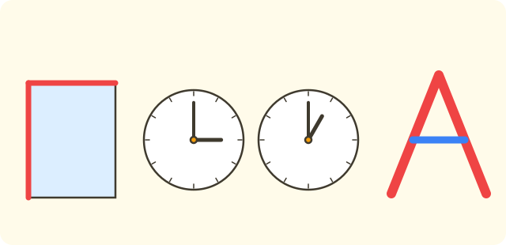
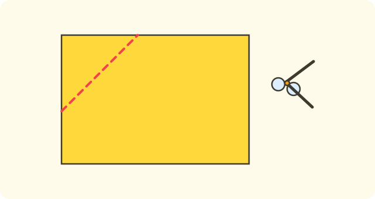

:::goals
- Nhận biết góc, đỉnh và hai cạnh của góc.
- Dùng ê-ke để kiểm tra một góc có phải góc vuông hay không.
- Tìm góc vuông và góc không vuông trong hình vẽ và đồ vật quanh em.
:::

Góc của quyển vở, góc của tờ giấy và góc của cửa sổ đều có hình dạng giống nhau. Làm sao em biết chắc một góc có phải là "góc vuông" hay không?

Bài này dạy em gọi tên góc và dùng ê-ke để kiểm tra góc vuông.

## Cùng khám phá

Hai cạnh của một cái kéo, hai kim đồng hồ hay hai que gỗ chụm lại ở một điểm tạo thành một **góc**. Điểm chung đó gọi là **đỉnh** của góc, hai tia gọi là hai **cạnh** của góc.

Hình dưới là góc đỉnh $O$, cạnh $OA$ và $OB$. Ở đỉnh $O$ có ký hiệu hình vuông nhỏ: đây là **góc vuông**.

:::diagram Góc vuông đỉnh O, cạnh OA và OB
alt: Góc có đỉnh O, hai cạnh OA nằm ngang và OB thẳng đứng, có ký hiệu hình vuông nhỏ ở đỉnh O cho biết đây là góc vuông
point O 0,0 below-left
point A 4,0 below-right
point B 0,4 above-left
segment O A
segment O B
right A O B
:::

Hình tiếp theo cũng là một góc đỉnh $O$ nhưng hai cạnh $OC$ và $OD$ mở ra theo cách khác. Em thấy nó nhỏ hơn góc vuông; đây là **góc không vuông**.

:::diagram Góc không vuông đỉnh O, cạnh OC và OD
alt: Góc có đỉnh O, cạnh OC nằm ngang và cạnh OD chếch lên, góc này không phải góc vuông
point O 0,0 below-left
point C 4,0 below-right
point D 3,3 above-right
segment O C
segment O D
angle C O D
:::

Em không nên chỉ nhìn bằng mắt. Ta dùng **ê-ke**, có một góc vuông, để kiểm tra:

1. Đặt đỉnh góc vuông của ê-ke trùng với đỉnh của góc cần kiểm tra.
2. Cho một cạnh của ê-ke trùng với một cạnh của góc.
3. Nhìn cạnh còn lại của ê-ke: nếu trùng với cạnh còn lại của góc thì đó là góc vuông.

:::theorem Góc vuông và góc không vuông
Góc có đỉnh và hai cạnh. Góc là **góc vuông** khi khớp đúng với góc của ê-ke: hai cạnh trùng hai cạnh của ê-ke. Nếu một cạnh của ê-ke hở ra hoặc lệch vào trong thì đó là **góc không vuông**.

Độ dài hai cạnh không làm thay đổi góc có vuông hay không.
:::

Ví dụ, một góc có hai cạnh dài $3$ cm và một góc có hai cạnh dài $6$ cm đều là góc vuông nếu khớp với ê-ke.

## Ví dụ

Ta bắt đầu bằng cách đọc tên đỉnh và cạnh của góc.

:::example Đỉnh và cạnh
Một góc có đỉnh $E$, hai cạnh là $ED$ và $EF$. Chỉ ra đỉnh và các cạnh của góc.

**Lời giải.** Đỉnh là điểm chung của hai cạnh, nên đỉnh là $E$. Hai cạnh là $ED$ và $EF$.

Vậy góc đỉnh $E$, cạnh $ED$ và $EF$.
:::

Bây giờ em dùng ê-ke để kiểm tra.

:::example Dùng ê-ke
Lan đặt ê-ke vào một góc, thấy cạnh còn lại của ê-ke trùng với cạnh còn lại của góc. Nam đặt ê-ke vào một góc khác, thấy cạnh còn lại của ê-ke hở ra bên ngoài góc. Góc nào là góc vuông?

**Lời giải.** Góc là góc vuông khi hai cạnh trùng hai cạnh của ê-ke. Góc của Lan khớp với ê-ke, còn góc của Nam bị hở.

Vậy góc của Lan là góc vuông, góc của Nam không phải góc vuông.
:::

Tiếp theo, em tìm góc vuông quanh mình.

:::example Góc vuông quanh em
Trong các đồ vật sau, đồ vật nào có góc vuông: góc của tờ giấy hình chữ nhật, hai kim đồng hồ lúc $3$ giờ đúng, hai kim đồng hồ lúc $1$ giờ đúng, mái nhà hình chữ A?

**Lời giải.** Em kiểm tra từng đồ vật bằng ê-ke.

- Góc tờ giấy hình chữ nhật khớp ê-ke: góc vuông.
- Hai kim đồng hồ lúc $3$ giờ đúng khớp ê-ke: góc vuông.
- Hai kim đồng hồ lúc $1$ giờ đúng chụm lại hẹp hơn ê-ke: góc không vuông.
- Hai mái nhà chữ A chụm lại hẹp hơn ê-ke: góc không vuông.

Vậy góc tờ giấy và hai kim lúc $3$ giờ là góc vuông.
:::

Bây giờ em tự vẽ một góc vuông.

:::example Vẽ góc vuông
Hãy vẽ góc vuông đỉnh $O$ bằng ê-ke.

**Lời giải.** Em làm theo các bước:

1. Chấm điểm $O$ rồi đặt đỉnh góc vuông của ê-ke trùng với $O$.
2. Kẻ một đoạn thẳng $OA$ dọc theo một cạnh của ê-ke.
3. Kẻ một đoạn thẳng $OB$ dọc theo cạnh còn lại của ê-ke.

Vậy góc đỉnh $O$, cạnh $OA$ và $OB$ là góc vuông.
:::

Cuối cùng, em tìm góc vuông trong các chữ cái.

:::example Chữ cái
Trong hai chữ cái $L$ và $V$ viết đẹp, chữ nào có góc vuông?

**Lời giải.** Hai nét của chữ $L$ gặp nhau ở góc vuông. Hai nét của chữ $V$ chụm lại nhỏ hơn góc vuông.

Vậy chữ $L$ có góc vuông, chữ $V$ không có.
:::

:::warning Những lỗi em hay gặp
- **Cho rằng cạnh dài hơn thì góc lớn hơn.** Sai: góc có cạnh $6$ cm lớn hơn góc có cạnh $3$ cm. Vì sao sai: độ lớn của góc không phụ thuộc độ dài cạnh. Đúng: hai góc vuông luôn "bằng nhau" dù cạnh dài ngắn khác nhau.
- **Chỉ nhìn bằng mắt.** Sai: "Trông giống góc vuông nên là góc vuông". Vì sao sai: mắt dễ nhầm với góc gần vuông. Đúng: dùng ê-ke để kiểm tra.
- **Đặt ê-ke sai đỉnh.** Sai: đặt góc vuông của ê-ke ở chỗ khác. Vì sao sai: đỉnh ê-ke phải trùng đỉnh của góc cần kiểm tra. Đúng: đặt đỉnh trùng đỉnh rồi cho một cạnh trùng một cạnh.
- **Nhầm đỉnh.** Sai: góc đỉnh $O$, cạnh $OA$ và $OB$ có đỉnh là $A$. Vì sao sai: đỉnh là điểm chung của hai cạnh. Đúng: đỉnh là $O$.
:::

## Thuật ngữ

:::terms
- góc | angle
- đỉnh | vertex
- cạnh | side
- góc vuông | right angle
- góc không vuông | angle that is not a right angle
- ê-ke | set square
- kiểm tra | check
- trùng nhau | match exactly
:::

## Tóm tắt

- Góc có một đỉnh và hai cạnh; đỉnh là điểm chung của hai cạnh.
- Dùng ê-ke để kiểm tra góc vuông: hai cạnh của góc phải trùng hai cạnh của ê-ke.
- Góc không khớp ê-ke là góc không vuông.
- Độ dài cạnh không làm đổi việc góc có vuông hay không.
- Đừng chỉ nhìn bằng mắt; hãy dùng ê-ke.

## Luyện tập

Mỗi bài có phần kiến thức và gợi ý. Em hãy tự làm trước, rồi mới bấm xem lời giải.

:::exercise
Một góc có đỉnh $K$, hai cạnh là $KA$ và $KB$.

a) Đỉnh của góc là điểm nào?

b) Hai cạnh của góc là gì?

c) Điểm nào là điểm chung của hai cạnh?

::hint
**Kiến thức:** đỉnh là điểm chung của hai cạnh.

**Gợi ý các bước:**
1. Hai cạnh $KA$, $KB$ cùng có điểm nào?
2. Điểm đó là đỉnh.

::solution
Theo đề bài, góc có đỉnh $K$ và hai cạnh là $KA$, $KB$. Hai cạnh của một góc cùng xuất phát từ đỉnh của góc đó.

a) Đỉnh của góc là điểm mà hai cạnh cùng xuất phát. Ở đây đó là điểm $K$.

b) Hai cạnh của góc là hai đoạn thẳng xuất phát từ đỉnh $K$, đó là $KA$ và $KB$.

c) Hai cạnh $KA$ và $KB$ cùng có một đầu là đỉnh $K$, nên điểm chung của hai cạnh là $K$.

Vậy đỉnh của góc là điểm $K$; hai cạnh của góc là $KA$ và $KB$; điểm chung của hai cạnh là $K$.

**Đáp số.** a) $K$; b) $KA$, $KB$; c) $K$.
:::

:::exercise
Em đặt ê-ke vào ba góc. Mỗi góc là góc vuông hay không vuông?

a) Cạnh còn lại của ê-ke trùng với cạnh còn lại của góc.

b) Cạnh còn lại của ê-ke nằm ngoài góc, hở ra.

c) Cạnh còn lại của góc nằm lọt vào trong góc của ê-ke.

::hint
**Kiến thức:** góc vuông khớp đúng với góc của ê-ke.

**Gợi ý các bước:**
1. Hai cạnh của góc có trùng hai cạnh của ê-ke không?
2. Nếu hở hoặc lệch thì không vuông.

::solution
Để kiểm tra một góc có phải góc vuông hay không, em đặt ê-ke sao cho đỉnh góc vuông của ê-ke trùng với đỉnh của góc, một cạnh của ê-ke trùng với một cạnh của góc. Sau đó em xem cạnh còn lại của ê-ke có trùng với cạnh còn lại của góc hay không.

a) Cạnh còn lại của ê-ke trùng với cạnh còn lại của góc, nên đó là góc vuông.

b) Cạnh còn lại của ê-ke nằm ngoài góc, hở ra, tức là không trùng với cạnh còn lại của góc, nên đó không phải là góc vuông.

c) Cạnh còn lại của góc nằm lọt vào trong góc của ê-ke, tức là không trùng với cạnh còn lại của ê-ke, nên đó không phải là góc vuông.

Vậy góc ở ý a) là góc vuông; các góc ở ý b) và c) là góc không vuông.

**Đáp số.** a) Vuông; b) không vuông; c) không vuông.
:::

:::exercise
Em hãy nhớ lại bài trước về hình tròn. Hình tròn tâm $O$ có bán kính $4$ cm. Các điểm $A$, $B$ nằm trên đường tròn. Góc đỉnh $O$, cạnh $OA$ và $OB$ có hai cạnh dài bao nhiêu xăng-ti-mét?

::hint
**Kiến thức:** mọi bán kính của một hình tròn bằng nhau.

**Gợi ý các bước:**
1. $OA$ và $OB$ là đoạn thẳng gì?
2. Dùng bán kính đã cho.

::solution
Hình tròn tâm $O$ có bán kính $4$ cm. Các điểm $A$, $B$ nằm trên đường tròn nên $OA$ và $OB$ là hai đoạn thẳng nối tâm $O$ với một điểm trên đường tròn.

Do đó $OA$ và $OB$ đều là bán kính của hình tròn, và mỗi đoạn dài $4$ cm. Hai cạnh của góc đỉnh $O$ bằng nhau.

Vậy mỗi cạnh của góc dài $4$ cm.

**Đáp số.** $OA=4$ cm và $OB=4$ cm.
:::

:::exercise
Trong các đồ vật sau, đồ vật nào có góc vuông?

a) Góc của quyển vở.

b) Hai kim đồng hồ lúc $1$ giờ đúng.

c) Góc của bảng đen.

d) Mái nhà hình chữ A.

::hint
**Kiến thức:** dùng ê-ke để kiểm tra góc vuông.

**Gợi ý các bước:**
1. Hình dung đặt ê-ke vào từng góc.
2. Chọn những góc khớp ê-ke.

::solution
Em dùng ê-ke để kiểm tra từng góc. Góc nào khớp với góc vuông của ê-ke thì đó là góc vuông.

a) Góc của quyển vở khớp với ê-ke, nên là góc vuông.

b) Hai kim đồng hồ lúc $1$ giờ đúng chụm lại hẹp, không khớp với góc vuông của ê-ke, nên không phải góc vuông.

c) Góc của bảng đen khớp với ê-ke, nên là góc vuông.

d) Mái nhà hình chữ A chụm hẹp, không khớp với góc vuông của ê-ke, nên không phải góc vuông.

Vậy các đồ vật có góc vuông là góc của quyển vở và góc của bảng đen.

**Đáp số.** Góc quyển vở và góc bảng đen.
:::

:::exercise
Hai góc vuông: một góc có hai cạnh dài $3$ cm, góc kia có hai cạnh dài $6$ cm. Hai góc có "bằng nhau" không? Vì sao?

::hint
**Kiến thức:** góc vuông được kiểm tra bằng ê-ke; độ dài cạnh không làm đổi góc.

**Gợi ý các bước:**
1. Cả hai góc có khớp ê-ke không?
2. Độ dài cạnh có ảnh hưởng đến việc góc vuông không?

::solution
Cả hai góc đều là góc vuông. Mọi góc vuông đều bằng nhau, vì khi đặt chồng lên nhau thì hai cạnh của chúng trùng khít.

Độ dài các cạnh ($3$ cm hay $6$ cm) chỉ cho biết các cạnh dài hay ngắn, không làm thay đổi việc góc đó có phải là góc vuông hay không.

Vậy hai góc đó bằng nhau, vì cả hai đều là góc vuông.

**Đáp số.** Bằng nhau, vì cả hai đều là góc vuông.
:::

:::exercise
Nam nói: "Góc này trông giống góc vuông nên đó là góc vuông". Nam làm chưa đúng ở đâu? Em sẽ làm thế nào?

::hint
**Kiến thức:** dùng ê-ke để kiểm tra góc vuông.

**Gợi ý các bước:**
1. Mắt có thể nhầm không?
2. Dùng dụng cụ nào để chắc chắn?

::solution
Nam chỉ nhìn bằng mắt. Mắt có thể nhầm một góc gần vuông với góc vuông, nên chỉ nhìn "trông giống" thì chưa thể kết luận đó là góc vuông.

Em sẽ dùng ê-ke để kiểm tra:

- Đặt đỉnh góc vuông của ê-ke trùng với đỉnh của góc cần kiểm tra.
- Đặt một cạnh của ê-ke trùng với một cạnh của góc.
- Xem cạnh còn lại của ê-ke có trùng với cạnh còn lại của góc hay không. Nếu trùng thì đó là góc vuông; nếu không trùng thì đó không phải góc vuông.

Vậy Nam làm chưa đúng vì chỉ dựa vào mắt nhìn; em phải kiểm tra bằng ê-ke.

**Đáp số.** Phải kiểm tra bằng ê-ke.
:::

:::exercise
a) Trong các chữ cái $L$, $V$, $T$, chữ nào có góc vuông?

b) Hai kim đồng hồ lúc $3$ giờ đúng tạo thành góc gì?

::hint
**Kiến thức:** góc vuông khớp ê-ke.

**Gợi ý các bước:**
1. Hình dung đặt ê-ke vào chỗ hai nét gặp nhau.
2. Kết luận theo ê-ke.

::solution
a) Ta kiểm tra chỗ hai nét gặp nhau của từng chữ cái bằng ê-ke.

Ở chữ $L$, hai nét gặp nhau tạo thành góc vuông. Ở chữ $T$, nét ngang và nét đứng gặp nhau cũng tạo thành góc vuông. Ở chữ $V$, hai nét chụm lại và không tạo thành góc vuông.

b) Lúc $3$ giờ đúng, kim giờ chỉ số $3$ và kim phút chỉ số $12$. Hai kim tạo thành góc vuông.

Vậy chữ $L$ và chữ $T$ có góc vuông; hai kim đồng hồ lúc $3$ giờ đúng tạo thành góc vuông.

**Đáp số.** a) $L$, $T$; b) góc vuông.
:::

:::exercise Thử thách
Một tờ giấy hình chữ nhật có $4$ góc vuông. Em cắt bỏ một góc bằng một nhát cắt thẳng (nhát cắt không đi qua góc nào khác). Tờ giấy còn lại có mấy góc vuông?

::hint
**Kiến thức:** cắt bỏ một góc là bỏ đi một góc vuông của tờ giấy.

**Gợi ý các bước:**
1. Đếm $4$ góc vuông ban đầu.
2. Một góc bị cắt đi, hai góc mới xuất hiện ở chỗ cắt nhưng không vuông.

::solution
Tờ giấy hình chữ nhật ban đầu có $4$ góc vuông.

Nhát cắt thẳng cắt bỏ một góc, nên mất đi $1$ góc vuông. Nhát cắt không đi qua góc nào khác nên $3$ góc vuông còn lại không bị ảnh hưởng. Tại chỗ cắt xuất hiện hai góc mới, và hai góc mới này là góc không vuông.

Số góc vuông còn lại là:
$$4-1=3\ \text{(góc vuông)}.$$

Vậy tờ giấy còn lại có $3$ góc vuông.

**Đáp số.** $3$ góc vuông.
:::

## Kiểm tra mini

:::quiz
::mc NB
Dụng cụ nào dùng để kiểm tra góc vuông?
A. Thước kẻ.
B. Ê-ke.
C. Com-pa.
D. Cái cân.
::key B
Ê-ke có một góc vuông để so với góc cần kiểm tra. Phương án A là lỗi dùng thước kẻ để đo độ dài.

::mc NB
Góc đỉnh $O$, cạnh $OA$ và $OB$. Đỉnh của góc là
A. $A$.
B. $B$.
C. $O$.
D. $AB$.
::key C
Đỉnh là điểm chung của hai cạnh $OA$ và $OB$, tức là $O$.

::mc TH
Đồ vật nào sau đây có góc vuông?
A. Hai kim đồng hồ lúc $1$ giờ.
B. Mái nhà hình chữ A.
C. Góc quyển vở.
D. Chữ cái $V$.
::key C
Góc quyển vở khớp ê-ke. Các phương án còn lại chụm hẹp hơn góc vuông.

::mc TH
Phát biểu nào đúng?
A. Góc có cạnh dài hơn thì lớn hơn.
B. Hai góc vuông luôn bằng nhau dù độ dài cạnh khác nhau.
C. Góc vuông luôn có cạnh dài $3$ cm.
D. Mọi góc đều là góc vuông.
::key B
Độ dài cạnh không làm đổi việc góc có vuông hay không. Phương án A là lỗi hay gặp khi nhìn bằng mắt.

::tf NB NB TH TH
Em dùng ê-ke để kiểm tra góc đỉnh $O$.
a) Nếu hai cạnh của góc trùng hai cạnh của ê-ke thì đó là góc vuông.
b) Nếu cạnh ê-ke hở ra khỏi góc thì đó là góc không vuông.
c) Chỉ cần nhìn bằng mắt là chắc chắn góc vuông.
d) Độ dài hai cạnh của góc quyết định góc có vuông hay không.
::key Đ Đ S S
a) Đúng: khớp ê-ke là góc vuông. b) Đúng: hở ra là góc không vuông. c) Sai: mắt dễ nhầm. d) Sai: độ dài cạnh không quyết định.

::sa TH
Chữ cái $L$ viết đẹp có mấy góc vuông?
::key 1
Hai nét của chữ $L$ gặp nhau ở một góc vuông.

::sa VD
Một tờ giấy hình chữ nhật có $4$ góc vuông. Cắt bỏ một góc bằng một nhát cắt thẳng. Tờ giấy còn lại mấy góc vuông?
::key 3
Cắt bỏ một góc vuông thì còn $4-1=3$ góc vuông.
:::
