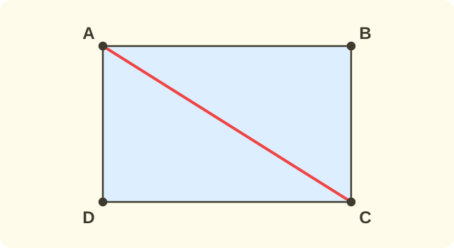

:::goals
- Nhận biết hình tam giác và hình tứ giác qua số đỉnh, số cạnh.
- Nhận biết hình chữ nhật và hình vuông, nêu đặc điểm về góc và cạnh.
- Tìm độ dài các cạnh của hình chữ nhật, hình vuông khi biết một vài cạnh.
:::

Lan cắt giấy màu thành nhiều hình. Có hình có $3$ cạnh, có hình có $4$ cạnh, lại có hình có $4$ góc vuông. Làm sao để gọi đúng tên từng hình? Em cùng giúp Lan nhé.

Cách làm khá đơn giản: đếm đỉnh, đếm cạnh, rồi dùng ê ke xem góc có phải góc vuông không. Biết nhìn như vậy, em sẽ gọi đúng tên từng hình mà không bị lẫn.

## Cùng khám phá

Em cầm một hình lên và thử đếm xem nó có mấy đỉnh, mấy cạnh:

- Hình có $3$ đỉnh và $3$ cạnh là **hình tam giác**.
- Hình có $4$ đỉnh và $4$ cạnh là **hình tứ giác**.
Cái tên cũng nhắc em số cạnh: "tam" là ba, "tứ" là bốn.

Trong các hình tứ giác, có hai hình em gặp rất nhiều: hình chữ nhật và hình vuông. Ta xem hình chữ nhật $ABCD$ trước.

:::diagram Hình chữ nhật ABCD
alt: Hình chữ nhật ABCD có bốn góc vuông; hai cạnh dài AB và CD có một vạch bằng nhau, hai cạnh ngắn BC và AD có hai vạch bằng nhau
point A 0,0 below-left
point B 4,0 below-right
point C 4,3 above-right
point D 0,3 above-left
polygon A B C D
right D A B
right A B C
right B C D
right C D A
mark A B 1
mark C D 1
mark B C 2
mark A D 2
:::

Em thử đặt ê ke vào từng góc: cả $4$ góc đều là góc vuông. Còn các cạnh thì sao? Hai cạnh đối diện $AB$ và $CD$ bằng nhau, hai cạnh đối diện $BC$ và $AD$ cũng bằng nhau.

Hình vuông $MNPQ$ đi xa hơn một bước: cả $4$ cạnh đều bằng nhau, không chỉ các cạnh đối diện.

:::diagram Hình vuông MNPQ
alt: Hình vuông MNPQ có bốn góc vuông và bốn cạnh có cùng một vạch, nghĩa là bằng nhau
point M 0,0 below-left
point N 3,0 below-right
point P 3,3 above-right
point Q 0,3 above-left
polygon M N P Q
right Q M N
right M N P
right N P Q
right P Q M
mark M N 1
mark N P 1
mark P Q 1
mark Q M 1
:::

:::theorem Cách nhận biết các hình
- **Hình tam giác:** $3$ đỉnh, $3$ cạnh.
- **Hình tứ giác:** $4$ đỉnh, $4$ cạnh.
- **Hình chữ nhật:** $4$ góc vuông, các cạnh đối diện bằng nhau.
- **Hình vuông:** $4$ góc vuông, $4$ cạnh bằng nhau.
:::

Em có thể tự kiểm tra bằng một tờ giấy. Lấy tờ giấy hình chữ nhật, gấp đôi lại sao cho hai cạnh đối diện chồng lên nhau: chúng sẽ trùng khít.

## Ví dụ

Trước hết, ta dùng tính chất của các cạnh đối diện để tìm độ dài các cạnh của một hình chữ nhật.

:::example Cạnh của hình chữ nhật
Hình chữ nhật $ABCD$ có $AB=4$ cm, $BC=3$ cm. Tìm độ dài $CD$ và $AD$.

**Lời giải.** Hai cạnh đối diện của hình chữ nhật bằng nhau. $CD$ đối diện $AB$, còn $AD$ đối diện $BC$:

$$CD=AB=4\ \text{cm},\qquad AD=BC=3\ \text{cm}.$$

Vậy $CD=4$ cm và $AD=3$ cm.
:::

Giờ ta làm ngược lại: cho các đặc điểm, em đoán xem đó là hình gì.

:::example Gọi tên hình
Một hình có $4$ đỉnh, $4$ góc vuông và $4$ cạnh đều dài $5$ cm. Đó là hình gì?

**Lời giải.** Hình có $4$ góc vuông và $4$ cạnh bằng nhau nên đó là hình vuông.

Vậy đó là hình vuông có cạnh $5$ cm.
:::

Hình vuông có $4$ cạnh bằng nhau. Vì vậy, thay vì cộng bốn lần cùng một số, ta nhân cho nhanh.

:::example Tổng độ dài bốn cạnh
Hình vuông $MNPQ$ có cạnh $5$ cm. Tổng độ dài bốn cạnh là bao nhiêu xăng-ti-mét?

**Lời giải.** Bốn cạnh đều dài $5$ cm, nên ta lấy $5$ nhân $4$:
$$5\times4=20\ \text{(cm)}.$$

Vậy tổng độ dài bốn cạnh là $20$ cm.
:::

Còn một câu hỏi nữa: nếu kẻ thêm một đoạn thẳng vào hình chữ nhật, ta sẽ được những hình nào?

:::example Chia hình chữ nhật
Nối hai đỉnh đối diện $A$ và $C$ của hình chữ nhật $ABCD$. Hình chữ nhật được chia thành mấy hình tam giác?

**Lời giải.** Đoạn $AC$ chia hình chữ nhật thành hai hình, mỗi hình có $3$ đỉnh và $3$ cạnh. Đó là tam giác $ABC$ và tam giác $ACD$.

Vậy hình chữ nhật được chia thành $2$ hình tam giác.
:::

:::warning Những lỗi em hay gặp
- **Gọi hình chữ nhật có hai cạnh khác nhau là hình vuông.** Chỗ này nhiều bạn hay nhầm. Hình có hai cạnh $6$ cm, hai cạnh $2$ cm mà gọi là hình vuông thì sai, vì hình vuông phải có $4$ cạnh bằng nhau. Hình đó là hình chữ nhật.
- **Nhầm cạnh đối diện.** Cho $ABCD$ là hình chữ nhật, $AB=4$ cm, mà viết $BC=4$ cm thì sai, vì $BC$ không đối diện $AB$. Đúng phải là $CD=4$ cm. Em hãy tìm cạnh đối diện trước khi viết.
- **Quên đơn vị.** Viết "Đáp số: $20$" là thiếu. Phải viết "Đáp số: $20$ cm".
Đừng lo nếu lần đầu còn nhầm. Em cứ đếm và kiểm tra lại từng bước là được.
:::

## Thuật ngữ

:::terms
- hình tam giác | triangle
- hình tứ giác | quadrilateral
- đỉnh | vertex (corner)
- cạnh | side
- góc vuông | right angle
- hình chữ nhật | rectangle
- hình vuông | square
- cạnh đối diện | opposite sides
:::

## Tóm tắt

- Hình tam giác có $3$ đỉnh, $3$ cạnh; hình tứ giác có $4$ đỉnh, $4$ cạnh.
- Hình chữ nhật có $4$ góc vuông; các cạnh đối diện bằng nhau.
- Hình vuông có $4$ góc vuông và $4$ cạnh bằng nhau.
- Tổng độ dài bốn cạnh của hình vuông cạnh $a$ là $a\times4$.
Quay lại câu hỏi của Lan: đếm đỉnh, đếm cạnh, kiểm tra góc vuông và so các cạnh là em gọi đúng tên mỗi hình. Làm thêm vài bài luyện tập, em sẽ quen mắt ngay.

## Luyện tập

Mỗi bài đều có phần kiến thức và gợi ý để em bắt đầu. Em cứ tự làm trước, chưa chắc thì xem gợi ý, rồi mới mở lời giải để đối chiếu.

:::exercise
Điền số vào chỗ trống: hình tam giác có $\ldots$ đỉnh và $\ldots$ cạnh; hình tứ giác có $\ldots$ đỉnh và $\ldots$ cạnh.

::hint
**Kiến thức:** số đỉnh bằng số cạnh; tam giác có $3$, tứ giác có $4$.

**Gợi ý các bước:**
1. Nhớ tên hình: "tam" là ba, "tứ" là bốn.
2. Điền số cho từng hình.

::solution
Em nhớ lại đặc điểm của từng hình.

Hình tam giác có $3$ đỉnh và $3$ cạnh.

Hình tứ giác có $4$ đỉnh và $4$ cạnh.

Vậy các số cần điền theo thứ tự là $3$; $3$; $4$; $4$.

**Đáp số.** $3$; $3$; $4$; $4$.
:::

:::exercise
Hình chữ nhật $ABCD$ có $AB=7$ cm, $BC=2$ cm. Tìm độ dài $CD$ và $AD$.

::hint
**Kiến thức:** các cạnh đối diện của hình chữ nhật bằng nhau.

**Gợi ý các bước:**
1. $CD$ đối diện cạnh nào?
2. $AD$ đối diện cạnh nào?

::solution
Trong hình chữ nhật, hai cạnh đối diện bằng nhau.

Cạnh $CD$ đối diện với cạnh $AB$ nên
$$CD=AB=7\ \text{(cm)}.$$

Cạnh $AD$ đối diện với cạnh $BC$ nên
$$AD=BC=2\ \text{(cm)}.$$

Vậy $CD=7$ cm và $AD=2$ cm.

**Đáp số.** $CD=7$ cm, $AD=2$ cm.
:::

:::exercise
Hình vuông $EFGH$ có cạnh $6$ cm. Mỗi cạnh còn lại dài bao nhiêu xăng-ti-mét?

::hint
**Kiến thức:** hình vuông có $4$ cạnh bằng nhau.

**Gợi ý các bước:**
1. Đề cho biết gì? Một cạnh dài $6$ cm.
2. Các cạnh còn lại thế nào so với cạnh đó?

::solution
Hình vuông có bốn cạnh bằng nhau.

Hình vuông $EFGH$ có một cạnh dài $6$ cm nên mỗi cạnh còn lại cũng dài $6$ cm.

Vậy mỗi cạnh còn lại của hình vuông $EFGH$ dài $6$ cm.

**Đáp số.** $6$ cm.
:::

:::exercise
Mỗi hình sau là hình gì?
a) Hình có $4$ góc vuông và $4$ cạnh bằng nhau.
b) Hình có $3$ đỉnh.
c) Hình có $4$ góc vuông, hai cạnh dài $8$ cm và hai cạnh dài $3$ cm.

::hint
**Kiến thức:** đếm đỉnh, xét góc vuông và so sánh các cạnh.

**Gợi ý các bước:**
1. Câu a: cạnh có bằng nhau không?
2. Câu c: hai cạnh $8$ cm và hai cạnh $3$ cm có bằng nhau cả bốn không?

::solution
a) Hình có $4$ góc vuông và $4$ cạnh bằng nhau là hình vuông.

b) Hình có $3$ đỉnh thì có $3$ cạnh, đó là hình tam giác.

c) Hình có $4$ góc vuông, hai cạnh dài $8$ cm và hai cạnh dài $3$ cm. Vì $8\ne3$ nên các cạnh không bằng nhau hết, do đó đó không phải là hình vuông. Hình có $4$ góc vuông mà các cạnh không bằng nhau hết là hình chữ nhật.

Vậy các hình đó lần lượt là hình vuông, hình tam giác, hình chữ nhật.

**Đáp số.** a) Hình vuông; b) Hình tam giác; c) Hình chữ nhật.
:::

:::exercise
Bác Hoa làm một khung hình vuông bằng $4$ thanh gỗ, mỗi thanh dài $5$ dm. Tất cả các thanh gỗ dài bao nhiêu đề-xi-mét?

::hint
**Kiến thức:** $4$ thanh bằng nhau thì lấy độ dài một thanh nhân $4$.

**Gợi ý các bước:**
1. Đề cho biết gì? $4$ thanh, mỗi thanh $5$ dm. Đề hỏi gì? Tổng độ dài.
2. Tính $5\times4$ và ghi đơn vị.

::solution
Bài giải

Khung hình vuông làm bằng $4$ thanh gỗ, mỗi thanh dài $5$ dm nên tổng độ dài các thanh gỗ là:
$$5\times4=20\ \text{(dm)}$$

Vậy tất cả các thanh gỗ dài $20$ dm.

**Đáp số.** $20$ dm.
:::

:::exercise
Tìm số thích hợp điền vào chỗ trống: hình vuông có cạnh $9$ cm thì tổng độ dài bốn cạnh là $\ldots$ cm.

::hint
**Kiến thức:** tổng độ dài bốn cạnh hình vuông bằng cạnh nhân $4$.

**Gợi ý các bước:**
1. Dùng bảng nhân $9$ hoặc bảng nhân $4$.
2. Tính $9\times4$.

::solution
Hình vuông có bốn cạnh bằng nhau, mỗi cạnh dài $9$ cm nên tổng độ dài bốn cạnh là:
$$9\times4=36\ \text{(cm)}$$

Vậy tổng độ dài bốn cạnh của hình vuông là $36$ cm.

**Đáp số.** $36$ cm.
:::

:::exercise
Em hãy nhớ lại bài trước: hình chữ nhật $ABCD$ có mấy góc vuông? Hình tam giác $MNP$ có đúng một góc vuông thì có mấy góc không vuông?

::hint
**Kiến thức:** hình chữ nhật có $4$ góc vuông; hình tam giác có $3$ góc.

**Gợi ý các bước:**
1. Hình chữ nhật có mấy góc, các góc đều là góc vuông.
2. Tam giác có $3$ góc, trừ đi góc vuông.

::solution
Hình chữ nhật $ABCD$ có $4$ góc vuông.

Hình tam giác $MNP$ có $3$ góc, trong đó có đúng $1$ góc vuông. Số góc không vuông là:
$$3-1=2\ \text{(góc)}$$

Vậy hình chữ nhật $ABCD$ có $4$ góc vuông; hình tam giác $MNP$ có $2$ góc không vuông.

**Đáp số.** $4$ góc vuông; $2$ góc không vuông.
:::

:::exercise Thử thách
Ghép hai hình vuông cạnh $3$ cm, có một cạnh chung, thành một hình chữ nhật. Hai cạnh của hình chữ nhật đó dài bao nhiêu xăng-ti-mét?

::hint
**Kiến thức:** hình chữ nhật có hai cạnh dài bằng nhau và hai cạnh ngắn bằng nhau.

**Gợi ý các bước:**
1. Vẽ hai hình vuông đặt cạnh nhau.
2. Cạnh dài gồm mấy cạnh hình vuông? Cạnh ngắn gồm mấy cạnh?

::solution
Bài giải

Cạnh dài của hình chữ nhật gồm hai cạnh của hình vuông ghép lại, nên cạnh dài là:
$$3+3=6\ \text{(cm)}$$

Cạnh ngắn của hình chữ nhật là một cạnh của hình vuông, nên cạnh ngắn dài $3$ cm.

Kiểm tra: hình ghép được có $4$ góc vuông và các cạnh đối diện bằng nhau ($6$ cm và $6$ cm; $3$ cm và $3$ cm). Đúng.

Vậy hình chữ nhật có hai cạnh dài $6$ cm và $3$ cm.

**Đáp số.** $6$ cm và $3$ cm.
:::

## Kiểm tra mini

:::quiz
::mc NB
Hình nào có $4$ góc vuông và $4$ cạnh bằng nhau?
A. Hình tam giác.
B. Hình chữ nhật có chiều dài khác chiều rộng.
C. Hình vuông.
D. Hình có $3$ đỉnh.
::key C
Chỉ hình vuông có đủ $4$ góc vuông và $4$ cạnh bằng nhau. Phương án B có cạnh không bằng nhau.

::mc TH
Hình chữ nhật $ABCD$ có $AB=8$ cm, $BC=5$ cm. Độ dài $CD$ là
A. $5$ cm.
B. $8$ cm.
C. $13$ cm.
D. $3$ cm.
::key B
$CD$ đối diện $AB$ nên $CD=8$ cm. Phương án A là độ dài $BC$, phương án C là lỗi cộng hai cạnh.

::mc NB
Hình tứ giác có bao nhiêu đỉnh?
A. $3$.
B. $4$.
C. $5$.
D. $2$.
::key B
Hình tứ giác có $4$ đỉnh và $4$ cạnh. Phương án A là số đỉnh của hình tam giác.

::mc TH
Nam ghép $4$ que, mỗi que dài $6$ cm, thành một hình vuông. Tổng độ dài các que là
A. $10$ cm.
B. $12$ cm.
C. $24$ cm.
D. $6$ cm.
::key C
$6\times4=24$ (cm). Phương án B là $6\times2$, thiếu hai que.

::tf NB NB TH TH
Hình vuông $MNPQ$ có cạnh $4$ cm.
a) Hình có $4$ góc vuông.
b) $NP=4$ cm.
c) $NP$ dài hơn $MN$.
d) Tổng độ dài bốn cạnh là $16$ cm.
::key Đ Đ S Đ
a) Đúng: hình vuông có $4$ góc vuông. b) Đúng: $4$ cạnh bằng nhau. c) Sai: $NP=MN=4$ cm. d) Đúng: $4\times4=16$ (cm).

::sa TH
Hình chữ nhật $EFGH$ có $EF=9$ cm, $FG=4$ cm. Độ dài $HG$ bằng bao nhiêu xăng-ti-mét?
::key 9
$HG$ đối diện $EF$ nên $HG=EF=9$ cm.

::sa TH
Một tấm bìa hình vuông có cạnh $7$ cm. Tổng độ dài bốn cạnh là bao nhiêu xăng-ti-mét?
::key 28
$7\times4=28$ (cm).
:::
