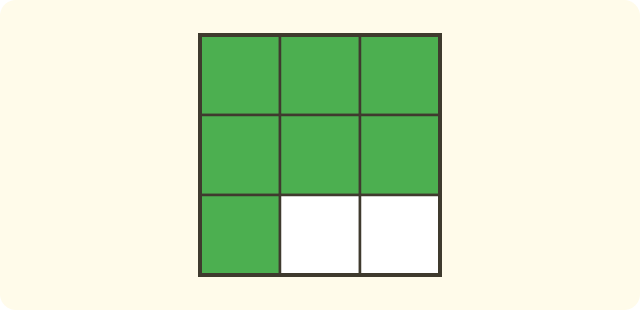

:::goals
- Biết thương của phép chia hai số tự nhiên ($a:b$, $b\neq0$) viết được thành phân số $\dfrac{a}{b}$.
- Viết một số tự nhiên dưới dạng phân số.
- Giải bài toán chia đều mà kết quả là một phân số.
:::

Cô giáo chia đều $3$ chiếc bánh cho $4$ bạn. Mỗi bạn được bao nhiêu phần của một chiếc bánh?

Em đã biết $12:4=3$. Nhưng $3:4$ thì không chia hết, và em cần một loại số mới để viết thương. Đó chính là phân số mà em vừa học.

## Cùng khám phá

Ta chia đều từng bước.

- Cắt mỗi chiếc bánh thành $4$ phần bằng nhau. Mỗi phần là $\dfrac{1}{4}$ chiếc bánh.
- Mỗi bạn lấy $1$ phần của chiếc bánh thứ nhất, $1$ phần của chiếc bánh thứ hai và $1$ phần của chiếc bánh thứ ba.
- Vậy mỗi bạn có $3$ phần, mỗi phần là $\dfrac{1}{4}$ chiếc bánh.

Mỗi bạn được $\dfrac{3}{4}$ chiếc bánh. Ta thấy $3:4=\dfrac{3}{4}$.

:::graph Trên trục số: 3 : 4 là điểm 3/4, nằm giữa 0 và 1
alt: Trục số từ 0 đến 1 chia thành 4 phần bằng nhau, đánh dấu các điểm 0, 3/4 và 1
x: -0.1..1.1
y: -0.15..0.15
segment: (0, 0) (1, 0)
point: (0, 0) "0" below
point: (0.75, 0) "3/4" below
point: (1, 0) "1" below
:::

:::theorem Phân số và phép chia
Thương của phép chia số tự nhiên $a$ cho số tự nhiên $b$ (khác $0$) viết được thành phân số có tử số là $a$ và mẫu số là $b$:
$$a:b=\frac{a}{b}.$$
:::

Điều này đúng vì chia đều $a$ cái bánh cho $b$ bạn thì mỗi bạn được $a$ phần, mỗi phần là $\dfrac{1}{b}$ chiếc bánh, tức $\dfrac{a}{b}$.

## Ví dụ

Ta bắt đầu với một phép chia mà số bị chia nhỏ hơn số chia.

:::example Chia bánh
Chia đều $2$ chiếc bánh cho $5$ bạn. Mỗi bạn được bao nhiêu phần chiếc bánh?

**Lời giải.** Ta lấy số bánh chia cho số bạn, rồi viết thương thành phân số:
$$2:5=\frac{2}{5}.$$
Vậy mỗi bạn được $\dfrac{2}{5}$ chiếc bánh.
:::

Khi số bị chia lớn hơn số chia, phân số có tử số lớn hơn mẫu số. Điều đó vẫn đúng.

:::example Chia ruy-băng
Chia đều $5$ m ruy-băng cho $4$ bạn. Mỗi bạn được bao nhiêu mét?

**Lời giải.** Ta chia $5$ cho $4$ và viết thương thành phân số:
$$5:4=\frac{5}{4}\ \text{(m)}.$$
Vậy mỗi bạn được $\dfrac{5}{4}$ m. Trên trục số, $\dfrac{5}{4}$ nằm sau điểm $1$ một phần tư.

:::

Mọi số tự nhiên cũng viết được dưới dạng phân số.

:::example Viết số tự nhiên thành phân số
Viết số $6$ và số $1$ dưới dạng phân số.

**Lời giải.** Chia $6$ cho $1$ thì được $6$, nên:
$$6=6:1=\frac{6}{1}.$$
Chia $8$ cho $8$ được $1$, nên $1=\dfrac{8}{8}$. Ta có thể viết số $1$ với mẫu số bất kì (khác $0$) bằng cách cho tử số bằng mẫu số.

**Kiểm tra.** $\dfrac{6}{1}$ là $6$ phần, mỗi phần là một cái nguyên: được $6$ cái nguyên. Đúng.
:::

Ta cũng đi theo chiều ngược lại: đọc một phân số như một phép chia.

:::example Phân số là một phép chia
Một sợi dây dài $9$ m được cắt thành $4$ đoạn bằng nhau. Mỗi đoạn dài bao nhiêu mét? Phân số $\dfrac{9}{4}$ là thương của phép chia nào?

**Lời giải.** Chia sợi dây thành $4$ đoạn bằng nhau nghĩa là chia $9$ cho $4$:
$$9:4=\frac{9}{4}\ \text{(m)}.$$
Vậy mỗi đoạn dài $\dfrac{9}{4}$ m, và phân số $\dfrac{9}{4}$ là thương của phép chia $9:4$.
:::

:::warning Những lỗi em hay gặp
- **Viết ngược.** Sai: $2:3=\dfrac{3}{2}$. Vì sao sai: số bị chia là tử số, số chia là mẫu số. Đúng: $2:3=\dfrac{2}{3}$.
- **Chia cho $0$.** Sai: $5:0=\dfrac{5}{0}$. Vì sao sai: không có phép chia cho $0$, và mẫu số không được bằng $0$. Đúng: số chia phải khác $0$.
- **Nghĩ thương luôn là số tự nhiên.** Sai: $3:4$ không có thương. Vì sao sai: thương là phân số $\dfrac{3}{4}$. Đúng: $3:4=\dfrac{3}{4}$.
:::

## Thuật ngữ

:::terms
- phép chia | division
- thương | quotient
- số bị chia | dividend
- số chia | divisor
- số tự nhiên | whole number
- chia đều | share equally
- phân số | fraction
:::

## Tóm tắt

- $a:b=\dfrac{a}{b}$ với $b\neq0$: số bị chia là tử số, số chia là mẫu số.
- Ví dụ: $3:4=\dfrac{3}{4}$.
- Phân số có thể có tử số lớn hơn mẫu số, ví dụ $5:4=\dfrac{5}{4}$.
- Số tự nhiên $a$ viết được thành $\dfrac{a}{1}$; số $1$ viết được thành $\dfrac{b}{b}$.
- Không chia cho $0$.

## Luyện tập

Mỗi bài có phần kiến thức và gợi ý. Em hãy tự làm trước, rồi mới bấm xem lời giải.

:::exercise
Viết thương của phép chia $3:5$ dưới dạng phân số.

::hint
**Kiến thức:** $a:b=\dfrac{a}{b}$.

**Gợi ý các bước:**
1. Số bị chia là tử số.
2. Số chia là mẫu số.

::solution
$3:5=\dfrac{3}{5}$.

**Đáp số.** $\dfrac{3}{5}$.
:::

:::exercise
Chia đều $4$ chiếc bánh cho $6$ bạn. Mỗi bạn được bao nhiêu phần chiếc bánh?

::hint
**Kiến thức:** chia đều thì dùng phép chia; viết thương thành phân số.

**Gợi ý các bước:**
1. Đề cho biết gì? Hỏi gì?
2. Viết phép chia rồi viết phân số.

::solution
$4:6=\dfrac{4}{6}$ (chiếc bánh).

**Đáp số.** $\dfrac{4}{6}$ chiếc bánh.
:::

:::exercise
Em hãy nhớ lại bài trước: một hình chia thành $9$ phần bằng nhau, tô màu $7$ phần. Viết phân số chỉ phần đã tô, rồi viết phân số đó dưới dạng một phép chia.

::hint
**Kiến thức:** tử số là số phần tô, mẫu số là số phần bằng nhau; $\dfrac{a}{b}=a:b$.

**Gợi ý các bước:**
1. Viết phân số.
2. Viết phép chia có số bị chia là tử số.

::solution
Phân số chỉ phần đã tô là $\dfrac{7}{9}$, và $\dfrac{7}{9}=7:9$.

**Đáp số.** $\dfrac{7}{9}=7:9$.
:::

:::exercise
Viết mỗi số tự nhiên sau dưới dạng phân số có mẫu số $1$: a) $5$; b) $12$. Viết số $1$ dưới dạng phân số có mẫu số $6$.

::hint
**Kiến thức:** $a=\dfrac{a}{1}$; $1=\dfrac{b}{b}$.

**Gợi ý các bước:**
1. Đặt mẫu số $1$ dưới số tự nhiên.
2. Với số $1$, cho tử số bằng mẫu số.

::solution
a) $5=\dfrac{5}{1}$. b) $12=\dfrac{12}{1}$. Số $1$ với mẫu số $6$ là $\dfrac{6}{6}$.

**Đáp số.** $\dfrac{5}{1}$; $\dfrac{12}{1}$; $\dfrac{6}{6}$.
:::

:::exercise
Vì sao không thể viết $5:0$ thành một phân số?

::hint
**Kiến thức:** số chia là mẫu số; phép chia cho $0$ không có nghĩa.

**Gợi ý các bước:**
1. Số chia của $5:0$ là số nào?
2. Mẫu số có thể là số đó không?

::solution
Số chia là $0$ sẽ thành mẫu số $0$. Không thể chia $5$ thành $0$ phần bằng nhau, nên không có phân số $\dfrac{5}{0}$.

**Đáp số.** Vì mẫu số không được bằng $0$.
:::

:::exercise
Hà viết: "$2:3=\dfrac{3}{2}$." Hà sai ở đâu? Hãy viết lại cho đúng.

::hint
**Kiến thức:** $a:b=\dfrac{a}{b}$: số bị chia ở trên.

**Gợi ý các bước:**
1. Số bị chia là số nào?
2. Số bị chia nằm ở tử số hay mẫu số?

::solution
Hà viết ngược. Số bị chia là $2$ nên là tử số: $2:3=\dfrac{2}{3}$.

**Đáp số.** $\dfrac{2}{3}$.
:::

:::exercise
Viết kết quả mỗi bài toán dưới dạng phân số:
a) Chia đều $2$ lít nước vào $3$ chai. Mỗi chai có bao nhiêu lít?
b) Chia đều $3$ lít nước vào $2$ chai. Mỗi chai có bao nhiêu lít?
c) Chia đều $6$ lít nước vào $6$ chai. Mỗi chai có bao nhiêu lít?

::hint
**Kiến thức:** số lít chia cho số chai.

**Gợi ý các bước:**
1. Viết phép chia cho từng câu.
2. Viết thương thành phân số.

::solution
a) $2:3=\dfrac{2}{3}$ (lít). b) $3:2=\dfrac{3}{2}$ (lít). c) $6:6=\dfrac{6}{6}=1$ (lít).

**Đáp số.** a) $\dfrac{2}{3}$ lít; b) $\dfrac{3}{2}$ lít; c) $1$ lít.
:::

:::exercise Thử thách
Tìm số thích hợp thay cho dấu $?$:
a) $4:9=\dfrac{?}{9}$.
b) $12:?=\dfrac{12}{5}$.
c) $7:4=\dfrac{?}{4}$.

::hint
**Kiến thức:** $a:b=\dfrac{a}{b}$; so sánh số bị chia với tử số, số chia với mẫu số.

**Gợi ý các bước:**
1. Số bị chia là tử số.
2. Số chia là mẫu số.

::solution
a) Số bị chia là $4$ nên $?=4$. b) Mẫu số là $5$ nên số chia $?=5$. c) Số bị chia là $7$ nên $?=7$.

**Kiểm tra.** $4:9=\dfrac{4}{9}$; $12:5=\dfrac{12}{5}$; $7:4=\dfrac{7}{4}$. Đúng.

**Đáp số.** a) $4$; b) $5$; c) $7$.
:::

## Kiểm tra mini

:::quiz
::mc
Thương của phép chia $5:8$ viết thành phân số là
A. $\dfrac{8}{5}$.
B. $5+8$.
C. $\dfrac{5}{8}$.
D. $13$.
::key C
Số bị chia $5$ là tử số, số chia $8$ là mẫu số. Phương án A là lỗi viết ngược.

::mc
Chia đều $3$ m dây cho $4$ bạn. Mỗi bạn được
A. $\dfrac{4}{3}$ m.
B. $3$ m.
C. $\dfrac{1}{4}$ m.
D. $\dfrac{3}{4}$ m.
::key D
$3:4=\dfrac{3}{4}$. Phương án A viết ngược.

::mc
Số $7$ viết dưới dạng phân số là
A. $\dfrac{7}{1}$.
B. $\dfrac{1}{7}$.
C. $\dfrac{7}{7}$.
D. $\dfrac{0}{7}$.
::key A
$7:1=7$ nên $7=\dfrac{7}{1}$. Phương án C bằng $1$, không phải $7$.

::mc
Phân số $\dfrac{9}{4}$ là thương của phép chia
A. $4:9$.
B. $9:4$.
C. $9+4$.
D. $9-4$.
::key B
Tử số là số bị chia, mẫu số là số chia, nên $\dfrac{9}{4}=9:4$.

::tf
Em xét các phép chia và phân số.
a) $3:5=\dfrac{3}{5}$.
b) $5:3=\dfrac{3}{5}$.
c) $\dfrac{8}{8}=1$.
d) Có thể viết $5:0$ thành phân số $\dfrac{5}{0}$.
::key Đ S Đ S
a) Đúng. b) Sai: $5:3=\dfrac{5}{3}$. c) Đúng: $8:8=1$. d) Sai: không chia cho $0$.

::sa
Biết $12:?=\dfrac{12}{5}$. Số cần điền vào $?$ là bao nhiêu?
::key 5
Số chia là mẫu số, nên $?=5$.

::sa
Phân số $\dfrac{10}{10}$ bằng số nào?
::key 1
$10:10=1$.
:::
