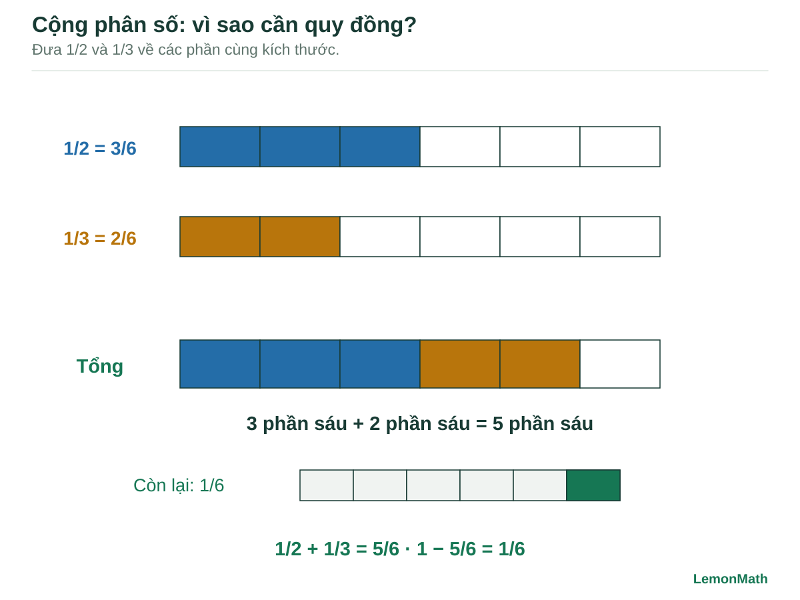

:::goals
- Cộng và trừ hai phân số có cùng mẫu số.
- Cộng và trừ hai phân số khác mẫu số bằng cách quy đồng mẫu số.
- Trừ một phân số từ $1$ bằng cách viết $1$ dưới dạng phân số.
- Rút gọn kết quả và giải bài toán có lời văn bằng phép cộng, phép trừ phân số.
:::

Giả sử một cuộn ruy-băng dài $1$ m. Lan cắt $\dfrac{1}{2}$ m để làm nơ và cắt $\dfrac{1}{3}$ m để buộc quà.

Lan đã dùng tất cả bao nhiêu mét ruy-băng? Cuộn ruy-băng còn lại bao nhiêu mét? Hai phân số $\dfrac{1}{2}$ và $\dfrac{1}{3}$ khác mẫu số nên em chưa cộng ngay được. Bài này dạy em cách cộng và trừ phân số.

## Phép cộng phân số

### Cùng khám phá

Em chia một băng giấy thành $7$ phần bằng nhau. Tô $2$ phần, rồi tô thêm $3$ phần. Số phần đã tô là $2+3=5$ phần, tức là $\dfrac{5}{7}$ băng giấy. Vậy:
$$\dfrac{2}{7}+\dfrac{3}{7}=\dfrac{2+3}{7}=\dfrac{5}{7}.$$

Hai phân số này cùng mẫu số nên các phần có cùng độ lớn, và ta chỉ cộng số phần: cộng các tử số, giữ nguyên mẫu số.

Với $\dfrac{1}{2}$ và $\dfrac{1}{3}$, các phần có độ lớn khác nhau nên chưa cộng được. Em quy đồng mẫu số về $6$ rồi cộng:
$$\dfrac{1}{2}+\dfrac{1}{3}=\dfrac{3}{6}+\dfrac{2}{6}=\dfrac{5}{6}.$$

:::theorem Cộng hai phân số
- **Cùng mẫu số:** cộng hai tử số với nhau và giữ nguyên mẫu số: $\dfrac{a}{c}+\dfrac{b}{c}=\dfrac{a+b}{c}$.
- **Khác mẫu số:** quy đồng mẫu số hai phân số rồi cộng hai phân số cùng mẫu số.

Nếu có thể, em rút gọn kết quả đến phân số tối giản.
:::

Vì sao phải quy đồng? Chỉ khi các phần có cùng độ lớn (cùng mẫu số) thì mới cộng được số phần với nhau, giống như chỉ cộng được $2$ quả cam với $3$ quả cam, còn nửa quả và một phần ba quả thì phải đổi về cùng cỡ.

**Kết nối.** Bài này dùng quy đồng mẫu số, rút gọn và so sánh phân số em đã học. Nó chuẩn bị cho bài nhân, chia phân số.

Ta bắt đầu với phân số cùng mẫu số.

:::example Cộng hai phân số cùng mẫu số
Tính:
a) $\dfrac{2}{7}+\dfrac{3}{7}$
b) $\dfrac{3}{8}+\dfrac{1}{8}$

**Lời giải.** a) $\dfrac{2}{7}+\dfrac{3}{7}=\dfrac{2+3}{7}=\dfrac{5}{7}$.

b) $\dfrac{3}{8}+\dfrac{1}{8}=\dfrac{3+1}{8}=\dfrac{4}{8}$. Cả $4$ và $8$ chia hết cho $4$ nên rút gọn: $\dfrac{4}{8}=\dfrac{1}{2}$.

Vậy a) $\dfrac{5}{7}$; b) $\dfrac{1}{2}$.
:::

Bây giờ phân số khác mẫu số.

:::example Cộng hai phân số khác mẫu số
Tính $\dfrac{1}{2}+\dfrac{1}{3}$.

**Lời giải.** Ta quy đồng mẫu số với mẫu số chung $2\times3=6$:
$$\dfrac{1}{2}=\dfrac{1\times3}{2\times3}=\dfrac{3}{6},\qquad \dfrac{1}{3}=\dfrac{1\times2}{3\times2}=\dfrac{2}{6}.$$
Rồi cộng: $\dfrac{3}{6}+\dfrac{2}{6}=\dfrac{5}{6}$.

Vậy $\dfrac{1}{2}+\dfrac{1}{3}=\dfrac{5}{6}$.

:::

Tổng của hai phân số có thể lớn hơn $1$.

:::example Tổng lớn hơn 1
Tính $\dfrac{3}{4}+\dfrac{5}{6}$.

**Lời giải.** Mẫu số chung nhỏ là $12$:
$$\dfrac{3}{4}=\dfrac{9}{12},\qquad \dfrac{5}{6}=\dfrac{10}{12}.$$
Rồi cộng: $\dfrac{9}{12}+\dfrac{10}{12}=\dfrac{19}{12}$.

Phân số $\dfrac{19}{12}$ có tử số lớn hơn mẫu số nên lớn hơn $1$. Nó không rút gọn được vì $19$ và $12$ không có số chung lớn hơn $1$.

Vậy $\dfrac{3}{4}+\dfrac{5}{6}=\dfrac{19}{12}$.
:::

## Phép trừ phân số

### Cùng khám phá

Em chia băng giấy thành $7$ phần bằng nhau. Có $5$ phần được tô, em xoá bớt $2$ phần. Còn lại $5-2=3$ phần, tức là $\dfrac{3}{7}$ băng giấy:
$$\dfrac{5}{7}-\dfrac{2}{7}=\dfrac{5-2}{7}=\dfrac{3}{7}.$$

Quay lại cuộn ruy-băng dài $1$ m. Em đã dùng $\dfrac{5}{6}$ m, vậy còn lại $1-\dfrac{5}{6}$ m. Em viết $1=\dfrac{6}{6}$ rồi trừ:
$$1-\dfrac{5}{6}=\dfrac{6}{6}-\dfrac{5}{6}=\dfrac{1}{6}.$$

:::theorem Trừ hai phân số
- **Cùng mẫu số:** trừ hai tử số cho nhau và giữ nguyên mẫu số: $\dfrac{a}{c}-\dfrac{b}{c}=\dfrac{a-b}{c}$.
- **Khác mẫu số:** quy đồng mẫu số hai phân số rồi trừ hai phân số cùng mẫu số.
- **Số $1$ trừ một phân số:** viết $1=\dfrac{n}{n}$ với $n$ là mẫu số của phân số đó, rồi trừ.
:::

Vì sao viết $1=\dfrac{6}{6}$? Một cuộn ruy-băng nguyên vẹn gồm $6$ phần sáu, nên $1=\dfrac{6}{6}$, và việc trừ $\dfrac{5}{6}$ chỉ còn là trừ số phần cùng cỡ.

:::example Trừ hai phân số cùng mẫu số
Tính $\dfrac{7}{9}-\dfrac{4}{9}$.

**Lời giải.** $\dfrac{7}{9}-\dfrac{4}{9}=\dfrac{7-4}{9}=\dfrac{3}{9}$.

Cả $3$ và $9$ chia hết cho $3$ nên rút gọn: $\dfrac{3}{9}=\dfrac{1}{3}$.

Vậy $\dfrac{7}{9}-\dfrac{4}{9}=\dfrac{1}{3}$.
:::

:::example Trừ hai phân số khác mẫu số
Tính $\dfrac{5}{6}-\dfrac{1}{4}$.

**Lời giải.** Mẫu số chung nhỏ là $12$:
$$\dfrac{5}{6}=\dfrac{10}{12},\qquad \dfrac{1}{4}=\dfrac{3}{12}.$$
Rồi trừ: $\dfrac{10}{12}-\dfrac{3}{12}=\dfrac{7}{12}$.

Vậy $\dfrac{5}{6}-\dfrac{1}{4}=\dfrac{7}{12}$.
:::

:::example Số 1 trừ một phân số
Tính $1-\dfrac{3}{8}$.

**Lời giải.** Ta viết $1=\dfrac{8}{8}$ rồi trừ:
$$1-\dfrac{3}{8}=\dfrac{8}{8}-\dfrac{3}{8}=\dfrac{5}{8}.$$
Vậy $1-\dfrac{3}{8}=\dfrac{5}{8}$.
:::

Bây giờ em trả lời câu hỏi về cuộn ruy-băng ở đầu bài.

:::example Cuộn ruy-băng
Một cuộn ruy-băng dài $1$ m. Lan cắt $\dfrac{1}{2}$ m để làm nơ và cắt $\dfrac{1}{3}$ m để buộc quà. Hỏi Lan đã dùng tất cả bao nhiêu mét ruy-băng và cuộn ruy-băng còn lại bao nhiêu mét?

**Hiểu đề.** Cuộn dài $1$ m; dùng $\dfrac{1}{2}$ m và $\dfrac{1}{3}$ m. Cần tìm tổng số mét đã dùng và số mét còn lại.

**Tìm cách giải.** Số mét đã dùng là tổng $\dfrac{1}{2}+\dfrac{1}{3}$. Số mét còn lại là $1$ trừ số mét đã dùng.

**Giải.** Số mét ruy-băng Lan đã dùng là $\dfrac{1}{2}+\dfrac{1}{3}=\dfrac{3}{6}+\dfrac{2}{6}=\dfrac{5}{6}$ (m).

Số mét ruy-băng còn lại là $1-\dfrac{5}{6}=\dfrac{6}{6}-\dfrac{5}{6}=\dfrac{1}{6}$ (m).

**Đáp số:** đã dùng $\dfrac{5}{6}$ m; còn lại $\dfrac{1}{6}$ m.

**Nhìn lại.** Ta thử lại: $\dfrac{5}{6}+\dfrac{1}{6}=\dfrac{6}{6}=1$ (m), đúng bằng chiều dài cuộn. Cũng hợp lí vì $\dfrac{5}{6}<1$.
:::

:::warning Những lỗi em hay gặp
- **Cộng cả tử số và mẫu số.** Sai: $\dfrac{1}{2}+\dfrac{1}{3}=\dfrac{2}{5}$. Vì sao sai: kết quả $\dfrac{2}{5}$ còn bé hơn $\dfrac{1}{2}$, mà tổng phải lớn hơn mỗi số hạng. Đúng: $\dfrac{1}{2}+\dfrac{1}{3}=\dfrac{5}{6}$.
- **Quên rút gọn kết quả.** Sai: $\dfrac{3}{8}+\dfrac{1}{8}=\dfrac{4}{8}$ rồi dừng. Vì sao sai: $\dfrac{4}{8}$ chưa phải phân số tối giản. Đúng: $\dfrac{4}{8}=\dfrac{1}{2}$.
- **Trừ cả tử số lẫn mẫu số.** Sai: $\dfrac{5}{6}-\dfrac{1}{4}=\dfrac{4}{2}$. Vì sao sai: hiệu phải bé hơn số bị trừ $\dfrac{5}{6}$, mà $\dfrac{4}{2}=2$ lớn hơn $1$. Đúng: $\dfrac{5}{6}-\dfrac{1}{4}=\dfrac{7}{12}$.
:::

## Thuật ngữ

:::terms
- phép cộng phân số | addition of fractions
- phép trừ phân số | subtraction of fractions
- cùng mẫu số | the same denominator
- quy đồng mẫu số | write over a common denominator
- tổng | sum
- hiệu | difference
- rút gọn | simplify
- tử số | numerator
- mẫu số | denominator
:::

## Tóm tắt

- Cộng hoặc trừ hai phân số cùng mẫu số: cộng hoặc trừ các tử số, giữ nguyên mẫu số.
- Khác mẫu số: quy đồng mẫu số rồi cộng hoặc trừ.
- Số $1$ trừ một phân số: viết $1=\dfrac{n}{n}$ rồi trừ.
- Rút gọn kết quả đến phân số tối giản khi có thể.
- Thử lại phép trừ bằng phép cộng: $\dfrac{5}{6}+\dfrac{1}{6}=1$.

## Luyện tập

Mỗi bài có phần kiến thức và gợi ý. Em hãy tự làm trước, rồi mới bấm xem lời giải.

:::exercise
Tính $\dfrac{3}{10}+\dfrac{4}{10}$.

::hint
**Kiến thức:** cùng mẫu số thì cộng các tử số, giữ nguyên mẫu số.

**Gợi ý các bước:**
1. Hai phân số có cùng mẫu số nào?
2. Cộng hai tử số.

::solution
Hai phân số có cùng mẫu số $10$ nên ta cộng hai tử số và giữ nguyên mẫu số.

$$\frac{3}{10}+\frac{4}{10}=\frac{3+4}{10}=\frac{7}{10}.$$

Phân số $\dfrac{7}{10}$ không rút gọn được vì $7$ và $10$ không có ước chung nào lớn hơn $1$.

Vậy $\dfrac{3}{10}+\dfrac{4}{10}=\dfrac{7}{10}$.

**Đáp số.** $\dfrac{7}{10}$.
:::

:::exercise
Tính $\dfrac{5}{12}+\dfrac{1}{12}$ và rút gọn kết quả.

::hint
**Kiến thức:** sau khi cộng, rút gọn nếu tử số và mẫu số cùng chia hết cho một số lớn hơn $1$.

**Gợi ý các bước:**
1. Cộng hai tử số.
2. Rút gọn phân số.

::solution
Hai phân số có cùng mẫu số $12$ nên ta cộng hai tử số và giữ nguyên mẫu số:
$$\frac{5}{12}+\frac{1}{12}=\frac{5+1}{12}=\frac{6}{12}.$$

Ta rút gọn phân số $\dfrac{6}{12}$. Vì $6$ và $12$ cùng chia hết cho $6$ nên chia cả tử số và mẫu số cho $6$:
$$\frac{6}{12}=\frac{6:6}{12:6}=\frac{1}{2}.$$

Vậy $\dfrac{5}{12}+\dfrac{1}{12}=\dfrac{1}{2}$.

**Đáp số.** $\dfrac{1}{2}$.
:::

:::exercise
Tính $\dfrac{2}{5}+\dfrac{1}{3}$.

::hint
**Kiến thức:** khác mẫu số thì quy đồng mẫu số trước.

**Gợi ý các bước:**
1. Mẫu số chung là $5\times3$.
2. Quy đồng rồi cộng hai tử số.

::solution
Hai phân số khác mẫu số nên ta quy đồng mẫu số. Mẫu số chung là $15$ vì $15=5\times3$.

Ta có
$$\frac{2}{5}=\frac{2\times3}{5\times3}=\frac{6}{15},\qquad \frac{1}{3}=\frac{1\times5}{3\times5}=\frac{5}{15}.$$

Do đó
$$\frac{2}{5}+\frac{1}{3}=\frac{6}{15}+\frac{5}{15}=\frac{6+5}{15}=\frac{11}{15}.$$

Vậy $\dfrac{2}{5}+\dfrac{1}{3}=\dfrac{11}{15}$.

**Đáp số.** $\dfrac{11}{15}$.
:::

:::exercise
Tính $\dfrac{7}{12}+\dfrac{5}{6}$.

::hint
**Kiến thức:** $12$ chia hết cho $6$ nên chỉ cần đổi một phân số.

**Gợi ý các bước:**
1. Đổi $\dfrac{5}{6}$ thành phân số có mẫu số $12$.
2. Cộng hai phân số cùng mẫu số.

::solution
Hai phân số khác mẫu số. Vì $12$ chia hết cho $6$ nên ta chọn mẫu số chung là $12$ và chỉ cần quy đồng phân số $\dfrac{5}{6}$:
$$\frac{5}{6}=\frac{5\times2}{6\times2}=\frac{10}{12}.$$

Do đó
$$\frac{7}{12}+\frac{5}{6}=\frac{7}{12}+\frac{10}{12}=\frac{7+10}{12}=\frac{17}{12}.$$

Vậy $\dfrac{7}{12}+\dfrac{5}{6}=\dfrac{17}{12}$.

**Đáp số.** $\dfrac{17}{12}$.
:::

:::exercise
Tính $\dfrac{11}{15}-\dfrac{4}{15}$.

::hint
**Kiến thức:** cùng mẫu số thì trừ các tử số, giữ nguyên mẫu số.

**Gợi ý các bước:**
1. Trừ hai tử số.
2. Xem kết quả có rút gọn được không.

::solution
Hai phân số có cùng mẫu số $15$ nên ta trừ hai tử số và giữ nguyên mẫu số:
$$\frac{11}{15}-\frac{4}{15}=\frac{11-4}{15}=\frac{7}{15}.$$

Phân số $\dfrac{7}{15}$ đã tối giản vì $7$ và $15$ không có ước chung nào lớn hơn $1$.

Vậy $\dfrac{11}{15}-\dfrac{4}{15}=\dfrac{7}{15}$.

**Đáp số.** $\dfrac{7}{15}$.
:::

:::exercise
Tính $\dfrac{3}{4}-\dfrac{2}{5}$.

::hint
**Kiến thức:** khác mẫu số thì quy đồng mẫu số rồi trừ.

**Gợi ý các bước:**
1. Mẫu số chung là $4\times5$.
2. Quy đồng rồi trừ hai tử số.

::solution
Hai phân số khác mẫu số nên ta quy đồng mẫu số. Mẫu số chung là $20$ vì $20=4\times5$.

Ta có
$$\frac{3}{4}=\frac{3\times5}{4\times5}=\frac{15}{20},\qquad \frac{2}{5}=\frac{2\times4}{5\times4}=\frac{8}{20}.$$

Do đó
$$\frac{3}{4}-\frac{2}{5}=\frac{15}{20}-\frac{8}{20}=\frac{15-8}{20}=\frac{7}{20}.$$

Vậy $\dfrac{3}{4}-\dfrac{2}{5}=\dfrac{7}{20}$.

**Đáp số.** $\dfrac{7}{20}$.
:::

:::exercise
Bác Hai trồng rau trên $\dfrac{2}{5}$ diện tích mảnh vườn và trồng hoa trên $\dfrac{1}{4}$ diện tích mảnh vườn. Hỏi hai loại cây chiếm bao nhiêu phần diện tích mảnh vườn? Phần diện tích còn lại là bao nhiêu?

::hint
**Kiến thức:** cả mảnh vườn là $1$; phần còn lại bằng $1$ trừ phần đã trồng.

**Gợi ý các bước:**
1. Đề cho biết gì? Đề hỏi gì?
2. Cộng $\dfrac{2}{5}+\dfrac{1}{4}$ rồi lấy $1$ trừ kết quả.

::solution
Bài giải

Hai loại cây chiếm số phần diện tích mảnh vườn là:
$$\frac{2}{5}+\frac{1}{4}=\frac{8}{20}+\frac{5}{20}=\frac{13}{20}\ \text{(diện tích mảnh vườn)}.$$

Coi cả mảnh vườn là $1$, tức là $\dfrac{20}{20}$. Phần diện tích còn lại là:
$$1-\frac{13}{20}=\frac{20}{20}-\frac{13}{20}=\frac{7}{20}\ \text{(diện tích mảnh vườn)}.$$

Vậy hai loại cây chiếm $\dfrac{13}{20}$ diện tích mảnh vườn và phần còn lại là $\dfrac{7}{20}$ diện tích mảnh vườn.

**Đáp số.** $\dfrac{13}{20}$ diện tích; còn lại $\dfrac{7}{20}$ diện tích.
:::

:::exercise
Giả sử một chiếc can đựng $\dfrac{3}{4}$ lít nước. Người ta rót ra $\dfrac{1}{3}$ lít. Hỏi trong can còn lại bao nhiêu lít nước?

::hint
**Kiến thức:** số nước còn lại bằng số nước ban đầu trừ số nước rót ra.

**Gợi ý các bước:**
1. Đề cho biết gì? Đề hỏi gì?
2. Trừ $\dfrac{3}{4}-\dfrac{1}{3}$ sau khi quy đồng mẫu số.

::solution
Bài giải

Số lít nước còn lại trong can bằng số nước ban đầu trừ đi số nước đã rót ra. Quy đồng mẫu số với mẫu số chung $12$:
$$\frac{3}{4}=\frac{9}{12},\qquad \frac{1}{3}=\frac{4}{12}.$$

Số lít nước còn lại là:
$$\frac{3}{4}-\frac{1}{3}=\frac{9}{12}-\frac{4}{12}=\frac{5}{12}\ \text{(lít)}.$$

Vậy trong can còn lại $\dfrac{5}{12}$ lít nước.

**Đáp số.** $\dfrac{5}{12}$ lít.
:::

:::exercise
Em hãy nhớ lại bài so sánh phân số. Hãy tính $\dfrac{2}{3}+\dfrac{1}{6}$ rồi so sánh kết quả với $\dfrac{5}{6}$.

::hint
**Kiến thức:** quy đồng mẫu số để cộng, rồi so sánh hai phân số.

**Gợi ý các bước:**
1. $6$ chia hết cho $3$; đổi $\dfrac{2}{3}$ thành phân số có mẫu số $6$.
2. Cộng, rồi so sánh với $\dfrac{5}{6}$.

::solution
Ta quy đồng phân số $\dfrac{2}{3}$ về mẫu số $6$ (vì $6=3\times2$):
$$\frac{2}{3}=\frac{2\times2}{3\times2}=\frac{4}{6}.$$

Do đó
$$\frac{2}{3}+\frac{1}{6}=\frac{4}{6}+\frac{1}{6}=\frac{4+1}{6}=\frac{5}{6}.$$

Kết quả $\dfrac{5}{6}$ và phân số $\dfrac{5}{6}$ có cùng tử số và cùng mẫu số nên hai phân số bằng nhau.

Vậy $\dfrac{2}{3}+\dfrac{1}{6}=\dfrac{5}{6}$.

**Đáp số.** $\dfrac{2}{3}+\dfrac{1}{6}=\dfrac{5}{6}$.
:::

:::exercise Thử thách
Tính tổng $\dfrac{1}{2}+\dfrac{1}{4}+\dfrac{1}{8}+\dfrac{1}{16}$. Tổng này còn thiếu bao nhiêu để bằng $1$?

::hint
**Kiến thức:** quy đồng tất cả các phân số về mẫu số $16$.

**Gợi ý các bước:**
1. Viết mỗi phân số với mẫu số $16$.
2. Cộng các tử số, rồi so với $\dfrac{16}{16}$.

::solution
Mẫu số chung của các phân số là $16$ vì $16$ chia hết cho $2$, $4$, $8$. Ta quy đồng:
$$\frac{1}{2}=\frac{8}{16},\qquad \frac{1}{4}=\frac{4}{16},\qquad \frac{1}{8}=\frac{2}{16}.$$

Tổng của bốn phân số là:
$$\frac{1}{2}+\frac{1}{4}+\frac{1}{8}+\frac{1}{16}=\frac{8}{16}+\frac{4}{16}+\frac{2}{16}+\frac{1}{16}=\frac{15}{16}.$$

Số $1$ viết dưới dạng phân số mẫu số $16$ là $\dfrac{16}{16}$. Phần còn thiếu để tổng bằng $1$ là:
$$1-\frac{15}{16}=\frac{16}{16}-\frac{15}{16}=\frac{1}{16}.$$

Vậy tổng bằng $\dfrac{15}{16}$ và còn thiếu $\dfrac{1}{16}$ để bằng $1$.

**Đáp số.** Tổng bằng $\dfrac{15}{16}$; còn thiếu $\dfrac{1}{16}$ để bằng $1$.
:::

## Kiểm tra mini

:::quiz
::mc NB
Kết quả của $\dfrac{2}{7}+\dfrac{3}{7}$ là
A. $\dfrac{5}{14}$.
B. $\dfrac{5}{7}$.
C. $\dfrac{6}{14}$.
D. $\dfrac{6}{7}$.
::key B
Cùng mẫu số thì cộng tử số, giữ nguyên mẫu số: $\dfrac{2+3}{7}=\dfrac{5}{7}$. Phương án A cộng cả hai mẫu số.

::mc TH
Kết quả của $\dfrac{1}{2}+\dfrac{1}{3}$ là
A. $\dfrac{1}{6}$.
B. $\dfrac{2}{5}$.
C. $\dfrac{5}{6}$.
D. $\dfrac{2}{6}$.
::key C
$\dfrac{1}{2}+\dfrac{1}{3}=\dfrac{3}{6}+\dfrac{2}{6}=\dfrac{5}{6}$. Phương án B là lỗi cộng cả tử số và mẫu số.

::mc TH
Kết quả của $\dfrac{5}{6}-\dfrac{1}{4}$ là
A. $\dfrac{4}{10}$.
B. $\dfrac{4}{2}$.
C. $\dfrac{13}{12}$.
D. $\dfrac{7}{12}$.
::key D
$\dfrac{5}{6}-\dfrac{1}{4}=\dfrac{10}{12}-\dfrac{3}{12}=\dfrac{7}{12}$. Phương án C là phép cộng, phương án B trừ cả tử số lẫn mẫu số.

::mc TH
Kết quả của $1-\dfrac{3}{8}$ là
A. $\dfrac{5}{8}$.
B. $\dfrac{4}{8}$.
C. $\dfrac{2}{8}$.
D. $\dfrac{3}{8}$.
::key A
$1=\dfrac{8}{8}$ nên $1-\dfrac{3}{8}=\dfrac{8}{8}-\dfrac{3}{8}=\dfrac{5}{8}$.

::tf TH TH TH TH
Em xét tổng $\dfrac{3}{8}+\dfrac{1}{8}$.
a) $\dfrac{3}{8}+\dfrac{1}{8}=\dfrac{4}{16}$.
b) $\dfrac{3}{8}+\dfrac{1}{8}=\dfrac{4}{8}$.
c) $\dfrac{3}{8}+\dfrac{1}{8}=\dfrac{1}{2}$.
d) Tổng này lớn hơn $1$.
::key S Đ Đ S
a) Sai: giữ nguyên mẫu số, không cộng mẫu số. b) Đúng: $\dfrac{3+1}{8}$. c) Đúng: $\dfrac{4}{8}=\dfrac{1}{2}$. d) Sai: $\dfrac{1}{2}<1$.

::sa NB
Tính $\dfrac{3}{4}+\dfrac{1}{4}$.
::key 1
$\dfrac{3}{4}+\dfrac{1}{4}=\dfrac{4}{4}=1$.

::sa VD
Một mảnh vườn có $\dfrac{1}{2}$ diện tích trồng rau và $\dfrac{1}{5}$ diện tích trồng hoa. Phần diện tích còn lại viết với mẫu số $10$ thì tử số là bao nhiêu?
::key 3
$\dfrac{1}{2}+\dfrac{1}{5}=\dfrac{5}{10}+\dfrac{2}{10}=\dfrac{7}{10}$, nên phần còn lại là $1-\dfrac{7}{10}=\dfrac{3}{10}$.
:::
