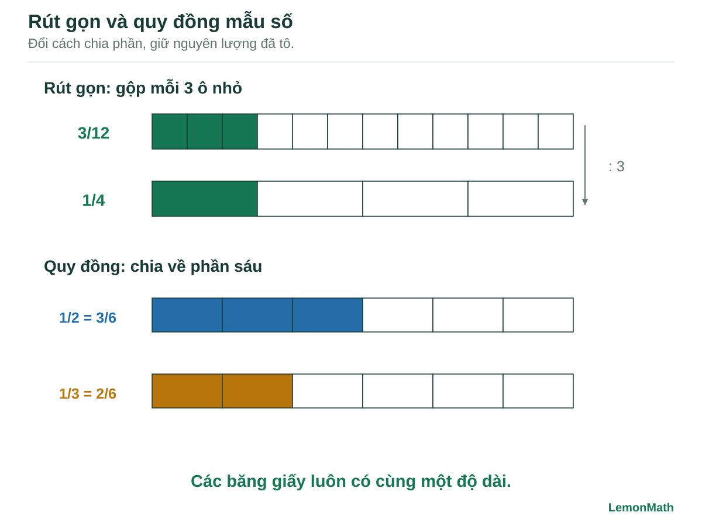

:::goals
- Biết tính chất cơ bản của phân số: nhân hoặc chia cả tử số và mẫu số với cùng một số thì được phân số bằng phân số đã cho.
- Rút gọn phân số đến phân số tối giản và nhận biết phân số tối giản.
- Quy đồng mẫu số hai phân số, kể cả khi mẫu số này chia hết cho mẫu số kia.
- Giải bài toán có lời văn bằng cách rút gọn hoặc quy đồng mẫu số.
:::

Mẹ cắt một chiếc bánh thành $12$ phần bằng nhau. An ăn $3$ phần, tức là $\dfrac{3}{12}$ chiếc bánh. Bình ăn $\dfrac{1}{4}$ chiếc bánh.

Hai bạn ăn bằng nhau hay bạn nào ăn nhiều hơn? Hai phân số có tử số và mẫu số khác nhau nên khó nhìn ra ngay. Bài này dạy em hai kĩ thuật để so sánh và làm việc với các phân số như vậy: **rút gọn** và **quy đồng mẫu số**.

## Rút gọn phân số

### Cùng khám phá

Em chia chiếc bánh thành $12$ phần bằng nhau, An ăn $3$ phần. Nếu em gộp mỗi $3$ phần liền nhau thành $1$ phần lớn thì chiếc bánh có $12:3=4$ phần lớn, và An ăn $3:3=1$ phần lớn. Vậy:
$$\dfrac{3}{12}=\dfrac{3:3}{12:3}=\dfrac{1}{4}.$$

Em thấy: chia cả tử số và mẫu số cho cùng số $3$ thì giá trị của phân số không đổi. Ngược lại, nhân cả tử số và mẫu số với cùng một số cũng không làm đổi giá trị: $\dfrac{1}{4}=\dfrac{1\times3}{4\times3}=\dfrac{3}{12}$.

:::theorem Tính chất cơ bản của phân số
Khi nhân cả tử số và mẫu số của một phân số với cùng một số tự nhiên khác $0$ thì được một phân số bằng phân số đã cho.

Khi chia cả tử số và mẫu số của một phân số cho cùng một số tự nhiên khác $0$ (mà cả hai đều chia hết cho số đó) thì được một phân số bằng phân số đã cho.
:::

Vì sao đúng? Nhân cả tử số và mẫu số với $3$ nghĩa là chia mỗi phần của chiếc bánh thành $3$ phần nhỏ hơn và lấy số phần nhỏ nhiều gấp $3$ lần. Số bánh được lấy vẫn như cũ.

Chia cả tử số và mẫu số của một phân số cho một số lớn hơn $1$ để được phân số đơn giản hơn gọi là **rút gọn phân số**.

:::definition Phân số tối giản
Phân số mà tử số và mẫu số không cùng chia hết cho số tự nhiên nào lớn hơn $1$ gọi là **phân số tối giản**. Phân số tối giản không rút gọn được nữa.
:::

Muốn rút gọn, em tìm một số lớn hơn $1$ mà cả tử số và mẫu số cùng chia hết, rồi chia cả hai cho số đó. Em dùng các dấu hiệu chia hết cho $2$, $3$, $5$, $9$ đã học để tìm số đó. Làm lặp lại cho đến khi được phân số tối giản.

**Kết nối.** Bài này dùng bảng nhân, chia và các dấu hiệu chia hết. Nó chuẩn bị cho các bài so sánh phân số, cộng và trừ phân số.

:::example Rút gọn từng bước
Rút gọn phân số $\dfrac{18}{24}$ đến phân số tối giản.

**Lời giải.** Cả $18$ và $24$ đều chia hết cho $2$. Chia cả tử số và mẫu số cho $2$:
$$\dfrac{18}{24}=\dfrac{18:2}{24:2}=\dfrac{9}{12}.$$
Cả $9$ và $12$ đều chia hết cho $3$. Chia cả hai cho $3$:
$$\dfrac{9}{12}=\dfrac{9:3}{12:3}=\dfrac{3}{4}.$$
Phân số $\dfrac{3}{4}$ có tử số $3$ và mẫu số $4$ không cùng chia hết cho số nào lớn hơn $1$, nên là phân số tối giản.

Vậy $\dfrac{18}{24}=\dfrac{3}{4}$.
:::

Bây giờ em kiểm tra xem một phân số đã tối giản chưa.

:::example Nhận biết phân số tối giản
Trong hai phân số $\dfrac{7}{15}$ và $\dfrac{12}{18}$, phân số nào là phân số tối giản?

**Lời giải.** Với $\dfrac{7}{15}$: số $7$ chỉ chia hết cho $1$ và $7$, mà $15$ không chia hết cho $7$. Vậy $\dfrac{7}{15}$ không rút gọn được, nó là phân số tối giản.

Với $\dfrac{12}{18}$: cả $12$ và $18$ đều chia hết cho $6$, nên $\dfrac{12}{18}=\dfrac{2}{3}$. Phân số này rút gọn được, nên không tối giản.

Vậy $\dfrac{7}{15}$ là phân số tối giản.
:::

Khi tìm được số chia chung lớn, em rút gọn nhanh hơn.

:::example Rút gọn một lần
Rút gọn phân số $\dfrac{45}{60}$ đến phân số tối giản.

**Lời giải.** Cả $45$ và $60$ đều chia hết cho $15$. Chia cả tử số và mẫu số cho $15$:
$$\dfrac{45}{60}=\dfrac{45:15}{60:15}=\dfrac{3}{4}.$$
Vậy $\dfrac{45}{60}=\dfrac{3}{4}$.
:::

## Quy đồng mẫu số các phân số

### Cùng khám phá

Em xét hai phân số $\dfrac{1}{2}$ và $\dfrac{1}{3}$ có mẫu số khác nhau. Muốn làm việc với chúng, em đổi cả hai về cùng một mẫu số. Mẫu số $6$ chia hết cho cả $2$ và $3$, nên:
$$\dfrac{1}{2}=\dfrac{1\times3}{2\times3}=\dfrac{3}{6},\qquad \dfrac{1}{3}=\dfrac{1\times2}{3\times2}=\dfrac{2}{6}.$$

Hai phân số $\dfrac{3}{6}$ và $\dfrac{2}{6}$ có cùng mẫu số $6$ và bằng hai phân số ban đầu. Việc làm này gọi là **quy đồng mẫu số** hai phân số, và $6$ là **mẫu số chung**.

:::theorem Quy đồng mẫu số hai phân số
Muốn quy đồng mẫu số hai phân số $\dfrac{a}{b}$ và $\dfrac{c}{d}$:
1. Nhân cả tử số và mẫu số của phân số thứ nhất với mẫu số của phân số thứ hai: $\dfrac{a\times d}{b\times d}$.
2. Nhân cả tử số và mẫu số của phân số thứ hai với mẫu số của phân số thứ nhất: $\dfrac{c\times b}{d\times b}$.

Nếu mẫu số của một phân số chia hết cho mẫu số của phân số kia thì ta chỉ cần đổi một phân số, giữ nguyên phân số còn lại.
:::

Vì sao làm như vậy được? Theo tính chất cơ bản, nhân cả tử số và mẫu số với cùng một số không làm đổi giá trị phân số. Cách làm trên làm cho hai mẫu số cùng bằng $b\times d$.

Em quy đồng hai phân số có mẫu số khác nhau và không chia hết cho nhau.

:::example Quy đồng hai phân số
Quy đồng mẫu số hai phân số $\dfrac{2}{3}$ và $\dfrac{3}{5}$.

**Lời giải.** Ta lấy mẫu số chung là $3\times5=15$:
$$\dfrac{2}{3}=\dfrac{2\times5}{3\times5}=\dfrac{10}{15},\qquad \dfrac{3}{5}=\dfrac{3\times3}{5\times3}=\dfrac{9}{15}.$$
Vậy quy đồng mẫu số hai phân số $\dfrac{2}{3}$ và $\dfrac{3}{5}$ được $\dfrac{10}{15}$ và $\dfrac{9}{15}$.
:::

Khi một mẫu số chia hết cho mẫu số kia, việc làm đơn giản hơn.

:::example Mẫu số này chia hết cho mẫu số kia
Quy đồng mẫu số hai phân số $\dfrac{5}{6}$ và $\dfrac{1}{3}$.

**Lời giải.** Mẫu số $6$ chia hết cho $3$ nên ta lấy mẫu số chung là $6$ và giữ nguyên $\dfrac{5}{6}$. Đổi $\dfrac{1}{3}$:
$$\dfrac{1}{3}=\dfrac{1\times2}{3\times2}=\dfrac{2}{6}.$$
Vậy hai phân số là $\dfrac{5}{6}$ và $\dfrac{2}{6}$.
:::

Đôi khi có mẫu số chung nhỏ hơn tích hai mẫu số.

:::example Chọn mẫu số chung nhỏ hơn
Quy đồng mẫu số hai phân số $\dfrac{3}{4}$ và $\dfrac{5}{6}$.

**Lời giải.** Theo cách ở trên, mẫu số chung là $4\times6=24$:
$$\dfrac{3}{4}=\dfrac{3\times6}{4\times6}=\dfrac{18}{24},\qquad \dfrac{5}{6}=\dfrac{5\times4}{6\times4}=\dfrac{20}{24}.$$
Nhưng cả $4$ và $6$ đều chia hết cho $12$, nên ta cũng lấy được mẫu số chung nhỏ hơn là $12$:
$$\dfrac{3}{4}=\dfrac{3\times3}{4\times3}=\dfrac{9}{12},\qquad \dfrac{5}{6}=\dfrac{5\times2}{6\times2}=\dfrac{10}{12}.$$
Vậy ta có thể quy đồng thành $\dfrac{9}{12}$ và $\dfrac{10}{12}$; các số nhỏ hơn thì tính dễ hơn.
:::

Bây giờ quay lại chiếc bánh của An và Bình.

:::example Ai ăn nhiều hơn?
An ăn $\dfrac{3}{12}$ chiếc bánh, Bình ăn $\dfrac{1}{4}$ chiếc bánh. Hỏi hai bạn ăn bằng nhau không?

**Hiểu đề.** An ăn $\dfrac{3}{12}$ chiếc bánh, Bình ăn $\dfrac{1}{4}$ chiếc bánh. Cần xem hai phân số có bằng nhau không.

**Tìm cách giải.** Rút gọn $\dfrac{3}{12}$ để so với $\dfrac{1}{4}$, hoặc quy đồng mẫu số rồi so sánh tử số.

**Giải.** Cách 1 (rút gọn): $\dfrac{3}{12}=\dfrac{3:3}{12:3}=\dfrac{1}{4}$.

Cách 2 (quy đồng): vì $12$ chia hết cho $4$ nên giữ $\dfrac{3}{12}$ và đổi $\dfrac{1}{4}=\dfrac{1\times3}{4\times3}=\dfrac{3}{12}$.

Cả hai cách đều cho $\dfrac{3}{12}=\dfrac{1}{4}$.

**Đáp số:** hai bạn ăn bằng nhau.

**Nhìn lại.** Hai cách cho cùng kết luận nên ta tin kết quả. Nếu Bình ăn $\dfrac{1}{3}$ chiếc bánh thì sao? Vì $\dfrac{1}{3}=\dfrac{4}{12}$ mà $4>3$, Bình sẽ ăn nhiều hơn An.
:::

:::warning Những lỗi em hay gặp
- **Cộng cùng một số vào tử số và mẫu số.** Sai: $\dfrac{3}{5}=\dfrac{4}{6}$. Vì sao sai: tính chất cơ bản chỉ cho phép **nhân** hoặc **chia** cả hai số, không cho cộng. Đúng: $\dfrac{3}{5}=\dfrac{6}{10}$ (nhân cả hai với $2$).
- **Rút gọn chưa đến phân số tối giản.** Sai: $\dfrac{12}{18}=\dfrac{6}{9}$ rồi dừng. Vì sao sai: $6$ và $9$ vẫn cùng chia hết cho $3$. Đúng: $\dfrac{12}{18}=\dfrac{2}{3}$.
- **Quy đồng mà chỉ nhân mẫu số.** Sai: $\dfrac{2}{3}$ và $\dfrac{3}{5}$ quy đồng thành $\dfrac{2}{15}$ và $\dfrac{3}{15}$. Vì sao sai: phải nhân cả tử số và mẫu số thì giá trị mới không đổi. Đúng: $\dfrac{10}{15}$ và $\dfrac{9}{15}$.
:::

## Thuật ngữ

:::terms
- phân số | fraction
- tử số | numerator
- mẫu số | denominator
- phân số bằng nhau | equivalent fractions
- rút gọn phân số | simplify a fraction
- phân số tối giản | fraction in its simplest form
- quy đồng mẫu số | write over a common denominator
- mẫu số chung | common denominator
- chia hết | divisible
:::

## Tóm tắt

- Nhân hoặc chia cả tử số và mẫu số với cùng một số khác $0$ thì được phân số bằng phân số đã cho.
- **Rút gọn** phân số: chia cả tử số và mẫu số cho số chung lớn hơn $1$, làm đến khi được **phân số tối giản**.
- **Quy đồng mẫu số** hai phân số: nhân cả tử số và mẫu số của mỗi phân số với mẫu số của phân số kia.
- Nếu mẫu số này chia hết cho mẫu số kia, chỉ cần đổi một phân số.
- Hai phân số bằng nhau khi rút gọn hoặc quy đồng chúng cho kết quả giống nhau.

## Luyện tập

Mỗi bài có phần kiến thức và gợi ý. Em hãy tự làm trước, rồi mới bấm xem lời giải.

:::exercise
Rút gọn phân số $\dfrac{10}{25}$.

::hint
**Kiến thức:** chia cả tử số và mẫu số cho số chung lớn hơn $1$.

**Gợi ý các bước:**
1. Cả $10$ và $25$ cùng chia hết cho số nào?
2. Chia cả hai cho số đó rồi kiểm tra đã tối giản chưa.

::solution
Muốn rút gọn phân số, ta tìm một số tự nhiên lớn hơn $1$ mà cả tử số và mẫu số cùng chia hết. Cả $10$ và $25$ đều chia hết cho $5$.

Chia cả tử số và mẫu số cho $5$, ta được
$$\frac{10}{25}=\frac{10:5}{25:5}=\frac{2}{5}.$$

Phân số $\dfrac{2}{5}$ có $2$ và $5$ không cùng chia hết cho số tự nhiên nào lớn hơn $1$, nên không rút gọn được nữa.

Vậy $\dfrac{10}{25}$ rút gọn được thành $\dfrac{2}{5}$.

**Đáp số.** $\dfrac{2}{5}$.
:::

:::exercise
Rút gọn phân số $\dfrac{36}{48}$ đến phân số tối giản.

::hint
**Kiến thức:** có thể rút gọn nhiều lần, hoặc chia một lần cho số chung lớn.

**Gợi ý các bước:**
1. Cả $36$ và $48$ cùng chia hết cho $12$.
2. Chia cả hai cho $12$.

::solution
Ta tìm số lớn nhất mà cả $36$ và $48$ cùng chia hết. Ta có $36=12\times3$ và $48=12\times4$, nên cả hai số cùng chia hết cho $12$.

Chia cả tử số và mẫu số cho $12$, ta được
$$\frac{36}{48}=\frac{36:12}{48:12}=\frac{3}{4}.$$

Phân số $\dfrac{3}{4}$ có $3$ và $4$ không cùng chia hết cho số tự nhiên nào lớn hơn $1$, nên đã là phân số tối giản.

Vậy rút gọn $\dfrac{36}{48}$ đến phân số tối giản ta được $\dfrac{3}{4}$.

**Đáp số.** $\dfrac{3}{4}$.
:::

:::exercise
Trong các phân số $\dfrac{4}{9}$, $\dfrac{6}{14}$, $\dfrac{15}{22}$, $\dfrac{18}{27}$, phân số nào là phân số tối giản?

::hint
**Kiến thức:** phân số tối giản là phân số không rút gọn được.

**Gợi ý các bước:**
1. Với mỗi phân số, tìm xem tử số và mẫu số có cùng chia hết cho số nào lớn hơn $1$ không.
2. Rút gọn thử các phân số chẵn hoặc có tổng chữ số chia hết cho $3$, $9$.

::solution
Một phân số là tối giản khi tử số và mẫu số không cùng chia hết cho số tự nhiên nào lớn hơn $1$. Ta xét từng phân số.

- $\dfrac{4}{9}$: $4$ và $9$ không có số chung lớn hơn $1$ cùng chia hết, nên tối giản.
- $\dfrac{6}{14}$: cả $6$ và $14$ cùng chia hết cho $2$, nên $\dfrac{6}{14}=\dfrac{6:2}{14:2}=\dfrac{3}{7}$, tức là rút gọn được.
- $\dfrac{15}{22}$: $15$ và $22$ không có số chung lớn hơn $1$ cùng chia hết, nên tối giản.
- $\dfrac{18}{27}$: cả $18$ và $27$ cùng chia hết cho $9$, nên $\dfrac{18}{27}=\dfrac{18:9}{27:9}=\dfrac{2}{3}$, tức là rút gọn được.

Vậy các phân số tối giản là $\dfrac{4}{9}$ và $\dfrac{15}{22}$.

**Đáp số.** $\dfrac{4}{9}$ và $\dfrac{15}{22}$.
:::

:::exercise
Rút gọn phân số $\dfrac{120}{180}$.

::hint
**Kiến thức:** có thể chia cả hai cho $10$ trước.

**Gợi ý các bước:**
1. Chia cả tử số và mẫu số cho $10$.
2. Rút gọn tiếp cho đến khi tối giản.

::solution
Cả tử số và mẫu số đều có chữ số $0$ ở tận cùng nên cùng chia hết cho $10$. Chia cả hai cho $10$, ta được
$$\frac{120}{180}=\frac{12}{18}.$$

Cả $12$ và $18$ cùng chia hết cho $6$. Chia cả hai cho $6$, ta được
$$\frac{12}{18}=\frac{12:6}{18:6}=\frac{2}{3}.$$

Phân số $\dfrac{2}{3}$ có $2$ và $3$ không cùng chia hết cho số tự nhiên nào lớn hơn $1$, nên đã tối giản.

Vậy $\dfrac{120}{180}$ rút gọn được thành $\dfrac{2}{3}$.

**Đáp số.** $\dfrac{2}{3}$.
:::

:::exercise
Quy đồng mẫu số hai phân số $\dfrac{3}{4}$ và $\dfrac{2}{7}$.

::hint
**Kiến thức:** nhân cả tử số và mẫu số của mỗi phân số với mẫu số của phân số kia.

**Gợi ý các bước:**
1. Mẫu số chung là $4\times7$.
2. Nhân cả tử số và mẫu số của $\dfrac{3}{4}$ với $7$, của $\dfrac{2}{7}$ với $4$.

::solution
Muốn quy đồng mẫu số hai phân số, ta chọn một mẫu số chung chia hết cho cả hai mẫu số. Ở đây ta chọn mẫu số chung là $4\times7=28$.

Nhân cả tử số và mẫu số của phân số thứ nhất với $7$ (mẫu số của phân số thứ hai):
$$\frac{3}{4}=\frac{3\times7}{4\times7}=\frac{21}{28}.$$

Nhân cả tử số và mẫu số của phân số thứ hai với $4$ (mẫu số của phân số thứ nhất):
$$\frac{2}{7}=\frac{2\times4}{7\times4}=\frac{8}{28}.$$

Vậy quy đồng mẫu số hai phân số $\dfrac{3}{4}$ và $\dfrac{2}{7}$ ta được $\dfrac{21}{28}$ và $\dfrac{8}{28}$.

**Đáp số.** $\dfrac{21}{28}$ và $\dfrac{8}{28}$.
:::

:::exercise
Quy đồng mẫu số hai phân số $\dfrac{7}{12}$ và $\dfrac{5}{6}$.

::hint
**Kiến thức:** nếu một mẫu số chia hết cho mẫu số kia thì chỉ đổi một phân số.

**Gợi ý các bước:**
1. $12$ có chia hết cho $6$ không?
2. Giữ $\dfrac{7}{12}$ và đổi $\dfrac{5}{6}$.

::solution
Ta so sánh hai mẫu số $12$ và $6$. Vì $12:6=2$ nên $12$ chia hết cho $6$, do đó ta chọn $12$ làm mẫu số chung.

Phân số $\dfrac{7}{12}$ đã có mẫu số là $12$ nên ta giữ nguyên.

Nhân cả tử số và mẫu số của phân số $\dfrac{5}{6}$ với $2$, ta được
$$\frac{5}{6}=\frac{5\times2}{6\times2}=\frac{10}{12}.$$

Vậy quy đồng mẫu số hai phân số $\dfrac{7}{12}$ và $\dfrac{5}{6}$ ta được $\dfrac{7}{12}$ và $\dfrac{10}{12}$.

**Đáp số.** $\dfrac{7}{12}$ và $\dfrac{10}{12}$.
:::

:::exercise
Một lớp có $40$ học sinh, trong đó có $15$ em thích bóng đá. Viết phân số chỉ số em thích bóng đá so với cả lớp, rồi rút gọn phân số đó.

::hint
**Kiến thức:** phân số chỉ một phần của cả lớp có tử số là số em thích bóng đá, mẫu số là số học sinh cả lớp.

**Gợi ý các bước:**
1. Đề cho biết gì? Đề hỏi gì?
2. Viết phân số $\dfrac{15}{40}$ rồi rút gọn.

::solution
Bài giải

Cả lớp có $40$ học sinh, trong đó có $15$ em thích bóng đá. Phân số chỉ số em thích bóng đá so với cả lớp là:
$$\frac{15}{40}.$$

Cả $15$ và $40$ cùng chia hết cho $5$. Chia cả tử số và mẫu số cho $5$, ta được:
$$\frac{15}{40}=\frac{15:5}{40:5}=\frac{3}{8}.$$

Phân số $\dfrac{3}{8}$ có $3$ và $8$ không cùng chia hết cho số tự nhiên nào lớn hơn $1$, nên đã tối giản.

Vậy số em thích bóng đá bằng $\dfrac{15}{40}$, rút gọn là $\dfrac{3}{8}$ số học sinh cả lớp.

**Đáp số.** $\dfrac{15}{40}=\dfrac{3}{8}$.
:::

:::exercise
Một băng giấy được chia thành $8$ phần bằng nhau và tô màu $6$ phần. Một băng giấy khác cùng độ dài được chia thành $12$ phần bằng nhau. Phải tô màu mấy phần thì được phân số bằng với phân số băng giấy thứ nhất?

::hint
**Kiến thức:** rút gọn $\dfrac{6}{8}$, rồi đổi sang mẫu số $12$.

**Gợi ý các bước:**
1. Rút gọn $\dfrac{6}{8}$.
2. Tìm phân số bằng nó có mẫu số $12$.

::solution
Bài giải

Phân số chỉ phần đã tô màu ở băng giấy thứ nhất là $\dfrac{6}{8}$. Rút gọn phân số này bằng cách chia cả tử số và mẫu số cho $2$:
$$\frac{6}{8}=\frac{6:2}{8:2}=\frac{3}{4}.$$

Băng giấy thứ hai được chia thành $12$ phần bằng nhau. Vì $12=4\times3$ nên ta nhân cả tử số và mẫu số của $\dfrac{3}{4}$ với $3$:
$$\frac{3}{4}=\frac{3\times3}{4\times3}=\frac{9}{12}.$$

Vậy phải tô màu $9$ phần của băng giấy thứ hai thì được phân số bằng phân số của băng giấy thứ nhất.

**Đáp số.** Phải tô màu $9$ phần.
:::

:::exercise
Em hãy nhớ lại bài nhân, chia với $10$, $100$, $1\,000$. Rút gọn phân số $\dfrac{2\,400}{3\,600}$ đến phân số tối giản.

::hint
**Kiến thức:** chia cả tử số và mẫu số cho $100$ thì bỏ hai chữ số 0.

**Gợi ý các bước:**
1. Chia cả hai cho $100$.
2. Rút gọn tiếp.

::solution
Cả tử số và mẫu số đều có hai chữ số $0$ ở tận cùng. Chia cả hai cho $100$, ta được
$$\frac{2\,400}{3\,600}=\frac{24}{36}.$$

Cả $24$ và $36$ cùng chia hết cho $12$. Chia cả tử số và mẫu số cho $12$, ta được
$$\frac{24}{36}=\frac{24:12}{36:12}=\frac{2}{3}.$$

Phân số $\dfrac{2}{3}$ có $2$ và $3$ không cùng chia hết cho số tự nhiên nào lớn hơn $1$, nên đã tối giản.

Vậy rút gọn $\dfrac{2\,400}{3\,600}$ đến phân số tối giản ta được $\dfrac{2}{3}$.

**Đáp số.** $\dfrac{2}{3}$.
:::

:::exercise Thử thách
Tìm phân số bằng $\dfrac{3}{7}$ sao cho tổng của tử số và mẫu số bằng $50$.

::hint
**Kiến thức:** phân số bằng $\dfrac{3}{7}$ có dạng $\dfrac{3\times k}{7\times k}$.

**Gợi ý các bước:**
1. Tử số và mẫu số cộng lại bằng bao nhiêu lần $k$?
2. Tìm $k$ rồi tìm phân số.

::solution
Bài giải

Phân số bằng $\dfrac{3}{7}$ có dạng $\dfrac{3\times k}{7\times k}$, với $k$ là một số tự nhiên lớn hơn $0$. Tổng của tử số và mẫu số là:
$$3\times k+7\times k=10\times k.$$

Theo đề bài, tổng này bằng $50$ nên $10\times k=50$. Suy ra
$$k=50:10=5.$$

Phân số cần tìm là:
$$\frac{3\times5}{7\times5}=\frac{15}{35}.$$

*Thử lại.* Ta có $15+35=50$ và $\dfrac{15}{35}=\dfrac{15:5}{35:5}=\dfrac{3}{7}$. Kết quả đúng.

Vậy phân số cần tìm là $\dfrac{15}{35}$.

**Đáp số.** $\dfrac{15}{35}$.
:::

## Kiểm tra mini

:::quiz
::mc TH
Rút gọn $\dfrac{18}{24}$ đến phân số tối giản được
A. $\dfrac{3}{4}$.
B. $\dfrac{6}{8}$.
C. $\dfrac{9}{12}$.
D. $\dfrac{2}{3}$.
::key A
$\dfrac{18}{24}=\dfrac{18:6}{24:6}=\dfrac{3}{4}$. Phương án C và B còn rút gọn được; phương án D không bằng $\dfrac{18}{24}$.

::mc NB
Phân số nào sau đây là phân số tối giản?
A. $\dfrac{6}{9}$.
B. $\dfrac{7}{15}$.
C. $\dfrac{12}{18}$.
D. $\dfrac{10}{15}$.
::key B
$7$ và $15$ không có số chung lớn hơn $1$. Ba phân số còn lại đều rút gọn được (cho $3$, $5$ và $6$).

::mc TH
Quy đồng mẫu số hai phân số $\dfrac{2}{3}$ và $\dfrac{3}{5}$ được
A. $\dfrac{2}{15}$ và $\dfrac{3}{15}$.
B. $\dfrac{6}{15}$ và $\dfrac{15}{15}$.
C. $\dfrac{10}{15}$ và $\dfrac{9}{15}$.
D. $\dfrac{10}{8}$ và $\dfrac{9}{8}$.
::key C
$\dfrac{2}{3}=\dfrac{2\times5}{3\times5}=\dfrac{10}{15}$ và $\dfrac{3}{5}=\dfrac{3\times3}{5\times3}=\dfrac{9}{15}$. Phương án A chỉ nhân mẫu số.

::mc TH
Phân số nào bằng $\dfrac{3}{5}$?
A. $\dfrac{5}{3}$.
B. $\dfrac{4}{6}$.
C. $\dfrac{3}{10}$.
D. $\dfrac{12}{20}$.
::key D
$\dfrac{3}{5}=\dfrac{3\times4}{5\times4}=\dfrac{12}{20}$. Phương án B cộng $1$ vào cả tử số và mẫu số nên sai.

::tf TH TH TH NB
Em xét phân số $\dfrac{4}{6}$.
a) $\dfrac{4}{6}=\dfrac{2}{3}$.
b) $\dfrac{4}{6}$ là phân số tối giản.
c) $\dfrac{4}{6}=\dfrac{8}{12}$.
d) Chia cả tử số và mẫu số của $\dfrac{4}{6}$ cho $2$ được $\dfrac{2}{3}$.
::key Đ S Đ Đ
a) Đúng: chia cả hai cho $2$. b) Sai: $4$ và $6$ cùng chia hết cho $2$. c) Đúng: nhân cả hai với $2$. d) Đúng: $4:2=2$ và $6:2=3$.

::sa TH
Tìm $x$ biết $\dfrac{3}{5}=\dfrac{x}{20}$.
::key 12
Vì $20=5\times4$ nên $x=3\times4=12$.

::sa VD
Rút gọn $\dfrac{24}{36}$ đến phân số tối giản, rồi tính tổng của tử số và mẫu số của phân số đó.
::key 5
$\dfrac{24}{36}=\dfrac{2}{3}$ và $2+3=5$.
:::
