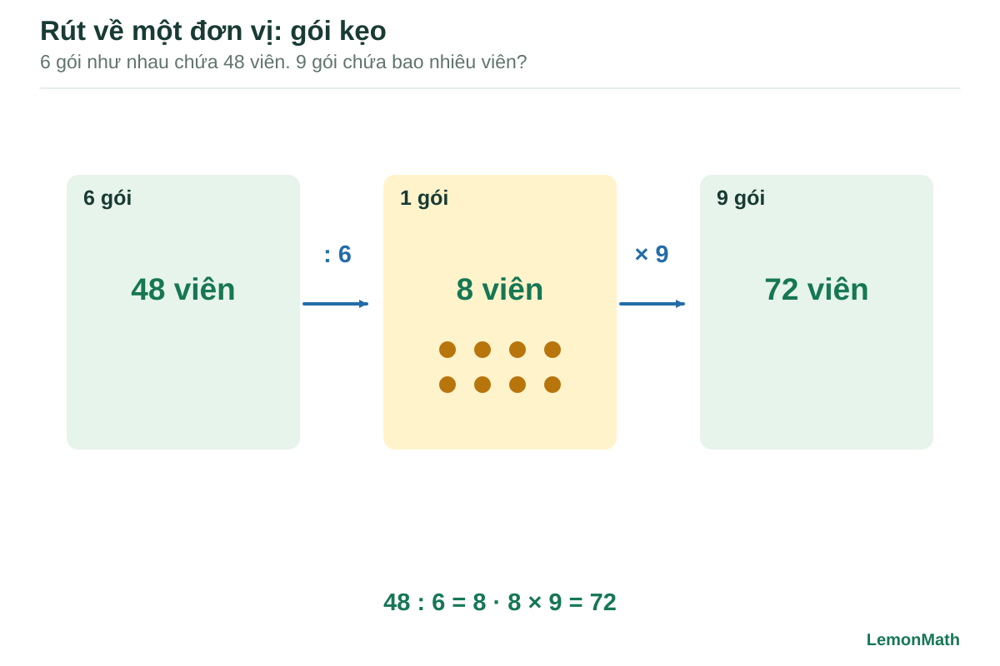

:::goals
- Biết rút về đơn vị: tìm giá trị của một đơn vị trước.
- Giải bài toán "biết giá trị của nhiều đơn vị, tìm giá trị của số đơn vị khác".
- Giải bài toán tìm số đơn vị khi biết số tiền hoặc số lượng.
:::

Mẹ mua $4$ quyển vở hết $24\,000$ đồng. Nếu mẹ mua $7$ quyển vở cùng loại thì hết bao nhiêu tiền? Khi đi mua đồ, em hay gặp chuyện này: biết giá của vài món, mà lại cần biết giá của số món khác.

Em chưa biết giá tiền của $7$ quyển ngay được. Nhưng nếu biết giá của một quyển thì bài toán dễ hơn nhiều. Vậy việc đầu tiên là tìm giá của một quyển. Với mọi bài toán kiểu này, ta đều bắt đầu như thế.

## Cùng khám phá

Ta làm từng bước nhỏ, em thử nghĩ trước nhé.

- Bước 1: $4$ quyển hết $24\,000$ đồng. Nếu chia đều số tiền ấy cho các quyển, một quyển có giá bao nhiêu?

Bảng dưới đây ghi lại từng bước.

| Số quyển | Số tiền |
|---|---|
| $4$ | $24\,000$ đồng |
| $1$ | $24\,000:4=6\,000$ đồng |
| $7$ | $6\,000\times7=42\,000$ đồng |

- Bước 2: biết một quyển giá $6\,000$ đồng, vậy $7$ quyển giá gấp $7$ lần số đó.

Các quyển giá bằng nhau, nên thêm một quyển là thêm một lần giá ấy.

Vậy mua $7$ quyển hết $42\,000$ đồng. Cách làm này gọi là **rút về đơn vị**: ta rút về giá của một quyển trước, rồi từ đó đi đến điều đề hỏi.

:::theorem Rút về đơn vị
Biết giá trị của nhiều đơn vị, muốn tìm giá trị của số đơn vị khác:
1. Tìm giá trị của một đơn vị: lấy giá trị đã cho chia cho số đơn vị.
2. Tìm giá trị cần hỏi: lấy giá trị của một đơn vị nhân với số đơn vị cần hỏi.
:::

Vì sao làm vậy được? Vì quyển vở nào cũng có giá bằng nhau. Nên $7$ quyển có giá gấp $7$ lần một quyển. Nếu mỗi quyển một giá thì cách này không dùng được, nên em nhớ đọc kĩ những chữ như "cùng loại" hay "như nhau" trong đề.

## Ví dụ

Ta bắt đầu với một bài toán về số lượng: số kẹo trong các gói.

:::example Gói kẹo
Có $6$ gói kẹo như nhau chứa $48$ viên kẹo. Hỏi $9$ gói kẹo như thế chứa bao nhiêu viên kẹo?

**Lời giải.** Trước hết tìm số kẹo trong một gói, rồi nhân với $9$:
$$48:6=8\ \text{(viên)},\qquad 8\times9=72\ \text{(viên)}.$$
Vậy $9$ gói kẹo chứa $72$ viên kẹo.

:::

Bài toán chuyển động cũng giải đúng theo cách ấy, chỉ khác là "một đơn vị" bây giờ là một giờ.

:::example Đi xe đạp
Một bạn đi xe đạp đều, $4$ giờ đi được $36$ km. Hỏi $7$ giờ bạn đó đi được bao nhiêu ki-lô-mét?

**Lời giải.** Tìm quãng đường đi được trong $1$ giờ, rồi nhân với $7$:
$$36:4=9\ \text{(km)},\qquad 9\times7=63\ \text{(km)}.$$
Vậy $7$ giờ bạn đó đi được $63$ km.
:::

Bây giờ em làm bài toán với số tiền lớn hơn. Các bước vẫn y như trước.

:::example Mua gạo
Mua $5$ kg gạo hết $75\,000$ đồng. Hỏi mua $8$ kg gạo như thế hết bao nhiêu tiền?

**Lời giải.** Tìm giá tiền $1$ kg gạo, rồi nhân với $8$:
$$75\,000:5=15\,000\ \text{(đồng)},\qquad 15\,000\times8=120\,000\ \text{(đồng)}.$$
Vậy mua $8$ kg gạo hết $120\,000$ đồng.
:::

Có một loại bài khác: biết số tiền, hỏi mua được bao nhiêu. Bước đầu vẫn là tìm giá của một đơn vị. Còn bước 2 lúc này là phép chia, vì ta hỏi số tiền đang có chứa được mấy lần giá một quả.

:::example Mua cam
Mua $12$ quả cam hết $60\,000$ đồng. Với $45\,000$ đồng thì mua được bao nhiêu quả cam như thế?

**Lời giải.** Tìm giá tiền một quả cam. Sau đó xem $45\,000$ đồng chứa bao nhiêu lần giá một quả:
$$60\,000:12=5\,000\ \text{(đồng)},\qquad 45\,000:5\,000=9\ \text{(quả)}.$$
Vậy với $45\,000$ đồng mua được $9$ quả cam.

**Kiểm tra.** $9$ quả giá $5\,000\times9=45\,000$ đồng. Đúng.
:::

:::warning Những lỗi em hay gặp
- **Nhân luôn, bỏ qua bước chia.** Sai: $24\,000\times7$. Vì sao sai: $24\,000$ là giá của $4$ quyển, không phải $1$ quyển. Đúng: chia cho $4$ trước.
- **Chia nhầm số.** Sai: $24\,000:7$. Vì sao sai: phải chia cho số quyển đã biết giá, tức $4$. Đúng: $24\,000:4=6\,000$.
- **Quên đơn vị.** Sai: "Đáp số: $42\,000$". Đúng: "Đáp số: $42\,000$ đồng".

Chỗ này nhiều bạn hay nhầm, nhất là lúc vội. Em đọc lại đề xem số nào ứng với mấy quyển rồi hãy tính.
:::

## Thuật ngữ

:::terms
- rút về đơn vị | unitary method
- một đơn vị | one unit
- giá tiền | cost
- phép chia | division
- phép nhân | multiplication
- bài toán có lời văn | word problem
- quãng đường | distance
:::

## Tóm tắt

- Rút về đơn vị gồm hai bước: tìm giá trị một đơn vị (chia), rồi tìm giá trị cần hỏi.
- Hỏi giá trị của số đơn vị khác: bước hai là nhân.
- Hỏi số đơn vị khi biết số tiền: bước hai là chia.
- Ví dụ: $24\,000:4=6\,000$, rồi $6\,000\times7=42\,000$.
- Nhớ viết đơn vị trong từng phép tính và đáp số.

Quay lại bài toán của mẹ: muốn biết giá của nhiều quyển, ta tìm giá của một quyển trước. Đó là điều em cần nhớ, vì em sẽ gặp lại nó trong rất nhiều bài toán khác. Em làm các bài luyện tập để quen tay nhé.

## Luyện tập

Mỗi bài có phần kiến thức và gợi ý để em bắt đầu. Em hãy tự làm trước, rồi mới bấm xem lời giải. Làm sai một lần cũng không sao, vì chỗ sai thường chỉ đúng chỗ cần nhớ.

:::exercise
Mua $3$ quyển vở hết $18\,000$ đồng. Hỏi một quyển vở giá bao nhiêu tiền?

::hint
**Kiến thức:** giá một đơn vị bằng tổng tiền chia cho số đơn vị.

**Gợi ý các bước:**
1. Đề cho biết gì? Hỏi gì?
2. Chia $18\,000$ cho $3$.

::solution
Bài giải

Mua $3$ quyển vở như nhau hết $18\,000$ đồng, nên giá một quyển vở là:
$$18\,000:3=6\,000\ \text{(đồng)}.$$

Thử lại: $6\,000\times3=18\,000$ (đồng), đúng với đề bài.

Vậy một quyển vở giá $6\,000$ đồng.

**Đáp số.** $6\,000$ đồng.
:::

:::exercise
$4$ can dầu như nhau chứa $28$ lít. Hỏi $6$ can dầu như thế chứa bao nhiêu lít?

::hint
**Kiến thức:** rút về một can, rồi nhân.

**Gợi ý các bước:**
1. Tìm số lít dầu trong một can.
2. Nhân với $6$.

::solution
Bài giải

Các can dầu như nhau, nên ta tìm số lít dầu trong một can trước (rút về đơn vị). Số lít dầu trong một can là:
$$28:4=7\ \text{(lít)}.$$

Số lít dầu trong $6$ can là:
$$7\times6=42\ \text{(lít)}.$$

Vậy $6$ can dầu như thế chứa $42$ lít.

**Đáp số.** $42$ lít.
:::

:::exercise
Em hãy nhớ lại bài trước: tìm số trung bình cộng của $12$, $18$ và $15$. Một bạn đọc mỗi ngày số trang bằng số đó. Hỏi $4$ ngày bạn đó đọc được bao nhiêu trang?

::hint
**Kiến thức:** trung bình cộng bằng tổng chia cho số các số hạng; sau đó nhân với số ngày.

**Gợi ý các bước:**
1. Tính trung bình cộng của ba số.
2. Nhân với $4$.

::solution
Bài giải

Số trung bình cộng của $12$, $18$ và $15$ bằng tổng của ba số chia cho $3$. Số trang bạn đó đọc mỗi ngày là:
$$(12+18+15):3=45:3=15\ \text{(trang)}.$$

Số trang bạn đó đọc được trong $4$ ngày là:
$$15\times4=60\ \text{(trang)}.$$

Vậy trong $4$ ngày bạn đó đọc được $60$ trang.

**Đáp số.** $60$ trang.
:::

:::exercise
Một công nhân làm $5$ ngày được $40$ sản phẩm. Hỏi làm $9$ ngày như thế thì được bao nhiêu sản phẩm?

::hint
**Kiến thức:** tìm số sản phẩm làm trong một ngày.

**Gợi ý các bước:**
1. Chia $40$ cho $5$.
2. Nhân kết quả với $9$.

::solution
Bài giải

Công nhân làm đều mỗi ngày như nhau, nên ta tìm số sản phẩm làm được trong một ngày trước. Số sản phẩm làm được trong một ngày là:
$$40:5=8\ \text{(sản phẩm)}.$$

Số sản phẩm làm được trong $9$ ngày là:
$$8\times9=72\ \text{(sản phẩm)}.$$

Vậy làm $9$ ngày như thế thì được $72$ sản phẩm.

**Đáp số.** $72$ sản phẩm.
:::

:::exercise
Mua $6$ kg đường hết $90\,000$ đồng. Hỏi mua $4$ kg đường hết bao nhiêu tiền? Vì sao phải tìm giá $1$ kg đường trước?

::hint
**Kiến thức:** biết giá một đơn vị thì tìm giá nhiều đơn vị bằng phép nhân.

**Gợi ý các bước:**
1. Tính giá $1$ kg đường.
2. Nhân với $4$.

::solution
Bài giải

Giá $1$ kg đường là:
$$90\,000:6=15\,000\ \text{(đồng)}.$$

Số tiền mua $4$ kg đường là:
$$15\,000\times4=60\,000\ \text{(đồng)}.$$

Vậy mua $4$ kg đường hết $60\,000$ đồng.

Trả lời câu hỏi "Vì sao phải tìm giá $1$ kg đường trước?": vì mỗi ki-lô-gam đường có giá bằng nhau, nên khi biết giá $1$ kg ta tính được giá của số ki-lô-gam bất kì bằng phép nhân.

**Đáp số.** $60\,000$ đồng.
:::

:::exercise
Lan giải: "$8$ cái bút giá $32\,000$ đồng. $5$ cái bút giá $32\,000\times5=160\,000$ đồng." Lan sai ở đâu? Hãy làm lại cho đúng.

::hint
**Kiến thức:** $32\,000$ đồng là giá của $8$ cái bút, không phải một cái.

**Gợi ý các bước:**
1. Tìm giá một cái bút.
2. Nhân với $5$.

::solution
Bài giải

Lan sai ở chỗ nhân ngay $32\,000\times5$ mà chưa tìm giá của một cái bút. Số $32\,000$ đồng là giá của $8$ cái bút, nên không thể nhân với $5$ để được giá của $5$ cái bút. Kết quả $160\,000$ đồng còn lớn hơn giá của $8$ cái bút, là điều vô lí vì $5$ cái bút ít hơn $8$ cái bút.

Cách làm đúng: giá một cái bút là
$$32\,000:8=4\,000\ \text{(đồng)}.$$

Giá $5$ cái bút là:
$$4\,000\times5=20\,000\ \text{(đồng)}.$$

Vậy $5$ cái bút giá $20\,000$ đồng.

**Đáp số.** $20\,000$ đồng.
:::

:::exercise
Vòi nước chảy đều, $3$ phút được $45$ lít.
a) Mỗi phút vòi chảy được bao nhiêu lít?
b) $8$ phút vòi chảy được bao nhiêu lít?
c) Cần bao nhiêu phút để chảy đầy bể $150$ lít?

::hint
**Kiến thức:** rút về một phút. Câu c) bước hai là chia.

**Gợi ý các bước:**
1. Chia $45$ cho $3$.
2. Nhân với $8$ ở câu b).
3. Chia $150$ cho số lít một phút ở câu c).

::solution
Bài giải

a) Mỗi phút vòi chảy được số lít nước là:
$$45:3=15\ \text{(lít)}.$$

b) $8$ phút vòi chảy được số lít nước là:
$$15\times8=120\ \text{(lít)}.$$

c) Số phút cần để chảy đầy bể $150$ lít là:
$$150:15=10\ \text{(phút)}.$$

Vậy mỗi phút vòi chảy được $15$ lít; $8$ phút chảy được $120$ lít; cần $10$ phút để chảy đầy bể $150$ lít.

**Đáp số.** a) $15$ lít; b) $120$ lít; c) $10$ phút.
:::

:::exercise Thử thách
Mua $6$ hộp bánh như nhau hết $90\,000$ đồng. Mai có $130\,000$ đồng. Hỏi Mai mua được nhiều nhất bao nhiêu hộp bánh như thế và còn thừa bao nhiêu tiền?

::hint
**Kiến thức:** tìm giá một hộp; rồi xem $130\,000$ đồng đủ mua mấy hộp.

**Gợi ý các bước:**
1. Tính giá một hộp bánh.
2. Thử nhân giá một hộp với $8$, $9$ để xem đủ tiền không.
3. Tính số tiền thừa.

::solution
Bài giải

Giá một hộp bánh là:
$$90\,000:6=15\,000\ \text{(đồng)}.$$

Ta thử số hộp bánh Mai có thể mua. Mua $8$ hộp hết:
$$15\,000\times8=120\,000\ \text{(đồng)},$$
số tiền này nhỏ hơn $130\,000$ đồng nên Mai đủ tiền. Mua $9$ hộp hết:
$$15\,000\times9=135\,000\ \text{(đồng)},$$
số tiền này lớn hơn $130\,000$ đồng nên Mai không đủ tiền.

Do đó Mai mua được nhiều nhất $8$ hộp bánh. Số tiền còn thừa là:
$$130\,000-120\,000=10\,000\ \text{(đồng)}.$$

Thử lại: $130\,000:15\,000=8$ (dư $10\,000$), khớp với kết quả trên.

Vậy Mai mua được nhiều nhất $8$ hộp bánh và còn thừa $10\,000$ đồng.

**Đáp số.** $8$ hộp, còn thừa $10\,000$ đồng.
:::

## Kiểm tra mini

:::quiz
::mc TH
Mua $5$ quyển vở hết $30\,000$ đồng. Giá một quyển vở là
A. $6\,000$ đồng.
B. $150\,000$ đồng.
C. $25\,000$ đồng.
D. $6$ đồng.
::key A
$30\,000:5=6\,000$. Phương án B là nhân thay vì chia, C là trừ.

::mc TH
Biết $4$ cái bút giá $12\,000$ đồng. Để tính giá $8$ cái bút, bước đầu tiên là
A. $12\,000\times4$.
B. $12\,000:4$.
C. $12\,000\times8$.
D. $12\,000+8$.
::key B
Phải tìm giá một cái bút trước: $12\,000:4=3\,000$. Phương án C nhân luôn với $8$ là lỗi hay gặp.

::mc VD
Một xe đi đều $3$ giờ được $90$ km. Hỏi $5$ giờ xe đi được bao nhiêu ki-lô-mét?
A. $30$ km.
B. $450$ km.
C. $150$ km.
D. $95$ km.
::key C
$90:3=30$ km một giờ, $30\times5=150$ km. Phương án A mới là quãng đường $1$ giờ, B nhân mà quên chia.

::mc VD
$6$ gói bánh có $48$ cái bánh. Hỏi $4$ gói như thế có bao nhiêu cái bánh?
A. $8$ cái.
B. $288$ cái.
C. $12$ cái.
D. $32$ cái.
::key D
$48:6=8$ cái một gói, $8\times4=32$ cái. Phương án A là số bánh một gói, B là nhân $48\times6$.

::tf TH VD TH VD
$4$ chai nước giá $20\,000$ đồng.
a) Một chai nước giá $5\,000$ đồng.
b) $6$ chai nước giá $30\,000$ đồng.
c) $6$ chai nước giá $20\,000\times6$ đồng.
d) Có $10\,000$ đồng thì mua được $2$ chai.
::key Đ Đ S Đ
a) Đúng: $20\,000:4=5\,000$. b) Đúng: $5\,000\times6=30\,000$. c) Sai: $20\,000$ là giá $4$ chai. d) Đúng: $10\,000:5\,000=2$.

::sa VD
$5$ hộp có $40$ cái bút. Hỏi $9$ hộp như thế có bao nhiêu cái bút?
::key 72
$40:5=8$ cái một hộp, $8\times9=72$ cái.

::sa VD
$4$ quyển vở giá $24\,000$ đồng. Với $42\,000$ đồng mua được bao nhiêu quyển vở như thế?
::key 7
Giá một quyển: $24\,000:4=6\,000$ đồng. $42\,000:6\,000=7$ quyển.
:::
