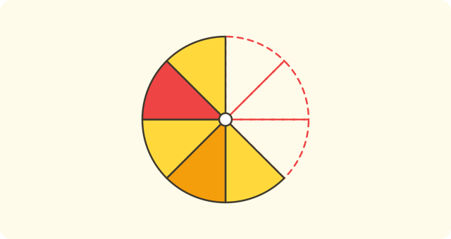
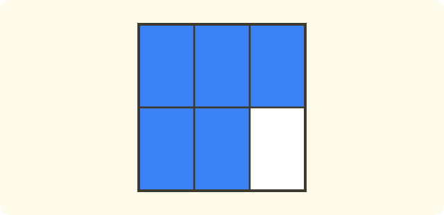
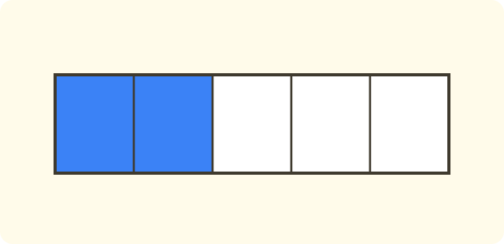
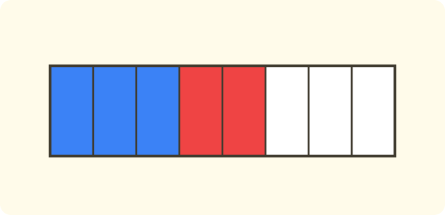

:::goals
- Hiểu phân số chỉ một hay nhiều phần trong các phần bằng nhau của một cái nguyên.
- Đọc, viết phân số và nhận ra tử số, mẫu số.
- Biểu diễn phân số bằng hình và trên trục số.
:::

Một chiếc bánh pizza được cắt thành $4$ phần bằng nhau. Lan ăn $1$ phần, Nam ăn $3$ phần. Mỗi bạn ăn mấy phần của chiếc bánh? Có phải ta viết được bằng một số không?

Số tự nhiên không viết được "một phần tư" hay "ba phần tư". Bài này dạy em một loại số mới để viết các phần của một cái nguyên.

## Cùng khám phá

Ta làm từng bước nhỏ.

- Chiếc bánh được cắt thành $4$ phần **bằng nhau**. Số $4$ cho biết chiếc bánh có bao nhiêu phần bằng nhau.
- Lan ăn $1$ phần. Ta viết số phần Lan ăn là $\dfrac{1}{4}$, đọc là "một phần tư".
- Nam ăn $3$ phần. Ta viết $\dfrac{3}{4}$, đọc là "ba phần tư".
- Lan và Nam ăn cả $4$ phần, tức ăn hết cả chiếc bánh. Ta viết $\dfrac{4}{4}=1$.

Ta cũng đặt các phân số lên trục số. Đoạn từ $0$ đến $1$ được chia thành $4$ phần bằng nhau, mỗi phần là $\dfrac{1}{4}$.

:::graph Trục số: đoạn từ 0 đến 1 chia thành 4 phần bằng nhau
alt: Trục số từ 0 đến 1 chia thành 4 phần bằng nhau, đánh dấu các điểm 0, 1/4, 2/4, 3/4 và 1
x: -0.1..1.1
y: -0.15..0.15
segment: (0, 0) (1, 0)
point: (0, 0) "0" below
point: (0.25, 0) "1/4" below
point: (0.5, 0) "2/4" below
point: (0.75, 0) "3/4" below
point: (1, 0) "1" below
:::

:::definition Phân số
Chia một cái nguyên thành $b$ phần bằng nhau, lấy $a$ phần. Số phần đã lấy được viết là $\dfrac{a}{b}$ và gọi là một **phân số**.

Số $a$ ở trên gọi là **tử số**. Số $b$ ở dưới gọi là **mẫu số**. Mẫu số không bao giờ bằng $0$.
:::

Mẫu số cho biết cái nguyên được chia thành bao nhiêu phần bằng nhau. Tử số cho biết ta lấy bao nhiêu phần.

## Ví dụ

Ta bắt đầu với việc viết phân số cho một hình.

:::example Viết phân số từ hình
Một chiếc bánh được cắt thành $8$ phần bằng nhau. Mai ăn $3$ phần. Viết phân số chỉ phần bánh Mai đã ăn.

**Lời giải.** Cái nguyên chia thành $8$ phần bằng nhau, nên mẫu số là $8$. Mai lấy $3$ phần, nên tử số là $3$:
$$\frac{3}{8}.$$
Vậy Mai ăn $\dfrac{3}{8}$ chiếc bánh.
:::

Bây giờ em đọc phân số và chỉ ra tử số, mẫu số.

:::example Đọc phân số
Đọc phân số $\dfrac{5}{6}$, rồi cho biết tử số và mẫu số. Viết phân số "bảy phần chín".

**Lời giải.** Phân số $\dfrac{5}{6}$ đọc là "năm phần sáu". Tử số là $5$ (ở trên) và mẫu số là $6$ (ở dưới). Phân số "bảy phần chín" có tử số $7$ và mẫu số $9$:
$$\frac{7}{9}.$$
:::

Ta cũng có thể viết phân số cho phần chưa lấy.

:::example Phần còn lại
Một hình vuông được chia thành $6$ phần bằng nhau, tô màu $5$ phần. Viết phân số chỉ phần đã tô và phân số chỉ phần chưa tô.

**Lời giải.** Mẫu số vẫn là $6$ vì cái nguyên chia thành $6$ phần. Phần đã tô là $5$ phần, phần chưa tô là $6-5=1$ phần:
$$\frac{5}{6}\ \text{(đã tô)},\qquad \frac{1}{6}\ \text{(chưa tô)}.$$
**Kiểm tra.** $5$ phần và $1$ phần là $6$ phần, tức cả hình: $\dfrac{5}{6}$ và $\dfrac{1}{6}$ ghép lại thành cả hình.
:::

Cuối cùng, ta đánh dấu một phân số trên trục số.

:::example Phân số trên trục số
Trên trục số, đoạn từ $0$ đến $1$ chia thành $4$ phần bằng nhau. Điểm nào biểu diễn $\dfrac{3}{4}$?

**Lời giải.** Mẫu số $4$ cho biết chia đoạn thành $4$ phần. Từ $0$, ta đi qua $3$ phần theo thứ tự $\dfrac{1}{4}$, $\dfrac{2}{4}$, $\dfrac{3}{4}$. Điểm thứ ba sau $0$ biểu diễn $\dfrac{3}{4}$, nằm trước điểm $1$ một phần.
:::

:::warning Những lỗi em hay gặp
- **Các phần không bằng nhau.** Sai: cắt chiếc bánh thành $4$ phần to nhỏ khác nhau rồi nói mỗi phần là $\dfrac{1}{4}$. Vì sao sai: phân số chỉ đúng khi các phần bằng nhau. Đúng: chia thành $4$ phần bằng nhau.
- **Viết ngược tử số và mẫu số.** Sai: ăn $3$ phần trong $4$ phần viết là $\dfrac{4}{3}$. Vì sao sai: mẫu số là số phần cả cái nguyên. Đúng: $\dfrac{3}{4}$.
- **Mẫu số bằng $0$.** Sai: $\dfrac{5}{0}$. Vì sao sai: không có cách chia thành $0$ phần. Đúng: mẫu số là số khác $0$.
:::

## Thuật ngữ

:::terms
- phân số | fraction
- tử số | numerator
- mẫu số | denominator
- phần bằng nhau | equal parts
- một phần tư | one quarter
- trục số | number line
- cái nguyên | whole
:::

## Tóm tắt

- Phân số $\dfrac{a}{b}$: cái nguyên chia thành $b$ phần bằng nhau, lấy $a$ phần.
- Tử số $a$ ở trên, mẫu số $b$ ở dưới; mẫu số khác $0$.
- Các phần phải bằng nhau.
- Ví dụ: $\dfrac{3}{4}$ đọc là "ba phần tư".
- Phân số có thể biểu diễn bằng hình hoặc bằng điểm trên trục số.

## Luyện tập

Mỗi bài có phần kiến thức và gợi ý. Em hãy tự làm trước, rồi mới bấm xem lời giải.

:::exercise
Một hình chữ nhật được chia thành $5$ phần bằng nhau, tô màu $2$ phần. Viết phân số chỉ phần đã tô.

::hint
**Kiến thức:** mẫu số là số phần bằng nhau, tử số là số phần được tô.

**Gợi ý các bước:**
1. Đề cho biết gì? Hỏi gì?
2. Viết tử số và mẫu số.

::solution
Chia thành $5$ phần, tô $2$ phần, nên phân số là $\dfrac{2}{5}$.

**Đáp số.** $\dfrac{2}{5}$.
:::

:::exercise
Viết các phân số: a) bốn phần bảy; b) hai phần năm; c) mười một phần mười hai.

::hint
**Kiến thức:** đọc "a phần b" thì viết $\dfrac{a}{b}$.

**Gợi ý các bước:**
1. Số đọc trước là tử số.
2. Số đọc sau chữ "phần" là mẫu số.

::solution
a) $\dfrac{4}{7}$; b) $\dfrac{2}{5}$; c) $\dfrac{11}{12}$.

**Đáp số.** $\dfrac{4}{7}$, $\dfrac{2}{5}$, $\dfrac{11}{12}$.
:::

:::exercise
Em hãy nhớ lại bài trước (số lần xuất hiện): tung đồng xu $10$ lần, mặt ngửa xuất hiện $6$ lần. Viết phân số chỉ số lần ngửa so với số lần tung.

::hint
**Kiến thức:** số lần tung là mẫu số, số lần ngửa là tử số.

**Gợi ý các bước:**
1. Số lần tung là bao nhiêu?
2. Số lần ngửa là bao nhiêu?

::solution
Số lần ngửa là $6$ trong $10$ lần tung, nên phân số là $\dfrac{6}{10}$.

**Đáp số.** $\dfrac{6}{10}$.
:::

:::exercise
Đọc các phân số $\dfrac{7}{10}$ và $\dfrac{3}{8}$, rồi chỉ ra tử số và mẫu số của mỗi phân số.

::hint
**Kiến thức:** tử số ở trên, mẫu số ở dưới.

**Gợi ý các bước:**
1. Đọc tử số trước, rồi chữ "phần", rồi mẫu số.
2. Chỉ từng số.

::solution
$\dfrac{7}{10}$ đọc là "bảy phần mười": tử số $7$, mẫu số $10$. $\dfrac{3}{8}$ đọc là "ba phần tám": tử số $3$, mẫu số $8$.

**Đáp số.** Xem lời giải.
:::

:::exercise
Một chiếc bánh được cắt thành $4$ phần to nhỏ khác nhau, Lan ăn $1$ phần. Có thể nói Lan ăn $\dfrac{1}{4}$ chiếc bánh không? Vì sao?

::hint
**Kiến thức:** phân số chỉ đúng khi các phần bằng nhau.

**Gợi ý các bước:**
1. Các phần có bằng nhau không?
2. So với định nghĩa phân số.

::solution
Không. Các phần không bằng nhau nên phần Lan ăn không nhất định là một phần tư chiếc bánh.

**Đáp số.** Không, vì các phần không bằng nhau.
:::

:::exercise
Nam viết: "Chiếc bánh chia $4$ phần, ăn $3$ phần nên phân số là $\dfrac{4}{3}$." Nam sai ở đâu? Hãy viết lại cho đúng.

::hint
**Kiến thức:** mẫu số là số phần bằng nhau của cả cái nguyên.

**Gợi ý các bước:**
1. Số phần của cả chiếc bánh là bao nhiêu?
2. Số phần đã ăn là bao nhiêu?

::solution
Nam viết ngược tử số và mẫu số. Cả chiếc bánh có $4$ phần nên mẫu số là $4$, ăn $3$ phần nên tử số là $3$: $\dfrac{3}{4}$.

**Đáp số.** $\dfrac{3}{4}$.
:::

:::exercise
Một thanh sô-cô-la có $12$ ô bằng nhau. Mai ăn $5$ ô, Nam ăn $4$ ô.
a) Viết phân số chỉ phần Mai ăn.
b) Viết phân số chỉ phần Nam ăn.
c) Viết phân số chỉ phần còn lại.

::hint
**Kiến thức:** mẫu số là $12$; tử số là số ô.

**Gợi ý các bước:**
1. Viết a) và b).
2. Tìm số ô còn lại rồi viết phân số.

::solution
a) $\dfrac{5}{12}$. b) $\dfrac{4}{12}$. c) Còn lại $12-5-4=3$ ô, nên $\dfrac{3}{12}$.

**Đáp số.** a) $\dfrac{5}{12}$; b) $\dfrac{4}{12}$; c) $\dfrac{3}{12}$.
:::

:::exercise Thử thách
Một băng giấy được chia thành $8$ phần bằng nhau. Em tô $3$ phần màu xanh, $2$ phần màu đỏ, phần còn lại để trắng. Viết phân số chỉ phần mỗi màu và phân số chỉ phần đã tô màu (cả hai màu).

::hint
**Kiến thức:** mẫu số luôn là $8$; tìm số phần trắng bằng phép trừ.

**Gợi ý các bước:**
1. Viết phân số cho xanh và đỏ.
2. Tìm số phần trắng: $8-3-2$.
3. Tìm số phần đã tô: $3+2$.

::solution
Xanh: $\dfrac{3}{8}$; đỏ: $\dfrac{2}{8}$; trắng: $8-3-2=3$ phần nên $\dfrac{3}{8}$. Phần đã tô là $3+2=5$ phần, tức $\dfrac{5}{8}$.

**Kiểm tra.** $3+2+3=8$ phần. Đúng.

**Đáp số.** Xanh $\dfrac{3}{8}$, đỏ $\dfrac{2}{8}$, trắng $\dfrac{3}{8}$; đã tô $\dfrac{5}{8}$.
:::

## Kiểm tra mini

:::quiz
::mc
Mẫu số của phân số $\dfrac{3}{5}$ là
A. $5$.
B. $3$.
C. $8$.
D. $15$.
::key A
Mẫu số là số ở dưới, $5$. Phương án B là tử số, C là tổng hai số.

::mc
Chiếc bánh cắt thành $6$ phần bằng nhau, ăn $1$ phần. Phân số chỉ phần đã ăn là
A. $\dfrac{6}{1}$.
B. $\dfrac{1}{6}$.
C. $\dfrac{1}{5}$.
D. $\dfrac{5}{6}$.
::key B
Cả chiếc bánh có $6$ phần, ăn $1$ phần nên $\dfrac{1}{6}$. Phương án A viết ngược, D là phần chưa ăn.

::mc
Phân số "bảy phần mười" viết là
A. $\dfrac{10}{7}$.
B. $7+10$.
C. $\dfrac{7}{10}$.
D. $17$.
::key C
Tử số $7$, mẫu số $10$. Phương án A viết ngược tử số và mẫu số.

::mc
Một hình được chia thành $8$ phần bằng nhau, tô màu $5$ phần. Phân số chỉ phần không tô màu là
A. $\dfrac{5}{8}$.
B. $\dfrac{3}{5}$.
C. $\dfrac{8}{3}$.
D. $\dfrac{3}{8}$.
::key D
Phần không tô là $8-5=3$ phần nên $\dfrac{3}{8}$. Phương án A là phần đã tô.

::tf
Em xét phân số $\dfrac{5}{9}$.
a) Tử số là $5$.
b) Mẫu số là $9$.
c) Đọc là "chín phần năm".
d) Có thể là $5$ phần trong một hình chia thành $9$ phần bằng nhau.
::key Đ Đ S Đ
a) Đúng. b) Đúng. c) Sai: đọc là "năm phần chín". d) Đúng.

::sa
Chiếc bánh chia thành $12$ phần bằng nhau, Mai ăn $5$ phần. Còn lại bao nhiêu phần?
::key 7
$12-5=7$ phần.

::sa
Phân số $\dfrac{3}{8}$ có mẫu số là bao nhiêu?
::key 8
Mẫu số là số ở dưới, $8$.
:::
