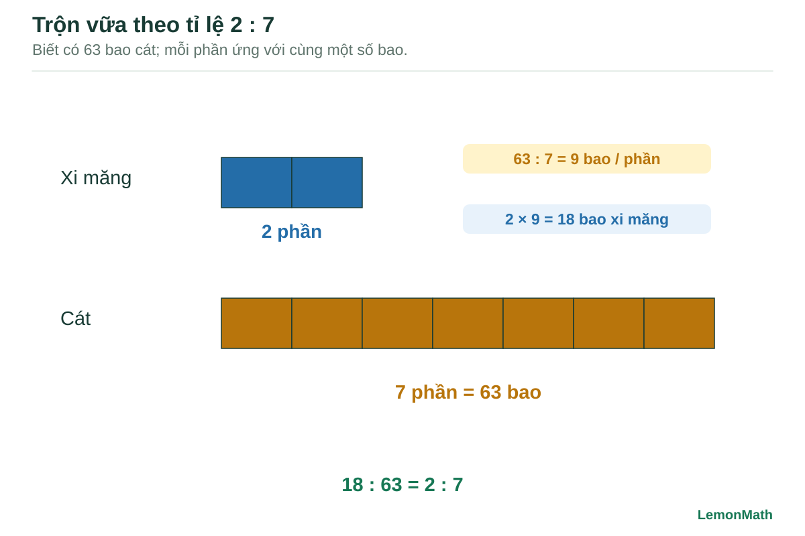

:::goals
- Nhận biết tỉ lệ thức, gọi tên ngoại tỉ, trung tỉ và dùng tính chất nhân chéo để tìm số chưa biết.
- Từ một đẳng thức dạng tích, lập được bốn tỉ lệ thức.
- Dùng tính chất của dãy tỉ số bằng nhau (cộng, trừ, ba tỉ số) để tìm các số khi biết tổng hoặc hiệu.
- Giải bài toán thực tế về pha trộn, xây dựng và chia tiền theo tỉ lệ.
:::

Giả sử bác Hùng sắp trát tường và trộn vữa theo công thức quen của thợ xây: cứ $2$ bao xi măng thì trộn với $7$ bao cát, tức xi măng và cát theo tỉ lệ $2:7$. Hôm nay bác đã chở về $63$ bao cát. Bác cần mua thêm bao nhiêu bao xi măng để vữa đúng tỉ lệ?

Bạn đã quen với tỉ số ở lớp 6. Bài này đi thêm một bước: khi hai tỉ số bằng nhau, ta có một công cụ rất gọn để tìm số còn thiếu, và khi có nhiều tỉ số bằng nhau cùng lúc, ta có thể chia một khoản tiền hay một mẻ vữa đúng theo tỉ lệ cho trước mà không phải thử từng số.

## Tỉ lệ thức

### Khám phá: hai tỉ số bằng nhau thì có gì chung?

Ta so sánh hai tỉ số $\dfrac27$ và $\dfrac6{21}$. Rút gọn $\dfrac6{21}$ cho $3$ ta được $\dfrac27$, nên hai tỉ số bằng nhau. Bây giờ nhìn vào các tích: $2\cdot21=42$ và $7\cdot6=42$, cũng bằng nhau.

Có thể đó chỉ là trùng hợp. Ta thử một cặp khác: $\dfrac35=\dfrac{12}{20}$. Ta có $3\cdot20=60$ và $5\cdot12=60$. Lại bằng nhau. Quy luật này đúng với mọi cặp tỉ số bằng nhau, và ta sẽ giải thích vì sao ngay sau đây.

:::definition Tỉ lệ thức
Tỉ lệ thức là đẳng thức của hai tỉ số
$$\frac ab=\frac cd\qquad(b\neq0,\ d\neq0).$$
Tỉ lệ thức này còn viết là $a:b=c:d$. Các số $a$, $d$ gọi là **ngoại tỉ** (hai số ở ngoài), các số $b$, $c$ gọi là **trung tỉ** (hai số ở giữa).
:::

:::theorem Tính chất của tỉ lệ thức
- Nếu $\dfrac ab=\dfrac cd$ thì $ad=bc$ (tích ngoại tỉ bằng tích trung tỉ).
- Ngược lại, nếu $ad=bc$ và $a$, $b$, $c$, $d$ đều khác $0$ thì ta có bốn tỉ lệ thức
$$\frac ab=\frac cd,\qquad \frac ac=\frac bd,\qquad \frac db=\frac ca,\qquad \frac dc=\frac ba.$$
:::

**Vì sao?** Nhân hai vế của $\dfrac ab=\dfrac cd$ với $bd$ (khác $0$), ta được $ad=cb$. Ngược lại, từ $ad=bc$, chia hai vế cho $bd$ ta được $\dfrac ab=\dfrac cd$; chia cho $cd$ ta được $\dfrac ac=\dfrac bd$; chia cho $ab$ ta được $\dfrac db=\dfrac ca$; chia cho $ac$ ta được $\dfrac dc=\dfrac ba$. Nói cách khác, "nhân chéo" thực chất là nhân cả hai vế với tích hai mẫu.

:::example Nhận biết tỉ lệ thức
Các cặp tỉ số sau có lập được tỉ lệ thức không?

a) $\dfrac23$ và $\dfrac{14}{21}$.

b) $\dfrac49$ và $\dfrac6{15}$.

c) $1{,}2:1{,}8$ và $2:3$.

**Lời giải.** Ta kiểm tra xem tích chéo có bằng nhau không.

a) Ta có $2\cdot21=42$ và $3\cdot14=42$. Hai tích bằng nhau nên $\dfrac23=\dfrac{14}{21}$, lập được tỉ lệ thức.

b) Ta có $4\cdot15=60$ và $9\cdot6=54$. Hai tích khác nhau nên không lập được tỉ lệ thức.

c) Ta có $1{,}2:1{,}8=\dfrac{1{,}2}{1{,}8}$ và $2:3=\dfrac23$. Vì $1{,}2\cdot3=3{,}6$ và $1{,}8\cdot2=3{,}6$ nên $\dfrac{1{,}2}{1{,}8}=\dfrac23$, lập được tỉ lệ thức.

Vậy các cặp ở a) và c) lập được tỉ lệ thức, cặp ở b) thì không.
:::

Khi đã có tính chất nhân chéo, tìm một số chưa biết trong tỉ lệ thức chỉ còn là giải một phương trình bậc nhất.

:::example Tìm số chưa biết
Tìm $x$, biết:

a) $\dfrac x6=\dfrac{14}{21}$.

b) $\dfrac9{x+1}=\dfrac35$.

**Lời giải.** a) Theo tính chất của tỉ lệ thức, ta có $21x=6\cdot14=84$. Suy ra $x=84:21=4$.

b) Điều kiện: $x\neq-1$. Theo tính chất của tỉ lệ thức, ta có $3(x+1)=9\cdot5=45$. Suy ra $x+1=15$, do đó $x=14$. Giá trị này thoả mãn điều kiện.

Vậy a) $x=4$; b) $x=14$.
:::

:::example Lập tỉ lệ thức từ một đẳng thức tích
Từ đẳng thức $6\cdot15=9\cdot10$, hãy lập các tỉ lệ thức.

**Lời giải.** Ta có $6\cdot15=90$ và $9\cdot10=90$, nên đẳng thức đã cho đúng. Lấy $a=6$, $b=9$, $c=10$, $d=15$ thì $ad=bc$. Theo tính chất của tỉ lệ thức, ta có bốn tỉ lệ thức:

$$\frac69=\frac{10}{15},\qquad \frac6{10}=\frac9{15},\qquad \frac{15}9=\frac{10}6,\qquad \frac{15}{10}=\frac96.$$

Kiểm tra bằng cách rút gọn: các tỉ số ở bốn đẳng thức lần lượt bằng $\dfrac23$, $\dfrac35$, $\dfrac53$, $\dfrac32$ (cả hai vế mỗi lần). Vậy ta lập được bốn tỉ lệ thức như trên.
:::

Bây giờ ta trả lời câu hỏi của bác Hùng, đi đủ bốn bước của việc giải một bài toán.

:::example Trộn vữa
Giả sử công thức trộn vữa là: xi măng và cát theo tỉ lệ $2:7$. Bác Hùng đã có $63$ bao cát. Hỏi bác cần bao nhiêu bao xi măng?

**Lời giải.**

*Hiểu đề.* Cứ $2$ bao xi măng đi với $7$ bao cát. Biết $63$ bao cát, cần tìm số bao xi măng tương ứng.

*Tìm cách giải.* Ở mọi mẻ vữa, tỉ số giữa số bao xi măng và số bao cát đều phải bằng $\dfrac27$. Ta gọi số bao xi măng là $x$, lập tỉ lệ thức rồi nhân chéo.

*Giải.* Gọi $x$ là số bao xi măng cần dùng ($x>0$). Theo đề bài, ta có
$$\frac x{63}=\frac27.$$
Theo tính chất của tỉ lệ thức, ta có $7x=63\cdot2=126$. Suy ra $x=126:7=18$. Vậy bác Hùng cần $18$ bao xi măng.

*Nhìn lại.* Thử lại: $\dfrac{18}{63}=\dfrac27$ (rút gọn cho $9$). Có cách khác không? Có: $63$ bao cát gồm $9$ nhóm, mỗi nhóm $7$ bao, mà mỗi nhóm cần $2$ bao xi măng nên cần $9\cdot2=18$ bao. Hai cách cho cùng kết quả, nhưng cách nhân chéo dùng được cả khi số liệu không chia hết gọn như thế. Nếu bác chỉ có $20$ bao xi măng thì sao? Khi đó $\dfrac{20}y=\dfrac27$, suy ra $2y=140$, $y=70$: bác cần $70$ bao cát.

:::

## Tính chất của dãy tỉ số bằng nhau

### Khám phá: cộng tử với tử, cộng mẫu với mẫu

Ta lấy hai tỉ số bằng nhau $\dfrac23=\dfrac69$. Cộng tử với tử và mẫu với mẫu: $\dfrac{2+6}{3+9}=\dfrac8{12}=\dfrac23$. Lấy hiệu: $\dfrac{6-2}{9-3}=\dfrac46=\dfrac23$. Cả hai tỉ số mới vẫn bằng $\dfrac23$. Đây chính là điều ta cần: nó cho phép biến hai tỉ số có hai ẩn thành một tỉ số mà ta biết cả tử lẫn mẫu.

:::theorem Tính chất của dãy tỉ số bằng nhau
Từ $\dfrac ab=\dfrac cd$ ta suy ra
$$\frac ab=\frac cd=\frac{a+c}{b+d}=\frac{a-c}{b-d}$$
(với điều kiện các mẫu đều khác $0$). Mở rộng cho ba tỉ số: từ $\dfrac ab=\dfrac cd=\dfrac ef$ ta có $\dfrac ab=\dfrac cd=\dfrac ef=\dfrac{a+c+e}{b+d+f}$ (với $b+d+f\neq0$).
:::

Dãy $\dfrac a2=\dfrac b3=\dfrac c5$ còn được viết gọn là $a:b:c=2:3:5$.

**Vì sao?** Đặt $k=\dfrac ab=\dfrac cd$. Khi đó $a=bk$ và $c=dk$, nên $a+c=(b+d)k$ và $a-c=(b-d)k$. Chia hai vế cho $b+d$ (hoặc $b-d$) ta được $\dfrac{a+c}{b+d}=k$ và $\dfrac{a-c}{b-d}=k$. Với ba tỉ số, ta làm hoàn toàn tương tự. Cách "đặt $k$" này rất hữu ích và bài sau về đại lượng tỉ lệ sẽ gặp lại.

:::example Biết tổng, biết hiệu
Tìm hai số $x$, $y$, biết:

a) $\dfrac x3=\dfrac y5$ và $x+y=48$.

b) $\dfrac x4=\dfrac y7$ và $y-x=21$.

**Lời giải.** a) Theo tính chất của dãy tỉ số bằng nhau, ta có
$$\frac x3=\frac y5=\frac{x+y}{3+5}=\frac{48}8=6.$$
Suy ra $x=3\cdot6=18$ và $y=5\cdot6=30$. Ta thấy $18+30=48$, đúng với đề bài.

b) Tử là $y-x$ nên mẫu phải là $7-4$. Ta có
$$\frac x4=\frac y7=\frac{y-x}{7-4}=\frac{21}3=7.$$
Suy ra $x=4\cdot7=28$ và $y=7\cdot7=49$. Ta thấy $49-28=21$, đúng với đề bài.

Vậy a) $x=18$, $y=30$; b) $x=28$, $y=49$.
:::

:::example Chia lãi theo vốn góp
Hà, Hùng và Lan góp vốn nuôi cá lần lượt $20$ triệu đồng, $30$ triệu đồng và $50$ triệu đồng. Cuối năm cả nhóm lãi $20$ triệu đồng, được chia theo tỉ lệ với vốn góp. Hỏi mỗi người nhận bao nhiêu tiền lãi?

**Lời giải.** Gọi số tiền lãi của Hà, Hùng, Lan lần lượt là $a$, $b$, $c$ (triệu đồng). Vì tiền lãi chia theo tỉ lệ với vốn góp nên
$$\frac a{20}=\frac b{30}=\frac c{50}\quad\text{và}\quad a+b+c=20.$$
Theo tính chất của dãy tỉ số bằng nhau, ta có
$$\frac a{20}=\frac b{30}=\frac c{50}=\frac{a+b+c}{20+30+50}=\frac{20}{100}=\frac15.$$
Suy ra $a=20\cdot\dfrac15=4$, $b=30\cdot\dfrac15=6$, $c=50\cdot\dfrac15=10$. Ta thấy $4+6+10=20$ (thoả mãn).

Vậy Hà nhận $4$ triệu đồng, Hùng nhận $6$ triệu đồng, Lan nhận $10$ triệu đồng.
:::

:::warning Những sai lầm thường gặp
- **Nhân chéo nhầm vị trí.** Sai: từ $\dfrac3x=\dfrac{12}{20}$ viết $x=\dfrac{3\cdot12}{20}=1{,}8$. Lí do sai: tích chéo là $3\cdot20$ và $12\cdot x$, không phải $3\cdot12$. Đúng: $12x=3\cdot20=60$, nên $x=5$.
- **Cộng cùng một số vào tử và mẫu.** Sai: "$\dfrac23=\dfrac45$ vì $2+2=4$ và $3+2=5$". Lí do sai: $2\cdot5=10$ nhưng $3\cdot4=12$. Đúng: muốn giữ nguyên tỉ số thì nhân (hoặc chia) cả tử và mẫu với cùng một số khác $0$, chẳng hạn $\dfrac23=\dfrac46$.
- **Lấy hiệu không cùng thứ tự.** Sai: từ $\dfrac x3=\dfrac y5$ viết $\dfrac x3=\dfrac y5=\dfrac{x-y}{5-3}$. Lí do sai: tử là $x-y$ thì mẫu phải là $3-5$, tức là hai hiệu phải lấy cùng thứ tự. Đúng: $\dfrac{x-y}{3-5}$ hoặc $\dfrac{y-x}{5-3}$.
:::

**Kết nối.** Tỉ lệ thức dựa trên tỉ số và phân số bạn đã học ở lớp 6, và việc tìm số chưa biết quy về phương trình bậc nhất. Ngược lại, tính chất của dãy tỉ số bằng nhau là nền cho bài sau về đại lượng tỉ lệ thuận và tỉ lệ nghịch. Còn bác Hùng thì cần $18$ bao xi măng; chỉ cần nhớ rằng trong tỉ lệ thức, tích chéo luôn bằng nhau.

## Thuật ngữ

:::terms
- tỉ số | ratio
- tỉ lệ thức | proportion
- ngoại tỉ | outer terms
- trung tỉ | inner terms
- tính chất nhân chéo | cross-multiplication property
- dãy tỉ số bằng nhau | chain of equal ratios
- hệ số tỉ lệ | constant of proportionality
- chia theo tỉ lệ | sharing in a given ratio
:::

## Tóm tắt

- Tỉ lệ thức là đẳng thức $\dfrac ab=\dfrac cd$ ($b\neq0$, $d\neq0$); $a$, $d$ là ngoại tỉ, $b$, $c$ là trung tỉ.
- Nếu $\dfrac ab=\dfrac cd$ thì $ad=bc$. Ngược lại từ $ad=bc$ (các số khác $0$) lập được bốn tỉ lệ thức.
- $\dfrac ab=\dfrac cd=\dfrac{a+c}{b+d}=\dfrac{a-c}{b-d}$, và với ba tỉ số: $\dfrac ab=\dfrac cd=\dfrac ef=\dfrac{a+c+e}{b+d+f}$.
- Biết tổng thì dùng tổng, biết hiệu thì dùng hiệu, và tử với mẫu phải lấy cùng thứ tự.
- Bài toán thực tế: đặt ẩn, lập dãy tỉ số, áp dụng tính chất rồi thử lại.

## Luyện tập

Mỗi bài có phần kiến thức và gợi ý các bước. Hãy tự làm trước, rồi mới bấm xem lời giải.

:::exercise
Các cặp tỉ số sau có lập được tỉ lệ thức không?

a) $\dfrac{15}{21}$ và $\dfrac{25}{35}$.

b) $\dfrac7{12}$ và $\dfrac{21}{35}$.

c) $1{,}5:2{,}5$ và $3:5$.

::hint
**Kiến thức:** hai tỉ số lập được tỉ lệ thức khi tích chéo bằng nhau.

**Gợi ý các bước:**
1. a) Tính $15\cdot35$ và $21\cdot25$.
2. b) Tính $7\cdot35$ và $12\cdot21$.
3. c) Viết $1{,}5:2{,}5=\dfrac{1{,}5}{2{,}5}$, rồi tính $1{,}5\cdot5$ và $2{,}5\cdot3$.

::solution
a) Ta có $15\cdot35=525$ và $21\cdot25=525$. Hai tích bằng nhau nên lập được tỉ lệ thức.

b) Ta có $7\cdot35=245$ và $12\cdot21=252$. Hai tích khác nhau nên không lập được tỉ lệ thức.

c) Ta có $1{,}5\cdot5=7{,}5$ và $2{,}5\cdot3=7{,}5$. Hai tích bằng nhau nên lập được tỉ lệ thức.

Vậy cặp ở a) và c) lập được tỉ lệ thức, cặp ở b) thì không.

**Đáp số.** a) có; b) không; c) có.
:::

:::exercise
Tìm $x$, biết:

a) $\dfrac x9=\dfrac{16}{12}$.

b) $\dfrac{x+3}8=\dfrac54$.

c) $0{,}4:x=1{,}6:6$.

::hint
**Kiến thức:** từ $\dfrac ab=\dfrac cd$ suy ra $ad=bc$.

**Gợi ý các bước:**
1. a) Nhân chéo: $12x=9\cdot16$.
2. b) Nhân chéo: $4(x+3)=8\cdot5$, rồi chuyển $3$ sang vế phải.
3. c) Viết $\dfrac{0{,}4}x=\dfrac{1{,}6}6$ rồi nhân chéo: $1{,}6x=0{,}4\cdot6$.

::solution
a) Theo tính chất của tỉ lệ thức, ta có $12x=9\cdot16=144$. Suy ra $x=144:12=12$.

b) Theo tính chất của tỉ lệ thức, ta có $4(x+3)=8\cdot5=40$. Suy ra $x+3=10$, do đó $x=7$.

c) Điều kiện: $x\neq0$. Ta có $\dfrac{0{,}4}x=\dfrac{1{,}6}6$, nên $1{,}6x=0{,}4\cdot6=2{,}4$. Suy ra $x=2{,}4:1{,}6=1{,}5$. Giá trị này thoả mãn điều kiện.

Vậy a) $x=12$; b) $x=7$; c) $x=1{,}5$.

**Đáp số.** a) $12$; b) $7$; c) $1{,}5$.
:::

:::exercise
Tìm hai số $x$, $y$, biết $\dfrac x5=\dfrac y7$ và $x+y=60$.

::hint
**Kiến thức:** $\dfrac x5=\dfrac y7=\dfrac{x+y}{5+7}$.

**Gợi ý các bước:**
1. Tính $\dfrac{x+y}{5+7}=\dfrac{60}{12}$.
2. Dùng giá trị đó để tính $x$ và $y$.

::solution
Theo tính chất của dãy tỉ số bằng nhau, ta có
$$\frac x5=\frac y7=\frac{x+y}{5+7}=\frac{60}{12}=5.$$
Suy ra $x=5\cdot5=25$ và $y=7\cdot5=35$. Ta thấy $25+35=60$ (thoả mãn).

Vậy $x=25$ và $y=35$.

**Đáp số.** $x=25$, $y=35$.
:::

:::exercise
Tìm ba số $a$, $b$, $c$, biết $\dfrac a3=\dfrac b4=\dfrac c6$ và $a+b+c=65$.

::hint
**Kiến thức:** với ba tỉ số bằng nhau, $\dfrac a3=\dfrac b4=\dfrac c6=\dfrac{a+b+c}{3+4+6}$.

**Gợi ý các bước:**
1. Cộng các mẫu: $3+4+6=13$.
2. Tính $\dfrac{65}{13}$ rồi nhân với $3$, $4$, $6$.

::solution
Theo tính chất của dãy tỉ số bằng nhau, ta có
$$\frac a3=\frac b4=\frac c6=\frac{a+b+c}{3+4+6}=\frac{65}{13}=5.$$
Suy ra $a=3\cdot5=15$, $b=4\cdot5=20$, $c=6\cdot5=30$. Ta thấy $15+20+30=65$ (thoả mãn).

Vậy $a=15$, $b=20$, $c=30$.

**Đáp số.** $a=15$, $b=20$, $c=30$.
:::

:::exercise
Một tổ có ba thợ làm việc lần lượt $6$ ngày, $8$ ngày và $10$ ngày. Chủ công trình thưởng cho cả tổ $12$ triệu đồng, chia theo tỉ lệ với số ngày công. Hỏi mỗi thợ được thưởng bao nhiêu tiền?

::hint
**Kiến thức:** tiền thưởng của mỗi người tỉ lệ với số ngày công của người đó.

**Gợi ý các bước:**
1. Gọi tiền thưởng của ba người là $x$, $y$, $z$ và lập $\dfrac x6=\dfrac y8=\dfrac z{10}$.
2. Cộng các mẫu: $6+8+10=24$, rồi dùng $x+y+z=12$.

::solution
Gọi số tiền thưởng của ba thợ lần lượt là $x$, $y$, $z$ (triệu đồng). Theo đề bài, ta có
$$\frac x6=\frac y8=\frac z{10}\quad\text{và}\quad x+y+z=12.$$
Theo tính chất của dãy tỉ số bằng nhau, ta có
$$\frac x6=\frac y8=\frac z{10}=\frac{x+y+z}{6+8+10}=\frac{12}{24}=\frac12.$$
Suy ra $x=6\cdot\dfrac12=3$, $y=8\cdot\dfrac12=4$, $z=10\cdot\dfrac12=5$. Ta thấy $3+4+5=12$ (thoả mãn).

Vậy ba thợ được thưởng lần lượt $3$ triệu đồng, $4$ triệu đồng và $5$ triệu đồng.

**Đáp số.** $3$; $4$; $5$ (triệu đồng).
:::

:::exercise
Giả sử một loại bê tông được trộn từ xi măng, cát và đá theo tỉ lệ khối lượng $1:2:4$. Để trộn được $1\,400$ kg hỗn hợp thì cần bao nhiêu ki-lô-gam mỗi loại?

::hint
**Kiến thức:** tỉ lệ $1:2:4$ nghĩa là $\dfrac x1=\dfrac y2=\dfrac z4$ với $x$, $y$, $z$ là khối lượng ba loại.

**Gợi ý các bước:**
1. Lập dãy tỉ số và dùng $x+y+z=1\,400$.
2. Cộng các mẫu: $1+2+4=7$.

::solution
Gọi khối lượng xi măng, cát, đá lần lượt là $x$, $y$, $z$ (kg). Theo đề bài, ta có
$$\frac x1=\frac y2=\frac z4\quad\text{và}\quad x+y+z=1\,400.$$
Theo tính chất của dãy tỉ số bằng nhau, ta có
$$\frac x1=\frac y2=\frac z4=\frac{x+y+z}{1+2+4}=\frac{1\,400}{7}=200.$$
Suy ra $x=200$, $y=2\cdot200=400$, $z=4\cdot200=800$. Ta thấy $200+400+800=1\,400$ (thoả mãn).

Vậy cần $200$ kg xi măng, $400$ kg cát và $800$ kg đá.

**Đáp số.** $200$ kg; $400$ kg; $800$ kg.
:::

:::exercise
Một mảnh vườn hình tam giác có chu vi $36$ m, ba cạnh có độ dài tỉ lệ với $3$, $4$, $5$. Tính độ dài mỗi cạnh.

::hint
**Kiến thức:** chu vi bằng tổng ba cạnh.

**Gợi ý các bước:**
1. Gọi ba cạnh là $a$, $b$, $c$ và lập $\dfrac a3=\dfrac b4=\dfrac c5$.
2. Dùng $a+b+c=36$ và $3+4+5=12$.

::solution
Gọi độ dài ba cạnh là $a$, $b$, $c$ (m). Theo đề bài, ta có
$$\frac a3=\frac b4=\frac c5\quad\text{và}\quad a+b+c=36.$$
Theo tính chất của dãy tỉ số bằng nhau, ta có
$$\frac a3=\frac b4=\frac c5=\frac{a+b+c}{3+4+5}=\frac{36}{12}=3.$$
Suy ra $a=3\cdot3=9$, $b=4\cdot3=12$, $c=5\cdot3=15$. Ta thấy $9+12+15=36$ (thoả mãn).

Vậy ba cạnh của mảnh vườn dài $9$ m, $12$ m và $15$ m.

**Đáp số.** $9$ m; $12$ m; $15$ m.
:::

:::exercise
Cho $\dfrac ab=\dfrac cd$ ($b\neq0$, $d\neq0$). Chứng minh rằng $\dfrac{a+b}b=\dfrac{c+d}d$.

::hint
**Kiến thức:** cộng phân số cùng mẫu, $\dfrac{a+b}b=\dfrac ab+\dfrac bb=\dfrac ab+1$.

**Gợi ý các bước:**
1. Tách vế trái thành $\dfrac ab+1$.
2. Tách vế phải thành $\dfrac cd+1$ rồi dùng giả thiết.

::solution
Ta biến đổi từng vế của đẳng thức cần chứng minh.

Vì $b\neq0$ nên
$$\frac{a+b}{b}=\frac ab+\frac bb=\frac ab+1.$$

Vì $d\neq0$ nên
$$\frac{c+d}{d}=\frac cd+\frac dd=\frac cd+1.$$

Theo giả thiết, $\dfrac ab=\dfrac cd$. Cộng $1$ vào cả hai vế, ta được $\dfrac ab+1=\dfrac cd+1$.

Do đó $\dfrac{a+b}{b}=\dfrac{c+d}{d}$.

Vậy $\dfrac{a+b}{b}=\dfrac{c+d}{d}$.

**Đáp số.** $\dfrac{a+b}b=\dfrac{c+d}d$.
:::

:::exercise Thử thách
Tìm ba số $x$, $y$, $z$, biết $\dfrac x2=\dfrac y3$, $\dfrac y4=\dfrac z5$ và $x+y+z=70$.

::hint
**Kiến thức:** để dùng được tính chất của dãy tỉ số bằng nhau, hai tỉ lệ thức phải có cùng một số ở mẫu của $y$.

**Gợi ý các bước:**
1. Chia hai vế của $\dfrac x2=\dfrac y3$ cho $4$ để có $y$ ở mẫu là $12$.
2. Chia hai vế của $\dfrac y4=\dfrac z5$ cho $3$ để có $y$ ở mẫu là $12$.

::solution
Chia hai vế của $\dfrac x2=\dfrac y3$ cho $4$, ta được $\dfrac x8=\dfrac y{12}$.

Chia hai vế của $\dfrac y4=\dfrac z5$ cho $3$, ta được $\dfrac y{12}=\dfrac z{15}$.

Do đó $\dfrac x8=\dfrac y{12}=\dfrac z{15}$. Theo tính chất của dãy tỉ số bằng nhau, ta có
$$\frac x8=\frac y{12}=\frac z{15}=\frac{x+y+z}{8+12+15}=\frac{70}{35}=2.$$
Suy ra $x=8\cdot2=16$, $y=12\cdot2=24$, $z=15\cdot2=30$. Ta thấy $\dfrac{16}2=\dfrac{24}3=8$ và $\dfrac{24}4=\dfrac{30}5=6$, đúng với đề bài.

Vậy $x=16$, $y=24$, $z=30$.

**Đáp số.** $x=16$, $y=24$, $z=30$.
:::

## Kiểm tra mini

:::quiz
::mc NB
Đẳng thức nào sau đây là một tỉ lệ thức?
A. $\dfrac25=\dfrac49$.
B. $\dfrac12=\dfrac35$.
C. $\dfrac34=\dfrac9{12}$.
D. $\dfrac56=\dfrac{10}{13}$.
::key C
$3\cdot12=36=4\cdot9$ nên B đúng. Ở A, B, D tích chéo không bằng nhau ($18\neq20$; $5\neq6$; $65\neq60$).

::mc TH
Tìm $x$, biết $\dfrac6x=\dfrac9{15}$.
A. $3{,}6$.
B. $22{,}5$.
C. $9$.
D. $10$.
::key D
$9x=6\cdot15=90$ nên $x=10$. A là kết quả khi nhân chéo nhầm ($6\cdot9:15$), B là $15\cdot9:6$, C là lấy nhầm tử số.

::mc VD
Cho $\dfrac x3=\dfrac y7$ và $x+y=40$. Giá trị của $x$ là
A. $12$.
B. $28$.
C. $4$.
D. $10$.
::key A
$\dfrac x3=\dfrac y7=\dfrac{40}{10}=4$ nên $x=12$. B là giá trị của $y$, C là hệ số $4$, D là tổng $3+7$.

::mc VD
Cho $\dfrac a2=\dfrac b3=\dfrac c4$ và $a+b+c=36$. Giá trị của $c$ là
A. $8$.
B. $16$.
C. $12$.
D. $4$.
::key B
$\dfrac a2=\dfrac b3=\dfrac c4=\dfrac{36}9=4$ nên $c=16$. A, C là giá trị của $a$, $b$; D là hệ số $4$.

::tf TH TH VD VD
Cho $\dfrac x4=\dfrac y9$ và $y-x=15$. Xét tính đúng sai của các mệnh đề sau:
a) Ta có $\dfrac x4=\dfrac y9=\dfrac{y-x}{4-9}$.
b) Ta có $\dfrac x4=\dfrac y9=\dfrac{y-x}{9-4}=3$.
c) $x=12$.
d) $y=24$.
::key S Đ Đ S
a) Sai: tử là $y-x$ thì mẫu phải là $9-4$. b) Đúng: $\dfrac{15}5=3$. c) Đúng: $x=4\cdot3=12$. d) Sai: $y=9\cdot3=27$.

::sa VD
Cho $\dfrac x5=\dfrac y3$ và $x+y=24$. Tính $x$.
::key 15
$\dfrac x5=\dfrac y3=\dfrac{24}8=3$, nên $x=5\cdot3=15$.

::sa VD
Tìm $x$, biết $\dfrac{0{,}6}x=\dfrac{1{,}2}5$ (viết dưới dạng số thập phân).
::key 2,5
$1{,}2x=0{,}6\cdot5=3$, nên $x=3:1{,}2=2{,}5$.
:::
